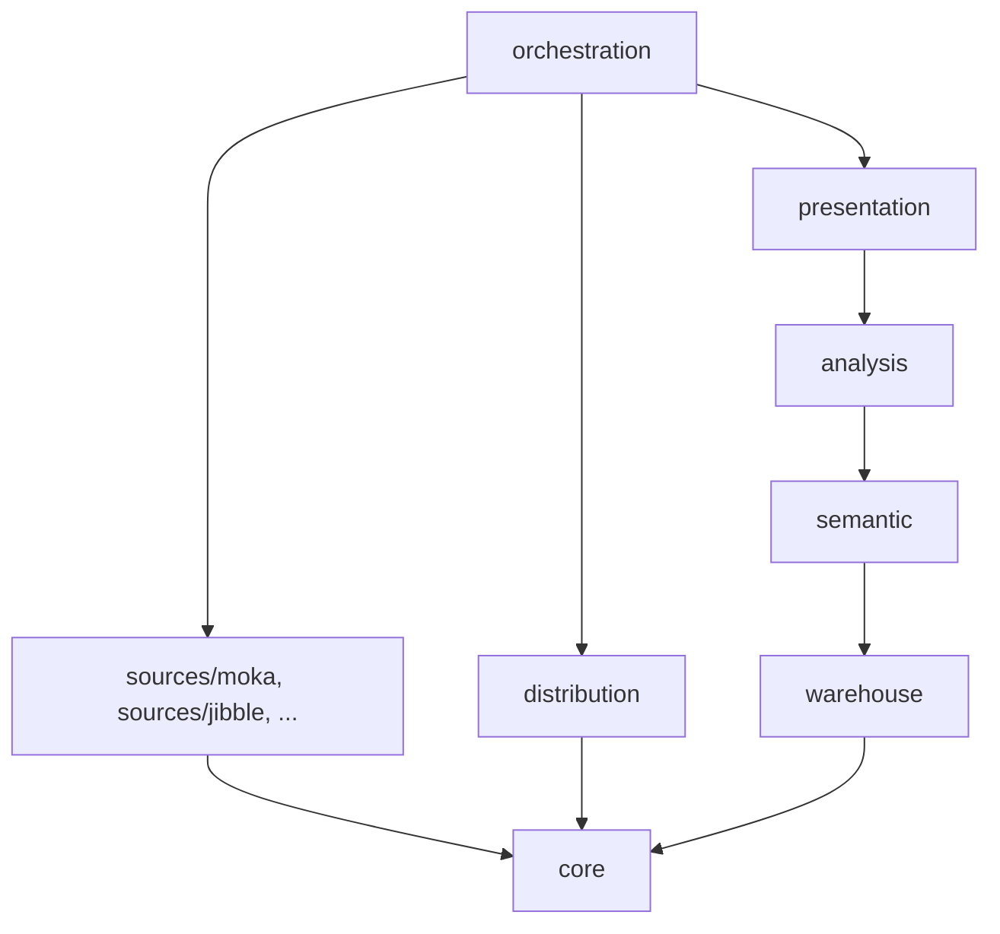

# Architecture

Status: the modules below are the code, as of phase A (platform plan, task t7, 27 Nov 2026).
Phases B to G still build the stored warehouse, the daily tick, audiences and the rest; the
design of phase B (storage, manifest, tick, due rule, failure policy, ledger) was agreed on
27 Nov 2026 (t10, D26 to D31). The
reporting framework (models, semantic layer, compiler, transforms, components, visuals, reports)
is designed in [components.md](components.md); the decisions are in [decisions.md](decisions.md).

Hari Lari analytics is a small BI platform for one café: sources are extracted once a day into a
landing zone, a warehouse is built from landing and config, and reports run on the warehouse and
go to the people who read them. It has to cost under 10 EUR a month; the expected cost is under
1 EUR (see [Cost budget](#cost-budget)).

## Principles

- **The warehouse holds nothing that cannot be rebuilt from landing and config.** Landing is the
  only record of what a source said; any warehouse can be deleted and built again.
- **`sources` and `distribution` import only `core`.** A new source or a new channel is a module
  of its own and never touches the report engine.
- **Reports name audiences, never channels** (from phase C). Who reads a report is config; how it
  reaches them is `distribution`.
- **A frontend renders bundles and never computes a metric.** Every number and display string is
  made once, in Python (D16).
- **One daily tick** (D22). One scheduler job, one run a day; a report's `schedule` says on which
  days it is due.
- **Engine and content are separate.** The usual work (a metric, a model, a component, a report,
  a seed) is content and needs no Python.

## Modules

Each module may import only the modules above it in this list. `sources` and `distribution` are
the exceptions: they import only `core`, and no source imports another. `orchestration` is the
one module that wires everything, `distribution` included. The packages live under
`src/hari_lari_analytics/` (`core/`, `sources/moka/`, `warehouse/`, ...); `frontend/` is a
separate app at the top of the repository.

| Module | Responsibility | May import |
| --- | --- | --- |
| `core` | settings (`project.yml`), secrets, storage (local or `gs://`), logging, clock, the landing manifest contract | nothing in the package |
| `sources/<name>` | one extractor per source system; writes `landing/<source>/<date>/` and nothing else | `core` |
| `warehouse` | staging per source, history models, marts, seeds, data tests; dbt-duckdb from t27 (D21) | `core` |
| `semantic` | metrics, dimensions, KPI tree, model metadata | `core`, `warehouse` |
| `analysis` | the numbers: query compiler, windows, results, transforms with `decompose`, `@query` sources | `core`, `warehouse`, `semantic` |
| `presentation` | components, facets, insight rules (D25), formats and display cells, visuals, layouts, the report engine, the renderers (PDF, PNG, XLSX, text, bundle), the semantic manifest | `core`, `warehouse`, `semantic`, `analysis` |
| `orchestration` | the daily tick, due rules, the run ledger, idempotency, ops alerts, the CLIs that run things | everything |
| `distribution` | channels (Telegram, later email) and publishing sinks (Drive) behind one message type | `core` |
| `frontend/` | static app over `bundle.json` and `reports/index.json` | reads files only |

The warehouse does not import `sources`: it reads landing through the manifest each source
writes, whose contract is in `core`. Phase A checks these rules in CI with an import-linter
layers contract and an independence contract (t8).



Each arrow means "may import"; a module may also import everything its targets may import, so
`presentation` may import `semantic`, `warehouse` and `core` too.

### Engine and content

The engine is Python and changes rarely. The content is SQL, YAML and CSV, changes weekly, and
lives next to the engine that reads it.

| Module | Engine | Content |
| --- | --- | --- |
| `core` | settings, storage, secrets, logging | `project.yml` |
| `sources/moka` | API client, tokens, fetch, table writer, checks | none (the warehouse's `sources.yml` says which landed columns it reads) |
| `warehouse` | model build, seed loaders, data-test runner | `models/*.sql`, `sources.yml`, `models.yml`, `checks.yml`; the config CSVs (private from t11) |
| `semantic` | registry | `metrics.yml`, `dimensions.yml`, `kpi_tree.yml` |
| `analysis` | compiler, windows, transforms, `@query` sources | none |
| `presentation` | component loader, facets, insight rule types, formats, visuals, layouts, report engine, renderers | `components/*.yml`, `reports/*.yml`, `insights.yml`, the generated `schema/*.json` and `semantic_manifest.json` |
| `orchestration` | tick, due rules, ledger, alerts, CLIs | none (schedules are in the report YAML) |
| `distribution` | message, channels, sinks | audiences in `project.yml` (phase C) |

### Where the code came from

Phase A (t7) moved the code without changing any output.

| Today | Module |
| --- | --- |
| `project.py`, `reporting/store.py`, `reporting/log.py` | `core` |
| `extract/` | `sources/moka` |
| `reporting/db.py`, `inputs.py` (the run reader and the seed loaders), `model_specs.py`, `checks.py`, `models/`, `sources.yml`, `models.yml`, `checks.yml` | `warehouse` |
| `reporting/registry.py`, `metrics.yml`, `dimensions.yml`, `kpi_tree.yml` | `semantic` |
| `reporting/compiler.py`, `result.py`, `windows.py`, `transforms/`, `queries/` | `analysis` |
| `reporting/components.py`, `facets.py`, `insights.py`, `insights.yml`, `formats.py`, `present.py`, `visuals/`, `layouts.py`, `reports.py`, `builder.py`, `outputs/`, `manifest.py`, `snapshots.py`, `gallery.py`, `preview.py`, `components/`, `reports/`, `schema/`, `semantic_manifest.json` | `presentation` |
| `reporting/report_cli.py`, `reporting/cli.py`, `reporting/delivery.py` (as it is; split in phase C) | `orchestration` |
| `deliver/` | `distribution` |

The console scripts keep their names. `extraction/moka/probe_schema.py` stays a script outside the
package.

## Storage layout

One bucket, `gs://hari-lari-data`, in `asia-southeast2`; locally the same layout under `data/`.
A dry run writes the same layout under a `dry-run/` prefix.

```text
landing/<source>/<date>/           one source run: tables/<table>.parquet, manifest.json,
                                   raw/*.json and request_log.csv
warehouse/<date>/                  warehouse.duckdb (every model), marts/<model>.parquet (exposed models)
warehouse/latest.json              the newest good build
reports/<report>/<anchor>/         PDF, PNG, XLSX, text, bundle.json
reports/index.json                 every report and anchor, for the frontend
runs/<date>/<run id>-<step>.json   the run ledger
config/                            private business config (aliases, groups, margins, targets, staff costs)
```

- **The date is the run date:** the local date (project time zone) on which the step ran, never
  the last day of the data. The tick of Monday 30 Nov 2026 at 04:00 writes
  `landing/moka/2026-11-30/` with the sales up to that minute, and the weekly report built on it
  has the anchor Sunday 29 Nov. `--date` on the tick changes which reports are due and their
  anchors, never a folder name, so a report sent by hand for an earlier day or a test cannot
  overwrite a day's snapshot with later data.
- **One run per source and date.** A second run on the same date replaces the first. The
  manifest is written last and is the commit: a folder without `manifest.json` is incomplete and
  nothing reads it, and a re-run deletes the old manifest before it writes its tables. Cloud
  Storage has no atomic rename; this rule makes a half-written run harmless.
- **The warehouse of a date** is replaced the same way; `latest.json` is written only after the
  data tests pass, so it always names a good build.
- **Retention** (D26): landing tables and manifests, reports and the ledger are kept; the
  bucket's lifecycle rules delete raw JSON after 90 days, `warehouse/<date>/` after 30 days (it is
  rebuildable), everything under `dry-run/` after 14 days. Measured on the run of 25 Nov 2026:
  6.4 MB of raw JSON, 0.9 MB of Parquet, 8.9 MB for the warehouse file. The Moka pull is the
  full history since 1 Jan 2026 every day, so a run grows with the history.

Today the bucket holds `raw/<date>/` (the Moka extraction, copied into `landing/moka/` by t12),
`reports/<report>/<anchor>/`, and the sent-markers `sent/<report>/<anchor>.json`, which the
ledger replaces but keeps honouring (t15). The config moves out of git and the image into
`config/` in t11; `config/examples/` in git keeps the columns with demo values.

### The landing manifest

`landing/<source>/<date>/manifest.json` is the contract between a source and the warehouse
(D26). Its model lives in `core`, so the warehouse never imports a source, and its JSON schema is generated
into git like the report schemas (t12 validates against it). Every source writes the same
fields; what only one source knows goes under `source_info`.

```json
{
  "manifest_version": 1,
  "source": "moka",
  "run_date": "2026-11-30",
  "run_id": "040012-a3f9",
  "started_at": "2026-11-30T04:00:12+08:00",
  "finished_at": "2026-11-30T04:02:14+08:00",
  "image": "bd35ece9d9f7",
  "window": { "since": "2026-01-01T00:00:00+08:00", "until": "2026-11-30T04:00:12+08:00" },
  "tables": {
    "transactions": {
      "kind": "events",
      "file": "tables/transactions.parquet",
      "rows": 1558,
      "columns": { "id": "string", "created_at": "timestamp[us]", "refund_amount": "double" },
      "latest_at": "2026-11-29T21:47:03"
    },
    "item_variants": {
      "kind": "snapshot",
      "file": "tables/item_variants.parquet",
      "rows": 154,
      "columns": { "id": "int64", "in_stock": "int64" }
    }
  },
  "checks": { "errors": [], "warnings": [] },
  "source_info": {
    "http_calls": 23,
    "token_expires_at": "2027-05-21T14:55:51+08:00",
    "token_refreshed": false
  }
}
```

- **`kind`** says how the warehouse may use a table. `events` are the records of the window
  (`since` to `until`); Moka's window is the whole history, so the newest run holds every sale,
  with the edits and late refunds of earlier days. `snapshot` is the state at `finished_at` (the
  catalogue, the stock levels); the history models read the snapshots of every dated run.
- **`columns`** is the Arrow type of each column as written. The warehouse's `sources.yml` says
  which of them it reads and casts; it gets one level per source (`moka:`, later `jibble:`),
  and the same table name in two sources is refused, so the `raw_<table>` names stay.
- **`latest_at`**, the newest record of an `events` table, is the freshness the warehouse and
  the alerts read. Today's `first_sale` and `last_sale` become `latest_at` and a model.
- **A run whose checks fail writes no manifest**, so it never lands; the ledger records the
  failure. `checks.warnings` land with the run and reach the data notes as today.
- **`source_info`** holds what one source alone knows. The Moka token's expiry stays there; the
  tick reads it for the reminder until the alerts take it over (t22).

The manifest of 25 Nov 2026 has `run_at`, `since`, `until`, `row_counts`, `first_sale`,
`last_sale`, `http_calls`, `duration_seconds`, the token fields, `errors` and `warnings`; t12
writes the new shape, and the copy of the old `raw/` runs converts their manifests.

## The warehouse

The warehouse is built once a day from the latest landing run of each source and the config, and
stored; reports open it read-only instead of extracting and rebuilding (t13, t14).

- **Rebuildable.** It holds nothing that cannot be rebuilt from landing and config. History
  models (the catalogue and the stock over time) are built from the dated landing runs, not from
  state kept in the warehouse, so this stays true with dbt (t27).
- **Layers.** `seed_`, `stg_` (one set per source), `int_`, `dim_`, `fct_`, then the cross-source
  marts. Data tests run on every build and a failed test fails the build.
- **Outputs.** `warehouse/<date>/warehouse.duckdb` holds every model;
  `warehouse/<date>/marts/<model>.parquet` holds the exposed models only, never line notes or
  personal data; `warehouse/latest.json` names the newest good build.
- **Personal data.** Employees get a pseudonymous key; no employee name reaches a bundle, an
  Excel file or a mart unless the owner decides otherwise; staff costs live in private config
  only (t29).

### End-state model

- **Dimensions:** `dim_date` (trading days, holidays, closures), `dim_item` with its history from
  the daily catalogue snapshots (renames and Moka's reuse of category ids handled properly),
  `dim_category` and groups, `dim_employee` (pseudonymous), `dim_supplier`,
  `dim_expense_category`.
- **Facts:** `fct_sales_lines`, `fct_orders`, `fct_stock_daily`, `fct_shifts`,
  `fct_labour_hourly`, `fct_expenses`, item costs as of each sale.
- **Cross-source marts:** `fct_daily_ops`, `fct_hourly_ops`, `fct_daily_pnl`. Here the café's key
  numbers appear: labour cost % of sales, sales per labour hour, staffing against demand by hour,
  prime cost % of sales, and a monthly profit estimate.

The semantic layer, the KPI tree and the compiler stay one model per query; a metric that needs
two sources reads a cross-source mart.

## A day

At 04:00 WITA (D27), Cloud Scheduler starts the job `hari-lari-pipeline tick` (D22), so the
weekly report keeps its hour. The tick's run date is the local date it started on. It:

1. extracts each source that has no landing run for the run date yet, one after the other;
2. builds the warehouse from the newest landing run of each source and the config, runs the
   data tests, writes the marts and `latest.json`;
3. runs every report that is due (below) and whose sources landed, each on its own: one failing
   report does not stop the others;
4. publishes through the audiences: publishing sinks (Drive) first, then the messages, whose
   links the sinks fill in;
5. writes a ledger record per step, regenerates `reports/index.json`, and sends ops alerts.

**Every step is idempotent on the ledger.** A second tick on the same date extracts no source
that already landed, rebuilds the warehouse only when a landing run changed, and sends no report
that was already sent. Re-running a day is therefore safe: run the tick again, without
`--force`.

**The retry tick** (D27): the same scheduler job fires at 04:00 and 06:00 (`0 4,6 * * *`). The
06:00 tick does only what the 04:00 tick left undone, which on a good day is nothing (one ledger
read, well under a minute of Cloud Run). It is still one scheduler job, so no free job is used
up. The tick times are listed once, in `project.yml` (`tick: { times: ["04:00", "06:00"] }`):
`deploy/` builds the scheduler's cron from them, and a tick knows from them whether it is the
last of the day.

### When a report is due

A report with a `schedule` is due on a date when the day-of-month, month and day-of-week fields
of its cron match that date in the project time zone (standard cron: when both day fields are
restricted, either may match). Minute and hour are not read: the tick decides the time. The
anchor is computed from the due date as today (`anchor: yesterday` is the day before the due
date). `enabled: false` keeps a report off the tick (D28).

- **Hour and minute** must each be a single number, or the loader refuses the report:
  `0 */6 * * *` would promise times that never happen.
- **The per-report `timezone` key goes**, refused with a hint, because the one tick runs in the
  project time zone.
- **No catch-up.** A report is sent only by the ticks of its due date. One that did not go out
  by the last tick of that day is sent by hand, with the anchor of its due date:
  `hari-lari-pipeline tick --date <due date> --only <report>`. Its chats are told that it is
  late (see "Failure policy").

### Which sources a report needs

Derived, not declared (D29). The components of a report's pages, text blocks and sheets name
their models; the warehouse already parses each model's SQL for the names it reads
(`build_order`); following them down to the `raw_` tables, and `sources.yml` to their source,
gives the report's sources. An `@query` source names the models it reads (`lines_export` reads
`fct_sales_lines`; `notes` reads the data checks, no model). `hari-lari-report list` and the
semantic manifest show each report's sources, and a test pins them: weekly and stock_alert need
`moka`.

### Failure policy

D30:

- **A source that fails** (an HTTP error after the client's retries, a timeout, a failed check)
  does not land; the other sources still land. The admin gets one alert per failure and tick:
  at 04:00 it says that the 06:00 tick retries, at 06:00 that this was the last try.
- **The warehouse is built anyway**, from the newest good landing run of each source; its run
  context records the landing date of each source.
- **A due report runs only when every source it needs landed on the run date.** Otherwise it is
  `skipped` with the reason, and the 06:00 tick tries again. Reports that do not need the failed
  source run as usual. There is no fallback to an older landing run: the weekly report on
  Sunday's run would miss Sunday.
- **A data test of severity error fails the warehouse build:** no report runs, the admin gets
  the alert, and `latest.json` keeps naming the previous build.
- **A failed report or delivery** alerts the admin once and does not stop the next report.
- **A report that is still not sent after the last tick of its due date** is announced to the
  chats it would have gone to (the group, for the weekly report), as a short plain message
  without the error: which report and period, that it could not be sent this morning, and that
  it follows by hand. The admin's alert has the error and the command that sends it. Only the
  scheduled tick sends this notice: a run by hand, a dry run and a run with `--to` do not; a report whose `deliver.when` held no condition
  (`quiet`) is not missing.
- **A good day sends no message**; the ledger shows it (`hari-lari-runs list`). A tick that never
  starts cannot alert about itself; the freshness alert of t22 catches it on the next day that
  runs.

## The run ledger

The ledger replaces what is scattered today over sent-markers, output folders, JSON logs and
Cloud Run executions. Every step writes one record, `runs/<run date>/<run id>-<step>.json`, when
it ends; a step that crashes the job leaves no record, and the next tick redoes it. The run id
is the local start time and four random hex digits (`040012-a3f9`). The steps are
`extract-<source>`, `warehouse` and `report-<report id>`.

A report and its deliveries are one record (D31): a delivery means nothing without its build,
and a build takes seconds. Each delivery has its own status, so a re-run
sends only to the targets that did not get the report.

```json
{
  "ledger_version": 1,
  "run_id": "040012-a3f9",
  "run_date": "2026-11-30",
  "step": "report-weekly",
  "trigger": "scheduler",
  "image": "bd35ece9d9f7",
  "dry_run": false,
  "force": false,
  "to": null,
  "status": "sent",
  "reason": null,
  "started_at": "2026-11-30T04:02:31+08:00",
  "finished_at": "2026-11-30T04:03:12+08:00",
  "seconds": 41.3,
  "seconds_by_phase": { "build": 30.2, "upload": 2.1, "drive": 4.0, "deliver": 5.0 },
  "inputs": {
    "landing": { "moka": "2026-11-30" },
    "warehouse": "2026-11-30",
    "report": "weekly",
    "due": "2026-11-30",
    "anchor": "2026-11-29"
  },
  "outputs": ["reports/weekly/2026-11-29/weekly.pdf", "reports/weekly/2026-11-29/bundle.json"],
  "deliveries": [
    { "channel": "drive", "status": "ok", "folder": "2026-11-29 (week 48)", "url": "https://drive.google.com/..." },
    { "channel": "telegram", "target": "group", "status": "ok", "message_ids": [812, 813] }
  ],
  "warnings": ["data check: ..."],
  "error": null
}
```

- **Statuses:** `ok` or `failed` for an extract and the warehouse; for a report `sent`, `quiet`
  (no condition of `deliver.when` held), `skipped` (a needed source did not land, or the
  warehouse failed) or `failed`. A report that is not due or already sent writes no record (the
  log says so), so a retry tick on a good day writes nothing. The notice that a report is late
  is a delivery of the last `skipped` or `failed` record of its due date.
- **Inputs** of an extract are its window; of the warehouse, the landing date per source and
  the config files with their hashes; of a report, as above.
- **No secrets:** targets are recorded by name, never by chat id; `error` holds the error type
  and the scrubbed message, as the alerts do.
- **"Already sent"** for a report and anchor is the newest record with status `sent`, not a dry
  run and without `--to`, or one of the old sent-markers. A dry run writes its ledger under
  `dry-run/runs/`; a run with `--to` is recorded with `to` set and never counts as sent.
- `hari-lari-runs list [--report] [--since]` prints the history (t15).

## Delivery

From phase C (t20, t21) a report names audiences (owners, managers, admin) in its `deliver`; each
audience in `project.yml` is a list of channel endpoints (a Telegram chat secret, a Drive
folder). `orchestration` turns a report's outputs into `distribution`'s channel-neutral message
(text, one image, documents, links), and `distribution` sends it to each endpoint. Ops alerts
go only to the admin audience, through `orchestration`, one message per alert key and tick
(t22). The one exception is the plain notice that a report is late, which goes to the
report's own audiences (D30). Until phase C the named Telegram targets of D14 apply.

Cloud Storage is the archive; Drive is a publishing sink only.

## Frontend

From phase F a static, mobile-first app in `frontend/` renders `bundle.json` and
`reports/index.json`: display strings only, raw values only to draw (t37). Hosting and sign-in
are decided by the owner (t36).

## Cost budget

Approximate list prices; t18 replaces the estimate with the real bill.

| Item | Per month | Note |
| --- | --- | --- |
| Cloud Run job, one tick a day, about 3 to 5 min | 0 | inside the free tier |
| Cloud Run service for the frontend (phase F) | 0 | scales to zero |
| Cloud Storage, `asia-southeast2` | under 0.20 EUR | the free 5 GB is only in US regions; a few GB a year |
| Secret Manager | about 0.20 to 0.40 EUR | 6 active versions free, then about 0.06 USD each (t18) |
| Cloud Scheduler | 0 | 2 of the 3 free jobs (the tick and the expense tracker's) |
| Artifact Registry, GitHub Actions, Cloudflare | 0 | inside the free tiers |
| **Total** | **under 1 EUR** | the 5 USD budget alert stays |

The hard limit is 10 EUR a month. A design that needs an always-on service, a managed database
or one scheduler job per report does not fit it.
