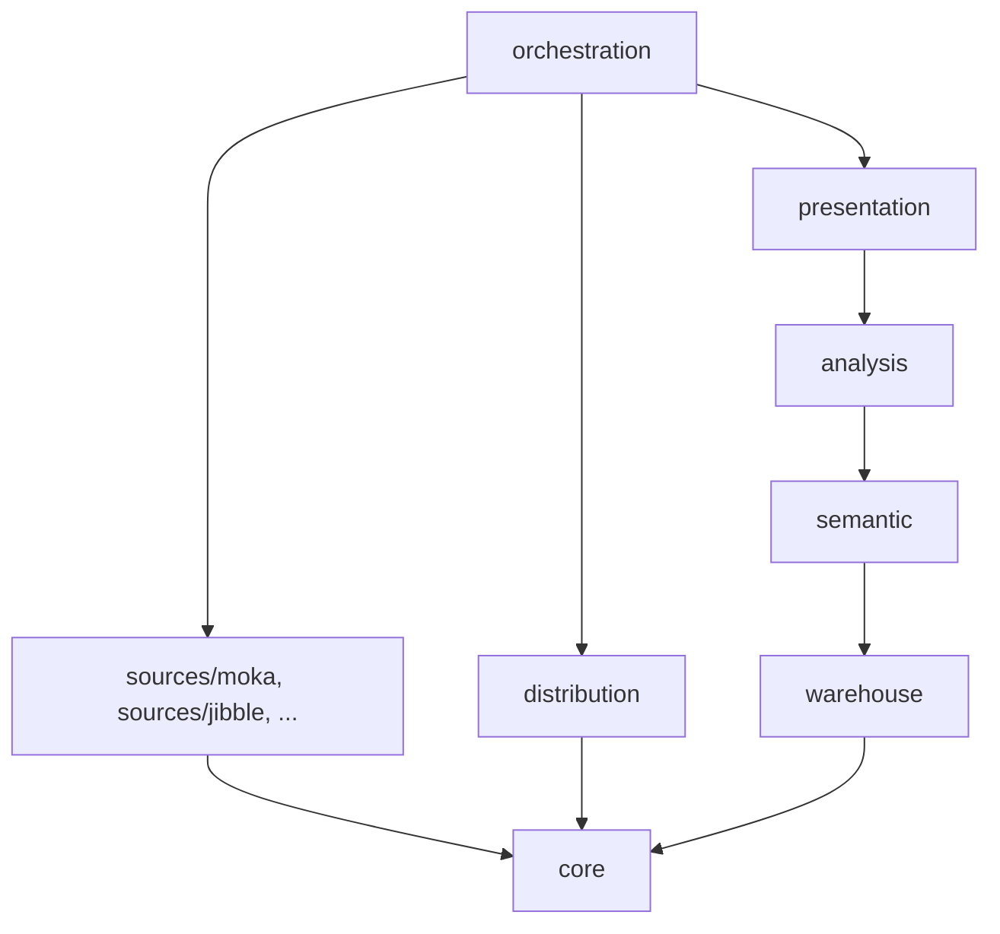

# Architecture

Status: target architecture, written 27 Nov 2026 (platform plan, task t3). Phases A to G of the
platform plan build it; until then the code is where [components.md](components.md), "Folder
layout", says. The reporting framework inside it (models, semantic layer, compiler, transforms,
components, visuals, reports) is designed in [components.md](components.md); the decisions are
in [decisions.md](decisions.md).

Hari Lari analytics is a small BI platform for one café: sources are extracted once a day into a
landing zone, a warehouse is built from landing and config, and reports run on the warehouse and
go to the people who read them. It has to cost under 10 EUR a month; the expected cost is under
1 EUR (see [Cost budget](#cost-budget)).

## Principles

- **The warehouse holds nothing that cannot be rebuilt from landing and config.** Landing is the
  only record of what a source said; any warehouse can be deleted and built again.
- **`sources` and `distribution` import only `core`.** A new source or a new channel is a module
  of its own and never touches the report engine.
- **Reports name audiences, never channels** (from phase C). Who reads a report is config; how it
  reaches them is `distribution`.
- **A frontend renders bundles and never computes a metric.** Every number and display string is
  made once, in Python (D16).
- **One daily tick** (D22). One scheduler job, one run a day; a report's `schedule` says on which
  days it is due.
- **Engine and content are separate.** The usual work (a metric, a model, a component, a report,
  a seed) is content and needs no Python.

## Modules

Each module may import only the modules above it in this list. `sources` and `distribution` are
the exceptions: they import only `core`, and no source imports another. `orchestration` is the
one module that wires everything, `distribution` included. The packages live under
`src/hari_lari_analytics/` (`core/`, `sources/moka/`, `warehouse/`, ...); `frontend/` is a
separate app at the top of the repository.

| Module | Responsibility | May import |
| --- | --- | --- |
| `core` | settings (`project.yml`), secrets, storage (local or `gs://`), logging, clock, the landing manifest contract | nothing in the package |
| `sources/<name>` | one extractor per source system; writes `landing/<source>/<date>/` and nothing else | `core` |
| `warehouse` | staging per source, history models, marts, seeds, data tests; dbt-duckdb from t27 (D21) | `core` |
| `semantic` | metrics, dimensions, KPI tree, model metadata | `core`, `warehouse` |
| `analysis` | the numbers: query compiler, windows, results, transforms with `decompose`, `@query` sources | `core`, `warehouse`, `semantic` |
| `presentation` | components, facets, insight rules (D25), formats and display cells, visuals, layouts, the report engine, the renderers (PDF, PNG, XLSX, text, bundle), the semantic manifest | `core`, `warehouse`, `semantic`, `analysis` |
| `orchestration` | the daily tick, due rules, the run ledger, idempotency, ops alerts, the CLIs that run things | everything |
| `distribution` | channels (Telegram, later email) and publishing sinks (Drive) behind one message type | `core` |
| `frontend/` | static app over `bundle.json` and `reports/index.json` | reads files only |

The warehouse does not import `sources`: it reads landing through the manifest each source
writes, whose contract is in `core`. Phase A checks these rules in CI with an import-linter
layers contract and an independence contract (t8).



Each arrow means "may import"; a module may also import everything its targets may import, so
`presentation` may import `semantic`, `warehouse` and `core` too.

### Engine and content

The engine is Python and changes rarely. The content is SQL, YAML and CSV, changes weekly, and
lives next to the engine that reads it.

| Module | Engine | Content |
| --- | --- | --- |
| `core` | settings, storage, secrets, logging | `project.yml` |
| `sources/moka` | API client, tokens, fetch, table writer, checks | none (the warehouse's `sources.yml` says which landed columns it reads) |
| `warehouse` | model build, seed loaders, data-test runner | `models/*.sql`, `sources.yml`, `models.yml`, `checks.yml`; the config CSVs (private from t11) |
| `semantic` | registry | `metrics.yml`, `dimensions.yml`, `kpi_tree.yml` |
| `analysis` | compiler, windows, transforms, `@query` sources | none |
| `presentation` | component loader, facets, insight rule types, formats, visuals, layouts, report engine, renderers | `components/*.yml`, `reports/*.yml`, `insights.yml`, the generated `schema/*.json` and `semantic_manifest.json` |
| `orchestration` | tick, due rules, ledger, alerts, CLIs | none (schedules are in the report YAML) |
| `distribution` | message, channels, sinks | audiences in `project.yml` (phase C) |

### Where today's code goes

Phase A moves the code without changing any output (t6 and t7).

| Today | Module |
| --- | --- |
| `project.py`, `reporting/store.py`, `reporting/log.py` | `core` |
| `extract/` | `sources/moka` |
| `reporting/db.py`, `inputs.py` (the run reader and the seed loaders), `model_specs.py`, `checks.py`, `models/`, `sources.yml`, `models.yml`, `checks.yml` | `warehouse` |
| `reporting/registry.py`, `metrics.yml`, `dimensions.yml`, `kpi_tree.yml` | `semantic` |
| `reporting/compiler.py`, `result.py`, `windows.py`, `transforms/`, `queries/` | `analysis` |
| `reporting/components.py`, `facets.py`, `insights.py`, `insights.yml`, `formats.py`, `present.py`, `visuals/`, `layouts.py`, `reports.py`, `builder.py`, `outputs/`, `manifest.py`, `snapshots.py`, `gallery.py`, `preview.py`, `components/`, `reports/`, `schema/`, `semantic_manifest.json` | `presentation` |
| `reporting/report_cli.py`, `reporting/cli.py`, `reporting/delivery.py` (as it is; split in phase C) | `orchestration` |
| `deliver/` | `distribution` |

The console scripts keep their names. `extraction/moka/probe_schema.py` stays a script outside the
package.

## Storage layout

One bucket, `gs://hari-lari-data`, in `asia-southeast2`; locally the same layout under `data/`.
A dry run writes the same layout under a `dry-run/` prefix.

```text
landing/<source>/<date>/      Parquet tables, manifest.json, raw JSON (deleted after 90 days)
warehouse/<date>/             warehouse.duckdb, marts/<model>.parquet
warehouse/latest.json         the newest good build
reports/<report>/<anchor>/    PDF, PNG, XLSX, text, bundle.json
reports/index.json            every report and anchor, for the frontend
runs/<date>/<run>-<step>.json the run ledger
config/                       private business config (aliases, groups, margins, targets, staff costs)
```

Today the bucket holds `raw/<date>/` (the Moka extraction, copied into `landing/moka/` by t12),
`reports/<report>/<anchor>/`, and the sent-markers `sent/<report>/<anchor>.json`, which the
ledger replaces but keeps honouring (t15). The config moves out of git and the image into
`config/` in t11; `config/examples/` in git keeps the columns with demo values.

**The landing manifest.** Every source run writes `manifest.json` next to its tables: the source,
the run time, each table with its row count and schema. It is the contract between a source and
the warehouse; its exact fields are settled in the phase B design (t10).

## The warehouse

The warehouse is built once a day from the latest landing run of each source and the config, and
stored; reports open it read-only instead of extracting and rebuilding (t13, t14).

- **Rebuildable.** It holds nothing that cannot be rebuilt from landing and config. History
  models (the catalogue and the stock over time) are built from the dated landing runs, not from
  state kept in the warehouse, so this stays true with dbt (t27).
- **Layers.** `seed_`, `stg_` (one set per source), `int_`, `dim_`, `fct_`, then the cross-source
  marts. Data tests run on every build and a failed test fails the build.
- **Outputs.** `warehouse/<date>/warehouse.duckdb` holds every model;
  `warehouse/<date>/marts/<model>.parquet` holds the exposed models only, never line notes or
  personal data; `warehouse/latest.json` names the newest good build.
- **Personal data.** Employees get a pseudonymous key; no employee name reaches a bundle, an
  Excel file or a mart unless the owner decides otherwise; staff costs live in private config
  only (t29).

### End-state model

- **Dimensions:** `dim_date` (trading days, holidays, closures), `dim_item` with its history from
  the daily catalogue snapshots (renames and Moka's reuse of category ids handled properly),
  `dim_category` and groups, `dim_employee` (pseudonymous), `dim_supplier`,
  `dim_expense_category`.
- **Facts:** `fct_sales_lines`, `fct_orders`, `fct_stock_daily`, `fct_shifts`,
  `fct_labour_hourly`, `fct_expenses`, item costs as of each sale.
- **Cross-source marts:** `fct_daily_ops`, `fct_hourly_ops`, `fct_daily_pnl`. Here the café's key
  numbers appear: labour cost % of sales, sales per labour hour, staffing against demand by hour,
  prime cost % of sales, and a monthly profit estimate.

The semantic layer, the KPI tree and the compiler stay one model per query; a metric that needs
two sources reads a cross-source mart.

## A day

At the tick time (proposed 04:00 WITA, so the weekly report keeps its hour), Cloud Scheduler
starts the job `hari-lari-pipeline tick`. It:

1. extracts each source that is due into `landing/`;
2. builds the warehouse, runs the data tests and writes the marts;
3. runs every report whose schedule is due today (its cron evaluated for the tick's date in the
   project time zone) and whose sources succeeded; one failing report does not stop the others;
4. publishes through the audiences: publishing sinks (Drive) first, then the messages, whose
   links the sinks fill in;
5. writes a ledger record per step, regenerates `reports/index.json`, and sends ops alerts.

A failed source alerts the admin once; reports that need it are not sent; reports that do not
need it run. Which sources a report needs is derived from the models of its components. The tick
time, the due rule and this failure policy are proposals until the phase B design (t10) records
the owner's answers.

## The run ledger

Every step of a run (extract per source, warehouse, report, delivery) writes one record,
`runs/<date>/<run id>-<step>.json`, with:

- the status and the timings;
- the inputs: landing dates, the warehouse date, the image tag;
- the outputs: the files written;
- the deliveries: chat and message ids, Drive links.

The ledger replaces what is scattered today over sent-markers, output folders, JSON logs and
Cloud Run executions. "Already sent" becomes a ledger lookup, so a re-run never sends a report
twice without `--force`; `hari-lari-runs list [--report] [--since]` prints the history. The
record's fields are settled in t10 and built in t15.

## Delivery

From phase C (t20, t21) a report names audiences (owners, managers, admin) in its `deliver`; each
audience in `project.yml` is a list of channel endpoints (a Telegram chat secret, a Drive
folder). `orchestration` turns a report's outputs into `distribution`'s channel-neutral message
(text, one image, documents, links), and `distribution` sends it to each endpoint. Ops alerts go only to the admin audience, through `orchestration`, one
message per alert key and day (t22). Until then the named Telegram targets of D14 apply.

Cloud Storage is the archive; Drive is a publishing sink only.

## Frontend

From phase F a static, mobile-first app in `frontend/` renders `bundle.json` and
`reports/index.json`: display strings only, raw values only to draw (t37). Hosting and sign-in
are decided by the owner (t36).

## Cost budget

Approximate list prices; t18 replaces the estimate with the real bill.

| Item | Per month | Note |
| --- | --- | --- |
| Cloud Run job, one tick a day, about 3 to 5 min | 0 | inside the free tier |
| Cloud Run service for the frontend (phase F) | 0 | scales to zero |
| Cloud Storage, `asia-southeast2` | under 0.20 EUR | the free 5 GB is only in US regions; a few GB a year |
| Secret Manager | about 0.20 to 0.40 EUR | 6 active versions free, then about 0.06 USD each (t18) |
| Cloud Scheduler | 0 | 2 of the 3 free jobs (the tick and the expense tracker's) |
| Artifact Registry, GitHub Actions, Cloudflare | 0 | inside the free tiers |
| **Total** | **under 1 EUR** | the 5 USD budget alert stays |

The hard limit is 10 EUR a month. A design that needs an always-on service, a managed database
or one scheduler job per report does not fit it.
