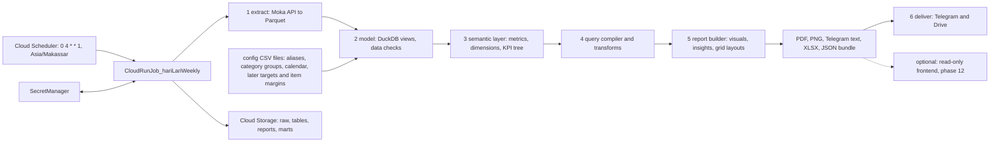

# Hari Lari go-live: weekly Moka report in Google Cloud plus a reporting framework for driving reports

> **Closed on 26 Nov 2026 after phase 9.8.** Phases 0 to 9 are done (6.5, the first live Monday, is t1-monday of the new plan). Everything open continues in [the platform plan](../hari_lari_analytics_platform.plan.md), whose table "Carried over from the go-live plan" maps the old numbers to the new todos. This file stays as the record of how the framework was built.

This is the Cursor version of [docs/go-live-plan.md](go-live-plan.md), with a status and a suggested LLM for every task. All paths are relative to `hari-lari-analytics/`.

## Legend

- **Status:**
  - `done`: finished.
  - `partial`: some of the work exists.
  - `todo`: not started.
  - `decision`: needs your call.
  - `manual`: you do it in a console or app.
  - `optional`: nice to have.
- **Suggested LLM** (match the model to the task):
  - **Opus 5.5:** design work, tricky data logic, parity debugging.
  - **Sonnet 5.5:** standard implementation with tests.
  - **GPT-5.4 nano:** small mechanical edits, docs and config.
  - **You:** steps in a console or app that need your login.
- **Size:** S is under an hour, M is a few hours, L is about a day.

## Architecture



## Design choices

- **Cloud Run Job, not Cloud Functions.** It runs our own container, the same code as on the laptop.
- **DuckDB and Parquet, not BigQuery, for v1.** The data is a few MB, so this needs no extra service and costs nothing.
- **Full pull every week, nothing incremental.**
- **Region `asia-southeast2` (Jakarta).**
- **Cost:** expect about 0 USD a month, inside the free tier.
- **Sequence:** go live with today's PDF fed from the API (phases 1 to 6). Build the framework (phases 7 and 8), prove it on new components and swap in the component report once its numbers match the old one (phase 9). Phase 7A refines the core before phase 8 builds on it. Phase 10 builds the driving reports on top, and phase 12 adds an optional frontend over the same outputs.
- **Framework first, measured on new work.** The goal of phases 7 to 9 is a framework in which a new component takes under 30 minutes and usually only YAML, and in which reports explain why a number moved. Success is measured on components the old report never had (9.1), not on reproducing the old PDF pixel for pixel.
- **Own framework, borrowed concepts.** Models follow dbt's layers and stay plain SQL; metric kinds follow dbt's semantic layer (MetricFlow). The presentation layer, the KPI tree and the push delivery are ours. Design: [docs/components.md](hari-lari-analytics/docs/components.md).
- **Compared with Lightdash (24 Nov 2026).** The layers match Lightdash's: models, a semantic layer, charts and dashboards as YAML, validation. Ours is stronger on comparisons, the KPI tree and sample sizes. Phase 7A takes over what it does better: model metadata in YAML, report-level filters, schedules and deliveries as code, and validation in CI. We do not take over its server, UI, join engine, permissions, caching or pre-aggregates, because a push report on a few MB needs none of them.
- **Push first, frontend optional.** Telegram stays the main channel. Every report also writes a JSON bundle (8.9) with the results and their display strings, so a later frontend (phase 12) only renders and never computes. It then shows the same numbers as the PDF, runs without a server between visits, and costs close to nothing.

## Known data issues to fix

- **Broken key on the lines table.** [extraction/moka/extract.py](hari-lari-analytics/extraction/moka/extract.py) `Table.add` does `{**parent, **flat(rec)}`. The line's own `payment_id` (always 0) therefore overwrites the parent key.
- **Wrong time zone label.** API timestamps say `+07:00`, but the clock time already equals Bali local time. Drop the offset; do not convert.
- **Refunds have the opposite sign.** A refund is a second payment with the same `payment_no`, positive amounts and `parent_payment_id` set.
- **The token expires on 11 May 2027.** It has a refresh token, which [extraction/moka/moka_client.py](hari-lari-analytics/extraction/moka/moka_client.py) currently refreshes only within 1 hour of expiry.

---

## Phase 0: Decisions

- **0.0** Write the go-live plan document. Status: done. LLM: Opus 5.5. Size: S.
- **0.1** Choose the Google Cloud project. Status: done. Decision: a new dedicated `hari-lari-analytics` project (add a suffix if the ID is taken).
- **0.2** Choose what gets sent to the group. Status: done. Decision: the cover PNG and the PDF go in Telegram, plus a message with a Google Drive link to the PDF and Excel lines file. New scope: upload to Drive with the `hari-lari-job` service account (enable the Drive API, share a folder with the service account), add the link to the caption (4.8), and add a Drive upload step to the orchestration (5.1). `deliver/telegram.py` (4.7) no longer sends the Excel.
- **0.3** Choose the group members. Status: done. Decision: owners and managers only. The Drive folder is restricted to named Google accounts. The Excel file (no names) is fine for them. Open item: the member list and their Google emails, collected in phase 4.
- **0.4** Choose where failure alerts go. Status: done. Decision: a private admin chat with the bot, plus the Cloud Monitoring email alert (3.13) as a backup.
- **0.5** Confirm the report anchor. Status: done. Decision: yesterday (Sunday, Bali date), with a manual `--anchor` override.

## Phase 1: Harden the extraction

- **1.0** Write the full-history extractor (`extraction/moka/extract.py`). Status: done (works locally). LLM: Opus 5.5.
- **1.1** Commit `extraction/` on a branch. Done when `git status` is clean. Status: done. LLM: GPT-5.4 nano. Size: S.
- **1.2** Fix the parent-key overwrite in `Table.add`: parent keys win, and child fields that clash get a prefix. Done when `transaction_lines.payment_id` matches `transactions.id` on 100% of rows. Status: done. LLM: Sonnet 5.5. Size: S.
- **1.3** Add a test for 1.2 on a saved JSON fixture: one payment with two lines, a discount and a modifier. Status: done. LLM: Sonnet 5.5. Size: S.
- **1.4** Move the extraction into `src/hari_lari_analytics/extract/` and add a `hari-lari-extract` command. Status: done. LLM: Sonnet 5.5. Size: M.
- **1.5** Use explicit 120-second timeouts and keep the retry, backoff and request log. Status: done. LLM: Sonnet 5.5. Size: S.
- **1.6** Add a `TokenStore` interface with two backends: local file and Secret Manager. A refresh writes a new secret version. Status: done. LLM: Opus 5.5. Size: M.
- **1.7** Refresh the token when fewer than 30 days remain, and test it with a fake clock. Status: done. LLM: Sonnet 5.5. Size: S.
- **1.8** Run one real refresh by hand to learn whether Moka rotates the refresh token, and note the result. Status: done (the refresh token IS rotated; every refresh must be saved, see 1.6). LLM: You (with Sonnet 5.5). Size: S.
- **1.9** Make the output location configurable (local folder or `gs://...`) and write Parquet. Status: done. LLM: Sonnet 5.5. Size: M.
- **1.10** Parse timestamps as naive local clock time (drop the offset), with a test. Status: done. LLM: GPT-5.4 nano. Size: S.
- **1.11** Add sanity checks that fail the run: zero payments, or last week's receipts missing. A stale last sale only warns. Status: done. LLM: Sonnet 5.5. Size: S.
- **1.12** Write a `manifest.json` per run: row counts, first and last sale, number of calls, duration, token expiry. Status: done. LLM: GPT-5.4 nano. Size: S.

## Phase 2: The report reads API data

- **2.1** Write `load_api.py`, which reads the Parquet tables of one run. Status: done. LLM: Sonnet 5.5. Size: S.
- **2.2** Map API lines to the cleaned line schema of [src/hari_lari_analytics/clean.py](hari-lari-analytics/src/hari_lari_analytics/clean.py) and add the ids: payment, item, variant and category. Status: done. LLM: Sonnet 5.5. Size: M.
- **2.3** Turn refund payments into negative quantity, with the amount in `refunds`. Done when `Gross - Discounts - Refunds = Net` holds on every line. Status: done. LLM: Opus 5.5. Size: M.
- **2.4** Derive the adjusted item and category by `item_id` from today's items. Fall back to `config/item_aliases.csv` for deleted items. Status: done. LLM: Opus 5.5. Size: M.
- **2.5** Take the payment type from `payment_type_label` and the discount code from `transaction_line_discounts.discount_name`. Status: done. LLM: GPT-5.4 nano. Size: S.
- **2.6** Parity test against the back-office CSV for 1 Jan to 31 Oct: 948 receipts and 1,700 lines. The only allowed difference is the refund of receipt `1O4S7G`. Status: done (the API data matches the CSV line for line, including the refund of `1O4S7G`, so there is no difference at all). LLM: Opus 5.5. Size: M.
- **2.7** Add `--source api|csv` and `--anchor` (default yesterday) to [src/hari_lari_analytics/cli.py](hari-lari-analytics/src/hari_lari_analytics/cli.py). Status: done (`--source` defaults to `csv` for now; the anchor defaults to yesterday for `api` and to the last sale date for `csv`, so old exports still work). LLM: Sonnet 5.5. Size: S.
- **2.8** Compare the API-based PDF with the CSV-based one page by page. Status: done (pages 2 to 10 are pixel-identical; the cover differs only in the "Input files" line; signed off). LLM: You (with Opus 5.5). Size: S.
- **2.9** Also render the cover as a PNG. Status: done. LLM: GPT-5.4 nano. Size: S.
- **2.10** Update the README and METRICS.md: API source, refund rule, time zone rule, anchor rule. Status: done. LLM: GPT-5.4 nano. Size: S.
- **2.11** Add `config/category_group.csv`, a hand-maintained mapping from adjusted category to `category_group_level_1` (values: `food`, `drink`, `consignment`), same style as [config/item_aliases.csv](hari-lari-analytics/config/item_aliases.csv). Columns: `category,category_group_level_1,category_group_level_2`. Level 2 is optional and may stay empty at first (for example coffee, tea or bakery under drink or food). Write a loader with validation: no duplicate category, level 1 limited to the three values, and a warning (not a failure) for categories in today's data that have no group, which land in `unmapped`. Join the groups onto the cleaned lines by adjusted category, and test it on a small fixture. Status: done (`config/category_group.csv` covers every live and deleted category; `Custom Amount` and `Other` (non-food entries) are deliberately left `unmapped`, and so is the unused `Bundle_Package`; loader `load_category_groups` in `load.py`, join `add_category_groups` in `dimensions.py`, `--category-groups` flag). LLM: Sonnet 5.5 (GPT-5.4 nano for the first CSV draft, which you check). Size: S.

## Phase 3: Google Cloud infrastructure

These steps are scripted as `gcloud` commands in `deploy/setup.sh`. Phase status: completed.

- **3.1** Install and authenticate the `gcloud` CLI in WSL. Status: done. LLM: You. Size: S.
- **3.2** Create the project and link billing. Status: done (project `hari-lari`, billing linked). LLM: You. Size: S.
- **3.3** Enable the APIs: run, cloudscheduler, secretmanager, artifactregistry, cloudbuild, storage, logging and monitoring. Status: done (also drive and billingbudgets). LLM: GPT-5.4 nano. Size: S.
- **3.4** Create a budget of 5 USD a month with alerts at 50% and 100%. Status: done (created by CLI: 120 CZK, about 5 USD, because the billing account is in CZK; alerts at 50% and 100%). LLM: You. Size: S.
- **3.5** Create a private bucket in `asia-southeast2`, with raw JSON moving to Nearline after 90 days. Status: done (`gs://hari-lari-data`, Nearline after 90 days for `raw/`). LLM: GPT-5.4 nano. Size: S.
- **3.6** Create the service account `hari-lari-job` with least-privilege roles: bucket object admin, plus secret accessor and secret version adder on the token secret. Status: done (`hari-lari-job`, plus an invoker account `hari-lari-scheduler`). LLM: Sonnet 5.5. Size: S.
- **3.7** Create the secrets: Moka client id and secret, `moka-oauth-token` (version 1 from `.token.json`), Telegram token, chat id and admin chat id. Status: done for the Moka secrets; Telegram secrets exist but are empty until phase 4. LLM: You. Size: S.
- **3.8** Create the Artifact Registry repository `hari-lari`. Status: done. LLM: GPT-5.4 nano. Size: S.
- **3.9** Write a `Dockerfile`: `python:3.13-slim`, `uv sync --frozen --no-dev`, entry point `hari-lari-weekly`. Status: done (`Dockerfile`; the entry point is `hari-lari-extract` until phase 5 adds `hari-lari-weekly`). LLM: Sonnet 5.5. Size: M.
- **3.10** Build and push the image with Cloud Build. Status: done. LLM: GPT-5.4 nano. Size: S.
- **3.11** Create the Cloud Run Job: 1 CPU, 1 GiB, 20-minute timeout, 1 retry, secrets as environment variables, `TZ=Asia/Makassar`. Status: done (a real execution succeeded and wrote Parquet to `gs://hari-lari-data/raw/2026-11-22/`). LLM: Sonnet 5.5. Size: S.
- **3.12** Create the Scheduler job `0 4 * * 1` in `Asia/Makassar`, calling the job through an invoker service account. Status: done (created and PAUSED until 6.4). LLM: Sonnet 5.5. Size: S.
- **3.13** Add a log-based email alert when a job run fails. Status: done (policy "Hari Lari job failed", email to harilari.bali@gmail.com). LLM: Sonnet 5.5. Size: S.

## Phase 4: Telegram bot and group

- **4.1** Create the bot with `@BotFather` using `/newbot`, and store the token only in Secret Manager. Status: done (`@HL_Reporter_bot`; token in `telegram-bot-token`, rotated once after it was pasted in chat). LLM: You. Size: S.
- **4.2** Set the bot's profile. Turn joining groups off again after 4.4 (`/setjoingroups`). Status: done. LLM: You. Size: S.
- **4.3** Create the group "Hari Lari - Weekly Report" and add the members. Status: done ("HL Reporting" with emojis; upgraded to a supergroup). LLM: You. Size: S.
- **4.4** Add the bot to the group. Status: done. LLM: You. Size: S.
- **4.5** Get the chat ids through `getUpdates`: the group id (starts with `-100`) and the admin chat id. Store both. Status: done (group `-100...` in `telegram-chat-id`, admin private chat in `telegram-admin-chat-id`; test message, a real cover + PDF with caption, and a test alert all arrived in the admin chat; a test message arrived in the group). LLM: You. Size: S.
- **4.6** Add a runbook note that the chat id changes when the group becomes a supergroup. Status: done (`docs/runbook.md`). LLM: GPT-5.4 nano. Size: S.
- **4.7** Write `deliver/telegram.py`: `sendPhoto` for the cover, `sendMediaGroup` for the PDF and Excel, retry on 429 using `retry_after`, and a 50 MB guard. Status: done (`deliver/telegram.py`, stdlib only, token scrubbed from errors; changed from the plan: `sendPhoto` for the cover and `sendDocument` for the PDF, because Telegram cannot mix photos and documents in a media group and the Excel goes to Drive per 0.2; helper CLI `hari-lari-telegram whoami|chat-ids|ping|send-report`). LLM: Sonnet 5.5. Size: M.
- **4.8** Write the caption: week and dates, net sales, orders and AOV with change vs prior, and the last sale timestamp, plus the Drive link once phase 5 has it. Status: done (`deliver/caption.py`, `build_caption(lines, anchor, drive_url)`; week = 7 days ending on the anchor). LLM: Sonnet 5.5. Size: S.
- **4.9** Write `send_alert` to the admin chat: which step failed, a short error and a link to the logs. Status: done (`send_alert`, never raises, links to the Cloud Run execution logs). LLM: GPT-5.4 nano. Size: S.

## Phase 5: Weekly orchestration

- **5.1** Write the `hari-lari-weekly` command: extract, model, report, upload, deliver, with each step timed. Status: done (`hari-lari-weekly`, package `weekly/`; a real local run with `--to admin` sent the cover, the PDF and the caption with the Drive link to the admin chat in 114 s; Drive step: because a service account has no storage quota in a normal Drive, the upload runs as harilari.bali@gmail.com through a one-time OAuth consent (`hari-lari-drive`, secrets `drive-oauth-*`), into a week folder `<anchor> (week N)` of the folder in `DRIVE_FOLDER_ID`, which is the "Weekly Sales Reports" folder; a failing Drive step warns the admin and the report goes out without the link). LLM: Sonnet 5.5. Size: M.
- **5.2** Add `--dry-run`: everything except sending, with output under a `dry-run/` prefix. Status: done (also no Drive upload, no marker, no admin alerts; real dry run against the Moka API verified). LLM: GPT-5.4 nano. Size: S.
- **5.3** Make sending idempotent with a sent-marker per anchor in the bucket, and a `--force` override. Status: done (marker `sent/<anchor>.json`; a private `--to admin` run neither reads nor writes it; a failing marker write only warns, because a non-zero exit would make Cloud Run retry and send twice). LLM: Sonnet 5.5. Size: S.
- **5.4** Wrap each step so a failure sends the admin alert and exits non-zero. Status: done (verified with a real run that has no sales: ERROR log, admin alert, exit 1). LLM: Sonnet 5.5. Size: S.
- **5.5** Log in structured JSON with a `severity` field. Status: done (`weekly/log.py`; every line has `step`). LLM: GPT-5.4 nano. Size: S.
- **5.6** Send a token-expiry reminder when fewer than 45 days remain. Status: done (`token_expiry_notice`, fake-clock tests; the expiry date was already in the manifest). LLM: GPT-5.4 nano. Size: S.

## Phase 6: Go live

- **6.1** Do a manual dry run in the cloud. Status: done (2026-11-23: image rebuilt from `main` at `1625dee`, job updated with the Telegram and Drive secrets and `DRIVE_FOLDER_ID`; execution `hari-lari-weekly-nt92k` finished in 127 s: extract, model, report and upload to `dry-run/reports/2026-11-22/` all succeeded, nothing sent). LLM: You. Size: S.
- **6.2** Do a real run that sends to the admin chat instead of the group. Status: done (2026-11-23: execution `hari-lari-weekly-nrnqg`, 81 s, no warnings or errors; Drive upload ok, report for 2026-11-22 sent to the admin chat, no sent-marker written). LLM: You. Size: S.
- **6.3** Check readability on a phone inside Telegram. Status: done (2026-11-23: confirmed by you on the admin-chat report). LLM: You. Size: S.
- **6.4** Switch to the group chat id and enable the scheduler. Status: done (2026-11-23: the job reads the group id from `telegram-chat-id` (no `--to admin`), scheduler `hari-lari-weekly` is ENABLED, `0 4 * * 1` Asia/Makassar; next run 2026-11-30 04:00 WITA, and reports the week 23-29 Nov, anchor Sunday 2026-11-29; verified by a real send of the 2026-11-22 report to the group, confirmed by you: cover with caption plus PDF). LLM: You. Size: S.
- **6.5** First live Monday, 30 Nov 2026: check at 04:10 WITA that the report arrived. With the cut-over before it (9.6, 9.7), this is the first live run of the component report and its test: read it on the phone, and if it failed or looks wrong, send the old report by hand from the paused old job. Status: manual. LLM: You. Size: S.
- **6.6** Write `docs/runbook.md`: re-running a week, re-authorising the token, adding members, what each alert means. Status: todo. LLM: Sonnet 5.5. Size: M.
- **6.7** Remove the CSV source after four good Mondays. Status: todo. (`config/item_aliases.csv` was already shortened from 22 to 11 rows after phase 2; the CSV source now needs the frozen full copy in `tests/fixtures/item_aliases_full_2026-11.csv`, so delete that copy and its use in the parity test too.) LLM: GPT-5.4 nano. Size: S.

---

## Phase 7: Framework core

The goal of phases 7 to 9 is a framework in which a new component takes under 30 minutes and usually only YAML, a new report only YAML, and the reports explain why a number moved, not only what it is. The design is in [docs/components.md](hari-lari-analytics/docs/components.md). Four ideas carry it:

- **One query compiler, many transforms.** A component states a semantic query: model, dimensions, metrics, window, comparison and filters. One compiler turns every query into SQL with the same output shape, including what changes the grouping (top N with "Other", time buckets, bins), so distinct order counts and ratios stay correct. Small transforms then reshape the result (per trading day, growth labels, pivot, cumulative share, classify, decompose). Most of today's charts and most of the backlog are one query plus two or three transforms. Only genuinely new logic needs Python, and then it is one transform or one visual that every later component reuses.
- **The semantics live in registries.** Metrics (including filtered metrics such as orders with a drink, and ratios of them), dimensions (including order attributes such as basket size or "has food") and a KPI tree (net sales = orders × AOV; AOV = items per order × average item price; AOV = Σ contributive AOV) are defined once. Components only name them.
- **Every number carries its sample size.** At about 180 orders a week (November 2026), with several categories on fewer than 30 receipts in 14 days, the framework greys out small rows and makes no claims about them, instead of reporting noise.
- **Every result can go to every output:** a PDF slot, a Telegram text line, an Excel sheet. Rule-based insights turn results into short sentences.

A component, new style:

```yaml
id: aov_bridge
title: Why the average order value moved
query:
  model: fct_orders
  metrics: [aov, items_per_order, avg_item_price]
  window: $period
  compare: prior
transforms:
  - decompose: { identity: aov_basket }
visual: { type: waterfall }
insights: [top_drivers]
```

A report places components into a 12-column page grid; the three period sections are one group of pages repeated through `repeat: { period: [L14D, L6W, L3M] }`, and any other parameter (for example the top 5 categories) can be repeated the same way. The phase ends with a tracer check (7.15): two components run through the whole core and match today's numbers.

- **7.1** Write the design note `docs/components.md`. Status: done (2026-11-24: first version agreed with decisions D1 to D4; revised the same day for the framework-first goal: one query compiler with composable transforms instead of one Jinja pattern per chart, filtered metrics, order and item attributes, calendar events, data checks, a KPI tree with exact decomposition, sample sizes, rule-based insights, grid layouts, four outputs, any report parameter and developer tooling; D1 and D2 stay, D3 and D4 changed, D5 to D10 added). LLM: Opus 5.5. Size: M.
- **7.1b** Review the revised note and confirm or change decisions D3 to D10 before 7.3. Status: done (2026-11-24: all of D3 to D10 confirmed as proposed, one by one; D8 clarified: no dbt installation and no extra cost, DuckDB runs in-process in the existing job). LLM: You. Size: S.
- **7.2** Add the dependencies `duckdb`, `pyyaml`, `jinja2` and `pydantic`. Status: done (2026-11-24: `uv add` put `duckdb>=2.0.1`, `jinja2>=3.1.6`, `pydantic>=2.14.4` and `pyyaml>=6.0.4` in `pyproject.toml` and `uv.lock`; imports work and all 157 tests pass; the revision needs no further dependency, since pydantic also writes the JSON Schema of 7.12). LLM: GPT-5.4 nano. Size: S.
- **7.3** Build the data models as DuckDB views in the layers `seed_`, `stg_`, `int_`, `dim_` and `fct_`, with the cleaning rules of `load_api.py` and `clean.py` inside them: refund lines, fully refunded receipts, the item and category resolution by id with the alias fallback, Custom Amount and variant capitalisation (this absorbs the old task 7.4). Besides `fct_sales_lines`, build `fct_orders` with order attributes (items, lines, weekday, hour, payment type, `has_food`, `has_drink`, `has_consignment`, `has_discount`, `has_modifier`), also joined onto the lines so filtered metrics work on both; `dim_items` with each item's first and last sale; `dim_categories` with the category groups; and `dim_calendar`, one row per day from the first sale to the anchor with `is_trading_day`. Join the category groups by adjusted category name, not by `category_id`: Moka reuses ids with a new meaning (`7436715` was "Minuman Kulkas" before it became "Non Coffee"). Carry the line `note` into `fct_sales_lines` for 10.3, but never into the Excel export, because free text may contain names. Done when `fct_sales_lines` equals the pandas lines row for row on the fixture and on the run of 2026-11-22. Status: done (2026-11-24, branch `framework-core`: `reporting/db.py` registers the run tables as typed `raw_` views (an empty Parquet table has no columns, so optional tables may be missing or empty) and the config files as `seed_` views, puts the anchor in `run_context`, and builds 16 SQL models in `reporting/models/` in dependency order, refusing upward references; `tests/test_models.py`: `fct_sales_lines` equals the pandas lines on all 40 columns on the fixture (two anchors) and on the run of 2026-11-22 (2,707 lines), and a perturbation of any column fails the test; `fct_orders` has 1,499 receipts, 1,497 of them orders, with the same net sales (107,559,625 IDR) as the lines; `fct_orders` dates a receipt at its payment, so a refund on a later day would land on the sale day there and on the refund day in `fct_sales_lines`, but both refunds so far were same-day). LLM: Opus 5.5. Size: L.
- **7.4** Add `config/calendar_events.csv` (`date_from,date_to,kind,name`, with kinds `holiday`, `closure`, `promotion` and `other`), a loader with validation, and the join into `dim_calendar` and `fct_orders`. Fill it with the Balinese and national holidays from 23 Jul 2026 to the end of 2027 (Galungan, Kuningan, Nyepi and others) and the closures you know. Status: done (2026-11-24: loader `load_calendar_events` in `load.py` (dates, `date_to` >= `date_from`, kinds, names, duplicates; empty `date_to` = one day; overlaps allowed); seed `seed_calendar_events`; `dim_calendar` gets `event_kind` (closure > holiday > promotion > other), `event_name` (names joined by ' + '), `is_holiday`, `is_closure`, `has_promotion`, and `fct_orders` and `fct_sales_lines` get the event of their day. The file holds the national holidays and cuti bersama of the SKB lists for 2026 and 2027, Galungan, Umanis Galungan, Kuningan, Saraswati, Pagerwesi and Nyepi, a closure on Nyepi 2027, and all 32 days without sales up to 22 Nov 2026 as closures named "Closed": you confirmed that a day without sales was always a closure, sometimes for internal reasons. A test checks this on the run of 2026-11-22. From now on, add each closure when it happens; 7.5 will warn about a day without sales and without a closure). LLM: Sonnet 5.5, with you checking the dates. Size: S.
- **7.5** Write the data checks `checks.yml`, run on every build and failing the run (with the admin alert in the weekly job): unique keys, not null, accepted values, relationships between facts and dimensions, `Gross - Discounts - Refunds = Net` on every line, and line totals equal to order totals. Status: done (2026-11-24: `reporting/checks.py` and `checks.yml`, 39 checks with pydantic-validated YAML, `severity: warn` and `message`, samples of the failing rows, `totals` over whole models; `open_run` builds, checks and raises `DataCheckError` on errors; on the run of 2026-11-22: no errors, one warning (the deliberately unmapped `Custom Amount` and `Other`). Decision: the live weekly job stays untouched; the checks join it at the cut-over (9.7), when the job builds the component report. The builder now creates each model once as a table: as stacked views, the checks took 40 s, as tables 0.07 s, with a 0.3 s build). LLM: Sonnet 5.5. Size: S.
- **7.6** Write the registries `metrics.yml` and `dimensions.yml`. Metric kinds: `sql` (an aggregate per model), `filtered` (a base metric restricted by dimension values, compiled to an aggregate `filter (where ...)`), `derived` (an expression over other metrics, such as AOV or an attach rate) and `relative` (uses the total of the filter: penetration, share, contributive AOV). Every metric has a label, description, format, `up_is_good`, additivity and the sample-size rule `min_n` (default: 30 orders). Dimensions have a grain (`line`, `order`, `item` or `day`), the models they exist on, a sort, a domain for empty values and optional bins. Define every metric of METRICS.md plus `share`, `discount_rate`, `items_per_order`, `avg_item_price`, `net_sales_per_trading_day`, the orders with food or a drink and the food and drink attach rates; the dimensions include the category groups of 2.11 and the order attributes of 7.3. Status: done (2026-11-24: `reporting/registry.py` loads `metrics.yml` (22 metrics: the 12 of METRICS.md plus `share`, `discount_rate`, `items_per_order`, `avg_item_price`, `net_sales_per_trading_day`, `food_orders`, `drink_orders`, `food_and_drink_orders`, `food_attach_rate` = orders with a drink that also have food ÷ orders with a drink, and `drink_attach_rate` the other way round) and `dimensions.yml` (36 dimensions: time truncations, weekday, calendar events, order attributes with `basket_size` and `order_line_count` as bins, items, categories, category groups, discount code, modifiers), checked against each other and the models with readable errors that name the file and entry. A `sql` metric is one aggregate per model, parsed, so a `filtered` metric adds its condition to the aggregate's own filter; `up_is_good: null` means neutral; dimensions get the grain `item` for item and category attributes (several per receipt), `labels` and `null_label`. The registry hands the compiler the aggregate of a metric per model, the expression of a derived or relative metric, and a plan with every input in order. Tests: every metric runs on both fact models, hand-computed values on the fixture, and parity with the pandas `compute_metrics` and `contributive_aov` on the fixture and on the run of 2026-11-22). LLM: Opus 5.5. Size: M.
- **7.7** Write the KPI tree `kpi_tree.yml`: identities of kind `product` (net sales = orders × AOV; AOV = items per order × average item price; contributive AOV = penetration × category AOV), `sum` (net sales = gross sales - discounts - refunds) and `sum_over` (AOV = Σ contributive AOV over the categories). Test that every identity holds on the run of 2026-11-22, to rounding. Status: done (2026-11-24: 7 identities: `sales_volume_value`, `net_from_gross`, `aov_basket`, `aov_by_category` and `aov_by_category_group` (each with `then: category_slice`), `category_slice` and `net_sales_by_category`; validated when loading (known metrics, a fully additive driver for `sum_over`, `then` matching the driver). `tests/test_kpi_tree.py` checks each identity on every model it exists on, over the full history and L14D, L6W and L3M, on the fixture and the run of 2026-11-22 (relative tolerance 1e-9; 106 checks on the real run, the category slices per category included); a wrong identity fails, and the worked example of `docs/components.md` is reproduced exactly). LLM: Opus 5.5. Size: S.
- **7.8** Write the window resolver: L14D, L6W, L3M, full, WTD, MTD and `last_n_days`, `last_n_weeks`, `last_n_months`; the comparison `prior`, `last_year` or `none`; the time grains day, week, month and 7-day blocks counted back from the window end (for sparklines); and the trading days per window. It wraps [src/hari_lari_analytics/periods.py](hari-lari-analytics/src/hari_lari_analytics/periods.py) and keeps its tests. `last_year` has no data until late July 2027 and shows `n/a` until then, like any comparison that starts before the first sale. Status: done (2026-11-24: `reporting/windows.py`, built on `periods.py`, which now has `last_n_days`, `last_n_weeks`, `last_n_months`, `week_to_date`, `month_to_date` and `full_history` (the old functions delegate, `test_periods.py` unchanged); names `L<n>D`, `L<n>W`, `L<n>M` or `last_n_*(n)`, `WTD`, `MTD`, `full`. Decision (you): `prior` is the same length directly before, except a day window shorter than a week (compared with the same weekdays a week earlier, so a Saturday with the Saturday before), `WTD` (the same weekdays a week earlier) and `MTD` (the same days of the month before, cut to its last day). `last_year` shifts by 364 days, or by 12 months for month windows, `MTD` and `full`. `Calendar.from_db` reads the anchor, first sale and trading days from the models; buckets per grain, 7-day blocks counted back from the window end, and the bucket before the window for growth labels. Tests: the old period cases through the resolver, every window and comparison, buckets, and the trading days equal those of `report_data.build_section`). LLM: Sonnet 5.5. Size: M.
- **7.9** Write the query compiler: a semantic query (model, dimensions, metrics, window, comparison, filters, `totals`, `keep_prior_only`, `top` with an optional "Other" row, time grain, bins, and extra buckets before the window for growth labels) becomes one SQL statement, with the current and prior period together, totals through `GROUPING SETS` and filters as bound parameters. It runs in DuckDB and returns a `Result` in one output convention: dimension columns, metrics, `prior_*`, `*_change`, `*_delta`, `is_total` and `n_orders`, plus `ResultMeta` (windows, `compare_ok`, `empty`, metric specs, trading days, result shape and the SQL). A registered Python `@query` is the escape hatch for sources that are not SQL aggregates: the data notes from the run manifest and the Excel lines export. Status: done (2026-11-24: `reporting/compiler.py` (pydantic `Query`, strict; `compile_query` and `run_query`), `reporting/result.py` (`Result`, `ResultMeta`, `BucketInfo`) and `reporting/queries/` (`@query`, `QueryContext`, `SourceQuery`, `execute`, `parse_query`; sources `notes` and `lines_export`). One statement per query: window rows, top-N mapping, aggregates with `GROUPING SETS`, a frame of output rows with current and prior joined, trading days from `dim_calendar`, then derived and relative metrics and changes; filter values are bound parameters; about 30 to 60 ms per query on the real run. Choices made on the way, documented in `docs/components.md`: a new time dimension `bucket` in the query's grain (`sale_date`, `sale_week` and `sale_month` bring their own); a series fills every bucket for every group and is compared with the prior bucket by bucket, by position; in a series a relative metric uses the total of its bucket, and `totals: true` adds a total row per bucket; `top` ranks over the current window, the prior of "Other" holds everything outside the top N, and without `other` the totals and shares still cover all groups (found by the parity test: today's top 15 items divide by all net sales); every row gets `trading_days` (per bucket, per weekday or other calendar value, else the window's), so every dimension of grain day is now also on `dim_calendar` (registry check); extra output columns `is_other`, `in_window`, `prior_n_*`, `prior_trading_days`; query options `bins` (override) and `buckets_before`; `keep_prior_only` refuses a time dimension or `top`. `tests/test_compiler.py` (67 tests): hand-computed cases on the fixture, 15 invalid queries with their messages, the two sources, and parity with `report_data.Section` for the anchor 2026-11-22 in L14D, L6W and L3M: KPIs and first and last sale, categories with prior-only rows and the total (same order), top 15 items, payment types, discounts by code, orders by hour per trading day, the trend with prior and growth, and the sparklines. Open for 9.3: the `notes` source has the run, the manifest warnings and the data-check warnings, but not yet today's cleaning notes (items outside the catalog, items ending up Uncategorized, refund amount gaps); those become warn checks when the data notes are ported). LLM: Opus 5.5. Size: L.
- **7.10** Write the transform library: pure functions from `Result` to `Result` that never query the database, each with an options schema, its requirements on the query (added or checked by the loader) and a hand-computed test: `sort_limit`, `rank`, `fill_domain`, `per_trading_day` (per window, or per weekday from `dim_calendar`), `growth_vs_previous`, `cumulative_share` (fully additive metrics only), `pivot`, `classify` (thresholds, quadrants, item lifecycle) and `suppress_small_n`. Status: done (2026-11-24: package `reporting/transforms/` with the `@transform` registry (`__init__.py`: pydantic options, accepted result shapes, `Requirements`, `parse_step`, `apply`, `run_pipeline`, and `plan_query`, which the loader of 7.12 calls to add buckets before the window and metrics and to fail on a missing dimension or comparison), `shape.py` (`sort_limit`, `rank`, `fill_domain`, `pivot`), `time.py` (`per_trading_day`, `growth_vs_previous`), `share.py` (`cumulative_share`), `classify.py` (thresholds, quadrants, item lifecycle) and `quality.py` (`suppress_small_n`, `small_n_mask`). `ResultMeta` gained `matrix` and `classifications` (the splits a scatter visual draws) and the compiler now puts the bins a query used into the result's dimensions, so `fill_domain` fills exactly those. `tests/test_transforms.py`: 54 tests, hand-computed on the fixture and on made-up results, and parity with `report_data` on the real run for the hours per trading day (`fill_domain` + `per_trading_day`) and the growth labels. Choices you may want to revisit: a filled row has no comparison, because the query drops groups without sales in the current window, so what the prior window held for them is unknown; `per_trading_day` gives no value for a row with 0 trading days (a weekday nobody sold on); `growth_vs_previous` skips the daily grain by default, as today's report does; the item lifecycle is decided from the comparison period alone ("new" = nothing sold in the prior period, rising and fading at ±25%, skipped when both periods have fewer than `min_n` = 15 orders with the item, an option; the default metric rule of 30 would classify 18 of 99 items over L6W, 15 classifies 32), documented in `docs/components.md`. Not done here: the options JSON Schema (7.12), `decompose` (7.11)). LLM: Sonnet 5.5. Size: M (about 9 tasks of S).
- **7.11** Write the `decompose` transform: it splits the change of a KPI between the prior and the current period over the drivers of one KPI-tree identity, so that the effects add up to the change exactly. It uses log-mean (LMDI) weights for products, differences for sums, one row per member for `sum_over`, and goes one level deeper on request (AOV, then the categories, then penetration and category AOV per category). New or vanished members are shown whole. Test it on hand-computed cases and on the worked example in the design note. Status: done (2026-11-24: `reporting/transforms/decompose.py`, shape `decomposition` with `meta.decomposition`; one row per driver or member, then the KPI as the total row, with `level`, `metric`, `label`, `sign`, `status` (`new`, `gone`, or `undefined` for a product with a missing or non-positive value), `prior`, `current`, `delta`, `change`, `effect`, `share_of_change` and the sample-size columns of the member; options `identity`, `depth: 2` (follows `then`, rows of level 2 below each member) and `order` (largest effect first, or as queried); it fails when the effects do not add up. `Requirements` gained `totals`, `all_groups` (adds `keep_prior_only`; with `top` it requires `other: true`) and `only_dimensions`, and the `requires` hooks now get the registry. `tests/test_decompose.py`: 66 tests, hand-computed products, sums and a `sum_over` with new and gone members at depth 2, the fixture, and on the run of 2026-11-22 the worked example exactly (+3,812 and +3,549 for the AOV, +31,680,243 and +4,500,382 for net sales) and every identity adding up on every model in L14D, L6W, L8W, L1M, WTD and MTD (L3M has no valid comparison yet)). LLM: Opus 5.5. Size: M.
- **7.12** Write the component schema and loader with pydantic: strict (an unknown key fails, naming the file and field); `query`, `transforms`, `visual`, `insights`, `facet`, `title`, `hint` and default `params`; parameters (`$period`, `$category`, `$item`, `$payment_type` or any parameter a report declares); overrides from a report slot with `with:`; the additivity check for transforms and visual options that sum rows; and the JSON Schema export, referenced from each YAML file for autocompletion and validation in the editor. Status: done (2026-11-24: `reporting/components.py`: `ComponentSpec` (strict pydantic; the query is a compiled query or a `source`), `parse_component`, `load_component`, `load_components`, `Component.bind(params, with_)` giving a `BoundComponent` with the planned query and the result shape, and `run(ctx)`. Checks without data, on a fixed calendar: the query compiles, transforms and options exist, the result shape is followed step by step, the transforms' requirements are added or refused, the additivity check (new `Registry.sum_problem`; a transform names the metrics it sums, `cumulative_share` does), the facet, unused defaults, Jinja syntax in title and hint. Every error names the file and field; schema errors are listed together. Choices you may want to revisit: a parameter without a default (`$category`) is allowed, so no real category has to sit in a component in git; such a component is checked completely when a report binds it; parameters a component does not use are ignored when binding; the visual and the insight rules are checked only for their form until 8.1 and 8.3. The JSON Schema `reporting/schema/component.schema.json` lists the models, metrics, dimensions, window forms, sources and every transform with its options, and accepts a `$parameter` in any query, facet or option field; a test fails when it is out of date, `uv run python -m hari_lari_analytics.reporting.components` rewrites it. New development dependency `jsonschema`, so a test checks the fixture components against the schema and that typos fail. `tests/test_components.py`: 61 tests; six fixture components in `tests/fixtures/components/`. The packaged `components/` folder is still empty; it fills from 7.15). LLM: Sonnet 5.5. Size: M.
- **7.13** Write the facet engine: repeat a component inside one slot by dimension value (all, a list, or the top N decided once over the component's own window), by period or by metric. Status: done (2026-11-24: `reporting/facets.py`: `FacetSpec` (`by`, `values`: `all`, a list or `{top, by}`, `layout`: row, column or `grid(RxC)`), `check_facet` (called by the loader), `values_query` and `facet_values` (one query over the component's window and filters decides `all` and the top N), and `run_facets(component, ctx, params, with_)`, which returns one `Facet` (key, label, result, metric) per cell, one without a label when there is no facet, none when the window has no sales. Labels come from `dimensions.yml` (`labels`, `null_label`; new `Dimension.value_label`), the window title or the metric label. A grid refuses more facets than cells and `values: all` of a dimension, whose count is known only at run time, so the number of cells of a grid is settled when loading. `tests/test_facets.py`: 13 tests, every kind on the fixture, and the top 5 categories of L6W on the run of 2026-11-22 equal the categories table). LLM: Opus 5.5. Size: M.
- **7.14** Write the developer CLI `hari-lari-component`: `run <id> --period L6W [--anchor] [--sql] [--csv]` prints the result and its SQL; `validate` checks every component and report; `new <id> [--from <id>]` scaffolds a component with its snapshot test; `schema` writes the JSON Schema. Status: done (2026-11-24: `reporting/cli.py`, script `hari-lari-component` in `pyproject.toml`. `run` builds the models of the latest run in `--run` (default `data/extract`, `gs://` works) up to `--anchor` (default: the last payment), binds `--period` and `--param name=value` (YAML values) before building, so a bad parameter fails at once, and prints per facet the rendered title and hint (an undefined name is an error), window, comparison, shape, trading days and the result, with `--sql` the statement and its bound parameters, with `--csv` CSV (SQL to stderr); about 2 s on the run of 2026-11-22; an unknown id suggests close names. `validate` lists every broken component, notes a missing schema line and the parameters only a report binds, checks the JSON Schema and exits non-zero on any problem; reports join with 8.5. `new` copies `--from` or a minimal template, refuses an existing or non-snake_case id or a copy that does not load, and writes the snapshot stub. `schema [--check]`. `--components <folder>` before the command points at another folder. Choice you may want to revisit: the snapshot test came forward from 8.7 in a minimal form: `reporting/snapshots.py` writes `tests/snapshots/<id>.yml` (the parameters, then per facet key, label and the result as CSV; a result shared by facets by metric is written once), `tests/test_snapshots.py` runs every packaged component on the test fixture against it, and `uv run pytest tests/test_snapshots.py --update-snapshots` refreshes them; `new` writes only the parameters, so a new component fails its snapshot test until it is filled in and committed. `tests/test_component_cli.py`: 17 tests on a Parquet copy of the fixture run). LLM: Sonnet 5.5. Size: M.
- **7.15** Tracer check, the exit of phase 7: the full-history KPIs and `category_contributive_aov` run through the whole core and equal `report_data.Section` for the anchor 2026-11-22 in all three periods. Status: done (2026-11-24: the first packaged components `components/full_history_kpis.yml` (the four cover cards, window `full`, facet by metric, `grid(1x4)`) and `components/category_contributive_aov.yml` (as in `docs/components.md`, default L6W), each with a snapshot. `tests/test_tracer.py` on the run of 2026-11-22 compares them with today's report built by the old pandas pipeline (`load_api_sales` and `prepare_lines`, not the new models) from the same run: the full-history KPIs with the cover's `compute_metrics` and the window from the first sale to the anchor; the categories in L14D, L6W and L3M with `report_data.Section` (order, all 12 columns and the delta in pp, the total row, `compare_ok`, trading days, and the hint, which says "Δ vs prior period" only when the comparison is valid, so not in L3M yet); and `hari-lari-component run ... --csv` prints the same numbers. All equal at a relative tolerance of 1e-12, no gaps found. The full-history KPIs have no period, so "all three periods" applies to the categories). LLM: Opus 5.5. Size: S.

## Phase 7A: Architecture refinements

A comparison of the phase 7 core with Lightdash, dbt's MetricFlow and Rill on 24 Nov 2026 found one semantic gap and a few structural ones. These tasks fix them before phase 8 builds on top. Order: 7A.6 and 7A.7 now (done); 7A.1 to 7A.5 and 7A.9 before 8.5; 7A.8 before 9.6. 7A.2 is needed before 9.5 and 10.12, and 7A.3 before 10.9.

- **7A.1** Write a failing test for relative metrics under a filter. On the fixture, take one category's `penetration`, `share` and `contributive_aov` from the categories table. Then get the same category three other ways: with `where: { adjusted_category: ... }`, as a facet by `adjusted_category`, and as a weekly series with that filter. All four must give the same values. Today the filtered versions show a penetration and share of 100% and a contributive AOV equal to the category AOV, because the totals are computed over the filtered lines. On the run of 2026-11-22, the top category shows 53.2% penetration in the table for L6W against 100% under the filter. Status: done (2026-11-24: `tests/test_focus.py`, failing before 7A.2. One fixture category is checked by hand (Coffee: 70,000, 2 of 4 orders, share 70/213, contributive AOV 17,500), then restricted, as a facet and as a weekly series; on the real run the focus and facet versions of the top category match the table's 0.532 over L6W. The `where` version became "refused, use `focus`", see 7A.2). LLM: Sonnet 5.5. Size: S.
- **7A.2** Separate the universe from the member. `where` keeps its meaning: it narrows the universe, and the totals cover what it keeps. A new query field `focus: { <dimension>: value or list }` keeps only those groups after the totals and their priors are computed, grouping by the dimension when the query does not. Facets by dimension, the report repeats and the `with:` overrides of a slot then use `focus` instead of `where`. The loader refuses a `where` on an item or line dimension of a line-grain model when the query has a relative metric, and suggests `focus`: those totals would count only the filtered lines. Update the `category_trend` fixture, the JSON Schema, the snapshots, and the query, facet and deep-dive examples in `docs/components.md`. Done when 7A.1, the tracer check (7.15) and the parity tests pass. Status: done (2026-11-24: 596 tests pass, snapshots unchanged. Your decisions: (1) under a focus the total row is the focus total, but relative metrics always divide by the universe, so penetration and share stay meaningful; (2) the narrow rule: a `where` with a relative metric is refused only when the query groups by nothing but time and has no focus, so grouped "within" shares (item shares inside one category, variants inside one item) stay allowed under a `where`; (3) a facet by dimension uses `focus`, and `within: true` makes each facet its own universe (`where`), refused on a facet without a group. The focus filters the aggregates instead of grouping by a hidden dimension, so a focus on a dimension the query does not group by gives the slice itself (a list of categories, a weekday with its own trading days). Top N ranks within the focus. To revisit: the rule covers every dimension, not only item and line dimensions, which is simpler and so far loses nothing). LLM: Opus 5.5. Size: M.
- **7A.3** Add the model metadata file `models.yml`. Per model: `description`; `primary_key` (the checks get their `unique` check from it); `time` (the date column the windows filter on, which the compiler today hardcodes as `sale_date`); `calendar` (whether trading days from `dim_calendar` apply); `sample_size` (the count metric behind the default `min_n`: `orders` for the sales models, none for a model without orders); and `exposed` (whether components may query it, as Lightdash exposes only production models; `stg_` and `int_` are not). The compiler, registry, checks and JSON Schema read it, so the hardcoded `sale_date` and `orders` go. Test with a fictional fixture model `fct_expenses`, which must load, compile and run a windowed query without orders. Today such a model fails to load, because the default `min_n` needs `orders`. Status: done (2026-11-24: `reporting/models.yml` with all 16 models, loaded by `model_specs.py`, which refuses a missing or extra entry, `calendar` without `time`, and an exposed `stg_` or `int_` model. The default `min_n` (now `min_n: 30` in `metrics.yml`) counts the model's `sample_size`, resolved per model by the registry; the primary-key `unique` entries left `checks.yml`, and repeating one there is refused. `tests/test_model_specs.py` runs a fictional `fct_expenses` (no orders, no calendar): WTD, groups with shares, a weekly series, no `n_` columns and no trading days. To revisit: no primary key for `int_item_resolution` (it has duplicates), the discounts, modifiers and refunds tables or `stg_items`; `dim_calendar` is exposed with time and calendar but has no metrics, so the JSON Schema does not offer it). LLM: Opus 5.5. Size: M.
- **7A.4** Add the project config file `project.yml` for the settings that are spread over the code today. It holds the currency and number format (separators, compact suffixes, which the `idr` formats read), the time zone (today only in the `Dockerfile`), the first day of the week, the default `min_n` (moved out of `metrics.yml`), the anchor rule (yesterday), and the reference date the loader checks components on (today hardcoded in `components.py`). The file is public; the demo café (11.3) has its own, and business identifiers stay in `.env` (11.6). Status: done (2026-11-24: `project.yml` and `project.py` (strict pydantic, `project()`, `use_project()`, `PROJECT_FILE` for another café's file). The `idr` formats, the caption, the CLI, the extraction check and the weekly job read the currency, the number format, the time zone and the anchor rule; `first_weekday` drives `sale_week` (the macro `week_start`), the pandas lines, the window buckets and `L<n>W`/`WTD`; `min_n` left `metrics.yml`; the loader compiles on the reference date of the project. The live output did not change: the PDF of the run of 2026-11-22 is identical page by page. 34 tests in `tests/test_project.py`). LLM: Sonnet 5.5. Size: S.
- **7A.5** Parse SQL with DuckDB instead of regular expressions. `build_order` should read each model's dependencies with `con.get_table_names()` on its `select`, so a model named only in a comment no longer counts as a dependency (today `fct_orders` depends on `fct_sales_lines` through a comment). Metric expressions are tokenized by DuckDB (for example `duckdb.tokenize`), so casts such as `::double` and type names no longer fail as "unknown metric(s) float". The error messages stay the same. Status: done (2026-11-24: `build_order` reads the tables of each model's syntax tree with `json_serialize_sql` instead of `get_table_names`, which binds the query and so fails on a view that does not exist yet, on `using (...)` columns and on registered macros. A model named in a comment or a string is no longer a dependency (`fct_orders` no longer depends on `fct_sales_lines`), a CTE is not a table, and a model DuckDB cannot parse fails with its name. Metric expressions go through `duckdb.tokenize`: `::double`, `cast(x as hugeint)` and a metric named like an unreserved keyword (`share`) work; quotes, semicolons and comments are refused; the 11 real expressions scan as before. Error messages unchanged; 652 tests pass). LLM: Sonnet 5.5. Size: S.
- **7A.6** Merge phase 7 into `main`: push `framework-core` (9 commits not on `origin/main`) and the local `main` (1 commit), open a pull request and merge it. The live job is not affected, because it does not use the reporting package until 9.7. Status: done (pull request #3, merged into `main` as `452d48e`). LLM: You (with GPT-5.4 nano). Size: S.
- **7A.7** Add CI with GitHub Actions on every push and pull request: `uv sync --frozen`, `ruff check`, `pytest`, `hari-lari-component validate` and `hari-lari-component schema --check`. The real-run tests skip there, because the run is not in git. Later steps join it: `hari-lari-report validate` (8.5, done), the frontend tests (12.6) and `publish_check.py` (11.7). The suite takes about 2 minutes, so this stays inside the free minutes of a private repository. Status: done (2026-11-24: `.github/workflows/ci.yml` runs on every push and pull request, one run per commit when a branch has a pull request: `uv sync --frozen --extra gcp`, `ruff check`, `pytest -q`, `hari-lari-component validate`, `hari-lari-component schema --check`. Verified on a clean `git archive` of `HEAD` without `data/`: 571 passed, 81 real-run tests skipped, all five steps green in about 2.5 minutes. The clean copy found two things the working tree hid: `ruff check` covers the whole repository (the Moka probe script got an import fix and a per-file ignore) and the Drive tests need the `gcp` extra, which the Docker image installs too). LLM: Sonnet 5.5. Size: S.
- **7A.8** Automate the release path, replacing the manual rule of 6.1:
  1. On a merge to `main`, build the image tagged with the commit (Cloud Build, or GitHub Actions with Workload Identity Federation, so no key file).
  2. Run it as a dry run in a second job, `hari-lari-weekly-dryrun`.
  3. Only when the dry run succeeds, point the live job at the new tag. Rolling back means pointing it at the previous tag.

  The runbook gets a section on this. Expected cost: inside Cloud Build's free monthly minutes (to check). Status: done (before 9.6; 2026-11-25: decided with you: GitHub Actions with Workload Identity Federation, the image built with docker on the runner and pushed to Artifact Registry, and you run the one-time Google Cloud setup. `deploy/release.sh` (`build`, `dryrun`, `promote`, `rollback`, `all`, `status`; the dry run always passes `--args=--dry-run`, the live job is only updated after a successful dry run and keeps the previous tag as a label) and `deploy/common.sh`, with 26 tests against a fake `gcloud` and `docker`. `deploy/setup.sh` has three new steps, `dryrun-job` (the job `hari-lari-weekly-dryrun`, the live job's configuration through one shared `deploy_job`), `cleanup-policy` (keeps `latest` and the 20 most recent versions, deletes after 60 days) and `wif` (pool `github`, provider `github-actions` restricted to this repository and the branch `main`, service account `hari-lari-release` with the registry writer role, `run.developer` on the two jobs and `serviceAccountUser` on the job account; prints the two repository variables for GitHub). `.github/workflows/release.yml` runs `deploy/release.sh all` on every push to `main`, and has a manual `rollback`. The runbook has a "Release path" section. Change: `setup.sh job` no longer resets the image of an existing job to `latest`. Cost: Cloud Build is not used; the build runs on the GitHub runner (about 10 minutes a release against 2,000 free minutes), and the registry clean-up policy keeps storage near the free 0.5 GB; check the bill after the first month. The one-time setup (`dryrun-job`, `cleanup-policy`, `wif`) and the two GitHub variables are done. First release: run #1 failed because the auth step's credentials file made the tree dirty; fixed by passing the commit tag and ignoring `gha-creds-*.json` in git and docker. Run #2 (`5f5ed15`) passed in 4 min 40 s: the live job and the dry-run job both run `weekly:5f5ed156f744`; the previous release is recorded as `latest`, so a first rollback returns to the old mutable tag). LLM: Sonnet 5.5. Size: M.
- **7A.9** Revise the report design in `docs/components.md` before 8.5:
  - **Filters.** Reports and pages get `filters` that apply to every slot whose model has the dimension, with an opt-out per slot, like Lightdash's dashboard filters. This replaces the `with: { query: { where: ... } }` repeated in each slot.
  - **Schedule and delivery.** A report states its `schedule` (cron and time zone) and `deliver` (the Telegram target, Drive, and an optional condition such as an insight rule or a failing check, which turns a report into an alert).
  - **One command.** `hari-lari-report run --report <id> [--dry-run] [--to admin]` replaces the weekly-specific steps at the cut-over (9.7), and `deploy/` creates one Cloud Scheduler job per report from the YAML.

  Implementation happens in 8.5 and 9.7. Status: done (2026-11-25: `docs/components.md`, "Reports" has the new parts "Filters", "Schedule and delivery" and "Running a report", plus `telegram_targets` in the project settings, the cut-over in "Migration" and decisions D11 to D14. Your decisions: (1) filters have the two keys `where` and `focus` with their query meaning, replace the component's own filter on the same dimension (component, report, page, slot `with:`: the most specific wins), and a slot opts out with `ignore_filters`; (2) one Cloud Run job for all reports, one Cloud Scheduler job `hari-lari-report-<id>` per scheduled report that starts it with `run --report <id>` (container overrides, so the scheduler's account needs `run.jobsExecutorWithOverrides`); (3) the release workflow syncs the scheduler jobs after the dry run and promotion, and the release account gets `cloudscheduler.admin` on the project; (4) named Telegram targets in `project.yml`, each mapped to the secret of its chat id, `admin` required, so a managers or stock-alert group needs no code. Also designed: `deliver.when` with the conditions `insight`, `rows` and `checks: warn` (no condition met: built and stored, nothing sent, success); one sent-marker per report and anchor, `sent/<report>/<anchor>.json`, and outputs in `reports/<report>/<anchor>/`; `hari-lari-report run --scheduled --dry-run` as the release dry run, so every scheduled report must build before a promotion; the old `hari-lari-report` becomes `hari-lari-report-legacy` at 8.5). LLM: Opus 5.5. Size: S.

## Phase 8: Presentation and outputs

Visuals draw and never compute. Pages are a grid, so placing or moving a component is a YAML change. One report writes a PDF, PNG pages, Telegram text and an Excel file.

- **8.0** Decide the renderer-neutral visual contract before 8.1. A visual's options state what to show (columns, bars, deltas, emphasis, rank), never how matplotlib draws it: no point sizes, and colours as theme tokens. A web renderer (phase 12) can then implement the same visual types from the same YAML. Number formatting lives in one place (`formats`, read from `project.yml` of 7A.4), which also writes the display strings into the JSON bundle (8.9), so no frontend has to reimplement the IDR, compact or percentage-point formats. Record this in `docs/components.md`, "Visuals". Status: done (2026-11-25: `docs/components.md`, "Visuals" has the parts "The contract", "Theme tokens and text roles" (15 colour tokens mapped to `DAYLIGHT`, 9 text roles), "The registry" and "The visuals" (13 visuals with their shapes and options), plus decisions D15 to D18. Your decisions: (1) one presentation step `present.py` makes the display cells (value, text, tone, small, n) for the PDF and the JSON bundle alike (D16); (2) a small sample is drawn grey with `n=…` and its change is never coloured, to revisit after reading the first reports (D17); (3) the compiler puts the calendar events in `meta.events` (D18); (4) a neutral change is drawn in the text colour (D15). A test checks that no visual option is a size or a colour value). LLM: Opus 5.5. Size: S.
- **8.1** Create the visual registry and theme: move the building blocks out of [src/hari_lari_analytics/report_pdf.py](hari-lari-analytics/src/hari_lari_analytics/report_pdf.py) unchanged (`Palette`, the formats `idr`, `pct`, `compact`, `headline` and `change_text`, and the card, chips, sparkline, table and bar column helpers) into `reporting/visuals/`, so the old report imports them and still renders identically. A visual is `(fig, rect, result, options, theme)`, declares its options schema, its minimum size and the result shapes it accepts, and does no data work. Status: done (2026-11-25: `reporting/formats.py` (no matplotlib: the old helpers plus values by format and style, changes, deltas in pp, `n/a` and `–`, tones, bucket ticks and labels), `reporting/visuals/theme.py` (`Palette`, `DAYLIGHT`, `Theme` with tokens and roles), `visuals/base.py` (card, chips, `after`, sparkline, table, bar column, moved unchanged) and `reporting/present.py`. `report_pdf.py` imports them; its 11 pages for the anchor of 22 Nov 2026 are pixel-identical to before. The registry `@visual(name, options, accepts, min_size, check, text, labels_facets)` in `visuals/__init__.py`, with `Area` (figure, rectangle and theme: text by role and token, axes, split into a grid), `draw`, `draw_facets`, `card` and `plain_text`; a visual is `(area, result, options, ctx)`, so the theme travels in the area and the facet's metric and the sentences in `ctx`. The loader runs `check_visual` (known, options, shape, the metrics the options name, `compare` for comparison options) and the JSON Schema lists every visual with its options. The compiler sets `meta.events` for queries by time (`Calendar.events` from `dim_calendar`). Also: `pivot` sorts columns of numbers and days (the hours of the heatmap), and the fixture heatmap lost its `format: decimal`, as `per_trading_day` already makes the values decimals). LLM: Sonnet 5.5. Size: M.
- **8.2** Write the core visuals, each with a rendering test on the fixture: `kpi_card` (value, change, prior, sparkline), `table` (bars, deltas coloured by `up_is_good`, total row, rank), `bar_trend` (prior ticks, growth labels), `hbar`, `dot_plot`, `stacked_share_bar`, `heatmap`, `scatter_quadrant`, `waterfall` (for `decompose`), `text_line` and `notes_card`. Rows below the sample-size rule are greyed out with their `n` shown. Time visuals (`bar_trend`, `heatmap`) mark the holidays, closures and promotions of `dim_calendar`, like Rill's annotations. Status: done (2026-11-25: `visuals/kpi.py` (`kpi_card`, `summary_card`, `text_line`), `tables.py` (`table`: bars, prior, deltas, bold, rank, total row, and one row per metric for a result without dimensions), `charts.py` (`bar_trend`, `hbar`, `dot_plot`, `stacked_share_bar`, `heatmap`, `scatter_quadrant`, `waterfall`), `notes.py` (`notes_card`, and `insights` of 8.3) and `common.py` (arrows, tone colours, `n=` labels, event marks under the buckets and a one-line legend). Small rows are pale or grey with `n=`, their changes never coloured; a chart that labels its marks drops the value axis. `tests/test_visuals.py` (59 tests) draws every visual, every fixture component and every packaged component on the fixture, and checks the grey `n=` rows, coloured or uncoloured changes by sample size, the event marks, the empty and no-comparison messages, the text forms and the loader's errors; `tests/test_present.py` (21) covers the formats and the presentation step. All 13 visuals were also drawn on the real run of 22 Nov 2026 and looked at). LLM: Sonnet 5.5. Size: L (about 11 tasks of S or M).
- **8.3** Write the insight engine: rule types in Python, rules in `insights.yml`. Rules read results and return scored sentences: the largest drivers of a change (from `decompose`), the biggest movers in a breakdown, threshold crossings, records since the first sale, and data notes. No sentence about fewer orders than the metric's `min_n`, and none without a valid comparison. A component lists its rules; the report collects, ranks and de-duplicates the sentences, and shows them through an `insights` visual and as plain text. Status: done (2026-11-25: `reporting/insights.py` with the rule types `drivers`, `movers`, `threshold`, `record` and `notes`, and `reporting/insights.yml` with the rules `top_drivers`, `movers`, `best_bucket`, `discount_rate_high` and `data_notes`. A rule type returns findings (the sentence's variables as display strings, a score of about 0 to 1, a key, a tone); a rule sets the options, a `weight` and the Jinja text, whose variables are checked when `insights.yml` loads. Comparing rules do not run without a valid comparison, and no rule speaks about a small row or a change with a small side. A component lists rules by name or changes their options (`[{movers: {metrics: [penetration]}}]`); the loader checks them (rule, options, shape, metrics, `compare`), and the JSON Schema lists them. `component_insights` evaluates a component's rules per facet; `collect` keeps the best sentence per key (metric and group), ranks by score and cuts to the top. The `insights` visual draws them with a dot in the tone's colour, and its text form gives the plain text. Your decision: a `record` only when the latest bucket is the best, "since opening" only from the first sale (D19). `tests/test_insights.py` (33 tests); on the real run the engine writes for example "Avg Order Value +11.0% vs prior 6 weeks (67,129 to 74,490 IDR), mostly items per order +3,812 and avg net price per item +3,549". To review with the first reports: for counts and amounts `movers` scores a group's delta against the total, so in a growing period the large categories' order gains outrank penetration moves). LLM: Opus 5.5. Size: M.
- **8.4** Write the grid layout engine: a page is a 12-column grid with row heights; a slot names a component with its row, column, span and height; the page chrome (header chips, footer, the note when a comparison starts before the first sale) comes from the report context. The engine checks each visual's minimum size, and a test fails when any text overflows its slot. Status: done (2026-11-25: `reporting/layouts.py`: `GridSpec` (12 columns, row heights in parts), `SlotSpec` (component, row, col, span, height, `with`, `params`, `card`, `ignore_filters`), `slot_rect`, `check_slots` (past the last column or row, overlap, with the page and slot named), `check_size` (each facet cell against the visual's `min_size`, with the numbers), `draw_chrome` (kicker, title, window chips, the note when the comparison starts before the first sale, footer) and the overflow check: the text artists a slot draws are recorded, the page is rendered once and each extent is compared with the slot (tolerance 0.3% of the page). `tests/test_layouts.py` (23 tests); the overflow test of every report runs in `tests/test_report_build.py`. On the real run of 22 Nov 2026 the tracer page has no overflow. Docs: `docs/components.md`, "Layouts"). LLM: Sonnet 5.5. Size: M. LLM: Sonnet 5.5. Size: M.
- **8.5** Write the report builder: report YAML with parameters and repeats over any parameter (a list of periods, the top 5 categories), `when_empty`, and the outputs PDF, PNG of chosen pages, Telegram text (text blocks of components, insights and template lines, checked against Telegram's 1,024-character caption limit; values known only at delivery, such as the Drive link, are filled in by the deliver step) and XLSX (one sheet per listed component, plus the lines export). It also implements the report filters, `schedule` and `deliver` of 7A.9 and the JSON output of 8.9. Commands: `hari-lari-report build --report weekly --run <run> [--anchor]` and `hari-lari-report validate`. Status: done (2026-11-25: `reporting/reports.py` (strict YAML schema, loader, repeats over a list or the `top` members of a dimension, `when_empty` as `{title, message}`, the filters of 7A.9 with their precedence, opt-out, facet conflict and unused-filter errors, `schedule` with a cron and time-zone check, `deliver` checked against the outputs and `telegram_targets`, the report JSON Schema), `builder.py` (runs the pages, text blocks and sheets on a run; Telegram length check with `{{ drive_url }}` counted as 100 characters), `outputs/` (PDF, PNG at 150 dpi, Telegram text, XLSX with one sheet per component plus the lines export, and `bundle.json` format 1) and `report_cli.py`: `hari-lari-report build|validate|schedules|schema`. `telegram_targets` is now in `project.yml` (D14). The old local command is `hari-lari-report-legacy`; the live `hari-lari-weekly` is untouched. `hari-lari-report validate` runs in CI. Tests: `tests/test_reports.py` (65), `tests/test_report_build.py` (32), additions in `test_project.py` and `test_component_cli.py`; 930 tests pass. Not here, by design: `run`, `--scheduled`, delivery, the sent-marker and the scheduler sync (9.7), and the JSON Schema of the bundle (8.9). Decided 2026-11-25: a text that runs over its slot is a warning (an error with `--strict`); CI gets no extra build step, because `tests/test_gallery.py` (every component and visual on the fixture, with `--strict` through the CLI) and `tests/test_report_build.py` (the tracer) already assert zero overflows in the suite; the weekly job on real data never uses `--strict`, so a long label cannot block a Monday delivery; `--strict` is for local checks and for the dry run of 9.6). LLM: Sonnet 5.5. Size: L. LLM: Opus 5.5. Size: L.
- **8.6** Add previews: `hari-lari-component run <id> --png` renders one component at its default slot size, and `--watch` re-renders it on every save. Status: done (2026-11-25: `reporting/preview.py` and `hari-lari-component run <id> --png [FILE] [--watch] [--span N] [--height N]`: the component is drawn into a slot on an A4 page with the same code as a report and cropped to the slot; the default slot is 12 columns by 3 of 6 row parts and the default file `data/output/preview/<id>.png`. A slot below the visual's `min_size` is refused as in a report; overflowing text is a warning. `--watch` polls the file, reads it afresh on every save, reuses the models, prints errors and goes on. 11 tests in `tests/test_component_cli.py`, the watch loop with an injected clock). LLM: Sonnet 5.5. Size: S. LLM: Sonnet 5.5. Size: S.
- **8.7** Build the gallery and snapshots: a gallery report generated from all components on the test fixture, and a golden result per component in `tests/snapshots/` (refreshed on purpose with an update flag), so a change to the compiler, a transform or a metric shows exactly which components it moves. Status: done (2026-11-25: `reporting/gallery.py` builds the gallery as a report from the components, not from a file: one page per component with a visual, its slot as wide as the page and as high as the visual's `min_size` asks (at least the preview's 3 of 6 parts); a component without a visual, or with a parameter that has no default, is returned as skipped with the reason. Command `hari-lari-report gallery [--run] [--anchor] [--out] [--no-png] [--strict]` writes the PDF and a PNG per page to `data/output/gallery/`; it ran on the real run of 22 Nov 2026 and on the fixture. Snapshots: `tests/test_snapshots.py` now covers the packaged and the six fixture components (`tests/components_fixture.py` loads both, and refuses a clash of ids), nine snapshots in all; `category_trend` has `category: Coffee` in its snapshot. `tests/test_gallery.py` (8 tests): a page per component with a visual, no overflow, PDF and PNGs, the bundle, the height rule, the skipped components and the CLI). LLM: Sonnet 5.5. Size: M.
- **8.8** Write the authoring guide: a README section and a Cursor rule `.cursor/rules/reporting-components.mdc` for `src/hari_lari_analytics/reporting/**`, covering how to add a metric, a component, a transform, a visual and a report, with two worked examples and the CLI loop. Status: done (2026-11-25: `.cursor/rules/reporting-components.mdc` (globs `src/hari_lari_analytics/reporting/**`, not always on): where to start (the manifest of 8.10), the rules that hold everywhere, the CLI loop, how to add a metric, dimension, component, transform, visual and report, two worked examples and a checklist. The examples are real: (1) a `refund_rate` metric with the component `refund_rate_by_payment_type`, YAML only, and (2) a `min_value` transform in Python with its test and a component that uses it. `tests/test_authoring_examples.py` (15 tests) holds the snippets as the source, checks that the rule quotes them verbatim, and runs them: the metric against a copy of the registry, the component on the fixture, as a PNG and in a report slot, and the transform in a copy of the transform registry, with the guide's own test executed as written. README: a section "Adding a metric, component, transform, visual or report" and the new commands; `docs/components.md`, "Developer workflow"). LLM: Sonnet 5.5. Size: S.
- **8.9** Add a fifth output, the JSON results bundle. Every report build writes `bundle.json` next to the PDF in `reports/<report>/<anchor>/` (7A.9). It holds:
  - the report, its pages, grid and slots;
  - per facet, the result in the output convention, with raw values and display strings;
  - the metadata (windows, `compare_ok`, sample-size flags);
  - the insights, the data notes and a format version.

  It contains no personal data and no line notes. A JSON Schema `bundle.schema.json` checks it in a test. The bundle is the contract for the frontend (phase 12) and for any later tool. Status: partly done (2026-11-25: `outputs/bundle.py` writes `bundle.json` with `format_version: 1` on every build: the report, pages, slots with position and filters, per facet the results and display cells from `present.py`, the window, metrics and rows of each result, the insights and the text blocks, without line notes; `tests/test_report_build.py` checks its structure. Done 2026-11-25: `outputs/bundle_schema.py` describes the file as strict pydantic models and `schema/bundle.schema.json` is generated from them, written and checked by `hari-lari-report schema [--check]` and `hari-lari-component schema [--check]` (CI). `tests/test_bundle.py` (32 tests) validates with `jsonschema` and pydantic the bundles of the tracer, the gallery (every visual and shape), a repeated report, an empty page and a result of a Python source; changes to the contract fail it; and it checks what a frontend needs and what must not be in it (line notes, SQL, NaN). The review for the frontend found and closed four gaps: the theme colours (`theme.colors` for every token and `theme.series`) and the extraction run (`report.run`) were missing; a matrix result had number column ids (the hours of the heatmap), now text; a Python-source result wrote `nan` as text, now null with an empty text; and the `when_empty` message was drawn on the PDF and written to the bundle as its template (`No sales in {{ period }}`), a bug of 8.5, now rendered. The contract is in `docs/components.md`, "The bundle"). LLM: Sonnet 5.5. Size: M.
- **8.10** Add the semantic manifest. `hari-lari-component manifest` writes `semantic_manifest.json`, the catalogue of the semantic layer, like dbt's manifest. It lists the models of 7A.3; the metrics with label, description, format and kind; the dimensions; the KPI tree; the window forms; and the components and reports. The frontend reads labels and descriptions from it, and the Cursor rule (8.8) points an LLM at it. A test fails when it is out of date, like the JSON Schema. Status: done (2026-11-25: `reporting/manifest.py` and `reporting/semantic_manifest.json`, written by `hari-lari-component manifest [--out FILE] [--check]`: 16 models with the metrics and dimensions on each, 22 metrics (label, description, format, unit, kind, additivity, `min_n`, models, depends on, SQL aggregate or expression), 37 dimensions, the 7 KPI-tree identities, the window forms and comparisons, 10 transforms, 13 visuals and 5 insight rules with option names, shapes and minimum sizes, and the components and reports with parameters, queries and pages. It holds no data and no business identifier: only the four project settings that decide how a number is written. `hari-lari-component validate` and a CI step (`manifest --check`) fail when it is out of date; `tests/test_manifest.py` (22 tests) checks that it lists everything the registries hold, refers only to what exists, parses its own window examples and stays free of identifiers). LLM: Sonnet 5.5. Size: S.

The exit of phase 8: a page with the two tracer components renders to PDF, PNG and Telegram text without text overflow, and writes a bundle that passes its schema. Met on 2026-11-25: the tracer page builds without overflow (`tests/test_report_build.py`), and its bundle, the gallery's and the real run's pass `bundle.schema.json` (`tests/test_bundle.py`); the full suite has 1013 passing tests.

## Phase 9: Prove the framework, then port and cut over

Decision (25 Nov 2026): no side-by-side Mondays. Nothing is in production yet and the first official run is Monday 30 Nov, so there is no running report to protect. The component report is checked once before then (9.6), the cut-over happens before 30 Nov (9.7), and that Monday's live run is its test (6.5). The old report's code and its paused scheduler job stay as the fallback until that run has gone well (9.7b). Do not rebuild or redeploy the image just before a Monday without a cloud dry run first (7A.8).

- **9.1** Extensibility trial: build three components the old report never had, each time-boxed to 30 minutes and allowed to touch only YAML. (1) Orders per trading day by weekday and hour: `fct_orders`, `per_trading_day`, `pivot`, `heatmap`. (2) The AOV bridge: `decompose` of AOV into items per order and average item price, `waterfall`. (3) The food and drink attach rate: filtered metrics on `fct_orders`, `bar_trend`. Write the time taken and every point where Python was needed into `docs/framework-gaps.md`. Status: done (2026-11-25: `orders_by_weekday_hour`, `aov_basket_bridge` and `attach_rate_trend` took 4, 3 and 2 minutes in YAML only; the stock alert you added (`stock_alert` on a new `fct_stock` from Moka's `item_variants`, with the report `reports/stock_alert.yml`) took 4 minutes but needed Python twice and three workarounds; `docs/framework-gaps.md` lists ten gaps, G1 to G10, one structural (a snapshot model could not be queried)). LLM: Sonnet 5.5 (Opus 5.5 reviews the gaps). Size: M.
- **9.2** Close the gaps from 9.1 in the framework (a transform, a metric kind, a compiler option, a visual option), then rebuild the affected components in YAML only. If a gap was structural, repeat the trial with one more new component. Status: done (2026-11-25: eight of ten gaps closed in the framework: the run tables in `reporting/sources.yml` with a clear error for an undeclared table, snapshot models without a window, a sort fallback and the order of a dimension's `values`, a text form for `table`, the extraction time in `run_context` (`stock_counted_at`), growth of rates in pp, `bar_trend` labels above the prior ticks; G7 (status tones) and G10 (prior colour, a theme decision) stay open. The stock report is YAML only now; trial 2, `stock_by_status` on the snapshot model, took 1 minute in YAML only). LLM: Opus 5.5. Size: M.
- **9.3** Port today's report, one component per piece, each with a parity test of its result against `report_data.Section`. The numbers must match; the drawing may improve, so there is no pixel diff. The pieces: full-history KPI cards and the gross, discounts and refunds line; period summary cards with sparklines (facet by period); the data notes from the run manifest; KPI cards with change, prior value and sparkline; the net sales and orders trend with prior ticks and growth labels (Opus 5.5); key figures; categories and contributive AOV with the total and prior-only rows (from 7.15); the penetration dot plot; top 15 items; orders by hour per trading day; payment types with "Other"; discounts by code; page chips and footer; the empty-period page; the Excel lines export. Status: done (2026-11-25: twelve new packaged components next to `full_history_kpis`, `category_contributive_aov` and `lines_export`, all YAML; `tests/test_port.py` checks each against `report_data.Section` for L14D, L6W and L3M on the fixture and on the real run of 22 Nov (62 tests). The port needed `grain: spark`, "Other" that never hides a single group, the period's grain on the summary card and a `counts_as_order` dimension; the cover's last-sale note, the currency in hints and growth labels on the orders line are open in `docs/framework-gaps.md`. The chips, footer and empty page are report-level and are checked with `reports/weekly.yml` in 9.4). LLM: Sonnet 5.5. Size: L.
- **9.4** Write `reports/weekly.yml` with today's pages in today's order, and its Telegram text output with the content of [deliver/caption.py](hari-lari-analytics/src/hari_lari_analytics/deliver/caption.py). Status: done (2026-11-25: ten pages in today's order (cover; overview, categories, details per L14D, L6W, L3M; an empty period as one page), the caption `weekly_caption` from the new component `week_kpis`, `last_sale` and template lines (`anchor_week`, the filter `days_ending`), the workbook `lines_export`; no schedule until the cut-over. `tests/test_port.py` checks titles, chips, notes, footer, the empty page and the caption's numbers against `report_pdf.py` and `caption.py`; the chip now names the prior days as today; the details page is two rows (minimum sizes) and the categories paragraph is open (no static text on a page)). LLM: Sonnet 5.5. Size: S.
- **9.5** Write a second report from existing components only, `reports/category_deep_dive.yml`, repeated over the top 5 categories of the last 6 weeks: penetration and category AOV trend, the category's top items, its hours, and its attach rate with the other group. No new Python; anything that would need Python goes into the gaps file. Needs `focus` (7A.2): with a `where` on the category, its penetration would always be 100%. Status: done (2026-11-25: five pages on the run of 22 Nov (Coffee to Soft Drinks & Water), YAML only: `sales_trend`, `top_items`, `orders_by_hour` and `category_penetration` with `with:` overrides; the attach rate uses the order flags `has_food` and `has_drink`, as a `where` on the category drops the other lines of the order. `tests/test_port.py` checks the pages, top items and attach rate against the lines. Gaps D1 to D4 in `docs/framework-gaps.md`: the page chip now binds `$category` (D1, a bug fix after 9.5); an order-level "contains the category" filter (D2) is open). LLM: Sonnet 5.5. Size: S.
- **9.6** Check the component report once before the cut-over, instead of two side-by-side Mondays:
  1. Your visual approval of the new PDF against the old one on the run of 22 Nov. Done (2026-11-25, after two fixes: the `table` option `fill` on the key figures and the component `note` with the old paragraph under the categories table, gaps W4 and W5, commit `acd83f3`).
  2. A fresh extraction, then the parity tests (`tests/test_port.py`) and a build of `reports/weekly.yml` with `--strict` on it, so the numbers are checked on a week the tests have not seen (the modifiers since 21 Nov included).
  3. The release through the path of 7A.8: its cloud dry run builds the component report in the container. Watch the run time and the peak memory against the job's 1 GiB (locally the report step takes about 25 s and 540 MB, against 16 s and 330 MB for the old report).
  4. One real run to the admin chat (`--to admin`, as 6.2), read on your phone, cover, caption and PDF.

  Finish by Saturday 28 Nov. If that slips, 30 Nov sends the old report and the cut-over moves a week. Status: done (steps 1 and 2: 2026-11-25, fresh extraction `data/extract/2026-11-25`, 1,558 receipts and 2,804 lines, last sale 25 Nov, no warnings; `PORT_RUN=data/extract/2026-11-25 PORT_ANCHOR=2026-11-24 pytest tests/test_port.py -k real`: 38 passed; `hari-lari-report build --report weekly --anchor 2026-11-24 --strict`: no overflow, 29 s and 538 MB, one data-check warning (the unmapped `Other` and `Custom Amount`). Found on the way: since 22 Nov Moka files some items under the new category `Extras` instead of `Non Coffee`, and the API pipeline files their past sales under the current category, so the old parity test against the October CSV export is now pinned to the run of 22 Nov. Step 3: the release of `dc1499cb5270` (the cut-over, 9.7); its cloud dry run `hari-lari-weekly-dryrun-4nlcx` succeeded in 2 min 25 s, the report step 24.5 s, memory about 15% of the 1 GiB (one sample of the Cloud Run metric). Step 4: the run `hari-lari-weekly-9psvd` to the admin chat, 182 s (extract 153 s, report 18 s, Drive 7 s, deliver 4 s), the cover with its caption and the PDF; your verdict: everything worked and the reports look outstanding). LLM: You (Sonnet 5.5 for the wiring). Size: S.
- **9.7** Cut over `hari-lari-weekly` to the component report and its caption before 30 Nov, as `hari-lari-report run --report weekly` with the steps of "Migration" in `docs/components.md`: the entry point, the dry-run arguments, swapping the scheduler job `hari-lari-weekly` for `hari-lari-report-weekly`, and the old sent-marker. The data checks (7.5) join the live job here. The old scheduler job is paused, not deleted, and the old code stays, so the old report can still be sent by hand if the first live run fails. Status: done (2026-11-25: `reporting/delivery.py` with `run_report_job` (marker check, extraction or `--run`, token reminder, models and data checks, build, upload to `reports/<report>/<anchor>/`, `deliver.when` with `insight`, `rows` and `checks`, Drive, Telegram per delivery, marker `sent/<report>/<anchor>.json`; the weekly report also respects the old `sent/<anchor>.json`) and `run_scheduled`; `hari-lari-report run --report <id> | --scheduled` with `--dry-run`, `--to`, `--force`, `--anchor`, `--run`; the image's entry point is `hari-lari-report`; `reports/weekly.yml` has the schedule `0 4 * * 1` Asia/Makassar, and its Drive folder is named as before (`<anchor> (week N)`). `deploy/release.sh`: the smoke test runs `hari-lari-report validate`, the dry run `run --scheduled --dry-run`, and a new step `schedules` (also last in `all`) syncs one scheduler job `hari-lari-report-<id>` per scheduled report through the Cloud Run v2 API with the arguments as a container override, pauses disabled ones and deletes `hari-lari-report-*` jobs whose report is gone. `deploy/setup.sh report-scheduler` (run on 2026-11-25): `run.jobsExecutorWithOverrides` on the job for the scheduler's account, `cloudscheduler.admin` and `serviceAccountUser` on the scheduler's account for the release account. Your decision: the old report stays sendable through a temporary `hari-lari-report legacy-weekly` in the same image (Cloud Run can override the arguments of a job, not its command). The job has no arguments of its own. Tests: `tests/test_report_run.py` (25) and the scheduler sync in `tests/test_release_script.py` (31); runbook "The report job" and "The cut-over". You merged; the release of `dc1499cb5270` promoted the image and created `hari-lari-report-weekly` (enabled, Mondays 04:00 Asia/Makassar); then 9.6 steps 3 and 4). LLM: Sonnet 5.5. Size: M.
- **9.7b** After the new flow has passed its cloud dry run and the run to the admin chat (your decision of 25 Nov: not after the first live Monday; 30 Nov sends only the component report): delete the old scheduler job, `report_data.py`, the page methods of `report_pdf.py` and `deliver/caption.py`, and update the README and METRICS.md. Status: done (2026-11-25: the old scheduler job `hari-lari-weekly` deleted (left: `hari-lari-report-weekly`); deleted `cli.py` (the command `hari-lari-report-legacy`), `report_data.py`, `report_pdf.py` (all of it: the theme and drawing helpers had moved to `reporting/` in 8.1), `deliver/caption.py`, the package `weekly/` (the command `hari-lari-weekly`; its store and log moved to `reporting/`) and the temporary `legacy-weekly`, `report_excel.write_excel`, and the old `deploy/setup.sh scheduler` step. `prepare_lines` moved to `dimensions.py` for the model tests. The tests that compared with the old report now compare with the pandas lines (`test_port.py`, `test_tracer.py`, `test_windows.py`, the hours in `test_transforms.py`) or were dropped where the fixture tests already cover them (the parity block of `test_compiler.py`, the old caption). README, METRICS.md, the runbook and `docs/components.md` (Migration: done) updated. With `cli.py` the CSV source has no command any more; its loader stays for the parity test until 6.7). LLM: Sonnet 5.5. Size: S.
- **9.8** Insights on the report pages, after the cut-over (9.7), so that the Mondays before the owner feedback (10.0) already show them. Design for this reading order: look at the 4 to 7 charts of a page, understand them, then glance at the insights to confirm that nothing was missed. So the insights come after the charts and never replace them, and silence must be trustworthy: when a chart says nothing stands out, nothing above the rule thresholds moved. Insights are decided case by case, per report and per component: a report states `insights: chart` or `none`, with `none` the default, so a new report never draws a sentence it was not designed for. The stock alert (`reports/stock_alert.yml`) stays `none`: it is an action list, an order to place per supplier (10.19), not an analysis. `category_deep_dive` stays `none` for now.

  **Decision (25 Nov 2026, after the prototypes): B, insights tied to their charts.** Two solutions were prototyped on the run of 22 Nov 2026 for all nine period pages of `weekly` (local and git-ignored: `data/output/design/9.8-insights/`, with `README.md`, a PDF per variant, `compare/<page>.png`, `sentences_by_anchor.txt` and the prototype code `proto.py`, `render.py`, `explore.py`, a reference only, not to copy):
  - **A, one "Insights" strip per page** (ranked by score, or as a checklist in reading order): the strip takes about 14% of the page height, half of it card title and padding. The overview and categories pages absorb it, but on the details page "Top 15 items" drops to 11 rows. Ranked by score, the chart references scatter ("Top items" twice, in two places).
  - **B, each card carries its own sentences at its foot:** it costs only the lines it writes (about 2% of the page per line) and nothing for a quiet chart; every table keeps its rows; the sentence sits under its evidence, which is what the confirming glance needs on a phone. The one-place summary that A offered is the "This week" page of 10.1, so `insights: page` is not built.

  The sentences are approved as prototyped; their wording is reviewed with the owner feedback (10.0). The work:
  1. **Item identity by id** (a prerequisite: without it a Moka rename reads as a new item). `adjusted_item_variant` in `int_sales_lines` follows the ids: a line whose variant still exists (in `stg_item_variants`, not deleted) gets today's label, `adjusted_item` plus today's variant name (just `adjusted_item` when the live variant has no name); a line whose variant is deleted or unknown, or that has none, falls back to the item: `adjusted_item`, which `int_item_resolution` already resolves by `item_id`. A run without the `item_variants` table (before it was extracted) keeps the sales-time label as today. `item_variant` (the raw label of the Excel lines) stays as sold. Apply the same rule in the pandas `dimensions.prepare_lines` that the parity tests compare with; `fct_stock` already labels from today's live catalog. Why: on 30 Oct Moka dropped the Hot and Cold variants; Latte (item `131153419`) kept its Hot variant without a name and deleted Cold, so "Latte-Hot", "Latte-Cold" and "Latte" are one item; the same for Americano, Matcha Latte and Raw Cacao Latte. On the run of 22 Nov the distinct labels go from 108 to 91, and the false "new in the top 15" of L6W (Latte, Americano, Flat White, Cappucino, Matcha Latte) disappear, while Rösti n Poached Eggs and Nasi Padang Vegan + Soft Drink stay. Accepted edge: a deleted variant next to live named variants of the same item becomes its own row "X" beside "X-Small". Tests: each of the three cases (live variant, deleted variant, no table); snapshots and fixture tests that name `Latte-Hot` are refreshed on purpose. Docs: METRICS.md and `dimensions.yml` (the description of `adjusted_item_variant`).
  2. **Report option** `insights: chart | none` (default `none`) in the report schema; `weekly` gets `chart`. It only decides what is drawn: the rules still run for `deliver.when: insight`, the text blocks and the bundle.
  3. **Sentences on the card.** With `chart`, a slot whose component has rules draws its sentences directly under the visual and above the component's `note`: `hint` size, a dot in the tone's colour, a thin rule above them, wrapped to the card's width, at most 2 per chart. A faceted component with more than one facet starts each sentence with the facet's label. A slot without a card (the KPI row) gets them under its cells. A quiet chart (rules, no sentence) shows "✓ nothing stands out" right-aligned in its card's header row (`hint` size, muted); when the comparison is not valid and no non-comparing rule (a record) spoke, it shows "no comparison" instead (L3M today). A chart without rules, or a quiet slot without a card, shows nothing. `check_size` reserves two lines in a slot whose component has rules when the report has `insights: chart`; the visual gets the area above the sentences actually drawn. The weekly overview grid goes from `rows: [1, 4]` to `[1.35, 4]` for the two KPI sentences (as prototyped); the other pages keep their grids.
  4. **Insight-only components.** The drivers of net sales and of the AOV are components with a query, a `decompose` and rules, but no visual: `net_sales_drivers` (`fct_sales_lines`, `net_sales`, `decompose: {identity: sales_volume_value}`) and `aov_drivers` (`fct_orders`, `aov`, `decompose: {identity: aov_basket}`). The component that shows their sentences names them: `period_kpis` gets `insights_from: [net_sales_drivers, aov_drivers]`, run with the slot's parameters and filters. The loader checks that each named component exists, has rules and no visual, and binds with those parameters.
  5. **Collecting per chart.** `SlotRun.insights` holds the chart's sentences: its own and those of `insights_from`, the best per (facet, key) across rules, at most 2, the best first. `PageRun.insights` stays the page-wide `collect` for the text blocks and 10.1.
  6. **Rule types** (Python, `insights.py`) and **rules** (`insights.yml`), as prototyped and tuned on the Sundays 1 to 22 Nov (L14D and L6W: overview 1 to 3 sentences, categories 1 to 2, details 2 to 5; L3M has no valid comparison yet, so it is quiet). Every sentence leads with a number its chart shows and adds the why; prior and current values stay on the chart; 40 to 80 characters. Changes to existing types: `drivers` gets `min_abs_change` (default 0), `every_driver` (name every level-1 driver, default false) and `style: compact` (amounts as 31.68M); `record` gets `style: compact`; `movers` gets `skip` (members never named, default `[Custom Amount, Other]`) and the variable `row.member` (the first dimension's value, "Americano" rather than "Americano · Coffee"). New types: `slice_movers` (a category's contributive AOV moved; says whether penetration or category AOV moved more, by the LMDI split of the row; checks at load that the query has `penetration`, `category_aov` and `contributive_aov` with a comparison), `top_entries` (a member of a `top` query that was not in the prior top n, from `prior_rank`, item 7), `peaks` (the top n buckets of a series changed; a newcomer must beat the bucket it replaces by `margin` in both periods) and `total_change` (the total row of a metric moved by at least `min_abs_delta`). The rules:

     | Component | Rule (type) | Fires when | Example on the run of 22 Nov |
     | --- | --- | --- | --- |
     | `net_sales_drivers` | `net_sales_drivers` (`drivers`, `every_driver`, compact) | net sales moved ≥ 3% | Net sales +130.8%: +31.68M from orders, +4.50M from AOV |
     | `aov_drivers` | `aov_drivers` (`drivers`, `every_driver`, weight 0.8) | the AOV moved ≥ 5% | AOV +11.0%: items per order +5.5%, item price +5.1% |
     | `sales_trend` | `sales_record` (`record`, compact, weight 0.8) | the last full bucket is the best | Best week in 6 weeks: week of 16 Nov, 13.75M (was 13.23M) |
     | `category_contributive_aov` | `category_slices` (`slice_movers`, top 3), replacing `movers` | a category's contributive AOV moved ≥ 2,000 IDR | Mains +14,933 to the AOV, mostly in more orders (penetration +15.8 pp) |
     | `top_items` | `top_entries` (`top_entries`, top 2) | an item is new in the top 15 | Rösti n Poached Eggs new in the top 15 at #1 (was #42) |
     | `top_items` | `item_share` (`movers` on `share`, top 2) | an item's share of net sales moved ≥ 1.5 pp | Americano 8.0% of net sales, +2.5 pp |
     | `orders_by_hour` | `peak_hours` (`peaks`, top 3, margin 0.15) | the 3 busiest hours changed clearly | Busiest hours now 06:00, 07:00 and 08:00 (were 06:00, 07:00 and 11:00) |
     | `discount_codes` | `discount_rate_total` (`total_change`) | the total discount rate moved ≥ 2 pp | Discounts 7.9% of gross sales, -4.3 pp |
     | `discount_codes` | `discount_cost` (`movers` on `discounts`, top 1) | a code's discounts moved ≥ 500,000 IDR, both sides above `min_n` | (did not fire: the codes' prior periods are small) |
     | `payment_types` | `payment_share` (`movers` on `share`, top 1) | a payment type's share moved ≥ 5 pp | Cash 24.0% of net sales, +13.8 pp |

     The components get `compare: prior` (`top_items`, `orders_by_hour`, `discount_codes`, `payment_types`) and `totals: true` (`discount_codes`: the table gains its total row, which the sentence quotes); their visuals stay as they are. `key_figures` gets no rules: the KPI sentences cover it. The prototype's texts are in `proto.py` (`EXTRA_RULES`).
  7. **Compiler: `prior_rank`.** A query with `top` and `compare` gets a `prior_rank` column: the member's rank by the `top` metric among all members of the prior window, null when it had no sales then. `top_entries` reads it (the prototype ran its own query).
  8. **Bundle and manifest.** Each slot of `bundle.json` gets its sentences and an `insights_status` (`found`, `quiet`, `no_comparison`, or null for a chart without rules or a report with `none`); regenerate `bundle.schema.json`, the component and report JSON Schemas and `semantic_manifest.json` (new rule types and options).
  9. **Tests:** a report with `insights: none` draws no sentence and no tag; with `chart`, each sentence is drawn inside its own slot; a quiet chart shows its tag, a chart without a valid comparison "no comparison"; `insights_from` checks (unknown component, one with a visual, one without rules); each new rule type and option on the fixture (fires, stays quiet below its threshold, never speaks about a small side); `prior_rank`; the overflow check and the row count of every table (no "… and n more rows") pass on `weekly` for L14D, L6W and L3M on the fixture and, with `PORT_RUN`, on the real run.
  10. **Docs:** `docs/components.md` ("Insights": the report option, the placement, `insights_from`, the new types and options; "Models": the item identity) and the authoring rule `.cursor/rules/reporting-components.mdc`.

  The Telegram caption keeps its numbers; the top three insights in the caption stay with 10.1. Status: done (2026-11-25: prototypes, your choice of B, the rules and the item identity, then the code. Item identity by id in `int_sales_lines.sql` and `prepare_lines` (live variants of the catalogue only, 120 raw labels became 91 on the real run); `prior_rank` and `ResultMeta.top_n` in the compiler; the report option `insights: chart | none` (`weekly` has `chart`); `insights_from` with the insight-only components `net_sales_drivers` and `aov_drivers`; the rule types `slice_movers`, `top_entries`, `peaks` and `total_change` and the new options of `drivers`, `record` and `movers`, with the ten rules of `insights.yml`; `SlotRun.insights` (at most 2 per chart), `candidates` and `status`; the sentences, the quiet tag and "no comparison" drawn in `pages.py` and `visuals.foot`/`quiet_tag`; `check_size` keeps two lines in slots with rules; the bundle has `insights` and `insights_status` per slot and `report.insights`; schemas and manifest regenerated. Grids: the weekly overview is `[1.35, 4]` as designed; the details page had to go from `[7, 4]` to `[6.2, 4]`, because the tables of row 2 no longer fit their minimum height with two reserved lines (the other pages keep their grids). Tests: `tests/test_insights_weekly.py` (every new type and option), `tests/test_chart_insights.py` (the option, drawing, tags, `insights_from`, room, bundle), `prior_rank` in `tests/test_compiler.py`, the item identity in `tests/test_models.py`, and the overflow and row-count check of `weekly` for L14D, L6W and L3M on the fixture and on the real run (`PORT_RUN=data/extract/2026-11-25 PORT_ANCHOR=2026-11-24`); 1,094 tests passed before the last test refactor, ruff clean. On the run of 25 Nov the L6W overview says "Net sales +131.3%: +31.82M from orders, +4.49M from AOV" and "AOV +10.9%: items per order +5.5%, item price +5.1%"; the wording is for 10.0). LLM: Sonnet 5.5 for the code (Opus 5.5 did the design). Size: M.

## Phase 10: Driving reports

Each item is a component, a page or a report built on the framework; the sizes assume phases 7 to 9 are done. The backlog is grouped by the decision it supports and ranked P1 (first), P2 (next) and P3 (only on request); 10.0 may reorder it. Status: all todo. LLM: Sonnet 5.5 unless noted.

Out of scope: the customer branch of the KPI tree, because only 38 of 1,501 receipts (2.5%) in the run of 2026-11-22 have a customer attached; and forecasting, because the history starts on 23 Jul 2026.

**Direction**

- **10.0** Ask the owners after four live Mondays (around 21 Dec): which pages they read, which numbers they acted on, what they missed, and their targets; and which insight sentences of 9.8 they read, trusted or found noisy, for small changes to their wording and thresholds. Record the answers here and reorder this backlog. LLM: You. Size: S.
- **10.1** Weekly v2 (P1): a first page "This week" with the top insights (the insights of 9.8 across all pages), the drivers of the net sales change along the KPI tree, the KPI cards against target (10.2) and, once 10.5 exists, the recipe margin. The period pages are trimmed to what 10.0 shows is read, or move to the Drive copy only. The Telegram caption carries the top three insights. LLM: Opus 5.5 for the design. Size: M.
- **10.2** Targets (P1): `config/targets.csv` (`period_kind,period_start,metric,value`), the target as a result column for the metrics that have one, target lines on `kpi_card` and `bar_trend`, and an insight rule for the share of target reached. Needs the owners' numbers from 10.0. Size: S.

**Money: revenue leakage, pricing and margin**

- **10.3** Unpriced add-ons (P1): in the run of 2026-11-22, 99 of the 236 line notes mention oat milk, while real modifiers exist only since 21 Nov 2026. A `classify` rule on the line note, with keywords and add-on prices in `config/note_addons.csv`, estimates the revenue not charged per week, so you can see whether the new modifiers stop it. LLM: Opus 5.5. Size: S.
- **10.4** Recipe margins from `config/item_margins.csv` (P1, details below). LLM: Opus 5.5 for the design, Sonnet 5.5 for the code. Size: M.
- **10.5** Recipe margin by item, category and category group, as a table and a trend, always with the margin coverage (P1, depends on 10.4). Size: S.
- **10.6** Discount dependence (P1): the discount rate and the share of orders with a discount over time, by code (`FOUNDER25` is on about 17% of all lines), and with 10.4 the margin given away per code. Size: S.
- **10.7** Menu engineering matrix (P2, depends on 10.4): popularity against recipe margin per item over the last 3 months, in four quadrants (`classify`, `scatter_quadrant`). Size: S.
- **10.8** Payment mix trend with estimated card fees, the rates in `config/payment_fees.csv` (P2). Size: S.

**Costs and profit**

- **10.9** Costs from the expense tracker (P2, after 10.4 and the go-live of `hari-lari-expense-tracking`, its task t28): read the Expenses tab of its production sheet read-only into `stg_expenses`, map the expense categories to P&L lines in `config/expense_group.csv`, and add a weekly and monthly profit estimate: net sales - recipe COGS - expenses. Needs the model metadata of 7A.3, because expenses have no orders. Sales and expenses meet in a day-grain model built in SQL (for example `fct_daily_pnl`); the compiler stays one model per query and gets no join engine. LLM: Opus 5.5. Size: M.

**Staffing and operations**

- **10.10** Staffing page (P2): orders per trading day by weekday (Friday has 427 receipts against 118 on Monday) and the weekday-by-hour heatmap from 9.1, with the calendar events marked. Size: S.
- **10.11** Refund and void log (P3). Size: S.
- **10.19** Stock alert as an order list (P2): one block per supplier with the products to order, so the report reads as a to-do per supplier rather than a list by stock status. Moka's item data holds no supplier, so first check whether its inventory API has suppliers or purchase orders; otherwise map them in `config/item_suppliers.csv` (`item,variant,supplier,order_unit`), private like every business config (11.2). It goes to whoever places the orders (a named Telegram target, D14 of `docs/components.md`) and has no insights (9.8). Size: S.

**Menu and mix**

- **10.12** Penetration and category AOV trend per category, faceted by category (P2, needs 7A.2). Size: S.
- **10.13** Basket size distribution and its trend (P2): orders average 2 items, and 54% have one line. Size: S.
- **10.14** Item Pareto, as an ABC analysis (P3). Size: S.
- **10.15** New, rising and fading items, from the item lifecycle in `dim_items` (P3). Size: S.

**Data quality**

- **10.16** Category hygiene check as a data note: near-duplicate categories and the 268 Uncategorized lines (P2). LLM: GPT-5.4 nano. Size: S.

**More reports**

- **10.17** Daily flash (P2): `reports/daily.yml`, yesterday against the same weekday a week earlier plus the insights, as Telegram text only to the managers (a new `managers` target, D14 of `docs/components.md`), through a second scheduler at 06:00 WITA. It also shows that a new report is one YAML file: its `schedule` and `deliver` (7A.9) create the scheduler job. Size: S.
- **10.18** Mirror the data to BigQuery and Looker Studio (P3): only if the owners want to explore the data themselves; the push reports stay the main channel. After 12.2 this needs no copy job: BigQuery external tables over the marts Parquet are enough. Looker Studio redefines the metrics by hand, though, so compare it with the frontend in 12.0 first. Size: S after 12.2.

### 10.4 Recipe margins: config/item_margins.csv

The idea is the same as [config/item_aliases.csv](hari-lari-analytics/config/item_aliases.csv): a small CSV in `config/` that the models join in. Margins live outside Moka for now (only 182 of 2,704 lines have a COGS in Moka). Their source of truth is your Excel recipe workbook, which lives outside this repository; you share it when this task starts. The CSV is a flat export of that workbook. The proposed columns below are a starting point; the real layout of the workbook decides the final shape.

What the numbers mean: this is a **recipe margin**, the margin if every sold item used exactly its recipe. Waste, unsold bakery stock, staff meals and comps are not in it, so the real gross margin is lower. Every margin visual says "recipe margin" and shows the coverage; the profit estimate (10.9) adds the real expenses.

Proposed columns (the consignment row is an invented example):

```text
item,variant,item_variant_id,cost_basis,unit_cost_idr,keep_pct,valid_from,recipe_ref,note
Latte,Hot,,recipe,14500,,2026-08-01,Recipes.xlsx!Latte,
Focaccia Tomato,,,recipe,9800,,2026-08-01,Recipes.xlsx!Focaccia,
HYGO Protein Bar,,,consignment,,0.25,2026-08-01,,consignment terms
```

- **Matching rule:** `item` and `variant` use today's adjusted names, like the aliases file. `item_variant_id` is optional; when filled it wins over the names.
- **Cost basis:** `recipe` items have a `unit_cost_idr`. `consignment` items (category group `consignment`) have no recipe; `keep_pct` is the share of their net sales that Hari Lari keeps.
- **Modifiers:** paid add-ons such as oat milk get their cost from `config/modifier_costs.csv` (`modifier_option_id,modifier_option_name,unit_cost_idr,valid_from`), added to the cost of the line.
- **Cost history:** `valid_from` allows cost changes; each sale uses the latest row with `valid_from <= sale date` (an as-of join in the model). Prefer dated ingredient prices in the workbook, so the export script (10.4f) writes a new row whenever a price moves and the CSV is never edited by hand.

Steps, each Size S:

0. **10.4-pre** You share the Excel recipe workbook: copy it into the session or give its path. It stays out of git, like `data/input/`. Status: blocked on you. LLM: You.
1. **10.4a** Read the workbook's real structure (sheets, recipe blocks, ingredient prices, yields). Map recipe names to today's Moka item and variant names, then fix the CSV columns. Status: todo, waiting on 10.4-pre. LLM: Opus 5.5.
2. **10.4b** Fill `config/item_margins.csv` with 5 to 10 real items from the workbook. Recipe costs never enter git: the file lives in the private config location of 11.2 (until that exists, add it to [.gitignore](hari-lari-analytics/.gitignore) and keep it local). Mark open questions such as yields or modifiers in `note`. Status: todo. LLM: Sonnet 5.5, with you checking the numbers.
3. **10.4c** Write the loaders with validation for `item_margins.csv` and `modifier_costs.csv`: no duplicate (item, variant, valid_from), costs above zero, `keep_pct` between 0 and 1, names that exist in today's items, and warnings for unmatched names. Status: todo. LLM: Sonnet 5.5.
4. **10.4d** Add the model `int_item_costs` (the as-of join) and the cost columns on `fct_sales_lines`, then the metrics `cogs_idr`, `gross_margin_idr`, `gross_margin_pct` (over the lines with a cost only) and `margin_coverage` (the share of net sales that has a cost) in `metrics.yml`, plus the identity gross margin = net sales - COGS in `kpi_tree.yml`, without touching the compiler. Status: todo. LLM: Sonnet 5.5.
5. **10.4e** Components and a small report `reports/margins.yml`: recipe margin by item and category for the last 6 weeks, with the coverage warning. Status: todo. LLM: Sonnet 5.5.
6. **10.4f** A script `scripts/export_item_margins.py` (openpyxl) that reads the workbook from a path given at run time and regenerates both CSVs. It becomes required rather than optional if the workbook layout is regular enough. Status: todo. LLM: Sonnet 5.5.

## Phase 11: Make the repository publishable

The goal: the repository can be public on GitHub without revealing Hari Lari's business. That means no real sales figures or counts; no real categories, items, consignment partners or discount codes; no costs, margins, targets or expenses; no internal identifiers; and none of these in the git history either. The code, the framework and the design docs stay public and run on a fictional demo café. Production keeps the real values outside git. Do 11.1 now and 11.2 before 10.2; the rest can follow phase 10.

What a survey of the tracked files and the full history found on 24 Nov 2026:

- **A Moka token in the history.** `extraction/moka/.token.json.bak-2026-11-22` (access and refresh token) was committed on 22 Nov and later scrubbed with `git filter-branch`, but the backup ref `refs/original/refs/heads/go-live-extraction` that filter-branch leaves behind still holds it. It was never pushed: no remote branch contains it. No other secret values are in the history.
- **Real categories and partners:** `config/category_group.csv` (every category with its Moka id, including the consignment partners HYGO, Casa Boa and BAHASA Books) and `config/item_aliases.csv` (real item names); the partner names also appear in `tests/fixtures/category_group.csv` and `tests/test_category_group.py`.
- **Real discount codes** in tests and fixtures: `FOUNDER25` and `CLEANUP20` (and `EVENTHOST100` in the docs). Otherwise the test fixtures are already fictional ("Demo Cafe", receipts `R001`, fake tokens).
- **Business figures in the docs:** receipt and line counts, net sales, orders per week, orders per category, discount shares, the weekday split and the oat-milk count, in this plan, `docs/go-live-plan.md` and the worked example of `docs/components.md`.
- **Internal identifiers:** the Gmail address (`deploy/setup.sh`, this plan, `docs/runbook.md`), the project `hari-lari`, the bucket `gs://hari-lari-data`, the bot handle, Cloud Run execution ids, and a first name in `pyproject.toml` and `tests/test_telegram.py`.
- **Coming with phase 10:** recipe costs, margins, targets, card fees and expenses, the most sensitive files of all. They never enter git (10.4b, 11.2).

Tasks:

- **11.0** Decide: (a) whether the name "Hari Lari" stays in the code and README (package `hari_lari_analytics`, commands `hari-lari-*`, report titles); recommended: keep it and publish no data, since a rename touches every file and the GCP resources. (b) Which docs stay public; recommended: README, METRICS.md, `docs/components.md` and a generic runbook, while the two plan files (an operational log full of ids and figures) move to the private location. (c) The history: rewrite this repository once and make it public, or keep it private and publish a fresh repository from a cleaned snapshot; recommended: rewrite once, because after 11.2 the real values live outside git and one repository is easier to maintain. (d) The owners agree to publishing the code without data. Status: decision. LLM: You. Size: S.
- **11.1** Purge the token backup now, whatever 11.0 decides: delete `refs/original/`, expire the reflog, run `git gc --prune=now`, and confirm that `git log --all -- extraction/moka/.token.json.bak-2026-11-22` returns nothing. Then test whether the access token in it (issued 12 Nov 2026, valid for 180 days) still works against the API. Moka rotates the refresh token on every refresh (1.8), but whether the old access token dies too is unknown; if it still works, ask Moka to revoke it or re-authorise (runbook) and test again. Status: todo (urgent, although the risk is local because it was never pushed). LLM: Opus 5.5, with you. Size: S.
- **11.2** Move the business config out of git. The job and the CLI read their config from `CONFIG_DIR`: a local folder (default `config/`, now untracked) or, in the cloud job, `gs://hari-lari-data/config/` through the job's existing bucket access; the Dockerfile stops copying `config/`, and a missing file fails the run loudly. This covers `category_group.csv`, `item_aliases.csv` and every phase-10 file (`targets.csv`, `item_margins.csv`, `modifier_costs.csv`, `note_addons.csv`, `payment_fees.csv`, `expense_group.csv`); `calendar_events.csv` may stay public if it holds only public holidays. Commit `config/examples/` with the same columns for the demo café. Done when a cloud dry run (6.1) builds the report with the config from the bucket. Status: todo (best before 10.2). LLM: Sonnet 5.5. Size: M.
- **11.3** Build the demo café: `scripts/make_demo_data.py` writes a fictional extraction run in the API's Parquet shape, seeded so it is reproducible: made-up categories, items, a consignment partner and discount codes, a weekday and hour pattern, growth, refunds, modifiers and a holiday, plus matching `config/examples/`. The tests, the gallery (8.7), the snapshots and the README screenshots use it. Status: todo. LLM: Opus 5.5. Size: M.
- **11.4** Replace the real names in tests and fixtures: consignment partners, discount codes and the first name become fictional names of the same shape (for example `Partner Ceramics`, `WELCOME25`). The tests must still fail and pass for the same reasons. Status: todo. LLM: Sonnet 5.5. Size: S.
- **11.5** Clean the docs: README, METRICS.md and `docs/components.md` lose every real figure (the worked example is recomputed on the demo café); the plan files move to the private location per 11.0; the runbook uses placeholders. Status: todo. LLM: Sonnet 5.5. Size: S.
- **11.6** Turn the internal identifiers into settings: `deploy/setup.sh` gets no default email (a required variable), and the project, bucket, bot and folder names come from `.env`, with neutral examples in `.env.example`. Status: todo. LLM: GPT-5.4 nano. Size: S.
- **11.7** Write the publish guard `scripts/publish_check.py`. It scans the working tree and the full history (all refs) for a denylist kept outside git (the real category, item, partner and code names, the email, the ids) and for patterns (email addresses, IDR amounts and counts in docs, token shapes, `gs://` paths, Moka category ids), and exits non-zero on any hit with file, commit and line. Run it as a pre-push hook and in CI, so nothing comes back after publishing. Status: todo. LLM: Sonnet 5.5. Size: M.
- **11.8** Rewrite the history per 11.0: delete the stale local branches first, then run `git filter-repo` with `--invert-paths` for the files that left git (the config CSVs, the plan files) and `--replace-text` with the denylist for strings in files that stay, across every branch. Force-push; every older clone must be re-cloned. Done when `publish_check.py` reports zero hits on all refs and the test suite passes. Status: todo. LLM: Opus 5.5. Size: M.
- **11.9** Publish: switch on GitHub secret scanning and push protection, read the README as a stranger would, get the owners' final OK, then make the repository public. Status: todo. LLM: You. Size: S.

## Phase 12 (optional): A reporting frontend at near-zero cost

The goal: if the owners want more than the Monday push (past weeks, switching periods, a category drill-down on the phone), a read-only frontend can show it without a new data pipeline and for close to nothing a month. Five rules:

1. **It renders the JSON bundle (8.9) and never computes a metric**, so its numbers are the PDF's.
2. **Nothing runs between visits.** Files are static, or a Cloud Run service scales to zero.
3. **The data is never public.** The bucket stays private and sign-in is checked on the server. After phase 11 the code may be public, the data never.
4. **The target cost is under 1 USD a month,** inside the existing 5 USD budget alert.
5. **Telegram stays the main channel.**

Do 12.0 after the owner feedback of 10.0. The contracts it builds on (7A.3, 8.0, 8.9 and 8.10) are cheap and come first anyway.

- **12.0** Decide whether a frontend is wanted and what it must do, then choose hosting and sign-in. The options:
  - **Telegram Mini App** (recommended): opened from a `t.me/<bot>/<app>` link in the caption (direct links work in groups) and from the bot's menu button. Sign-in is Telegram's signed `initData`, so nobody needs a new account. The server checks group membership, and the app runs on Cloud Run scaled to zero.
  - **Cloud Run service with Google sign-in** and an allowlist of the Google accounts of 0.3, or with Identity-Aware Proxy directly on Cloud Run if available in the region (to check).
  - **Static site on Cloudflare Pages behind Cloudflare Access:** free for a few users, Google login, but the data leaves Google Cloud.
  - **Looker Studio over BigQuery external tables** on the marts (12.2, 10.18): free and self-serve, but the metrics are defined again by hand.
  - **Evidence or Rill over the marts:** more features, but more to run, and their hosted versions are paid.

  Not considered: a self-hosted Lightdash, which needs a server and Postgres running all the time. Status: decision. LLM: You (with Opus 5.5). Size: S.
- **12.1** Keep the bundle history. Keep every week's `reports/<report>/<anchor>/bundle.json`, plus an index `reports/index.json` that the frontend reads first. Backfill the past anchors by rebuilding them from the stored raw runs. Status: todo. LLM: Sonnet 5.5. Size: S.
- **12.2** Export the marts. Each run also writes the exposed models (7A.3) as Parquet to `marts/<anchor>/`, without the line note and any personal data, a few MB. This enables 12.5, BigQuery external tables for Looker Studio (10.18), or DuckDB in the browser, without a new pipeline. Status: todo. LLM: Sonnet 5.5. Size: S.
- **12.3** Build the frontend MVP: a static, mobile-first single-page app in `frontend/`, built with Vite and one chart library (ECharts or Vega-Lite, chosen in 12.0). It renders a bundle: insights first, then the report's pages as stacked cards, drawn with web versions of the visual types of 8.0. It offers a week picker over 12.1 and a period switch over the periods already in the bundle. There is no metric logic in JavaScript: it shows the display strings and uses the raw values only to draw. Status: todo. LLM: Sonnet 5.5. Size: M.
- **12.4** Set up hosting and sign-in as decided in 12.0. For the Telegram Mini App, one small Cloud Run service (scale to zero, at most one instance) does four things:
  - it serves the app;
  - it checks the `initData` signature with the bot token;
  - it checks the user's membership in the group with `getChatMember`, cached;
  - it returns bundles from the bucket through the job's service account.

  The caption gets the link. After the first month, check the bill. Status: todo. LLM: Opus 5.5 (the sign-in), Sonnet 5.5. Size: M.
- **12.5** Add interactive queries, only if 12.3 is not enough. An endpoint on the same service runs a registered component with parameters from an allowlist (period, category, item). It uses the existing compiler on DuckDB over the marts of 12.2, so the definitions and numbers stay the same, and caches each result in the bucket by anchor and parameters. There is no free SQL. A cold start of a few seconds is acceptable. Status: todo. LLM: Opus 5.5. Size: M.
- **12.6** Add tests and guards, all running in CI (7A.7):
  - the frontend renders every bundle of the gallery (8.7) without errors (headless Playwright);
  - the service refuses unsigned requests and non-members;
  - the publish guard (11.7) also scans `frontend/`, and no bundle or mart ever enters git.

  Status: todo. LLM: Sonnet 5.5. Size: S.

## Risks

- **Token expiry or a failed refresh:** handled by tasks 1.6, 1.7, 5.6 and the runbook (6.6).
- **Slow or unavailable Moka API:** retries, a 20-minute timeout and one Cloud Run retry.
- **Report sent twice:** the sent-marker (5.3).
- **Wrong numbers after a switch:** the parity tests (2.6 and 9.3), the data checks on every build (7.5) and the KPI-tree identity tests (7.7).
- **Telegram chat id changes:** runbook note (4.6), and a failed send alerts the admin chat.
- **The framework grows without paying off:** the 30-minute trial (9.1) measures it on new components; every gap goes into `docs/framework-gaps.md` and is fixed in the framework rather than worked around in a component.
- **Noise read as a signal:** about 180 orders a week, with several categories on fewer than 30 receipts in 14 days. The sample-size rule (7.6) greys out small rows and keeps insights off them, and the calendar events (7.4) explain holiday weeks.
- **Breaking the live Monday run:** the cut-over (9.7) comes only after the one check of 9.6 (a fresh extraction with the parity tests, the cloud dry run and a real run to the admin chat), every release gets a cloud dry run first (7A.8), and the old job stays paused as the fallback until the first live Monday has gone well (9.7b).
- **Recipe margins read as real margins:** they are labelled recipe margins and shown with their coverage (10.4); the profit estimate (10.9) uses the real expenses.
- **Margins out of date relative to the recipes:** the `valid_from` column, the coverage metric (10.4d) and the export script (10.4f).
- **Business data leaks once the repository is public:** the config lives outside git (11.2), the publish guard runs on every push (11.7), and the history is rewritten once and checked on all refs (11.8).
- **Ratios wrong under a category filter:** penetration and share read 100% when a component filtered on one category. Fixed by 7A.2 (24 Nov 2026): `focus` keeps the universe, and a `where` that would give such a ratio is refused.
- **A release breaks the Monday run:** the release path (7A.8) only points the live job at an image whose cloud dry run succeeded.
- **The frontend leaks business data:** the bucket stays private, sign-in and membership are checked on the server (12.4), and the publish guard covers `frontend/` (12.6).
- **The frontend shows other numbers than the PDF:** it renders the bundle's display strings and never computes a metric (8.9, 12.3).
- **The weekly job breaks when the config leaves the image:** 11.2 ends with a cloud dry run, and a missing config file fails the run with the admin alert instead of producing a report without groups or aliases.
