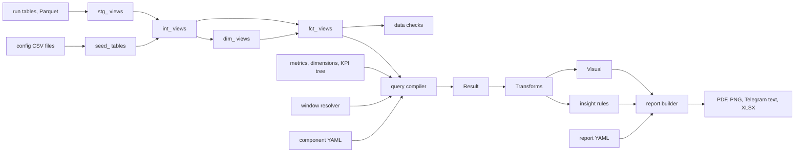

# Reporting framework: design note

Status: revised 24 Nov 2026 (plan task 7.1). The first version, agreed the same day, had one
Jinja SQL pattern per kind of chart. This revision puts one query compiler with composable
transforms at the centre and adds driver decomposition, insights, grid layouts and four
outputs, because the main goal is a framework in which new components and reports are quick to
build. Decisions D1 and D2 stand as agreed; D3 and D4 changed and D5 to D10 are new, all agreed
on 24 Nov 2026 (task 7.1b). Phase 7 builds the core, phase 8 the
presentation, phase 9 proves the framework and ports today's report, phase 10 builds the driving
reports.

## Goal

The framework succeeds when:

1. **A new component takes under 30 minutes and usually only YAML.** Python is written once per
   transform and once per visual, and reused by every later component.
2. **A new report is only YAML:** pages, a grid, components in slots, parameters and outputs.
3. **Reports explain why, not only what.** The change of a KPI is split over its drivers, and
   rules turn results into short sentences.
4. **The numbers can be trusted:** checked data, one definition per metric, and no claims on
   samples too small to mean anything.

It is measured on components the old report never had (plan task 9.1), not on reproducing the
old PDF.

## Principles

- **One compiler, many transforms.** A component states what it needs as a semantic query:
  model, dimensions, metrics, window, comparison, filters. One compiler writes the SQL for every
  query, with one output shape. Small transforms reshape the result. A pattern per chart would
  need new SQL for nearly every new chart; this design needs new Python only for genuinely new
  logic.
- **Grouping happens in SQL, reshaping in transforms.** Anything that changes the grouping (top
  N with "Other", time buckets, bins) is done by the compiler, so distinct order counts and
  ratios such as AOV are always recomputed from the rows. Transforms only reshape a result or
  compute from columns it already has, and never query the database.
- **Semantics live in registries.** Metrics, dimensions and the KPI tree are defined once;
  components only name them.
- **Visuals draw and never compute.** If a visual needs a number, a metric or a transform
  provides it.
- **Every number carries its sample size.** At about 180 orders a week (November 2026), and with
  several categories on fewer than 30 receipts in 14 days, a large percentage change is often
  noise.
- **Every result can go to every output:** a PDF slot, a Telegram text line, an Excel sheet.
- **Fail loudly and early:** strict schemas when loading, data checks when building.
- **Borrow the concepts.** Models follow dbt's layers and stay plain SQL; metric kinds follow
  dbt's semantic layer (MetricFlow). If the framework is ever replaced by those tools, the
  definitions carry over.

## Vocabulary

| Term | What it is | Written in | Example |
| --- | --- | --- | --- |
| **Model** | A DuckDB view over the Parquet tables of one extraction run or over a seed | SQL | `fct_orders` |
| **Seed** | A hand-maintained CSV in `config/`, loaded as a table | CSV | `seed_calendar_events` |
| **Check** | A data test that fails the build | `checks.yml` | receipts are unique in `fct_orders` |
| **Metric** | A named aggregate with format, direction, additivity and sample-size rule | `metrics.yml` | `net_sales`, `drink_orders`, `food_attach_rate` |
| **Dimension** | A named column to group or filter by, with its grain | `dimensions.yml` | `adjusted_category`, `weekday`, `has_food` |
| **KPI tree** | Identities between metrics | `kpi_tree.yml` | net sales = orders × AOV |
| **Window** | A date range relative to the anchor, plus a comparison range | resolver (Python) | `L6W` against the prior 6 weeks |
| **Query** | The semantic request of a component | component YAML | model, dimensions, metrics, window |
| **Compiler** | Turns a query into SQL, runs it and wraps the result | Python | — |
| **Result** | A DataFrame in the output convention plus metadata | Python | — |
| **Transform** | A reusable step that reshapes a result | Python, one function each | `pivot`, `per_trading_day`, `decompose` |
| **Component** | One chart, table or text: query, transforms, visual, insights | YAML | `aov_bridge` |
| **Facet** | Repeat one component inside a slot per value, period or metric | component YAML | the trend for the top 5 categories |
| **Visual** | Draws a result into a rectangle | Python | `table`, `heatmap`, `waterfall` |
| **Insight rule** | Turns a result into scored sentences | `insights.yml` | `top_drivers` |
| **Report** | Pages on a grid, parameters, repeats and outputs | YAML | `reports/weekly.yml` |
| **Parameter** | A placeholder that a report or a default binds | YAML | `$period`, `$category` |
| **Output** | One rendered form of a report | builder | PDF, PNG, Telegram text, XLSX |

A **facet** repeats a visual inside one slot; a **repeat** duplicates whole pages. Today's three
period sections are a repeat; the three period cards on the cover are a facet.

## Data flow



One run opens one in-memory DuckDB connection, builds all models over the run's tables, runs
the checks, and executes every component against it. The model files are views, but the builder
creates each one once as a table, in dependency order: the checks and the components query the
models many times, and a stack of views would recompute every layer on every query (39 checks
took 40 seconds as views and 0.07 seconds as tables, with the build itself at 0.3 seconds). The
tables are read with the existing `load_run` (local folder or `gs://`) and copied into
`raw_<table>` tables with the columns the models need, cast to fixed types: an empty table comes
back from Parquet without any columns, and a column that is NULL on every row has no type. A
missing optional table (discounts, modifiers, refunds) becomes an empty view; a missing required
table or column fails the build. `run_context` holds the anchor (default: the day of the last
payment); the models end on it.

## Folder layout

Everything ships inside the Python package (D1), so the Docker image needs no change and files
are found with `importlib.resources`. The hand-maintained CSVs stay in `config/` (D2).

```text
src/hari_lari_analytics/reporting/
  __init__.py
  db.py               # open DuckDB, load seeds, build the models in layer order
  checks.py           # run checks.yml; a broken check fails the build
  registry.py         # load and validate metrics.yml, dimensions.yml, kpi_tree.yml
  windows.py          # window resolver, built on periods.py
  compiler.py         # semantic query -> SQL -> Result
  result.py           # Result and ResultMeta
  transforms/
    __init__.py       # the @transform registry
    shape.py          # sort_limit, rank, fill_domain, pivot
    time.py           # per_trading_day, growth_vs_previous
    share.py          # cumulative_share
    classify.py       # thresholds, quadrants, item lifecycle
    quality.py        # suppress_small_n
    decompose.py      # change attribution along the KPI tree
  queries/            # the @query escape hatch for sources that are not SQL aggregates
    notes.py          # data notes from the cleaning steps and the run manifest
    lines_export.py   # the cleaned lines for the Excel export
  components.py       # pydantic schemas, loader, parameters, overrides
  facets.py           # facet engine
  insights.py         # insight engine and rule types
  layouts.py          # grid layout engine
  builder.py          # report builder
  outputs/
    pdf.py
    png.py
    telegram.py
    xlsx.py
  cli.py              # hari-lari-component
  metrics.yml
  dimensions.yml
  kpi_tree.yml
  insights.yml
  checks.yml
  schema/             # written by `hari-lari-component schema`
    component.schema.json
    report.schema.json
  models/
    stg_transactions.sql
    stg_transaction_lines.sql
    stg_transaction_line_discounts.sql
    stg_transaction_line_modifiers.sql
    stg_transaction_refunds.sql
    stg_items.sql
    stg_categories.sql
    int_signed_lines.sql          # refund payments turned into negative lines (plan 2.3)
    int_item_resolution.sql       # adjusted item and category per sold item (plan 2.4)
    int_sales_lines.sql           # cleaned lines with dimensions and groups, up to the anchor
    int_order_attributes.sql      # items, lines, has_food, has_drink, ... per receipt
    int_item_lifecycle.sql        # first and last sale per adjusted item-variant
    dim_items.sql
    dim_categories.sql            # with category_group_level_1 and _level_2
    dim_calendar.sql              # with trading days and calendar events
    fct_sales_lines.sql
    fct_orders.sql
  components/
    full_history_kpis.yml
    category_contributive_aov.yml
    aov_bridge.yml
    ...
  reports/
    weekly.yml
    category_deep_dive.yml
  visuals/
    __init__.py                   # the @visual registry
    base.py                       # Palette, theme, card, chips, table, bar column, sparkline
    formats.py                    # idr, pct, compact, headline, change_text
    kpi.py                        # kpi_card, summary_card, text_line
    tables.py                     # table (bars, deltas, rank, total row)
    charts.py                     # bar_trend, hbar, dot_plot, stacked_share_bar, heatmap,
                                  # scatter_quadrant, waterfall
    text.py                       # notes_card, insights
config/
  item_aliases.csv
  category_group.csv
  calendar_events.csv             # new in plan 7.4
  # later: targets.csv, item_margins.csv, modifier_costs.csv, note_addons.csv,
  #        payment_fees.csv, expense_group.csv
```

Naming: a file name is the object's id (`components/aov_bridge.yml` has `id: aov_bridge`), all
ids are `snake_case`, and models carry a layer prefix: `seed_`, `stg_`, `int_`, `dim_`, `fct_`.

## Models

Models are plain SQL files, one `create or replace view <name> as ...` each, with no templating.
A model may read from its own or a lower layer (seeds, then `stg_`, `int_`, `dim_`, `fct_`);
`db.py` finds the model names each file uses, refuses a reference to a higher layer, and builds
them in dependency order. One Python function is registered: `title_case`, Python's
`str.title`, so variants are capitalised exactly as in the pandas pipeline.

- **`seed_*`**: `config/item_aliases.csv`, `config/category_group.csv`,
  `config/calendar_events.csv`, and later the margin, target and fee files. The existing Python
  loaders in `load.py` validate each file before it is registered, so a bad CSV fails with the
  same messages as today.
- **`stg_*`**: one per Parquet table. They select and rename only the needed columns, cast
  types, drop the `+07:00` offset from timestamps (naive Bali clock time) and drop personal
  data (`customer_name`, `customer_phone`, `customer_email`, `collected_by`, `served_by`, ...).
- **`int_*`**: the cleaning rules of `load_api.py` and `clean.py`: refund payments as negative
  lines, the item and category resolution by `item_id` with the alias fallback, `Custom Amount`,
  variant capitalisation, fully refunded receipts. Plus the order attributes and the item
  lifecycle.
- **`fct_sales_lines`**: line grain. The columns of today's cleaned lines (the result of
  `load_api_sales` plus `add_dimensions` and `add_category_groups`), so every existing metric
  and dimension keeps its name: ids, `receipt_nr`, `sale_ts`, the time truncations,
  `adjusted_item`, `adjusted_item_variant`, `adjusted_category`, the category groups,
  `quantity`, the four money columns, `discount_code`, `payment_type`, `is_refund`,
  `counts_as_order`, the modifier columns. Also the order attributes of its receipt, so that
  filtered metrics work at line grain too; the line `note` (for plan 10.3, never exported); and
  later the cost columns (plan 10.4).
- **`fct_orders`**: receipt grain: `receipt_nr`, `sale_ts` and its truncations, `weekday`,
  `hour_of_day`, `payment_type`, the four money columns, `items` (sum of quantity), `lines`,
  `has_food`, `has_drink`, `has_consignment`, `has_discount`, `has_modifier`, `has_refund`,
  `counts_as_order`, and the calendar event of the day. A receipt is dated at its payment, so a
  refund on a later day counts on the day of the sale here but on the day of the refund in
  `fct_sales_lines`, as in today's report. Both refunds up to 22 Nov 2026 were on the day of the
  sale. On lines, the order attributes are named `order_items` and `order_lines`.
- **`dim_items`**: today's catalog plus the deleted items that still appear in sales, with
  `first_sale_date`, `last_sale_date` and `is_live`.
- **`dim_categories`**: the categories with `category_group_level_1` and `_level_2`. The groups
  are joined by adjusted category name, not by `category_id`, because Moka reuses ids with a new
  meaning: `7436715` was "Minuman Kulkas" before it became "Non Coffee" (D10). The `category_id`
  column of `config/category_group.csv` is informational.
- **`dim_calendar`**: one row per day from the first sale (23 Jul 2026) to the anchor: date, ISO
  week, month, weekday, `is_trading_day` (at least one order), and from
  `config/calendar_events.csv` (`date_from,date_to,kind,name`, kinds `holiday`, `closure`,
  `promotion`, `other`): `event_kind` (the most telling kind of the day: closure, holiday,
  promotion, other), `event_name` (several names joined by ' + '), `is_holiday`, `is_closure`
  and `has_promotion`. `fct_orders` and `fct_sales_lines` carry the event of their day. The
  compiler uses the calendar to fill empty time buckets and to count trading days.

The parity rule of plan 7.3: on the saved fixture and on a real run, `fct_sales_lines` equals the
pandas lines row for row.

## Checks

`checks.yml` holds data tests in the style of dbt, for any model (staging included). They run on
every build (`open_run` raises `DataCheckError` on a failing error-level check and returns the
warnings), and a broken check will fail the Monday job with the admin alert, like the sanity
checks of plan 1.11, once the job builds the component report (plan 9.6); until then the live
job does not run them. A check is an error unless it says `severity: warn`; warnings become data
notes. Each failure names the check (or its `message`) and shows up to five sample rows, using
the model's `sample_columns`.

```yaml
models:
  fct_sales_lines:
    sample_columns: [receipt_nr, item]
    unique: [[payment_id, line_uuid]]          # a column or a list of columns
    not_null: [receipt_nr, sale_ts, adjusted_item, adjusted_category]
    accepted_values:
      category_group_level_1: [food, drink, consignment, unmapped]
    relationships:
      receipt_nr: fct_orders.receipt_nr
    expressions:
      - gross_sales - discounts - refunds = net_sales
  dim_calendar:
    expressions:
      - expr: is_trading_day or is_closure
        severity: warn
        message: days without sales and without a closure in config/calendar_events.csv
totals:                                         # sum, min, max or count of model.column
  - sum(fct_sales_lines.net_sales) = sum(fct_orders.net_sales)
```

Besides these, the checks cover fractional Rupiah amounts and lines without a payment (both
were errors in `load_api.py`), unique payments, items, categories and days, the relationships
of the lines to every dimension, and the totals of all four money columns and the quantity.

## Semantic layer

### Metrics (`metrics.yml`)

A metric has exactly one of four kinds:

- **`sql`**: an aggregate over the rows of a model, keyed by model, because the same metric is
  written differently per grain.
- **`filtered`**: a base metric restricted by dimension values, compiled to an aggregate
  `filter (where ...)`. The filter uses the same syntax as a component's `where`. Label, format,
  direction and additivity are inherited from the base unless overridden.
- **`derived`**: an expression over other metrics, evaluated after aggregation. It may use the
  window value `trading_days`.
- **`relative`**: an expression that also uses `total.<metric>`, the same metric over the whole
  filter rather than the group. The compiler computes totals with `GROUPING SETS`, so a total is
  always recomputed from the rows, never summed.

Running totals and cumulative shares are transforms, not metrics.

```yaml
defaults:
  min_n: { orders: 30 }        # fewer orders in a row or period: greyed out, no insight

net_sales:
  label: Net Sales
  description: Gross sales minus discounts and refunds
  format: idr
  up_is_good: true
  additivity: full
  sql:
    fct_sales_lines: sum(net_sales)
    fct_orders: sum(net_sales)

orders:
  label: Orders
  description: Distinct receipts, without fully refunded ones
  format: count
  up_is_good: true
  additivity: order_grain       # a receipt has one payment type and hour, but many categories
  sql:
    fct_sales_lines: count(distinct receipt_nr) filter (where counts_as_order)
    fct_orders: count(*) filter (where counts_as_order)

aov:
  label: Avg Order Value
  format: idr
  up_is_good: true
  additivity: none
  derived: net_sales / nullif(orders, 0)

items_per_order:
  label: Items per order
  format: decimal
  up_is_good: true
  additivity: none
  derived: items_sold / nullif(orders, 0)

avg_item_price:
  label: Avg net price per item
  format: idr
  up_is_good: true
  additivity: none
  derived: net_sales / nullif(items_sold, 0)

drink_orders:
  label: Orders with a drink
  filtered: { base: orders, where: { has_drink: true } }

food_and_drink_orders:
  label: Orders with food and a drink
  filtered: { base: orders, where: { has_drink: true, has_food: true } }

food_attach_rate:
  label: Food attach rate
  description: Share of the orders with a drink that also have food
  format: pct
  up_is_good: true
  additivity: none
  derived: food_and_drink_orders / nullif(drink_orders, 0)
  min_n: { drink_orders: 30 }

net_sales_per_trading_day:
  label: Net sales per trading day
  format: idr
  up_is_good: true
  additivity: none
  derived: net_sales / nullif(trading_days, 0)

penetration:
  label: Order penetration
  format: pct
  up_is_good: true
  additivity: none
  relative: orders / nullif(total.orders, 0)

contributive_aov:
  label: Contributive AOV
  format: idr
  up_is_good: true
  additivity: full              # the slices add up to the AOV
  relative: net_sales / nullif(total.orders, 0)
```

- **`sql`**: per model, one aggregate `func(expr)` or `func(distinct expr)`, optionally with
  `filter (where condition)`; `func` is `sum`, `count`, `min`, `max` or `avg`. The registry
  parses it, so a `filtered` metric adds its condition to the aggregate's own filter. A
  `filtered` metric is based on a `sql` or another `filtered` metric, and exists on the models
  that have its base and every dimension of its `where`.
- **`format`**: `idr`, `idr_compact`, `count`, `decimal`, `pct` or `timestamp`. A change of a
  `pct` metric is shown in percentage points, every other change as a ratio.
- **`additivity`**: `full` (sums across any dimension), `order_grain` (sums across dimensions of
  grain `order` only) or `none`. The engine never sums a metric on its own. The loader checks
  every transform and visual option that sums rows (a stacked bar, a cumulative share, a total
  drawn outside SQL) and refuses the wrong combination of metric and dimension.
- **`up_is_good`**: colours the changes (discounts and refunds are `false`); `null` is neutral
  and leaves the change uncoloured (`share`, the first and last sale). Every metric states it.
- **`min_n`**: the sample-size rule. The compiler returns `n_orders` per row (and every count
  named in a `min_n`). Visuals grey out rows below it and show their `n`; insight rules skip
  them. The default is 30 orders. Every count it names must be a `count` metric on every model
  of the metric.

Every metric of METRICS.md is defined (the four money metrics, orders, AOV, items sold,
penetration, category AOV, contributive AOV, first and last sale), plus `share`,
`discount_rate` and the metrics above. Margins (plan 10.4) add `cogs_idr`, `gross_margin_idr`,
`gross_margin_pct` and `margin_coverage` without touching the compiler.

### Dimensions (`dimensions.yml`)

```yaml
adjusted_category:
  label: Category
  grain: item
  sort: { by: net_sales, desc: true }
  models: [fct_sales_lines]

category_group_level_1:
  label: Category group
  grain: item
  models: [fct_sales_lines]

payment_type:
  label: Payment type
  grain: order
  models: [fct_sales_lines, fct_orders]

hour_of_day:
  label: Hour
  grain: order
  sort: { by: value }
  domain: span              # fill missing hours between the first and last hour with zeros
  models: [fct_sales_lines, fct_orders]

weekday:
  label: Weekday
  grain: day
  sort: { by: value }       # Monday first
  domain: all               # all seven days, even without sales
  values: [1, 2, 3, 4, 5, 6, 7]
  labels: { 1: Mon, 2: Tue, 3: Wed, 4: Thu, 5: Fri, 6: Sat, 7: Sun }
  models: [fct_sales_lines, fct_orders]

has_food:
  label: Has food
  grain: order
  labels: { true: With food, false: Without food }
  models: [fct_sales_lines, fct_orders]

basket_size:
  label: Items in the order
  column: { fct_sales_lines: order_items, fct_orders: items }
  grain: order
  bins: [1, 2, 3, 4, "5+"]
  models: [fct_sales_lines, fct_orders]

discount_code:
  label: Discount code
  grain: line
  null_label: No discount
  models: [fct_sales_lines]
```

`column` defaults to the id; a mapping names the column per model when it differs. Every
dimension of grain `day` is also on `dim_calendar`, so the compiler can count trading days per
value, and `bucket` is the time dimension in the query's grain, computed by the compiler. `grain`
says what the value describes and drives the additivity check: `day` (the calendar: date,
week, weekday, events) and `order` (payment type, hour, the order attributes) have one value
per receipt, so `order_grain` metrics such as orders may be summed over them; `item` (item,
category, category groups) and `line` (discount code, modifier, refund line) can have several
values per receipt. `domain` tells the compiler which empty values to fill: `span`, `all` (the
listed `values`), `calendar` (the time truncations, through `dim_calendar`) or `none`. `labels`
and `null_label` are the display names of values and of the empty value. `bins` turns a number
into ordered buckets, in SQL: an exact value, a range such as `"2-3"`, or an open last bucket
such as `"5+"`. The category groups of plan 2.11, the order attributes and the calendar events
are ordinary dimensions.

### KPI tree (`kpi_tree.yml`)

The KPI tree states how metrics build on each other. It drives the `decompose` transform and the
`top_drivers` insight, and a test checks that every identity holds on a real run (plan 7.7).

```yaml
- id: sales_volume_value
  kpi: net_sales
  kind: product
  drivers: [orders, aov]

- id: aov_basket
  kpi: aov
  kind: product
  drivers: [items_per_order, avg_item_price]

- id: aov_by_category
  kpi: aov
  kind: sum_over
  dimension: adjusted_category
  driver: contributive_aov
  then: category_slice          # optionally split each member's change one level further

- id: category_slice
  kpi: contributive_aov
  kind: product
  drivers: [penetration, category_aov]

- id: net_from_gross
  kpi: net_sales
  kind: sum
  drivers: [gross_sales, -discounts, -refunds]
```

`aov_by_category` followed by `category_slice` is the reading of METRICS.md made explicit: a
category's slice of the AOV moves because the category appears in more or fewer orders
(penetration) or because orders with it spend more or less on it (category AOV). The file also
has `aov_by_category_group` (the same split over food, drink and consignment) and
`net_sales_by_category`. The driver of a `sum_over` must be fully additive. Margins and costs
add identities later, for example gross margin = net sales - COGS.

A test checks every identity on every model it exists on, over the full history and the L14D,
L6W and L3M windows, on the fixture and on the run of 2026-11-22; for a `sum_over` with `then`
it also checks the `then` identity on every member. A product is undefined (and not checked)
where a value is missing, for example the category AOV of a category without orders.

## Windows

`windows.py` turns a window name and the anchor into a `Window` (start, end inclusive, default
grain, title, label, trading days) plus an optional comparison `Window`. It wraps `periods.py`,
so L14D, L6W and L3M keep their tests.

| Window | Range | Default grain |
| --- | --- | --- |
| `L14D` | the 14 days up to the anchor | day |
| `L6W` | the last 6 complete ISO weeks | week |
| `L3M` | the last 3 complete months | month |
| `full` | first sale to anchor | month |
| `WTD`, `MTD` | the anchor's week or month so far | day |
| `last_n_days(n)`, `last_n_weeks(n)`, `last_n_months(n)` | like L14D, L6W, L3M with any n; also written `L<n>D`, `L<n>W`, `L<n>M` | day, week, month |

Time grains are `day`, `week`, `month` and `block_7d`: 7-day blocks counted back from the window
end, so the latest block is a full week, as the sparklines do today. Weeks and months are
calendar buckets, so the first and last bucket may reach outside the window. `bucket_before`
gives the bucket before the first one, for the growth label of the first bucket; it is used
only when it lies fully within the sales history.

`compare` is `prior`, `last_year` or `none`. `prior` is the same length directly before, except
where that would compare different weekdays or days of the month (agreed 24 Nov 2026): a day
window shorter than a week is compared with the same weekdays a week earlier (`L1D` on a
Saturday with the Saturday before), `WTD` with the same weekdays of the week before, and `MTD`
with the same days of the month before (cut to that month's last day). `last_year` shifts by
364 days for day and week windows, so weekdays line up, and by 12 months for month windows,
`MTD` and `full`. A comparison whose start lies before the first sale is not run: its columns
are NULL and `meta.compare_ok` is false, which the visuals show as `n/a`, as today. With the
first sale on 23 Jul 2026, `last_year` shows `n/a` until late July 2027, and `full` never has a
valid comparison.

`$period` in a component is a placeholder that a report repeat, a period facet or the
component's default `params` binds to a window name.

## Queries and the compiler

A component's `query` names everything the compiler needs:

```yaml
query:
  model: fct_sales_lines
  dimensions: [adjusted_category]
  metrics: [net_sales, share, items_sold, orders, penetration, category_aov, contributive_aov]
  window: $period
  compare: prior                    # prior | last_year | none
  where: { payment_type: [Cash] }   # optional; values become bound parameters
  totals: true                      # add the total row
  keep_prior_only: true             # keep groups that sold only in the comparison window
  top: { n: 15, by: net_sales, other: false }   # optional; other: true adds "Other (k)"
  grain: week                       # for time dimensions; defaults to the window's grain
  bins: { basket_size: [1, 2, "3+"] }   # optional; replaces the bins of dimensions.yml
  buckets_before: 1                 # series only: buckets before the window, for growth labels
```

The compiler checks the query against the registries (every metric and dimension exists on the
model), resolves the window and writes one statement. For the categories table in the L6W
section, in outline:

```sql
with cur as (
  select adjusted_category, grouping(adjusted_category) = 1 as is_total,
         sum(net_sales) as net_sales,
         sum(quantity) as items_sold,
         count(distinct receipt_nr) filter (where counts_as_order) as orders
  from fct_sales_lines
  where sale_ts >= $cur_start and sale_ts < $cur_end_excl
  group by grouping sets ((adjusted_category), ())
),
prior as ( ... the same over $prior_start and $prior_end_excl ... ),
joined as (                         -- full outer join keeps prior-only categories
  select coalesce(c.adjusted_category, p.adjusted_category) as adjusted_category,
         coalesce(c.is_total, p.is_total) as is_total,
         coalesce(c.net_sales, 0) as net_sales, ..., p.net_sales as prior_net_sales, ...
  from cur c full join prior p
    on c.is_total = p.is_total and c.adjusted_category is not distinct from p.adjusted_category
)
select *,
       net_sales / nullif(total.net_sales, 0) as share,
       orders / nullif(total.orders, 0) as penetration,
       net_sales / nullif(orders, 0) as category_aov,
       net_sales / nullif(total.orders, 0) as contributive_aov,
       ... the same for prior_*, then *_change and *_delta ...
from joined, (select * from joined where is_total) as total
order by is_total, net_sales desc
```

The total row's orders are all distinct receipts, so its penetration is 100% and its category
AOV and contributive AOV equal the AOV, exactly as METRICS.md describes, without special cases.
The real compiler (`compiler.py`) writes a few more steps than this outline: the rows of each
window, the top-N mapping, the aggregates, a frame of output rows with the current and prior
aggregates joined, the trading days, then the derived and relative metrics and the changes.
`meta.sql` shows the full statement.

**Top N.** `top` ranks the groups by `by` over the current window (ties by the dimension values)
and maps every other group, in both windows, to `Other (k)` in the same statement, so the orders
of "Other" are distinct receipts, not a sum, and the prior of "Other" holds everything outside
the top N, including groups sold only in the prior window. Without `other: true` that row is
dropped from the output, but the totals and every relative metric (share, penetration) still
cover all groups. `by` may be any metric except a relative one. `keep_prior_only` does not
combine with `top` or with a time dimension.

**Series.** A query with a time dimension returns a series: `bucket` groups by the query's
`grain` (default: the window's), and `sale_date`, `sale_week` and `sale_month` group by their own
grain. Every bucket of the window appears, for every group of the window, with zeros where
nothing sold. The prior is matched bucket by bucket by position (week 1 of the window with week 1
of the comparison), as the prior ticks of today's trend. `buckets_before: n` adds up to n
buckets before the window (`in_window = false`, no prior), only those that lie fully within the
sales history. In a series, a relative metric uses the total of its own bucket (the penetration
of Coffee in a week is over the orders of that week), and with `totals: true` each bucket has a
total row (with its bucket set) besides the total of the window. At most one time dimension per
query; `bucket` cannot be filtered on (use the window).

**Trading days.** Every row with dimensions gets `trading_days`, counted in `dim_calendar`: per
bucket in a series, per value of the calendar dimensions (weekday, holiday, ...) in the row,
otherwise those of the window. Orders by weekday and hour per trading day therefore divide by
the trading days of each weekday. A filter on a calendar dimension restricts the trading days
too; other filters (payment type, category) do not. A derived metric that uses `trading_days`
reads the value of its row.

**Output convention.** One row per group: the dimension columns, `is_total`, `is_other` (with
`top: {other: true}`), `in_window` (with `buckets_before`), then one column per metric. With a
comparison, `prior_<metric>`, `<metric>_change` (ratio) and `<metric>_delta` (difference; for
`pct` metrics in fractions, which the visuals show as pp); a timestamp metric gets only its
prior. When the comparison is not valid these columns exist and are NULL. Always `n_orders`,
plus every count named in a `min_n` as `n_<count>`, each with `prior_n_<count>`; then
`trading_days` (and `prior_trading_days`). A total row has `is_total = true` and NULL dimensions
(except the bucket of a bucket total). Groups sort by the dimension's `sort` (bins in their own
order, NULL last), "Other" after them, the total last; series by bucket. Sums of an empty group
are 0, not NULL; ratios over zero are NULL. A query without dimensions returns one row, the
total.

**`ResultMeta`** carries the window and comparison window, `compare_ok`, `empty` (no sales in the
window), the metric specs of every column (label, format, `up_is_good`, `min_n`), the dimension
specs, the trading days of both windows, the result shape (`single`, `rows`, `series`, `matrix`
or `decomposition`), for a series its grain and the current and prior buckets, and the rendered
SQL with its parameters for debugging.

**Escape hatch.** A registered Python function `@query("notes")` returns a `Result` for sources
that are not SQL aggregates. Components use one with `query: { source: notes }`, plus `options`
when the source declares an options model. A source gets a `QueryContext`: the connection, the
registry, the calendar, and the run (with its manifest) and the data-check report when there is
one. Two exist: `notes` (where the data comes from, extraction errors and warnings from the run
manifest, data-check warnings) and `lines_export` (the cleaned lines with the columns of the
Excel export, never the line note).

## Transforms

A transform is a registered function `(result, options, ctx) -> Result` with a pydantic options
model. Transforms run in the order listed and never query the database. A transform can declare
what it needs from the query; the loader adds it when it can and fails otherwise. For example,
`growth_vs_previous` asks for one extra bucket before the window, and `decompose` asks for the
drivers of its identity.

| Transform | What it does |
| --- | --- |
| `sort_limit` | sort by a column, keep the first n rows |
| `rank` | add a rank column |
| `fill_domain` | add the missing values of a dimension's domain, with zeros |
| `per_trading_day` | divide the additive metrics by the window's trading days, or, when grouped by a calendar dimension such as weekday, by the trading days of each group |
| `growth_vs_previous` | growth of each time bucket over the one before; the first bucket looks one bucket back if that bucket lies fully within the history |
| `cumulative_share` | running share of a fully additive metric, for Pareto and ABC classes |
| `pivot` | turn two dimensions into a matrix (shape `matrix`) |
| `classify` | add a class column from thresholds, quadrants (two metrics against their medians or given values) or the item lifecycle (new, rising, steady, fading) |
| `suppress_small_n` | blank the metrics of rows below the sample-size rule, instead of greying them out |
| `decompose` | split the change of a KPI over the drivers of one KPI-tree identity (shape `decomposition`) |

Writing a new transform is one function, one options model and one hand-computed test,
registered with `@transform("name")`. Every later component can then use it in YAML.

### Decompose

For a `product` identity Y = X1 × X2 × ..., with every value positive, the effect of driver i on
the change from the prior period (0) to the current one (1) is the log-mean (LMDI) share:

```text
effect_i = L(Y1, Y0) × ln(Xi1 / Xi0),   where L(a, b) = (a − b) / (ln a − ln b) and L(a, a) = a
```

The effects add up to Y1 − Y0 exactly, whatever the order of the drivers. For a `sum` identity
the effect of each term is its difference. For `sum_over`, each member's effect is the change of
its slice (prior-only members included, so the slices add up), and `then:` splits each slice
with its own product identity. When a value is zero or missing (a category that is new or gone),
the product split is undefined and the member's change is shown whole, labelled new or gone.

The result has one row per driver: label, prior and current value, effect, and share of the
change.

## Components

```yaml
# yaml-language-server: $schema=../schema/component.schema.json
id: category_contributive_aov
title: Adjusted categories & contributive AOV
hint: >-
  Sorted by net sales · AOV = Σ contributive AOV = Σ penetration × category AOV ·
  a category's share of AOV equals its % of net · Δ vs prior period
params: { period: L6W }                # default, so the CLI can run it without a report
query:
  model: fct_sales_lines
  dimensions: [adjusted_category]
  metrics: [net_sales, share, items_sold, orders, penetration, category_aov, contributive_aov]
  window: $period
  compare: prior
  totals: true
  keep_prior_only: true
visual:
  type: table
  bars: [share]
  deltas: { penetration: delta, category_aov: change, contributive_aov: delta }
  bold: [net_sales, contributive_aov]
insights: [movers]
```

A component that today's report does not have, in YAML only:

```yaml
id: orders_heatmap
title: Orders per trading day
hint: By weekday and hour · {{ meta.window.label }}
params: { period: L6W }
query:
  model: fct_orders
  dimensions: [weekday, hour_of_day]
  metrics: [orders]
  window: $period
transforms:
  - per_trading_day
  - pivot: { rows: weekday, columns: hour_of_day }
visual: { type: heatmap, format: decimal }
```

The fields: `id`, `title` and `hint` (short Jinja strings with access to `meta`), `description`
(shown in the gallery), `params` (defaults), `query`, `transforms`, `facet`, `visual` and
`insights`. The loader (plan 7.12) validates a component with pydantic and fails with the file
name and field:

- unknown keys are errors (a typo such as `metrcis` fails);
- the model, every transform, the visual and every insight rule must exist;
- every metric and dimension must exist in the registry and be available on the model;
- the requirements of each transform are met or added;
- the visual accepts the result shape the query and transforms produce;
- `options` fit the transform's schema, `visual` fits the visual's schema;
- the additivity check described above;
- every parameter is bound by a default or by the report.

The first line points the editor at the JSON Schema, so the YAML autocompletes and shows errors
while typing.

A report slot may override fields of a component without copying it, as a deep merge:
`{ component: top_items, with: { query: { top: { n: 10 } } } }`.

## Facets

```yaml
facet:
  by: adjusted_category            # a dimension, or `period`, or `metric`
  values: { top: 5, by: net_sales } # or `all`, or a list such as [Coffee, Mains]
  layout: grid(2x3)                # row, column or grid(n x m): how the slot is split
```

- **By dimension**: the component runs once per value, with the value added to `where`. The top
  N is decided once, over the component's own window, so all facets show the same values in the
  same order.
- **By period**: binds `$period` per facet, for the three period cards on the cover.
- **By metric**: runs once and hands one metric per facet to the visual, for the four KPI cards.

The facet engine returns one `Result` per facet with its label; the slot is split by `layout`
and the visual is drawn once per cell.

## Visuals

A visual is a registered Python function:

```python
@visual("table", options=TableOptions, accepts={"rows", "single"}, min_size=(0.25, 0.20))
def table(fig: Figure, rect: Rect, result: Result, options: TableOptions, theme: Theme) -> None:
    ...
```

It formats values from the metric specs in `result.meta`, lays them out and draws. It never
filters, groups or computes a metric. `accepts` lists the result shapes it can draw, and
`min_size` (as fractions of the page) lets the layout engine refuse a slot that is too small.
Rows below the sample-size rule are drawn in grey with their `n`.

The first visuals are those of today's report (plan 8.1 moves the building blocks out of
`report_pdf.py` unchanged, so the old report keeps rendering identically): `kpi_card`,
`summary_card`, `text_line`, `table` (bars, deltas, rank, total row), `bar_trend`, `dot_plot`,
`stacked_share_bar` and `notes_card`. New ones: `hbar`, `heatmap`, `scatter_quadrant`,
`waterfall` and `insights`.

By default a slot draws a card with the component's `title` and `hint` and gives the visual the
inner rectangle. `title` and `hint` have access to `meta`, so
"Average per trading day · {{ meta.trading_days }} days" works. A slot can turn the card off
with `card: false` (the cover KPI line).

## Insights

Insight rule types are Python (plan 8.3); the rules themselves are YAML. A rule reads one result
and returns sentences with a score.

```yaml
top_drivers:                       # for results of shape decomposition
  type: drivers
  top: 2
  min_share_of_change: 0.2
  text: >-
    {{ kpi.label }} {{ change | signed_pct }} on the {{ compare.label }}:
    {{ drivers | join_effects }}

movers:                            # for breakdowns with a comparison
  type: movers
  by: delta
  top: 2
  min_abs_delta: { pct: 0.05, idr: 2000 }
  text: "{{ row.label }}: {{ metric.label | lower }} {{ row.delta | signed }} ({{ row.n_orders }} orders)"

best_bucket:                       # for trends
  type: record
  text: "Best {{ grain }} since opening: {{ bucket.label }} with {{ bucket.value | idr }}"
```

Rules never speak about a row or period below its `min_n`, nor about a change without a valid
comparison. The score is the size of the effect relative to its KPI. The report collects the
sentences of all components, removes duplicates (same metric and group), ranks them, and shows
the top ones through the `insights` visual and in the Telegram text.

## Layouts

A page is a 12-column grid with row heights in parts of the usable height. A slot names a
component with its row, column, column span and row span. The chrome (header with kicker, title
and window chips; footer with "data through" and "generated"; the note when the comparison
starts before the first sale) comes from the report context.

```yaml
- id: overview
  title: Overview
  grid: { columns: 12, rows: [2, 5] }
  slots:
    - { component: kpi_cards,          row: 1, col: 1, span: 12 }
    - { component: sales_orders_trend, row: 2, col: 1, span: 8 }
    - { component: key_figures,        row: 2, col: 9, span: 4 }
```

The engine checks every slot against its visual's `min_size`, and a test renders every report
on the fixture and fails when any text overflows its slot (measured with matplotlib's text
extents).

## Reports

```yaml
# yaml-language-server: $schema=../schema/report.schema.json
id: weekly
title: Sales report
params:
  anchor: yesterday                  # overridden by --anchor
outputs:
  pdf: true
  png: [cover]                       # page ids, or `all`
  telegram: weekly_caption           # a text block, below
  xlsx: [lines_export]
text_blocks:
  weekly_caption:                    # at most 1,024 characters under the cover photo
    - component: week_kpis_text      # net sales, orders and AOV against the prior week
    - insights: { top: 3 }
    - text: "PDF and Excel lines: {{ drive_url }}"   # filled in by the deliver step
pages:
  - id: cover
    title: Sales report
    params: { period: full }
    grid: { columns: 12, rows: [3, 1, 4, 2] }
    slots:
      - { component: full_history_kpis,    row: 1, col: 1, span: 12 }
      - { component: full_history_amounts, row: 2, col: 1, span: 12, card: false }
      - { component: period_summary_cards, row: 3, col: 1, span: 12 }
      - { component: data_notes,           row: 4, col: 1, span: 12 }
  - repeat: { period: [L14D, L6W, L3M] }
    when_empty: { page: empty_period }  # one page instead of the group
    pages:
      - id: overview
        ...
      - id: categories
        grid: { columns: 12, rows: [1] }
        slots:
          - { component: category_contributive_aov, row: 1, col: 1, span: 12 }
      - id: details
        ...
```

Any parameter can be repeated, not only the period. The category deep dive (plan 9.5):

```yaml
id: category_deep_dive
params: { period: L6W }
repeat:
  category: { top: 5, by: net_sales, window: L6W }
pages:
  - id: category
    title: "{{ category }}"
    grid: { columns: 12, rows: [1, 1] }
    slots:
      - { component: penetration_aov_trend, row: 1, col: 1, span: 8,
          with: { query: { where: { adjusted_category: $category } } } }
      - { component: top_items, row: 1, col: 9, span: 4,
          with: { query: { where: { adjusted_category: $category }, top: { n: 8 } } } }
      ...
```

The builder (plan 8.5) resolves the anchor, expands every repeat (binding the parameters and the
page chrome), replaces a repeated group by its `when_empty` page when the window has no sales,
runs the components and facets, draws the visuals into their slots, collects the insights, and
writes the requested outputs.

## Outputs

- **PDF**: A4 landscape, as today.
- **PNG**: the chosen pages, at a resolution that reads well on a phone.
- **Telegram text**: plain text from a text block. A caption under a photo holds at most 1,024
  characters and a message 4,096; the builder fails when a block is too long rather than let
  Telegram cut it. Values known only at delivery, such as the Drive link, are filled in by the
  deliver step.
- **XLSX**: one formatted sheet per listed component (its result in the output convention), and
  the lines export without personal data and without the line note.

## Developer workflow

Adding a component:

1. `hari-lari-component new orders_heatmap --from orders_by_hour` copies a similar component and
   creates its snapshot test.
2. Edit the YAML; the editor autocompletes it from the JSON Schema.
3. `hari-lari-component run orders_heatmap --period L6W --sql --png --watch` shows the result,
   the SQL and the rendered component on every save.
4. `hari-lari-component validate` checks all components and reports; accept the new snapshot.
5. Place the component in a report slot.

The gallery (plan 8.7) renders every component on the test fixture, so it is both the catalogue
and a visual check. The Cursor rule `.cursor/rules/reporting-components.mdc` (plan 8.8) explains
this loop to an LLM, with two worked examples.

## Worked example: why the AOV moved in the last 6 weeks

The component is `aov_bridge` from the plan:

```yaml
id: aov_bridge
title: Why the average order value moved
params: { period: L6W }
query:
  model: fct_orders
  metrics: [aov, items_per_order, avg_item_price]
  window: $period
  compare: prior
transforms:
  - decompose: { identity: aov_basket }
visual: { type: waterfall }
insights: [top_drivers]
```

**1. Load and validate.** `decompose` requires the drivers of `aov_basket`; the query asks for
them. `items_per_order` and `avg_item_price` are `derived`, so the compiler also selects their
inputs `items_sold`, `net_sales` and `orders`. The `waterfall` visual accepts the shape
`decomposition`.

**2. Resolve the window.** In the run of 2026-11-22 the anchor is Sunday 22 Nov, so `L6W` is
12 Oct to 22 Nov, compared with 31 Aug to 11 Oct. The comparison starts after the first sale, so
`compare_ok` is true.

**3. Compile and run.** One row with the current and prior values:

| Metric | Prior 6 weeks | Last 6 weeks |
| --- | ---: | ---: |
| Net sales (IDR) | 27,657,250 | 63,837,875 |
| Orders | 412 | 857 |
| Items sold | 799 | 1,754 |
| AOV (IDR) | 67,129 | 74,490 |
| Items per order | 1.94 | 2.05 |
| Avg net price per item (IDR) | 34,615 | 36,396 |

**4. Decompose.** With L(74,490, 67,129) = 70,746, the AOV change of +7,361 splits into
items per order: 70,746 × ln(2.047 / 1.939) = +3,812, and the average item price:
70,746 × ln(36,396 / 34,615) = +3,549. The two effects add up to +7,361 exactly. One level up,
`sales_volume_value` splits the net sales change of +36,180,625 into +31,680,243 from more
orders and +4,500,382 from the higher AOV.

**5. Draw and say it.** The waterfall goes from 67,129 through the two effects to 74,490. The
`top_drivers` rule writes: "Avg Order Value +11.0% on the prior 6 weeks: +3,812 from more items
per order (1.94 → 2.05), +3,549 from a higher price per item." On the weekly v2 page (plan 10.1)
the same rule on `sales_volume_value` writes: "Net sales +131% on the prior 6 weeks: +31.7M from
more orders, +4.5M from a higher order value."

No step needed Python beyond what the framework provides. With `facet: { by: period, values:
[L14D, L6W, L3M], layout: row }` it shows the three periods side by side, and with
`identity: aov_by_category` it shows which categories moved the AOV.

## Testing

- **Models** (plan 7.3): `fct_sales_lines` equals the pandas lines on the fixture and on a real
  run; row counts match phase 2.
- **Checks** (7.5): each check type fails on a fixture built to break it.
- **Registries and KPI tree** (7.6, 7.7): every metric and dimension of METRICS.md is defined;
  every identity holds on a real run.
- **Windows** (7.8): the existing `test_periods.py` cases pass through the resolver, plus new
  cases for WTD, MTD, `last_n_*`, `last_year` and `block_7d`.
- **Compiler** (7.9): hand-computed results on a small fixture for totals, prior-only rows, top
  N with "Other", bins, filters, filtered metrics, series, trading days and invalid queries;
  parity with `report_data.Section` on the run of 2026-11-22 for the KPIs, categories, top
  items, payment types, discounts, orders by hour, the trend and the sparklines.
- **Transforms and decompose** (7.10, 7.11): one hand-computed test each; decompose effects add
  up to the change exactly, and the worked example above is a test.
- **Loader** (7.12): one test per validation rule, each with a readable message.
- **Visuals and layouts** (8.2, 8.4): every visual renders on the fixture; no text overflows.
- **Snapshots** (8.7): a golden result per component.
- **Ported components** (9.3): parity of the numbers with `report_data.Section`.

## Migration

The old report stays untouched and keeps going out every Monday until the cut-over (plan 9.7).
The component report reads its sales from API runs only: the back-office CSV export is removed
after four good Mondays (6.7), and the parity tests compare against the old report built from
the same API run. The config CSVs are not affected; they are seeds of the models. Plan task 8.1
moves the drawing helpers out of `report_pdf.py`; the old report imports them from there, so
both paths share them until `report_pdf.py` is deleted. For two Mondays before the cut-over the
job also builds the component report under `dry-run/` (9.6). There is no pixel diff: the numbers
must match, the drawing may improve.

## Out of scope

- Arbitrary SQL or Python inside a component or report. A new need becomes a compiler option, a
  transform, a visual or, for a source that is not an SQL aggregate, a registered `@query`.
- Interactive dashboards (plan 10.18 covers BigQuery and Looker Studio separately).
- Persistent or incremental models; at a few MB, every run builds all models in memory.
- The customer branch of the KPI tree: only 38 of 1,501 receipts (2.5%) in the run of
  2026-11-22 have a customer attached.
- Forecasting: the history starts on 23 Jul 2026.

## Decisions

D1 and D2 were agreed on 24 Nov 2026 with the first version. D3 to D10 were agreed on the same
day after the revision (plan task 7.1b), each as proposed.

| # | Question | Decision |
| --- | --- | --- |
| D1 | Where the definitions live | agreed: inside the package (`src/hari_lari_analytics/reporting/`) |
| D2 | Data source of the component report | agreed: sales from API runs only; the hand-maintained `config/*.csv` files (aliases, category groups, later margins) stay and are loaded as `seed_*` tables |
| D3 | Layout definitions | agreed: a 12-column grid in the report YAML, with a minimum size per visual and an overflow test (replaces the rectangles in `layouts.yml`) |
| D4 | Where Python lives | agreed: one query compiler; Python only for transforms, visuals, insight rule types and `@query` sources; none in components or reports (replaces the Jinja SQL pattern per chart with an optional `post` step) |
| D5 | Explaining changes | agreed: a KPI tree in `kpi_tree.yml` and a `decompose` transform with log-mean (LMDI) attribution |
| D6 | Outputs | agreed: PDF, PNG, Telegram text and XLSX from one report; the Telegram caption becomes a report output and replaces `deliver/caption.py` at the cut-over |
| D7 | Sample size | agreed: a default rule of 30 orders per row or period, overridable per metric; rows below it are greyed out with their `n`, and insights skip them |
| D8 | Build or adopt | agreed: own framework, with dbt's model layers and MetricFlow's metric kinds as concepts only; no dbt installation; models stay plain SQL run by DuckDB in-process |
| D9 | Acceptance of the port | agreed: parity of each ported component's numbers with `report_data.Section`; no pixel diff, so the drawing may improve |
| D10 | Joining category groups | agreed: by adjusted category name; `category_id` in `config/category_group.csv` is informational, because Moka reuses category ids |
