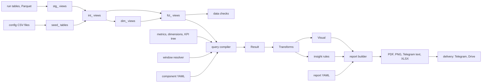

# Reporting framework: design note

Status: revised 24 Nov 2026 (plan task 7.1). The first version, agreed the same day, had one
Jinja SQL pattern per kind of chart. This revision puts one query compiler with composable
transforms at the centre and adds driver decomposition, insights, grid layouts and four
outputs, because the main goal is a framework in which new components and reports are quick to
build. Decisions D1 and D2 stand as agreed; D3 and D4 changed and D5 to D10 are new, all agreed
on 24 Nov 2026 (task 7.1b). Phase 7 builds the core, phase 8 the
presentation, phase 9 proves the framework and ports today's report, phase 10 builds the driving
reports. On 25 Nov 2026 (task 7A.9) the reports gained filters, a schedule and a delivery, and
one command runs any report; D11 to D14 record the decisions. All decisions are in
[decisions.md](decisions.md); where this framework sits in the platform is in
[architecture.md](architecture.md).

## Goal

The framework succeeds when:

1. **A new component takes under 30 minutes and usually only YAML.** Python is written once per
   transform and once per visual, and reused by every later component.
2. **A new report is only YAML:** pages, a grid, components in slots, parameters and outputs.
3. **Reports explain why, not only what.** The change of a KPI is split over its drivers, and
   rules turn results into short sentences.
4. **The numbers can be trusted:** checked data, one definition per metric, and no claims on
   samples too small to mean anything.

It is measured on components the old report never had (plan task 9.1), not on reproducing the
old PDF.

## Principles

- **One compiler, many transforms.** A component states what it needs as a semantic query:
  model, dimensions, metrics, window, comparison, filters. One compiler writes the SQL for every
  query, with one output shape. Small transforms reshape the result. A pattern per chart would
  need new SQL for nearly every new chart; this design needs new Python only for genuinely new
  logic.
- **Grouping happens in SQL, reshaping in transforms.** Anything that changes the grouping (top
  N with "Other", time buckets, bins) is done by the compiler, so distinct order counts and
  ratios such as AOV are always recomputed from the rows. Transforms only reshape a result or
  compute from columns it already has, and never query the database.
- **Semantics live in registries.** Metrics, dimensions and the KPI tree are defined once;
  components only name them.
- **Visuals draw and never compute.** If a visual needs a number, a metric or a transform
  provides it.
- **Every number carries its sample size.** At about 180 orders a week (November 2026), and with
  several categories on fewer than 30 receipts in 14 days, a large percentage change is often
  noise.
- **Every result can go to every output:** a PDF slot, a Telegram text line, an Excel sheet.
- **Fail loudly and early:** strict schemas when loading, data checks when building.
- **Borrow the concepts.** Models follow dbt's layers and stay plain SQL; metric kinds follow
  dbt's semantic layer (MetricFlow). If the framework is ever replaced by those tools, the
  definitions carry over.

## Vocabulary

| Term | What it is | Written in | Example |
| --- | --- | --- | --- |
| **Model** | A DuckDB view over the Parquet tables of one extraction run or over a seed | SQL | `fct_orders` |
| **Seed** | A hand-maintained CSV in `config/`, loaded as a table | CSV | `seed_calendar_events` |
| **Check** | A data test that fails the build | `checks.yml` | receipts are unique in `fct_orders` |
| **Metric** | A named aggregate with format, direction, additivity and sample-size rule | `metrics.yml` | `net_sales`, `drink_orders`, `food_attach_rate` |
| **Dimension** | A named column to group or filter by, with its grain | `dimensions.yml` | `adjusted_category`, `weekday`, `has_food` |
| **KPI tree** | Identities between metrics | `kpi_tree.yml` | net sales = orders × AOV |
| **Window** | A date range relative to the anchor, plus a comparison range | resolver (Python) | `L6W` against the prior 6 weeks |
| **Query** | The semantic request of a component | component YAML | model, dimensions, metrics, window |
| **Compiler** | Turns a query into SQL, runs it and wraps the result | Python | — |
| **Result** | A DataFrame in the output convention plus metadata | Python | — |
| **Transform** | A reusable step that reshapes a result | Python, one function each | `pivot`, `per_trading_day`, `decompose` |
| **Component** | One chart, table or text: query, transforms, visual, insights | YAML | `aov_bridge` |
| **Facet** | Repeat one component inside a slot per value, period or metric | component YAML | the trend for the top 5 categories |
| **Visual** | Draws a result into a rectangle | Python | `table`, `heatmap`, `waterfall` |
| **Insight rule** | Turns a result into scored sentences | `insights.yml` | `top_drivers` |
| **Report** | Pages on a grid, parameters, repeats and outputs | YAML | `reports/weekly.yml` |
| **Parameter** | A placeholder that a report or a default binds | YAML | `$period`, `$category` |
| **Output** | One rendered form of a report | builder | PDF, PNG, Telegram text, XLSX |
| **Filter** | A `where` or `focus` on a report or page, applied to every slot whose model has the dimension | report YAML | `focus: { adjusted_category: $category }` |
| **Schedule** | When a report runs by itself | report YAML | Monday 04:00 WITA |
| **Delivery** | Where a report's outputs go, and an optional condition | report YAML | the cover and PDF to the group, the files to Drive |
| **Target** | A named Telegram chat; its chat id is a secret | `project.yml` | `group`, `admin` |

A **facet** repeats a visual inside one slot; a **repeat** duplicates whole pages. Today's three
period sections are a repeat; the three period cards on the cover are a facet.

## Data flow



One run opens one in-memory DuckDB connection, builds all models over the run's tables, runs
the checks, and executes every component against it. The model files are views, but the builder
creates each one once as a table, in dependency order: the checks and the components query the
models many times, and a stack of views would recompute every layer on every query (39 checks
took 40 seconds as views and 0.07 seconds as tables, with the build itself at 0.3 seconds). The
tables are read with the existing `load_run` (local folder or `gs://`) and copied into
`raw_<table>` tables with the columns the models need, cast to fixed types: an empty table comes
back from Parquet without any columns, and a column that is NULL on every row has no type. The
run tables and their columns are declared in `warehouse/sources.yml` (plan 9.2), so a new Moka
table (`item_variants` for the stock) is one entry there and a `stg_` model, without Python; a
model that reads a `raw_` table not in `sources.yml` (or a `seed_` that is not a seed, or a model
that does not exist) fails the build with its name. A missing optional table (`required: false`:
discounts, modifiers, refunds, item variants) becomes an empty view; a missing required table or
column fails the build. `run_context` holds the anchor (default: the day of the last payment),
which the models end on, and `extracted_at`, the run's extraction time from its manifest (local
clock time), which a snapshot model such as `fct_stock` carries as its as-of time.

## Folder layout

Everything ships inside the Python package (D1), so the Docker image needs no change and files
are found with `importlib.resources`. The hand-maintained CSVs stay in `config/` (D2).

```text
src/hari_lari_analytics/
  core/
    project.yml       # project settings: currency, number format, time zone, week start,
                      # default min_n, anchor rule, reference date (plan 7A.4)
    project.py        # load and validate project.yml; project() is the setting of the process
    store.py          # local or gs:// storage
    log.py            # JSON logs
  sources/moka/       # the Moka extractor: client, tokens, fetch, tables, checks
  warehouse/
    inputs.py         # read an extraction run and validate the config CSVs (the seeds)
    db.py             # open DuckDB, load seeds, build the models in layer order
    model_specs.py    # load and validate models.yml
    checks.py         # run checks.yml; a broken check fails the build
    sources.yml       # the run tables and their columns
    models.yml        # description, primary key, time column, ... of every model
    checks.yml
    models/           # the SQL, one file per model
  semantic/
    registry.py       # load and validate metrics.yml, dimensions.yml, kpi_tree.yml
    metrics.yml
    dimensions.yml
    kpi_tree.yml
  analysis/
    windows.py        # periods and the window resolver
    compiler.py       # semantic query -> SQL -> Result
    result.py         # Result and ResultMeta
    transforms/
      __init__.py     # the @transform registry
      shape.py        # sort_limit, rank, fill_domain, pivot
      time.py         # per_trading_day, growth_vs_previous
      share.py        # cumulative_share
      classify.py     # thresholds, quadrants, item lifecycle
      quality.py      # suppress_small_n
      decompose.py    # change attribution along the KPI tree
    queries/          # the @query escape hatch for sources that are not SQL aggregates
      notes.py        # data notes from the cleaning steps and the run manifest
      lines_export.py # the cleaned lines for the Excel export
  presentation/
    components.py     # pydantic schemas, loader, parameters, overrides
    facets.py         # facet engine
    snapshots.py      # the golden result of a component, tests/snapshots/<id>.yml
    gallery.py        # every component on a run, one page each (8.7)
    manifest.py       # the semantic manifest, semantic_manifest.json (8.10)
    insights.py       # insight engine and rule types
    insights.yml
    layouts.py        # grid layout engine: geometry, sizes, page chrome, overflow check (8.4)
    reports.py        # report YAML schema, loader, repeats, filters, checks, JSON Schema (8.5)
    builder.py        # runs a report on a run: pages, text blocks, sheets (8.5)
    preview.py        # one component in its default slot as a PNG, with --watch (8.6)
    formats.py        # display strings: idr, pct, compact, headline, change_text, ...
    present.py        # a result as display cells: value, text, tone, small, n
    semantic_manifest.json  # written by `hari-lari-component manifest`
    outputs/          # write_outputs(run, dir): one renderer per output
      pages.py        # draws a page: chrome, slots, empty page, the overflow check
      bundle.py       # the JSON bundle (format_version 1)
      bundle_schema.py  # its contract: pydantic models, and the JSON Schema generated from them
      pdf.py
      png.py
      telegram.py
      xlsx.py
    schema/           # written by `hari-lari-component schema`
      component.schema.json
      report.schema.json
      bundle.schema.json
    components/
      full_history_kpis.yml
      category_contributive_aov.yml
      aov_bridge.yml
      ...
    reports/
      weekly.yml
      category_deep_dive.yml
    visuals/
      __init__.py     # the @visual registry, Area, DrawContext, draw()
      theme.py        # Palette, DAYLIGHT, theme tokens and text roles
      base.py         # card, chips, table, bar column, sparkline (from report_pdf)
      common.py       # arrows, tone colours, n= labels, event marks, legends
      kpi.py          # kpi_card, summary_card, text_line
      tables.py       # table (bars, deltas, rank, total row)
      charts.py       # bar_trend, hbar, dot_plot, stacked_share_bar, heatmap,
                      # scatter_quadrant, waterfall
      notes.py        # notes_card, insights
  orchestration/
    delivery.py       # schedule and deliver of a report: conditions, Telegram, Drive, marker
    cli.py            # hari-lari-component
    report_cli.py     # hari-lari-report: run, build, validate, schedules
  distribution/       # Telegram and Drive
  fonts/              # Inter, embedded in the PDF
config/
  item_aliases.csv
  category_group.csv
  calendar_events.csv             # new in plan 7.4
  # later: targets.csv, item_margins.csv, modifier_costs.csv, note_addons.csv,
  #        payment_fees.csv, expense_group.csv
```

Naming: a file name is the object's id (`components/aov_bridge.yml` has `id: aov_bridge`), all
ids are `snake_case`, and models carry a layer prefix: `seed_`, `stg_`, `int_`, `dim_`, `fct_`.

## Project settings

`project.yml` holds the settings that used to sit in several places in the code. It is public
and has no business data; the demo café has its own copy, chosen with `PROJECT_FILE`, and
business identifiers stay in `.env`. `project.py` validates it strictly (an unknown or missing
key fails with the file name and the key) and `project()` hands the settings to the code.

| Key | What it decides | Read by |
| --- | --- | --- |
| `currency` | the code (`IDR`) and the decimals of an amount | the format helpers, the PDF, the caption |
| `numbers` | thousands and decimal separator; `compact`, the short forms of large numbers (`2.50M`, `85k`) | `idr`, `pct`, `compact`, `headline`, `change_text` |
| `timezone` | the time zone of the business | the extraction, the anchor, the weekly job; the Dockerfile, `deploy/setup.sh` and the scheduler must use the same, and a test checks the first two |
| `first_weekday` | the first day of the week (`monday` ... `sunday`) | `sale_week` in the models (`week_start` macro, from `run_context`), the complete weeks of `L<n>W`, `WTD`, the buckets of the windows, "last week" in the extraction check |
| `min_n` | the default sample-size rule | the registry (`Registry.default_min_n`) |
| `anchor` | the last day of a report when none is given: `yesterday` or `today` | `hari-lari-report` |
| `reference_date` | the date on which the loader compiles components without data | `check_calendar()` in `components.py` |
| `telegram_targets` | the Telegram chats a report may deliver to: a name per chat, mapped to the Secret Manager secret that holds its chat id (never the id itself); `admin` is required, because failure alerts go there; `project.py` validates the names and the secret names, and the report loader checks every `deliver` target against it | `deliver` of a report, `deploy/setup.sh` |

ISO week labels (`sale_iso_week`, "week 47" in a Drive folder name) and the ISO weekday
(`weekday`, Monday = 1) stay ISO whatever the first weekday is. The Excel lines export keeps
`IDR` in its column titles, because owners build pivot tables on them; the XLSX output of the
report builder (8.5) reads the currency from `project.yml` for the column titles of its sheets.

Tests that need other settings use `use_project(settings)`; the registry is cached, so a test
with another `min_n` calls `load_registry(settings=...)`.

## Models

Models are plain SQL files, one `create or replace view <name> as ...` each, with no templating.
A model may read from its own or a lower layer (seeds, then `stg_`, `int_`, `dim_`, `fct_`);
`db.py` reads each model's select with DuckDB's own parser (`json_serialize_sql`, which only
parses: nothing has to exist yet), so the references are the tables the syntax tree reads, not
the names that appear in the text: a name in a comment or a string is not a dependency, and a CTE
is not a table. It refuses a reference to a higher layer and builds the models in dependency
order. A model that DuckDB cannot parse fails with its name and DuckDB's message. Two helpers
are registered on the connection: the Python function `title_case`, Python's `str.title`, so
variants are capitalised as Python does it, and the macro `week_start(date)`,
the first day of the week of `project.yml`.

- **`seed_*`**: `config/item_aliases.csv`, `config/category_group.csv`,
  `config/calendar_events.csv`, and later the margin, target and fee files. The loaders in
  `inputs.py` validate each file before it is registered, so a bad CSV fails with a message
  that names the file and the row.
- **`stg_*`**: one per Parquet table. They select and rename only the needed columns, cast
  types, drop the `+07:00` offset from timestamps (naive Bali clock time) and drop personal
  data (`customer_name`, `customer_phone`, `customer_email`, `collected_by`, `served_by`, ...).
- **`int_*`**: the cleaning rules (METRICS.md): refund payments as negative
  lines, the item and category resolution by `item_id` with the alias fallback, `Custom Amount`,
  variant capitalisation, fully refunded receipts. Plus the order attributes and the item
  lifecycle.
- **Item identity by id** (plan 9.8): an item is the same item when its id is, whatever Moka
  renamed. `adjusted_item` already follows `item_id`; `adjusted_item_variant` now follows the
  line's `variant_id` too: a variant that is still in today's catalog (`stg_item_variants`, not
  deleted, of the same item) gives today's label, `adjusted_item` plus the variant's name (just
  `adjusted_item` when that variant has no name); a variant that is deleted or unknown to the
  catalog, or a line without one, is `adjusted_item`. On 30 Oct Moka dropped the Hot and Cold
  variants of Latte, Americano, Matcha Latte and Raw Cacao Latte, so "Latte-Hot", "Latte-Cold"
  and "Latte" are one item, and a top-15 no longer shows a false newcomer. A run without the
  `item_variants` table (from before it was extracted) keeps the label of the time of the sale.
  `item_variant` (the raw label of the Excel lines) stays as sold. An accepted edge: a deleted
  variant beside live, named variants of the same item is its own row "X" next to "X-Small".
- **`fct_sales_lines`**: line grain. The columns of the cleaned lines of the former pandas pipeline,
  so every existing metric
  and dimension keeps its name: ids, `receipt_nr`, `sale_ts`, the time truncations,
  `adjusted_item`, `adjusted_item_variant`, `adjusted_category`, the category groups,
  `quantity`, the four money columns, `discount_code`, `payment_type`, `is_refund`,
  `counts_as_order`, the modifier columns. Also the order attributes of its receipt, so that
  filtered metrics work at line grain too; the line `note` (for plan 10.3, never exported); and
  later the cost columns (plan 10.4).
- **`fct_orders`**: receipt grain: `receipt_nr`, `sale_ts` and its truncations, `weekday`,
  `hour_of_day`, `payment_type`, the four money columns, `items` (sum of quantity), `lines`,
  `has_food`, `has_drink`, `has_consignment`, `has_discount`, `has_modifier`, `has_refund`,
  `counts_as_order`, and the calendar event of the day. A receipt is dated at its payment, so a
  refund on a later day counts on the day of the sale here but on the day of the refund in
  `fct_sales_lines`, as in today's report. Both refunds up to 22 Nov 2026 were on the day of the
  sale. On lines, the order attributes are named `order_items` and `order_lines`.
- **`dim_items`**: today's catalog plus the deleted items that still appear in sales, with
  `first_sale_date`, `last_sale_date` and `is_live`.
- **`dim_categories`**: the categories with `category_group_level_1` and `_level_2`. The groups
  are joined by adjusted category name, not by `category_id`, because Moka reuses ids with a new
  meaning: `7436715` was "Minuman Kulkas" before it became "Non Coffee" (D10). The `category_id`
  column of `config/category_group.csv` is informational.
- **`dim_calendar`**: one row per day from the first sale (23 Jul 2026) to the anchor: date, ISO
  week, month, weekday, `is_trading_day` (at least one order), and from
  `config/calendar_events.csv` (`date_from,date_to,kind,name`, kinds `holiday`, `closure`,
  `promotion`, `other`): `event_kind` (the most telling kind of the day: closure, holiday,
  promotion, other), `event_name` (several names joined by ' + '), `is_holiday`, `is_closure`
  and `has_promotion`. `fct_orders` and `fct_sales_lines` carry the event of their day. The
  compiler uses the calendar to fill empty time buckets and to count trading days.

The parity rule of plan 7.3: on the saved fixture, `fct_sales_lines` equals the lines of the
former pandas pipeline row for row, frozen in `tests/golden/` (plan t5).

**`models.yml`** (plan 7A.3) describes every model, one entry per SQL file; a missing or extra
entry fails the load. The compiler, the registry, the checks and the JSON Schema read it, so a new
model (expenses, say) needs no change in Python:

```yaml
fct_orders:
  description: One receipt that counts as an order, dated at its payment
  primary_key: receipt_nr      # a column or a list; checked for uniqueness on every build
  time: sale_date              # the date column the windows filter on
  calendar: true               # the trading days of dim_calendar apply to its rows
  sample_size: orders          # the count of the default sample-size rule
  exposed: true                # components may query it
```

- **`time`**: a model with one is queried over a window, which the query must name. A model
  without one is a **snapshot** (plan 9.2: `fct_stock`, the stock levels at extraction): its
  queries name no window and no comparison, there are no trading days, and the as-of time is a
  column of the model (`counted_at`), shown through a metric such as `stock_counted_at`.
- **`calendar`**: needs `time`. Without it, `trading_days` is empty and the per-trading-day
  metrics stay blank.
- **`sample_size`**: a `count` metric on the model. The default `min_n` of `project.yml` counts
  it; a model without one (no orders) has no default sample-size rule.
- **`exposed`**: only `dim_` and `fct_` models can be. The schema of a component offers the
  exposed models that have at least one metric.

Today `fct_sales_lines` and `fct_orders` have all six fields, `dim_calendar` has a time column and
the calendar, and no primary key is declared where duplicates are legitimate
(`int_item_resolution`) or where the grain is not settled yet (discounts, modifiers, refunds,
`stg_items`).

## Checks

`checks.yml` holds data tests in the style of dbt, for any model (staging included). They run on
every build (`open_run` raises `DataCheckError` on a failing error-level check and returns the
warnings), and a broken check will fail the Monday job with the admin alert, like the sanity
checks of plan 1.11, once the job builds the component report (plan 9.6); until then the live
job does not run them. A check is an error unless it says `severity: warn`; warnings become data
notes. Each failure names the check (or its `message`) and shows up to five sample rows, using
the model's `sample_columns`. The primary keys of `models.yml` are checked for uniqueness first,
without an entry here; repeating one as a `unique` check (a column or a list of columns) in
`checks.yml` is refused.

```yaml
models:
  fct_sales_lines:
    sample_columns: [receipt_nr, item]
    not_null: [receipt_nr, sale_ts, adjusted_item, adjusted_category]
    accepted_values:
      category_group_level_1: [food, drink, consignment, unmapped]
    relationships:
      receipt_nr: fct_orders.receipt_nr
    expressions:
      - gross_sales - discounts - refunds = net_sales
  dim_calendar:
    expressions:
      - expr: is_trading_day or is_closure
        severity: warn
        message: days without sales and without a closure in config/calendar_events.csv
totals:                                         # sum, min, max or count of model.column
  - sum(fct_sales_lines.net_sales) = sum(fct_orders.net_sales)
```

Besides these, the checks cover fractional Rupiah amounts and lines without a payment (both
were errors in the pandas pipeline), a refund whose lines differ from Moka's refund amount (a
warning, as the pandas pipeline's run note was), unique payments, items, categories and days, the
relationships of the lines to every dimension, and the totals of all four money columns and the
quantity.

## Semantic layer

### Metrics (`metrics.yml`)

A metric has exactly one of four kinds:

- **`sql`**: an aggregate over the rows of a model, keyed by model, because the same metric is
  written differently per grain.
- **`filtered`**: a base metric restricted by dimension values, compiled to an aggregate
  `filter (where ...)`. The filter uses the same syntax as a component's `where`. Label, format,
  direction and additivity are inherited from the base unless overridden.
- **`derived`**: an expression over other metrics, evaluated after aggregation. It may use the
  window value `trading_days`. DuckDB's tokenizer reads it: a word is a metric unless it is SQL
  syntax (`case`, `is`), a function (`nullif(`) or a type name after `::` or `cast(... as`, so
  `net_sales::double` and `cast(x as hugeint)` work. A metric may be named like an unreserved
  DuckDB keyword (`share`). Quotes, semicolons and comments are refused. Only the first word of
  a type is skipped, so write `::double`, not `::double precision`.
- **`relative`**: an expression that also uses `total.<metric>`, the same metric over the whole
  filter rather than the group. The compiler computes totals with `GROUPING SETS`, so a total is
  always recomputed from the rows, never summed.

Running totals and cumulative shares are transforms, not metrics.

```yaml
net_sales:
  label: Net Sales
  description: Gross sales minus discounts and refunds
  format: idr
  up_is_good: true
  additivity: full
  sql:
    fct_sales_lines: sum(net_sales)
    fct_orders: sum(net_sales)

orders:
  label: Orders
  description: Distinct receipts, without fully refunded ones
  format: count
  up_is_good: true
  additivity: order_grain       # a receipt has one payment type and hour, but many categories
  sql:
    fct_sales_lines: count(distinct receipt_nr) filter (where counts_as_order)
    fct_orders: count(*) filter (where counts_as_order)

aov:
  label: Avg Order Value
  format: idr
  up_is_good: true
  additivity: none
  derived: net_sales / nullif(orders, 0)

items_per_order:
  label: Items per order
  format: decimal
  up_is_good: true
  additivity: none
  derived: items_sold / nullif(orders, 0)

avg_item_price:
  label: Avg net price per item
  format: idr
  up_is_good: true
  additivity: none
  derived: net_sales / nullif(items_sold, 0)

drink_orders:
  label: Orders with a drink
  filtered: { base: orders, where: { has_drink: true } }

food_and_drink_orders:
  label: Orders with food and a drink
  filtered: { base: orders, where: { has_drink: true, has_food: true } }

food_attach_rate:
  label: Food attach rate
  description: Share of the orders with a drink that also have food
  format: pct
  up_is_good: true
  additivity: none
  derived: food_and_drink_orders / nullif(drink_orders, 0)
  min_n: { drink_orders: 30 }

net_sales_per_trading_day:
  label: Net sales per trading day
  format: idr
  up_is_good: true
  additivity: none
  derived: net_sales / nullif(trading_days, 0)

penetration:
  label: Order penetration
  format: pct
  up_is_good: true
  additivity: none
  relative: orders / nullif(total.orders, 0)

contributive_aov:
  label: Contributive AOV
  format: idr
  up_is_good: true
  additivity: full              # the slices add up to the AOV
  relative: net_sales / nullif(total.orders, 0)
```

- **`sql`**: per model, one aggregate `func(expr)` or `func(distinct expr)`, optionally with
  `filter (where condition)`; `func` is `sum`, `count`, `min`, `max` or `avg`. The registry
  parses it, so a `filtered` metric adds its condition to the aggregate's own filter. A
  `filtered` metric is based on a `sql` or another `filtered` metric, and exists on the models
  that have its base and every dimension of its `where`.
- **`format`**: `idr`, `idr_compact`, `count`, `decimal`, `pct` or `timestamp`. A change of a
  `pct` metric is shown in percentage points, every other change as a ratio.
- **`additivity`**: `full` (sums across any dimension), `order_grain` (sums across dimensions of
  grain `order` only) or `none`. The engine never sums a metric on its own. The loader checks
  every transform and visual option that sums rows (a stacked bar, a cumulative share, a total
  drawn outside SQL) and refuses the wrong combination of metric and dimension
  (`Registry.sum_problem`; a transform names the metrics it sums in its requirements).
- **`up_is_good`**: colours the changes (discounts and refunds are `false`); `null` is neutral
  and leaves the change uncoloured (`share`, the first and last sale). Every metric states it.
- **`min_n`**: the sample-size rule. The compiler returns `n_orders` per row (and every count
  named in a `min_n`). Visuals grey out rows below it and show their `n`; insight rules skip
  them. A metric without its own rule gets the default (`min_n` of `project.yml`, 30) on the
  `sample_size` count of the
  model it is queried on (`orders` on both sales models, see `models.yml`), and no rule on a
  model without one. Every count an explicit rule names must be a `count` metric on every model
  of the metric.

Every metric of METRICS.md is defined (the four money metrics, orders, AOV, items sold,
penetration, category AOV, contributive AOV, first and last sale), plus `share`,
`discount_rate` and the metrics above. Margins (plan 10.4) add `cogs_idr`, `gross_margin_idr`,
`gross_margin_pct` and `margin_coverage` without touching the compiler.

### Dimensions (`dimensions.yml`)

```yaml
adjusted_category:
  label: Category
  grain: item
  sort: { by: net_sales, desc: true }
  models: [fct_sales_lines]

category_group_level_1:
  label: Category group
  grain: item
  models: [fct_sales_lines]

payment_type:
  label: Payment type
  grain: order
  models: [fct_sales_lines, fct_orders]

hour_of_day:
  label: Hour
  grain: order
  sort: { by: value }
  domain: span              # fill missing hours between the first and last hour with zeros
  models: [fct_sales_lines, fct_orders]

weekday:
  label: Weekday
  grain: day
  sort: { by: value }       # Monday first
  domain: all               # all seven days, even without sales
  values: [1, 2, 3, 4, 5, 6, 7]
  labels: { 1: Mon, 2: Tue, 3: Wed, 4: Thu, 5: Fri, 6: Sat, 7: Sun }
  models: [fct_sales_lines, fct_orders]

has_food:
  label: Has food
  grain: order
  labels: { true: With food, false: Without food }
  models: [fct_sales_lines, fct_orders]

basket_size:
  label: Items in the order
  column: { fct_sales_lines: order_items, fct_orders: items }
  grain: order
  bins: [1, 2, 3, 4, "5+"]
  models: [fct_sales_lines, fct_orders]

discount_code:
  label: Discount code
  grain: line
  null_label: No discount
  models: [fct_sales_lines]
```

`column` defaults to the id; a mapping names the column per model when it differs. Every
dimension of grain `day` is also on `dim_calendar`, so the compiler can count trading days per
value, and `bucket` is the time dimension in the query's grain, computed by the compiler. `grain`
says what the value describes and drives the additivity check: `day` (the calendar: date,
week, weekday, events) and `order` (payment type, hour, the order attributes) have one value
per receipt, so `order_grain` metrics such as orders may be summed over them; `item` (item,
category, category groups) and `line` (discount code, modifier, refund line) can have several
values per receipt. `domain` tells the compiler which empty values to fill: `span`, `all` (the
listed `values`), `calendar` (the time truncations, through `dim_calendar`) or `none`. `labels`
and `null_label` are the display names of values and of the empty value. A dimension with
`values` sorts in their order (`stock_status`: negative, out, low, ok), and a `sort` metric that
is not on the queried model (net sales on `fct_stock`) falls back to sorting by the value. `bins` turns a number
into ordered buckets, in SQL: an exact value, a range such as `"2-3"`, or an open last bucket
such as `"5+"`. The category groups of plan 2.11, the order attributes and the calendar events
are ordinary dimensions.

### KPI tree (`kpi_tree.yml`)

The KPI tree states how metrics build on each other. It drives the `decompose` transform and the
`top_drivers` insight, and a test checks that every identity holds on a real run (plan 7.7).

```yaml
- id: sales_volume_value
  kpi: net_sales
  kind: product
  drivers: [orders, aov]

- id: aov_basket
  kpi: aov
  kind: product
  drivers: [items_per_order, avg_item_price]

- id: aov_by_category
  kpi: aov
  kind: sum_over
  dimension: adjusted_category
  driver: contributive_aov
  then: category_slice          # optionally split each member's change one level further

- id: category_slice
  kpi: contributive_aov
  kind: product
  drivers: [penetration, category_aov]

- id: net_from_gross
  kpi: net_sales
  kind: sum
  drivers: [gross_sales, -discounts, -refunds]
```

`aov_by_category` followed by `category_slice` is the reading of METRICS.md made explicit: a
category's slice of the AOV moves because the category appears in more or fewer orders
(penetration) or because orders with it spend more or less on it (category AOV). The file also
has `aov_by_category_group` (the same split over food, drink and consignment) and
`net_sales_by_category`. The driver of a `sum_over` must be fully additive. Margins and costs
add identities later, for example gross margin = net sales - COGS.

A test checks every identity on every model it exists on, over the full history and the L14D,
L6W and L3M windows, on the fixture and on the run of 2026-11-22; for a `sum_over` with `then`
it also checks the `then` identity on every member. A product is undefined (and not checked)
where a value is missing, for example the category AOV of a category without orders.

## Windows

`windows.py` turns a window name and the anchor into a `Window` (start, end inclusive, default
grain, title, label, trading days) plus an optional comparison `Window`. Each name is a
`Period` with its own prior period; L14D, L6W and L3M are checked against the periods of the
former pandas pipeline (`tests/golden/periods.csv`).

| Window | Range | Default grain |
| --- | --- | --- |
| `L14D` | the 14 days up to the anchor | day |
| `L6W` | the last 6 complete weeks (Monday to Sunday, or as `first_weekday` says) | week |
| `L3M` | the last 3 complete months | month |
| `full` | first sale to anchor | month |
| `WTD`, `MTD` | the anchor's week or month so far | day |
| `last_n_days(n)`, `last_n_weeks(n)`, `last_n_months(n)` | like L14D, L6W, L3M with any n; also written `L<n>D`, `L<n>W`, `L<n>M` | day, week, month |

Time grains are `day`, `week`, `month` and `block_7d`: 7-day blocks counted back from the window
end, so the latest block is a full week, as the sparklines do today. `grain: spark` is the
sparkline grain of today's report: `day` on a window whose trend is daily (L14D), `block_7d`
otherwise, so one component gives the right sparkline in every facet by period. Weeks and months are
calendar buckets, so the first and last bucket may reach outside the window. `bucket_before`
gives the bucket before the first one, for the growth label of the first bucket; it is used
only when it lies fully within the sales history.

`compare` is `prior`, `last_year` or `none`. `prior` is the same length directly before, except
where that would compare different weekdays or days of the month (agreed 24 Nov 2026): a day
window shorter than a week is compared with the same weekdays a week earlier (`L1D` on a
Saturday with the Saturday before), `WTD` with the same weekdays of the week before, and `MTD`
with the same days of the month before (cut to that month's last day). `last_year` shifts by
364 days for day and week windows, so weekdays line up, and by 12 months for month windows,
`MTD` and `full`. A comparison whose start lies before the first sale is not run: its columns
are NULL and `meta.compare_ok` is false, which the visuals show as `n/a`, as today. With the
first sale on 23 Jul 2026, `last_year` shows `n/a` until late July 2027, and `full` never has a
valid comparison.

`$period` in a component is a placeholder that a report repeat, a period facet or the
component's default `params` binds to a window name.

## Queries and the compiler

A component's `query` names everything the compiler needs:

```yaml
query:
  model: fct_sales_lines
  dimensions: [adjusted_category]
  metrics: [net_sales, share, items_sold, orders, penetration, category_aov, contributive_aov]
  window: $period
  compare: prior                    # prior | last_year | none
  where: { payment_type: [Cash] }   # optional; narrows the universe; values are bound parameters
  focus: { adjusted_category: Coffee }  # optional; keeps only these groups, totals unchanged
  totals: true                      # add the total row
  keep_prior_only: true             # keep groups that sold only in the comparison window
  top: { n: 15, by: net_sales, other: false }   # optional; other: true adds "Other (k)"
  grain: week                       # for time dimensions; defaults to the window's grain
  bins: { basket_size: [1, 2, "3+"] }   # optional; replaces the bins of dimensions.yml
  buckets_before: 1                 # series only: buckets before the window, for growth labels
```

The compiler checks the query against the registries (every metric and dimension exists on the
model), resolves the window and writes one statement. For the categories table in the L6W
section, in outline:

```sql
with cur as (
  select adjusted_category, grouping(adjusted_category) = 1 as is_total,
         sum(net_sales) as net_sales,
         sum(quantity) as items_sold,
         count(distinct receipt_nr) filter (where counts_as_order) as orders
  from fct_sales_lines
  where sale_ts >= $cur_start and sale_ts < $cur_end_excl
  group by grouping sets ((adjusted_category), ())
),
prior as ( ... the same over $prior_start and $prior_end_excl ... ),
joined as (                         -- full outer join keeps prior-only categories
  select coalesce(c.adjusted_category, p.adjusted_category) as adjusted_category,
         coalesce(c.is_total, p.is_total) as is_total,
         coalesce(c.net_sales, 0) as net_sales, ..., p.net_sales as prior_net_sales, ...
  from cur c full join prior p
    on c.is_total = p.is_total and c.adjusted_category is not distinct from p.adjusted_category
)
select *,
       net_sales / nullif(total.net_sales, 0) as share,
       orders / nullif(total.orders, 0) as penetration,
       net_sales / nullif(orders, 0) as category_aov,
       net_sales / nullif(total.orders, 0) as contributive_aov,
       ... the same for prior_*, then *_change and *_delta ...
from joined, (select * from joined where is_total) as total
order by is_total, net_sales desc
```

The total row's orders are all distinct receipts, so its penetration is 100% and its category
AOV and contributive AOV equal the AOV, exactly as METRICS.md describes, without special cases.
The real compiler (`compiler.py`) writes a few more steps than this outline: the rows of each
window, the top-N mapping, the aggregates, a frame of output rows with the current and prior
aggregates joined, the trading days, then the derived and relative metrics and the changes.
`meta.sql` shows the full statement.

**`where` and `focus`** (plan 7A.2). `where` narrows the universe: the rows it drops are gone,
and the totals, and so every relative metric (share, penetration, contributive AOV), cover only
what it keeps. `focus` keeps the universe and only picks the members to show: the groups, the
top N and the total rows are computed over the focused rows, while a relative metric still
divides by the total of everything the `where` keeps, in the same window and bucket. The total
row (`totals: true`) is therefore the focus as a whole, and its share and penetration are those
of the focus. A focus on a dimension the query does not group by returns that slice: one row,
or one row per bucket in a series, and with a list the values together. An example with 1,000
orders and 50 M IDR in a week, Coffee in 300 orders with 15 M, Latte in 200 orders with 9 M:

| Query | `where: { adjusted_category: Coffee }` | `focus: { adjusted_category: Coffee }` |
|---|---|---|
| no dimension: penetration, share | 100%, 100% (refused, see below) | 30%, 30% |
| by `adjusted_item_variant`: share of Latte | 60% of Coffee | 18% of everything; total row 30% |
| by `adjusted_item_variant`: penetration of Latte | 67% of the orders with coffee | 20% of all orders |

Both are useful: `where` for values within a slice (the items' shares of a category, as a pie),
`focus` for a member's place in the whole (a category's penetration trend, a category deep
dive). The compiler refuses a `where` together with a relative metric when the query has no
dimension besides time and no focus, because every value would then be relative to its own
rows (100% for a share or penetration); the message suggests `focus`. A focus on a calendar
dimension (weekday, holiday) restricts the trading days of the rows, as a `where` does, but
not those of the totals.

**Top N.** `top` ranks the groups by `by` over the current window (ties by the dimension values)
and maps every other group, in both windows, to `Other (k)` in the same statement, so the orders
of "Other" are distinct receipts, not a sum, and the prior of "Other" holds everything outside
the top N, including groups sold only in the prior window. "Other" never hides a single group:
when it would hold one group of the window and nothing else, that group keeps its name (the top
3 payment types of four show all four, as today's report does). Without `other: true` that row is
dropped from the output, but the totals and every relative metric (share, penetration) still
cover all groups. `by` may be any metric except a relative one. Under a `focus`, the top N and
"Other" are ranked among the focused groups only. `keep_prior_only` does not combine with
`top` or with a time dimension.

With a comparison, a `top` query also returns `prior_rank`: the rank the group had in the prior
window among *all* groups, by the same `by` (NULL when it did not sell then, NULL on every row
when the comparison is not valid; the rows of "Other" and the totals have none), and
`ResultMeta.top_n` holds the `n`. That is what the `top_entries` insight reads: an item is new
in the top when its `prior_rank` is NULL or above n.

**Series.** A query with a time dimension returns a series: `bucket` groups by the query's
`grain` (default: the window's), and `sale_date`, `sale_week` and `sale_month` group by their own
grain. Every bucket of the window appears, for every group of the window, with zeros where
nothing sold. The prior is matched bucket by bucket by position (week 1 of the window with week 1
of the comparison), as the prior ticks of today's trend. `buckets_before: n` adds up to n
buckets before the window (`in_window = false`, no prior), only those that lie fully within the
sales history. In a series, a relative metric uses the total of its own bucket (the penetration
of Coffee in a week is over the orders of that week), and with `totals: true` each bucket has a
total row (with its bucket set) besides the total of the window. At most one time dimension per
query; `bucket` cannot be filtered on (use the window).

**Trading days.** Every row with dimensions gets `trading_days`, counted in `dim_calendar`: per
bucket in a series, per value of the calendar dimensions (weekday, holiday, ...) in the row,
otherwise those of the window. Orders by weekday and hour per trading day therefore divide by
the trading days of each weekday. A filter on a calendar dimension restricts the trading days
too; other filters (payment type, category) do not. A derived metric that uses `trading_days`
reads the value of its row.

**Output convention.** One row per group: the dimension columns, `is_total`, `is_other` (with
`top: {other: true}`), `in_window` (with `buckets_before`), then one column per metric. With a
comparison, `prior_<metric>`, `<metric>_change` (ratio) and `<metric>_delta` (difference; for
`pct` metrics in fractions, which the visuals show as pp); a timestamp metric gets only its
prior. When the comparison is not valid these columns exist and are NULL. Always `n_orders`,
plus every count named in a `min_n` as `n_<count>`, each with `prior_n_<count>`; then
`trading_days` (and `prior_trading_days`). A total row has `is_total = true` and NULL dimensions
(except the bucket of a bucket total). Groups sort by the dimension's `sort` (bins in their own
order, NULL last), "Other" after them, the total last; series by bucket. Sums of an empty group
are 0, not NULL; ratios over zero are NULL. A query without dimensions returns one row, the
total.

**`ResultMeta`** carries the window and comparison window, `compare_ok`, `empty` (no sales in the
window), the metric specs of every column (label, format, `up_is_good`, `min_n`), the dimension
specs, the trading days of both windows, the result shape (`single`, `rows`, `series`, `matrix`
or `decomposition`), for a series its grain and the current and prior buckets, and the rendered
SQL with its parameters for debugging.

**Escape hatch.** A registered Python function `@query("notes")` returns a `Result` for sources
that are not SQL aggregates. Components use one with `query: { source: notes }`, plus `options`
when the source declares an options model. A source gets a `QueryContext`: the connection, the
registry, the calendar, and the run (with its manifest) and the data-check report when there is
one. Two exist: `notes` (where the data comes from, extraction errors and warnings from the run
manifest, data-check warnings) and `lines_export` (the cleaned lines with the columns of the
Excel export, never the line note).

## Transforms

A transform is a registered function `(result, options, ctx) -> Result` with a pydantic options
model (unknown options fail, as everywhere in the YAML). It is a list entry of a component, a bare
name (`- per_trading_day`) or a name with options (`- pivot: {rows: weekday, columns: hour_of_day}`),
and the steps run in the order listed. Transforms never query the database and never change their
input; `ctx` holds the registry and the run's calendar, which is in memory. A transform declares:

- the **result shapes** it accepts (`sort_limit` works on rows, `growth_vs_previous` on a series);
  `apply` refuses any other shape with a message, and `pivot` produces the shape `matrix`;
- its **requirements** on the query. The loader calls `plan_query(query, steps)`, which *adds* what
  can be added (extra buckets before the window, metrics the options name) and *fails* on what
  cannot (a dimension the query does not group by, a comparison the query does not ask for).
  `growth_vs_previous` asks for one bucket before the window, `cumulative_share` and the lifecycle
  mode of `classify` for their metric, `classify` also for a comparison, `pivot` for its two
  dimensions, and `decompose` for the metrics of its identity and a comparison; for a `sum_over`
  also exactly the identity's dimension, the total row and every group of both windows
  (`keep_prior_only` is added; with `top`, `other: true` is required). A transform that sums a
  metric across rows names it (`cumulative_share` does), and `plan_query` refuses a metric that
  does not add up over the query's dimensions (`Registry.sum_problem`, the additivity rule
  above); the visuals that sum rows will use the same check.

| Transform | What it does |
| --- | --- |
| `sort_limit` | sort by a column (`by`, `desc`), keep the first `n` rows; ties keep the query's order, NULL last; `Other (k)` and total rows stay at the end |
| `rank` | add a rank column (`into`, `method` min, dense or first), over the regular rows, optionally inside each group of `within` columns such as the time bucket |
| `fill_domain` | add the missing values of a dimension's domain as rows with zeros: the bins, all seven weekdays, the hours between the first and last, or the `values` given. A filled row has zero sums and counts, no value for ratios and no comparison (the query dropped what the comparison window held for it); its trading days come from the rows with the same weekday, else from the calendar |
| `per_trading_day` | divide the metrics that sum (orders, net sales, ...) by the `trading_days` of each row, which the query counted per bucket, per weekday or for the window, and the prior values by the prior trading days; changes are recomputed; ratios, relative metrics and the sample-size columns stay; a count becomes a decimal; a row without trading days has no value |
| `growth_vs_previous` | add `<metric>_growth`: each bucket over the one before, per group, as a ratio (for a share or rate, format `pct`, the difference, shown in percentage points: an attach rate from 40% to 45% is +5.0 pp, not +12.5%); the first bucket uses the bucket before the window (`buckets_before`, only when fully inside the history), which is dropped afterwards; no growth for a previous value of 0, for the window total, and by default for the daily grain (`grains`) |
| `cumulative_share` | add the running share of a fully additive metric, largest first, over the total row when there is one (a top 15 reads against all sales); an `order_grain` metric (orders) only when no dimension has several values per receipt |
| `pivot` | turn two dimensions into a matrix: the row dimension first, one column per value of the column dimension (shape `matrix`, `meta.matrix` names the value; `Result.matrix_frame()` gives the plain matrix); several rows in one cell are an error |
| `classify` | add a class column (`into`): `mode: thresholds` (bands with an inclusive `upto`, else `otherwise`; ABC classes from `cumulative_share`), `quadrants` (two columns against their median, mean or a given number; a value on the split is high; the four classes are named by `labels`) or `lifecycle` (see below). Only the regular rows get a class; the classes and the splits used are kept in `meta.classifications` for the visuals |
| `suppress_small_n` | blank the metrics of rows below the sample-size rule, instead of greying them out: a value by its own counts, its prior by the prior counts, a change or delta when either side is small; the `n_` columns stay |
| `decompose` | split the change of a KPI over the drivers of one KPI-tree identity (shape `decomposition`) |

**Lifecycle.** The class is decided from a metric (`by`, such as items sold) in this period and in
the comparison period, so the query needs `compare`. *New*: nothing sold in the comparison period,
however little is sold now (a fact, not a statistic). Otherwise the change decides: *rising* at
`rising_at` or more (default +25%), *fading* at `fading_at` or less (default -25%, which includes
an item that sold nothing now), *steady* in between. Rising, steady and fading are statements
about a change, so they stay empty when the item has fewer than `min_n` orders in both periods
(default 15; `null` switches the rule off). The count is the orders that contain the item in that
period, as in the `n_orders` column of its row, not its sales over its whole life. The metric's own
rule of 30 orders would classify only 18 of 99 items over L6W on the run of 2026-11-22, a `min_n` of
15 classifies 32. Nothing sold in either period, or no comparison: no class. "New" is relative to
the comparison period: an item that sold two periods ago and not in the last one counts as new
again; the first sale of the item (`dim_items`) would settle that and can be added to the query
when 10.15 needs it.

Writing a new transform is one function, one options model and one hand-computed test,
registered with `@transform("name", options=Model, shapes=..., requires=...)`; its docstring is its
description in the gallery. Every later component can then use it in YAML.

### Decompose

For a `product` identity Y = X1 × X2 × ..., with every value positive, the effect of driver i on
the change from the prior period (0) to the current one (1) is the log-mean (LMDI) share:

```text
effect_i = L(Y1, Y0) × ln(Xi1 / Xi0),   where L(a, b) = (a − b) / (ln a − ln b) and L(a, a) = a
```

The effects add up to Y1 − Y0 exactly, whatever the order of the drivers. For a `sum` identity
the effect of each term is its difference. For `sum_over`, each member's effect is the change of
its slice (prior-only members included, so the slices add up), and `then:` splits each slice
with its own product identity. When a value is zero or missing (a category that is new or gone),
the product split is undefined and the member's change is shown whole, labelled new or gone.

The result (shape `decomposition`, `meta.decomposition` names the identity, the KPI and the
depth) has one row per driver, or per member of a `sum_over`, then the KPI as the total row.
Columns: `level` (1; 2 for the split of a member; 0 for the KPI), `metric` (whose format the
values have), `label` (the metric's, or the member's display name), `sign` (-1 for a subtracted
term), `status`, `prior`, `current`, `delta` and `change` of the row's own values, `effect` (in
the unit of the KPI), `share_of_change` (effect over the change of the KPI; NULL when the KPI did
not move), `is_total`, `is_other` with a top N, and the sample-size columns of the row the values
come from (a member's own orders, so an insight can skip a small category). For a `sum_over` the
member is in the column named by the dimension.

- `status` is `new` (no slice in the prior period) or `gone` (no slice now), both shown whole
  and never split further, or `undefined`: a product with a missing or non-positive value, whose
  change is not split (its effects are NULL). Without a valid comparison every effect is NULL.
- Options: `identity`; `depth: 2` (only for an identity with `then`) adds the split of each
  member as rows of level 2 directly below it, whose effects add up to the member's; `order`:
  `effect` (default: members by the size of their effect, "Other" last) or `query`.
- The transform checks that the effects add up to the change of the KPI (relative tolerance
  1e-6) and fails otherwise, for example when groups are missing.

On the run of 2026-11-22 the effects add up for every identity of `kpi_tree.yml` on every model
it exists on, in L14D, L6W, L8W, L1M, WTD and MTD (L3M has no valid comparison yet), with the
split of every member where the identity has `then`.

## Components

```yaml
# yaml-language-server: $schema=../schema/component.schema.json
id: category_contributive_aov
title: Adjusted categories & contributive AOV
hint: >-
  Sorted by net sales · AOV = Σ contributive AOV = Σ penetration × category AOV ·
  a category's share of AOV equals its % of net · Δ vs prior period
params: { period: L6W }                # default, so the CLI can run it without a report
query:
  model: fct_sales_lines
  dimensions: [adjusted_category]
  metrics: [net_sales, share, items_sold, orders, penetration, category_aov, contributive_aov]
  window: $period
  compare: prior
  totals: true
  keep_prior_only: true
visual:
  type: table
  bars: [share]
  deltas: { penetration: delta, category_aov: change, contributive_aov: delta }
  bold: [net_sales, contributive_aov]
insights: [movers]
```

A component that today's report does not have, in YAML only:

```yaml
id: orders_heatmap
title: Orders per trading day
hint: By weekday and hour · {{ meta.window.label }}
params: { period: L6W }
query:
  model: fct_orders
  dimensions: [weekday, hour_of_day]
  metrics: [orders]
  window: $period
transforms:
  - per_trading_day
  - pivot: { rows: weekday, columns: hour_of_day }
visual: { type: heatmap }
```

The fields: `id`, `title` and `hint` (short Jinja strings with access to `meta`, `facet` and the
parameters), `note` (a Jinja string like the hint, but an explanation of how to read the visual,
written at the foot of the card; a line break in it is kept), `description` (shown in the
gallery), `params` (defaults), `query`, `transforms`,
`facet`, `visual` and `insights`. The loader (`components.py`, plan 7.12) validates a component
with pydantic and the registries, without any data (the queries are compiled on a fixed
calendar), and fails with the file name and field, listing every schema error at once:

- unknown keys are errors (a typo such as `metrcis` fails with `query.metrcis: Extra inputs are
  not permitted`); `title` and `query` are required; the id is snake_case and the file name;
- the model, every metric and dimension exist and are available on the model; the query
  compiles (window name, comparison, top, bins, grain, filters); a Python source exists and its
  options fit;
- every transform exists and its options fit its schema; the result shape is followed through
  the steps, so a transform on the wrong shape fails with its position (`transforms.1:
  sort_limit does not work on a result of shape decomposition`);
- the requirements of each transform are met or added (`plan_query`), and the planned query
  compiles too;
- the additivity check described above;
- the facet (see below);
- the visual exists, its options fit its schema, it draws the result's shape, and the metrics
  its options name are in the query (`visual: bars: aov is not a metric of the query`; see
  "Visuals");
- every insight rule exists in `insights.yml`, its options (with the component's changes) fit,
  it reads the result's shape, and a rule that compares has `compare` (see "Insights"); every
  `insights_from` names an insight-only component that binds with this one's parameters (checked
  with all components, `check_sources`);
- every parameter is bound by a default or by the report, and every default is used.

**Parameters.** A value written `$name` anywhere in the query, transforms, facet or visual is a
parameter and replaced as a whole value of any type (a window name, a category, a number for
`top.n`, a list for a filter); a name used as `{{ name }}` in the title or hint is one too. A
component whose parameters all have a default is checked completely when loaded, so the CLI can
run it on its own. A parameter without a default (`$category`, which only a report binds, and
whose real values should not sit in a component in git) is allowed: the component is checked
when loaded except for the values that hold it, and completely when bound
(`Component.bind(params, with_)`). Binding takes the defaults, then the report's parameters;
those the component does not use are ignored. The result is a `BoundComponent` with the planned
query and the shape of its result, which `run(ctx)` executes with its transforms.

The first line points the editor at the JSON Schema, `schema/component.schema.json`, so the YAML
autocompletes and shows errors while typing:
`# yaml-language-server: $schema=../schema/component.schema.json`. The schema is written from the
pydantic models and lists the models, metrics, dimensions, window forms, sources and every
transform with its options; any field of the query, facet and transform options may also hold a
`$parameter`. A test fails when the committed file is out of date; `uv run hari-lari-component schema`
rewrites it.

A report slot may override fields of a component without copying it, as a deep merge (mappings
merge key by key, lists and other values are replaced; the id cannot change):
`{ component: top_items, with: { query: { top: { n: 10 } } } }`. The merged component is
validated like a file, and an override may introduce a parameter, such as
`focus: { adjusted_category: $category }`.

## Facets

```yaml
facet:
  by: adjusted_category            # a dimension, or `period`, or `metric`
  values: { top: 5, by: net_sales } # or `all`, or a list such as [Coffee, Mains]
  layout: grid(2x3)                # row, column or grid(n x m): how the slot is split
  within: false                    # by dimension: true filters each facet with where
```

- **By dimension**: the component runs once per value, with the value as its `focus`
  (replacing a focus on the same dimension), so a share or penetration in each facet stays one
  of the whole filter: the penetration of each category. `within: true` adds the value to the
  `where` instead (replacing a filter on the same dimension), so each facet is its own universe:
  the items' shares within each category. The loader compiles one facet's query, so `within`
  on a component without a dimension besides time and with a relative metric fails when
  loaded. `values` is a list (an empty value is written
  `null`), `all` (every value sold in the component's window, in the dimension's sort order) or
  `{ top: N, by: metric }` (the first N by a metric that is not relative, over the component's
  window). `all` and the top N are decided once, by one query over the component's window and
  filters, so all facets show the same values in the same order. A window without sales gives no
  facets.
- **By period**: binds `$period` per facet, for the three period cards on the cover; `values` is
  the list of windows, and the component must use `$period`.
- **By metric**: runs once and hands one metric per facet to the visual, for the four KPI cards;
  `values` is `all` (the metrics of the query as written) or a list of them.

`layout` is `row` (the default), `column` or `grid(<rows>x<columns>)`. A grid has a fixed number
of cells, so the loader refuses more facets than cells and refuses `values: all` of a dimension,
whose number of values is known only when it runs (use `top`). `run_facets(component, ctx,
params, with_)` in `facets.py` returns one `Facet` per cell: its key (the value, the window name
or the metric), its label (the value's display name from `dimensions.yml`, the window's title or
the metric's label), its `Result` and, by metric, the metric. A component without a facet gives
one facet without a label, so the builder treats every slot alike; the slot is split by `layout`
and the visual is drawn once per cell.

## Visuals

Visuals draw and never compute. The contract below (plan 8.0, agreed 25 Nov 2026, D15 to D18)
keeps them renderer-neutral: the YAML of a visual says *what* to show, so a web renderer (plan
12) can implement the same visual types from the same YAML and the same display strings, and
show the same numbers as the PDF.

### The contract

- **Options say what, never how.** A visual's options name metrics and columns (`metric`,
  `bars`, `deltas`, `bold`), switch elements on or off (`prior`, `growth`, `sparkline`,
  `events`), state an emphasis (`highlight: { top: 3 }`, `rank`) or a display form (`style:
  compact`, `orientation: metrics`). They never hold a point size, a coordinate, a line width
  or a hex colour; a test checks every visual's options schema for that. Colours are **theme tokens** and text sizes are **text roles**, both resolved by
  the renderer's theme.
- **One place formats numbers.** `presentation/formats.py` (no matplotlib) writes every display
  string from the settings of `project.yml`: values by the metric's `format` (`idr`,
  `idr_compact`, `count`, `decimal`, `pct`, `timestamp`) in a `style` (`full`, `compact`,
  `headline`), changes, deltas and growth, bucket labels and window labels. The old helpers
  `idr`, `pct`, `compact`, `headline`, `stamp` and `change_text` live there too.
- **One presentation step.** `presentation/present.py` turns a result into display cells: for each
  row and column the raw value, the display string, the tone of a change, the sample-size flag
  and its `n`, plus the row's label. The matplotlib visuals draw from these cells, and the JSON
  bundle (plan 8.9) writes the same cells, so no frontend formats a number or applies a rule.
- **Changes.** A change is shown as a signed percentage for amounts, counts and decimals
  (`+12.3%`, capped at `>+999%`), and as a difference in percentage points for `pct` metrics
  (`+1.2 pp`); a `delta` of an amount or count is a signed number (`+3,812`). The display string
  has no arrow: a visual that wants ▲ ▼ adds it. A comparison that is not valid shows `n/a`, a
  missing value `–`.
- **Tone.** Every change has a tone: `good` or `bad` from its sign and the metric's
  `up_is_good`, `neutral` for a metric with `up_is_good: null` (share, first and last sale) and
  for no change at all. Good is drawn in `good`, bad in `bad`, neutral in the normal text
  colour, so a neutral change stays readable but carries no signal.
- **Small samples** (D7). A value below its sample-size rule is flagged `small`, with its `n`; a
  change is small when either side is. A small value and its change are drawn in `muted`, with
  `n=12` beside them, and a small change is never drawn in `good` or `bad`, because the colour
  would suggest a signal. (To revisit once the owners have read the first component reports.)
  Matrix cells (after `pivot`) carry no sample size and are not greyed.
- **Calendar events.** A result whose rows are time buckets or days carries the holidays,
  closures and promotions of both its windows in `meta.events` (one entry per day: date, kind,
  name), set by the compiler from `dim_calendar`. A time visual marks the buckets that hold an
  event and the bundle writes them; the visual never looks anything up.
- **Empty windows.** For a result with `meta.empty`, the registry draws "No sales in this
  period" instead of calling the visual.

### Theme tokens and text roles

The theme (`presentation/visuals/theme.py`) maps the tokens to today's `DAYLIGHT` palette:

| Token | Use | Today |
| --- | --- | --- |
| `bg`, `card`, `edge`, `grid` | page, card, card border, gridlines | `#f3f5f8`, `#ffffff`, `#e3e7ed`, `#e9edf2` |
| `text`, `muted` | text; secondary text, small samples | `#0f172a`, `#64748b` |
| `accent` | bars, lines, the main series | `#0e7c7b` |
| `highlight` | emphasis: the top hours, the latest point | `#ff6b4a` |
| `prior` | the comparison period: ticks, hollow dots | `#ff6b4a` |
| `good`, `bad` | the tone of a change | `#0e7c7b`, `#d9480f` |
| `holiday`, `closure`, `promotion` | calendar events | `#f2b84b`, `#64748b`, `#7c8db5` |
| `series` | categorical colours (payment types) | the four of `DAYLIGHT` |

Text roles: `page_title`, `kicker`, `card_title`, `hint`, `headline` (the big KPI number),
`value` (a KPI number in a smaller card), `label` (upper-case labels above a value), `body`
(tables and text), `small` (annotations, value labels). Their sizes in points are the theme's;
an option may choose a role (`role: small`), never a size.

### The registry

A visual is a registered Python function:

```python
@visual(
    "table",
    options=TableOptions,
    accepts=("rows", "single"),
    min_size=(0.25, 0.20),
    check=table_needs,
    text=table_text,
)
def table(area: Area, result: Result, options: TableOptions, ctx: DrawContext) -> None: ...
```

- `area` is the figure and the rectangle the visual may use (the inside of its slot's card, in
  fractions of the page), with helpers to place text by role and colour by token and to add
  axes inside it.
- `ctx` holds the theme and, for a facet by metric, the metric of the cell; for the `insights`
  visual, the collected sentences.
- `accepts` lists the result shapes it can draw; `min_size` (width, height as fractions of the
  A4 landscape page) lets the layout engine refuse a slot that is too small (plan 8.4).
- `check(options, query, shape, registry)` runs when the component loads: the metrics an option
  names must be in the query, a comparison option needs `compare`, and a visual that stacks rows
  (`stacked_share_bar`) takes a share (a `pct` metric such as `share`), so it never adds up
  amounts itself. An error names the file and the option, like every loader error.
- `text(result, options, ctx)`, where a visual has one, gives its plain-text form for the
  Telegram text blocks (plan 8.5): `kpi_card`, `text_line`, `notes_card`, `insights` and
  `table` (plan 9.2: one line per row, `Negative · Focaccia Tomato: In stock -7 · Alert at 0`;
  without dimensions one line per metric with its change) have one.

The JSON Schema of a component lists every visual with its options, so the editor
autocompletes `visual:` too.

### The visuals

| Visual | Shapes | What it shows | Main options |
| --- | --- | --- | --- |
| `kpi_card` | single, series | one metric: the value, its change and prior; on a series with `totals: true` the window total and a sparkline of the buckets | `metric` (default: the facet's), `prior`, `sparkline`, `style`, `card` |
| `summary_card` | single, series | a period card: the window, its comparison and two or three metrics with their change, and a sparkline on a series | `metrics`, `sparkline`, `card` |
| `text_line` | single | one line of values: "Gross 1.2M · Discounts 85k · Refunds 0 IDR" | `metrics`, `labels`, `style` |
| `table` | rows, single, series | one row per group: dimension columns, metric columns with bars, prior values and deltas, rank, the total row; a result without dimensions as one row per metric (current, prior, change) | `columns`, `bars`, `deltas`, `prior`, `bold`, `rank`, `total`, `orientation`, `fill` (spread the rows over the whole slot, as the key figures) |
| `bar_trend` | series, rows | bars over buckets or an ordered dimension (hours), prior ticks, growth labels, a second metric as a line, highlighted bars, event marks | `metric`, `line`, `prior`, `growth`, `labels`, `highlight`, `events`, `color` |
| `hbar` | rows | horizontal bars of one metric per group, with value labels and prior ticks | `metric`, `prior`, `highlight`, `labels` |
| `dot_plot` | rows | one dot per group, the prior as a hollow dot joined by a line, coloured by tone | `metric`, `prior`, `labels` |
| `stacked_share_bar` | rows | one bar split by the groups' shares (a `pct` metric), with a legend of values | `metric`, `details` |
| `heatmap` | matrix | the cells of a pivot shaded by value (a change shaded good or bad), with the values written in | `labels`, `color` |
| `scatter_quadrant` | rows | two metrics per group, the split lines of a `classify` quadrant, points coloured by class | `x`, `y`, `classes`, `labels` |
| `waterfall` | decomposition | the KPI's prior value, one step per driver or member (level 1), the current value; a note when there is no valid comparison or the change is not split | `labels` |
| `notes_card` | rows, series | a short list, one note per row: a column with optional columns before and after it | `column`, `before`, `after`, `empty`, `max_items` |
| `insights` | any | the sentences of the insight engine (see "Insights") | `max_items`, `empty` |

The heatmap's numbers are in the format of its metric, so `per_trading_day` makes them decimals
without an option. A chart that does not label its marks shows a value axis; one that labels
them (`labels: true`, the default) leaves the axis out. Under every chart a one-line legend
names what needs naming: the prior ticks, "pale: small sample" and the kinds of calendar event
marked.

The first ones replaced the drawing code of the old report (plan 8.1 moved its building blocks
out of `report_pdf.py` unchanged; the old report was deleted at the cut-over, 9.7b).

By default a slot draws a card with the component's `title` and `hint` and gives the visual the
inner rectangle. `title` and `hint` have access to `meta`, so
"Average per trading day · {{ meta.trading_days }} days" works. A component's `note` is written
at the foot of the slot, below the visual, which gets the rectangle above it (the reading guide
under the categories table). A slot can turn the card off with `card: false` (the cover KPI
line).

## Insights

Insight rule types are Python (`presentation/insights.py`, plan 8.3); the rules themselves are
YAML (`presentation/insights.yml`). A rule type reads one result and returns findings: the
variables of a sentence as display strings from `present.py`, a score, a key (what the sentence
is about: the metric and the group) and a tone. A rule picks a type, sets its options, a
`weight` (default 1) and the Jinja `text` of the sentence:

```yaml
top_drivers:                       # for results of shape decomposition
  type: drivers
  top: 2
  min_share_of_change: 0.2
  text: >-
    {{ kpi.label }} {{ kpi.change }} vs {{ compare.label }} ({{ kpi.prior }} to {{ kpi.value }}
    {{ kpi.unit }}), mostly {{ drivers | join_effects }}

movers:                            # for breakdowns with a comparison
  type: movers
  top: 2
  min_abs_delta: { pct: 0.05, idr: 2000, idr_compact: 2000, count: 5 }
  text: >-
    {{ row.label }}: {{ metric.label | lower }} {{ row.delta }} vs {{ compare.label }}
    ({{ row.prior }} to {{ row.value }} {{ metric.unit }})

best_bucket:                       # for trends
  type: record
  weight: 0.8
  text: "Best {{ grain }} {{ since }}: {{ bucket }} with {{ value }} ..."
```

On the run of 22 Nov 2026 these say, for example: "Avg Order Value +11.0% vs prior 6 weeks
(67,129 to 74,490 IDR), mostly items per order +3,812 and avg net price per item +3,549" and
"Best week since opening: the week of 16 Nov with 13,752,000 IDR net sales (previous best
13,234,000, the week of 09 Nov)".

| Rule type | Shapes | Fires when | Score | Options |
| --- | --- | --- | --- | --- |
| `drivers` | decomposition | the KPI changed (by at least `min_abs_change`, a ratio) and some drivers (level 1) carry at least `min_share_of_change` of it; none when the change is not split. With `every_driver` it names every driver, the largest effect first, and stays silent when one is small or unknown | the KPI's change (a ratio, at most 1) | `top`, `min_share_of_change`, `min_abs_change` (0), `every_driver` (false), `style` |
| `movers` | rows | a group's delta is at least `min_abs_delta` for the metric's format; the members in `skip` (default `Custom Amount`, `Other`) are never named | a pp move as a fraction (5 pp is 0.05), otherwise the delta over the total | `metrics`, `top`, `min_abs_delta`, `skip` |
| `threshold` | single, rows | the value crossed `above` (or `below`) since the comparison period | 0.5 plus half the distance past the threshold | `metric`, `above` or `below`, `rows` |
| `record` | series | the latest bucket is the best of the series (D19): the highest, the lowest where down is good; a partial last bucket and buckets without trading days do not count; "since opening" only when the series starts at the first sale. It needs no comparison | 0.3 plus the margin over the previous best | `metric`, `min_buckets`, `style` |
| `slice_movers` | rows | a group's contributive AOV moved by at least `min_abs_delta` (in the currency); the sentence says whether it is in more or fewer orders (penetration) or more or less is spent on it per order (category AOV), by the larger of the two log ratios (the LMDI split of the row), or that the group is new or gone. The query needs `penetration`, `category_aov` and `contributive_aov` | the delta over the total contributive AOV (the AOV) | `top`, `min_abs_delta`, `skip` |
| `top_entries` | rows | a member of a `top` query was not in the prior top n: it is new at its rank, with the rank it had (`prior_rank`, see "Queries and the compiler") or "not sold" | 0.05 plus 0.15 for the rank (the first is the most) | `top`, `skip` |
| `peaks` | series, rows | the busiest `top` members of a distribution (the hours) are not the prior period's, and each newcomer beats the member it replaces by `margin` (15%) in both periods | 0.06 per newcomer | `metric`, `top`, `margin`, `labels` (`hour` writes 6 as 06:00) |
| `total_change` | rows, single | the total of a metric moved by at least `min_abs_delta` in its own unit (0.02 is 2 pp for a rate) | the pp move, or the change for an amount | `metric`, `min_abs_delta` |
| `notes` | rows | a data note (source `notes`) of the given kinds | `score` (0.5) | `kinds`, `score` |

`style: compact` (on `drivers` and `record`) writes the amounts as the bars label them (31.68M),
which a sentence of one line needs. `slice_movers`, `top_entries`, `peaks` and `total_change`
compare, so they need `compare` on the query like `movers`; `top_entries` needs `top`.

The loader checks `insights.yml` (the type, its options, the weight, and that the text uses only
the variables of its type) and every component's rules: known rules, options, the result shape,
the metrics they name, and `compare` on the query for a rule that compares. A component lists
rules by name, or changes an option for itself: `insights: [{movers: {metrics: [penetration],
top: 1}}]`.

Rules never speak about a row or period below its `min_n` (a small row, or a change with a small
side), nor about a change without a valid comparison: `drivers`, `movers` and `threshold` do not
run then. Scores are comparable across rules, about 0 to 1, times the rule's weight. The report
(plan 8.5) evaluates each component's rules on each facet (`component_insights`), collects the
sentences of all components with `collect`: the best sentence per key (the same metric and
group, in the same facet), ranked by score, the top ones. It shows them through the `insights`
visual and in the Telegram text (the visual's text form).

### Sentences on the charts (plan 9.8)

A report says where its sentences go with `insights: chart | none` (default `none`, so a new
report never gets an empty tile; the weekly report has `chart`, the stock alert and the category
deep dive stay `none`). With `chart`, each card carries the sentences of its own component at its
foot, under the visual and above the component's `note`, at the `hint` size, each with a dot in
the tone's colour, a thin rule above them, wrapped to the card's width, **at most 2 per chart**
(`CHART_MAX`). The rule is that the page is read chart first and the sentences confirm what the
reader saw: a sentence leads with a number the chart shows and adds the why, so that "nothing
stands out" can be trusted. The option only decides what is drawn: the rules run for every
report, for `deliver.when: insight`, the text blocks and the bundle.

- A faceted component with more than one facet prefixes each sentence with the facet's label.
- A slot without a card (the KPI row of the overview) gets its sentences under its cells.
- A chart with rules whose rules say nothing shows `✓ nothing stands out` at the right of the
  card's header row (`hint` size, muted). A chart that asked for a comparison and has no valid
  one (L3M today) shows `no comparison` there instead, even when a rule that needs none (a
  record) was looked at. A chart without rules, an empty window, or a quiet slot without a card
  shows nothing.
- `check_size` keeps two lines free in the slot of a component that has rules (its own or
  `insights_from`) when the report is `chart`, so a grid that fits the chart must also fit its
  sentences. That is why the weekly overview has rows `[1.35, 4]` and the details page `[6.2, 4]`.

**`insights_from`.** A card of a single number (the KPI cards) has no result to read a sentence
from, and the sentence about it comes from another query (net sales split into orders and AOV). A
component lists insight-only components in `insights_from: [net_sales_drivers, aov_drivers]`.
An insight-only component has a query and rules and no visual (`net_sales_drivers` is net sales
by `decompose: {identity: sales_volume_value}`, `aov_drivers` the AOV by `aov_basket`); the
gallery leaves it out. The slot binds each one with its own parameters and filters (and its
`ignore_filters`), runs it, and the sentences count as the host's. The loader checks that each
named component exists, has rules, draws no visual, is not the host and has no sources of its
own, and binds with the host's parameters.

In the run, `SlotRun.insights` holds the chart's sentences (its rules' and its sources', the best
per facet and key, at most 2, best first), `SlotRun.candidates` everything its rules found and
`SlotRun.status` one of `found`, `quiet`, `no_comparison` or `None`. `PageRun.insights` stays the
page-wide `collect` of the candidates (for the text blocks and `insights.pages`), and
`deliver.when: insight` reads the candidates. The bundle has `insights` and `insights_status` on
every slot and `insights` in the `report` object.

The rules of the weekly report, with the 22 Nov 2026 run for the wording (`insights.yml`):

| Component | Rule | Type | Says, for example |
| --- | --- | --- | --- |
| `net_sales_drivers` | `net_sales_drivers` | `drivers` | Net sales +130.8%: +31.68M from orders, +4.50M from AOV |
| `aov_drivers` | `aov_drivers` | `drivers` | AOV +11.0%: items per order +5.5%, item price +5.1% |
| `sales_trend` | `sales_record` | `record` | Best week in 6 weeks: week of 16 Nov, 13.75M (was 13.23M) |
| `category_contributive_aov` | `category_slices` | `slice_movers` | Mains +14,933 to the AOV, mostly in more orders (penetration +15.8 pp) |
| `top_items` | `top_entries`, `item_share` | `top_entries`, `movers` | Rösti n Poached Eggs new in the top 15 at #1 (was #42) |
| `orders_by_hour` | `peak_hours` | `peaks` | Busiest hours now 06:00, 07:00 and 08:00 (were 06:00, 07:00 and 11:00) |
| `discount_codes` | `discount_rate_total`, `discount_cost` | `total_change`, `movers` | Discounts 7.9% of gross sales, -4.3 pp |
| `payment_types` | `payment_share` | `movers` | Cash 24.0% of net sales, +13.8 pp |

`top_items`, `orders_by_hour`, `discount_codes` and `payment_types` got `compare: prior` for
this (and `discount_codes` `totals: true`); their visuals show what they showed before.
`key_figures` has no rules: its numbers are the cards' numbers. Wording is for the owner to
review in 10.0.

## Layouts

A page is a 12-column grid with row heights in parts of the usable height. A slot names a
component with its row, column, column span and row span. The chrome (header with kicker, title
and window chips; footer with "data through" and "generated"; the note when the comparison
starts before the first sale) comes from the report context.

```yaml
- id: overview
  title: Overview
  grid: { columns: 12, rows: [2, 5] }
  slots:
    - { component: kpi_cards,          row: 1, col: 1, span: 12 }
    - { component: sales_orders_trend, row: 2, col: 1, span: 8 }
    - { component: key_figures,        row: 2, col: 9, span: 4 }
```

The engine checks every slot against its visual's `min_size`, and a test renders every report
on the fixture and fails when any text overflows its slot (measured with matplotlib's text
extents).

**As built (8.4, `layouts.py`).**

- *Geometry.* The usable area is x 3.5%–96.5% and y 7%–85.5% of the page; columns are equal with
  a gap of 1.33% of the width, rows share the height in the given parts with a gap of 2%. A slot
  has `row`, `col`, `span` (default 12) and `height` (default 1, in rows). The loader refuses a
  slot past the last column or row and two slots that overlap, naming the page and the slots.
- *Slot fields.* Besides `component`, the position and `with:` (a deep merge into the component),
  a slot has `params` (binds parameters for this slot only), `card` (default: a card with title
  and hint, except for a visual that draws its own, such as `kpi_card`) and `ignore_filters`
  (`true`, or a list of dimensions).
- *Sizes.* `check_size` compares each facet cell (the slot minus the card's padding and head,
  split by the facet layout) with the visual's `min_size`. A slot too small is an error of the
  report, with the numbers: "the visual table needs at least 40% × 22% of the page but the slot
  gives 33% × 10%: give it more columns or rows".
- *Chrome.* A report has optional `kicker` (default: the title) and `footer` (default: the
  kicker). Each page header shows the kicker, the page title (a template over the parameters,
  `anchor`, `anchor_iso_week` and `anchor_week`), chips for the page's window, the days of its
  comparison ("vs 26 Oct 2026 – 08 Nov 2026", or "no comparison" with the note "The prior
  period starts before the first sale") and the filters in force, as on today's pages.
- *Templates.* Titles, folder names and text lines are Jinja templates over the parameters,
  `anchor` (a date), `anchor_iso_week` (`2026-W47`), `anchor_week` (47) and `report`; the filter
  `days_ending(n, before=0)` writes the `n` days ending on a date as a short range, so the weekly
  caption's "Week {{ anchor_week }} · {{ anchor | days_ending(7) }}" reads "Week 47 · 16–22 Nov
  2026" and `days_ending(7, before=7)` gives the week before. The footer is `<footer> · data through <anchor> · generated <time>`.
- *Overflow.* The builder records the text artists before and after each slot draws, renders the
  page once and compares every text's extent with its slot rectangle (tolerance 0.3% of the
  page). `build` prints each overflow as a warning and `--strict` makes it an error; the test of
  the phase-8 exit asserts that the tracer page has none.

## Reports

```yaml
# yaml-language-server: $schema=../schema/report.schema.json
id: weekly
title: Sales report
params:
  anchor: yesterday                  # overridden by --anchor
schedule:
  cron: "0 4 * * 1"                  # Monday 04:00, in the time zone of project.yml
outputs:
  pdf: true
  png: [cover]                       # page ids, or `all`
  telegram: [weekly_caption]         # the text blocks to render, below
  xlsx: [lines_export]
text_blocks:
  weekly_caption:                    # at most 1,024 characters under the cover photo
    - component: week_kpis           # net sales, orders and AOV against the prior week
    - insights: { top: 3 }
    - text: "PDF and Excel lines: {{ drive_url }}"   # filled in by the deliver step
insights: chart                      # chart | none (default): each chart's sentences at its foot
deliver:
  drive: { folder: "{{ anchor }} (week {{ anchor_iso_week }})", files: [pdf, xlsx] }
  telegram:
    - { to: group, photo: cover, document: pdf, text: weekly_caption }
pages:
  - id: cover
    title: Sales report
    params: { period: full }
    grid: { columns: 12, rows: [3, 1, 4, 2] }
    slots:
      - { component: full_history_kpis,    row: 1, col: 1, span: 12 }
      - { component: full_history_amounts, row: 2, col: 1, span: 12, card: false }
      - { component: period_summaries,     row: 3, col: 1, span: 12 }
      - { component: data_notes,           row: 4, col: 1, span: 12 }
  - repeat: { period: [L14D, L6W, L3M] }
    when_empty: { title: Overview, message: "No sales in {{ period }}" }  # one page instead of the group
    pages:
      - id: overview
        ...
      - id: categories
        grid: { columns: 12, rows: [1] }
        slots:
          - { component: category_contributive_aov, row: 1, col: 1, span: 12 }
      - id: details
        ...
```

The packaged `reports/weekly.yml` (plan 9.4) is this report with today's pages in today's
order and today's caption (the week, net sales, orders and AOV against the week before, the last
sale, the Drive link), without insights in the caption, which today's has not, and without the
schedule, which the cut-over adds (9.7) so that nothing runs it before then.
`tests/test_port.py` checked its pages, chips, footer, empty page and caption against
`report_pdf.py` and `deliver/caption.py` until they were deleted (9.7b); the pages, chips, footer
and empty page are still checked against the periods and the lines.

**Repeats as built (8.5, `reports.py`).** `repeat` takes one parameter and either a list of
values or `{ dimension, top, by, window, model }`: the `top` members of a dimension by a metric
over a window (`window: $period` reads the parameter), decided under the report's `where` (the
model defaults to the first exposed model that has the dimension and the metric). A page of a
repeat gets the id `<id>_<value>` (`overview_l6w`, `cat_coffee`), and `outputs.png` and
`insights.pages` name the base id, which covers all its repeats. A `repeat` may also stand at the
top of the report, to repeat every page. `when_empty` is `{ title, message }` (both templates)
and works for a repeat over `period`: when the window has no net sales, the group becomes one
page with the message, which is not written as PNG. A report with no page at all is an error.
`validate` expands a `top` repeat with one placeholder value, so it needs no data.

Any parameter can be repeated, not only the period. The category deep dive (plan 9.5):

```yaml
id: category_deep_dive
params: { period: L6W }
repeat:
  category: { top: 5, by: net_sales, window: L6W }
filters:
  focus: { adjusted_category: $category }
pages:
  - id: category
    title: "{{ category }}"
    grid: { columns: 12, rows: [1, 1] }
    slots:
      - { component: penetration_aov_trend, row: 1, col: 1, span: 8 }
      - { component: top_items, row: 1, col: 9, span: 4, with: { query: { top: { n: 8 } } } }
      - { component: category_hours, row: 2, col: 1, span: 6 }    # on fct_sales_lines
      ...
```

The filter is a `focus`, not a `where`: the penetration of the category is over all orders, and
its top items are ranked within the category while their shares stay shares of everything.
Without a filter, each slot would repeat `with: { query: { focus: ... } }`.

The builder (plan 8.5) resolves the anchor, expands every repeat (binding the parameters and the
page chrome), applies the filters, replaces a repeated group by its `when_empty` page when the
window has no sales, runs the components and facets, draws the visuals into their slots,
collects the insights, and writes the requested outputs. Delivering them is a separate step
(below), so `build` never sends anything.

### Filters

A report and each page may have `filters`, with the same two keys and the same meaning as in a
query (see "`where` and `focus`"). They apply to every slot whose component queries a model that
has the dimension (the dimension's `models` in `dimensions.yml`), like Lightdash's dashboard
filters:

```yaml
filters:
  where: { payment_type: [Cash] }            # narrows the universe of every slot
  focus: { adjusted_category: $category }    # picks the member; totals stay the whole
```

- **Precedence.** A filter replaces the component's own filter of the same kind on the same
  dimension; it is not combined with it. The more specific one wins: the component, then the
  report, then the page, then the slot's `with:`. A `where` and a `focus` on the same dimension
  are separate filters and both apply.
- **Opt-out.** A slot ignores every filter with `ignore_filters: true`, or some with
  `ignore_filters: [payment_type]`: the full-history KPIs on the cover of a filtered report, say.
- **Where a filter does not apply.** A slot whose model lacks the dimension, a slot that opts
  out, and a `@query` source (the data notes, the lines export) run unfiltered. Its card hint
  says so ("… · not filtered by Payment type"), and the page header shows the filters that are
  in force as chips, so a printed page never looks filtered where it is not.
- **Values** are bound parameters, so `$category` from a repeat works; a list means any of the
  values, `null` the empty value.
- **Repeats and facets.** The values of a repeat (`top: 5`) and of a facet (`top`, `all`) are
  decided under the report's and page's `where`, not under its `focus` (which is usually the
  repeated value itself). A facet by a dimension that a filter of its slot sets is refused,
  because the facet would replace the filter; opt the slot out of that filter instead.
- **Checks.** The loader merges the filters into each slot's component and validates the result
  like a component with `with:`, so the rules of 7A.2 hold: a `where` with a relative metric on a
  query without a dimension besides time is refused, and the message names the report or page
  filter it came from. A filter that applies to no slot of its report or page is an error (a
  typo, or a filter on a dimension no model has). `hari-lari-report validate` lists, per filter,
  the slots it does not apply to.

### Schedule and delivery

```yaml
schedule:
  cron: "0 6 * * *"            # five fields: minute hour day month weekday
  timezone: Asia/Makassar      # optional; defaults to the time zone of project.yml
  enabled: true                # optional; false keeps the scheduler job paused
deliver:
  when: [{ insight: low_margin_items }]   # optional; any one condition sends
  drive: { folder: "{{ anchor }} (week {{ anchor_iso_week }})", files: [pdf, xlsx] }
  telegram:
    - { to: managers, text: daily_flash }
```

**Schedule.** One per report; a report without one runs only on demand. The loader checks the
cron expression and the time zone. The anchor is the report's `anchor` parameter, by default the
rule of `project.yml` (yesterday), so the daily flash at 06:00 covers yesterday and the weekly
report on Monday at 04:00 ends on Sunday.

**Telegram.** Each entry names a target and what to send: `text` (a text block of
`outputs.telegram`), optionally `photo` (a page of `outputs.png`, with the text as its caption)
and `document` (`pdf` or `xlsx`). With a photo, the text is the caption, then the document
follows, as `send_report` does today; with a document only, the text is its caption; without
either, it is a message. The builder checks the text against the limit of its form (1,024
characters for a caption, 4,096 for a message) and fails rather than let Telegram cut it.
Several entries send to several chats, each with its own content.

**Targets.** A report names chats, never chat ids, because the YAML is public. `project.yml` maps
each name to the Secret Manager secret that holds the id:

```yaml
telegram_targets:
  group: telegram-chat-id            # owners and managers
  admin: telegram-admin-chat-id      # required: failure alerts and notices go here
  # managers: telegram-chat-id-managers   (10.17)
  # stock: telegram-chat-id-stock         (a stock alert group)
```

The job reads each id from an environment variable named after its secret, upper case with `_`
for `-` (`TELEGRAM_CHAT_ID`, `TELEGRAM_ADMIN_CHAT_ID`, the names used today), and `deploy/setup.sh`
builds the job's `--set-secrets` from this list. A new chat is `deploy/setup.sh telegram-chat
<name> <chat id>`, which creates the secret, plus one line here and a release. The loader refuses
a delivery to a name that is not listed.

**Drive.** `drive` uploads the listed files into a subfolder of `DRIVE_FOLDER_ID` named by the
template (`anchor`, `anchor_iso_week` and the report's parameters are available), and its link
is `{{ drive_url }}` in the text blocks. As today, a failed upload does not stop the delivery:
the text goes out without the lines that use `drive_url`, and the admin chat is told.

**Conditions.** Without `when`, a report is always delivered. With `when`, it is delivered only
if one of its conditions holds, which turns a report into an alert:

| Condition | Holds when |
| --- | --- |
| `{ insight: <rule> }` | the rule wrote at least one sentence in this build (so never about a sample below its `min_n`) |
| `{ rows: <component> }` | the component's result has at least one regular row, for example the items below a stock level |
| `{ checks: warn }` | a data check of severity `warn` failed; an error-level check fails the run anyway, with the admin alert |

When no condition holds, the outputs are still built and stored, nothing is sent, no sent-marker
is written, the log says which conditions were checked, and the run succeeds.

**Sent-marker.** One per report and anchor, `sent/<report>/<anchor>.json`, written after the last
delivery of a real run to the report's own targets; a run whose marker exists sends nothing
unless `--force` is given (plan 5.3). The stored outputs go to `reports/<report>/<anchor>/`.

### Running a report

One command runs any report, locally and in Cloud Run:

```text
hari-lari-report run --report weekly [--anchor YYYY-MM-DD] [--dry-run] [--to admin] [--force] [--run <run>]
hari-lari-report run --scheduled --dry-run    # every report with a schedule, on one extraction
hari-lari-report build --report weekly --run <run> [--anchor ...] [--out DIR] [--strict]  # 8.5
hari-lari-report validate                     # every report and component, the JSON Schemas
hari-lari-report schedules [--json]           # the schedules, as deploy/ reads them
hari-lari-report schema [--check]             # the JSON Schemas of reports and components
```

`build`, `validate`, `schedules` and `schema` exist since 8.5; `run` and `--scheduled` since the
cut-over (9.7), in `orchestration/delivery.py`, with the scheduler sync in `deploy/release.sh
schedules`. The job itself has no arguments: every start names what to run.

`build` never sends anything. It opens the latest run in `--run` (default `data/extract`) up to
the anchor (`--anchor`, else the report's `params.anchor`, else the rule of `project.yml`),
builds the models and checks, runs the report and writes the outputs to
`data/output/reports/<report>/<anchor>/` (`--out` changes the folder): `<id>_<anchor>.pdf`,
`<id>_<anchor>_<page>.png` for each page of `outputs.png`, `<block>.txt` for each text block,
`<id>_<anchor>.xlsx` and `bundle.json`, and prints their paths. A text that overflows its slot
is a warning on stderr, an error with `--strict`. CI does not build with `--strict` (the tests
assert zero overflows on the fixture), and the live job never does, so a long label cannot block a
delivery; use it locally and on the dry run. `--report` takes an id from `reports/` or the
path of a YAML file. `--reports <folder>` and `--components <folder>`, before the command, point
at other folders (the tests use `tests/fixtures/reports/`).

`run` does what the old weekly command did, for any report: check the sent-marker, extract
(unless `--run` names an existing run), the Moka token reminder, build the models and run the
checks, build the outputs, store them, evaluate `when`, upload to Drive, send to Telegram and
write the marker. Each step is timed and logged as JSON, and a failing step sends the admin
alert and exits 1, as in plan 5.4.

- `--dry-run` does everything except sending: the files go under `dry-run/`, there is no Drive
  upload, no marker and no admin alert, and the log shows, per target, what would be sent and
  whether `when` held.
- `--to <target>` sends every Telegram delivery of the report to that one chat instead (usually
  `admin`, for a private check), reads and writes no marker, and still uploads to Drive.
- `--scheduled` runs every report that has a schedule, enabled or not, one after the other on
  one extraction, and exits 1 if any of them failed. The release path's dry run (7A.8) uses it,
  so a release is only promoted when every scheduled report builds.

**In Google Cloud.** All reports share one Cloud Run job, so the release path keeps promoting
exactly the live job and its dry-run twin. Each report with a schedule gets one Cloud Scheduler
job, `hari-lari-report-<id>`, which starts that Cloud Run job with the arguments
`run --report <id>` (a run with container overrides of the Cloud Run Admin API; the scheduler's
account needs `roles/run.jobsExecutorWithOverrides` on the job instead of `run.invoker`). The
release workflow syncs them from `hari-lari-report schedules --json` after a successful dry run
and promotion: it creates or updates a scheduler job per report, pauses it when `enabled` is
false and deletes a `hari-lari-report-*` job whose report is gone. It leaves any other scheduler
job alone. A schedule change therefore goes live with the image that contains it. For this the
release service account gets `roles/cloudscheduler.admin` on the project (Cloud Scheduler has no
per-job roles) and `iam.serviceAccountUser` on the scheduler's account.

## Outputs

- **PDF**: A4 landscape, as today.
- **PNG**: the chosen pages, at a resolution that reads well on a phone.
- **Telegram text**: plain text from each text block in `outputs.telegram`. A caption under a
  photo or document holds at most 1,024 characters and a message 4,096; the builder fails when
  a block is too long for the form its delivery sends it in, rather than let Telegram cut it.
  Values known only at delivery, such as the Drive link, are filled in by the deliver step.
- **XLSX**: one formatted sheet per listed component (its result in the output convention), and
  the lines export without personal data and without the line note.
- **JSON bundle**: always written, `bundle.json` with `format_version: 1`: the report (with the
  extraction run it was built from), the theme colours, the pages with their slots, the results
  and display cells of every facet, the insights and the text blocks. See "The bundle" below.

**As built (8.5).** `outputs/__init__.py` renders every page once and feeds the PDF and the PNGs
from that one drawing (PNG at 150 dpi). A text block is a list of `text` lines (templates over
the report's parameters, `anchor`, `anchor_iso_week` and `drive_url`), `component` references
(the visual's text form, one or more lines per facet) and `insights: { top: N, pages: [...] }`
(the best sentences across pages, ranked, one bullet each). The length is checked when the
report runs: the limit is the strictest of the deliveries that send the block (1,024 for a
caption under a photo or document, 4,096 for a message alone, 1,024 when no delivery names the
block), and `{{ drive_url }}` counts as 100 characters while it stays in the text as a
placeholder. `fill_drive_url` is what the deliver step calls; without a link it drops the lines
that carry it, so no message shows a bare placeholder. A sheet is a component in `outputs.xlsx`
(by id or as a reference with `with`/`params`), runs under the report's filters, and the lines
export is the component `lines_export`, whose source is the cleaned lines; it has no visual and
cannot be placed on a page. Sheet names are made valid and unique (31 characters, none of
`[]:*?/\`).

The checks of `parse_report` also cover delivery: each `deliver.telegram` target must exist in
`telegram_targets`, its photo be a page listed in `outputs.png`, its document an output of the
report and its text a block of `outputs.telegram`; `deliver.drive.files` must be outputs, and
`deliver.when` must name an existing insight rule, component or `checks: warn`. `schedule.cron`
is a five-field cron expression and `timezone` an IANA name (default: `project.yml`).

### The bundle (8.9)

`outputs/bundle_schema.py` describes `bundle.json` as strict pydantic models (an unknown key is an
error); `schema/bundle.schema.json` is generated from them like the other two schemas;
`hari-lari-report schema --check` and CI fail when it is out of date, and `tests/test_bundle.py`
validates every bundle the builder writes, among them the gallery of all components, a repeated
report and an empty page, against it. The contract for a renderer:

- `report`: `id`, `title`, `kicker`, `footer`, `anchor` (the last day, ISO), `generated`, `run`
  (the extraction run) and `params`. `theme`: `font`, the hex colour of every token and the
  `series` colours, so a renderer draws the tokens of a visual's options as the PDF does.
- `pages[]`: `id` (a repeat has a longer one than its `base`), `title`, `period`, `chips`, `note`,
  the `grid` and `slots[]`, the page's ranked `insights`, and `empty_message` for a `when_empty`
  page (then it has no slots).
- `slots[]`: `component`, the rendered `title`, `hint` and `note` (empty without one),
  `visual {type, options}`, the facet
  `layout`, `position`, `card`, the `filters` in force, `results[]` and `facets[]`, which point at
  a result by index (facets by metric share one result), the chart's own `insights` (at most 2,
  best first) and `insights_status` (`found`, `quiet`, `no_comparison` or null); `report.insights`
  says whether the pages draw them.
- `results[]`: `shape`, `empty`, the `window` with its comparison (`compare_ok` false means show
  `n/a`), the metrics (label, description, format, unit, `up_is_good`), the calendar `events`,
  and `columns` and `rows` of **cells** `{value, text, compact?, tone?, small?, n?}`. A renderer
  shows `text`, uses `value` only to draw, colours a change by `tone` unless `small`, and never
  formats a number or applies a rule itself. Column ids are text (the hours of a matrix too).
- Not in it: SQL, the free-text fields of the lines (customer, note) and anything of a Python
  source that is not on a page; a result of a Python source has columns and rows and no window.

Reviewing it against what a frontend needs turned up three gaps, all closed: the theme colours,
the run name, and a `when_empty` message that was written to the PDF and the bundle as its
template (`No sales in {{ period }}`) instead of its text.

### The manifest (8.10)

`hari-lari-component manifest [--out FILE] [--check]` writes `semantic_manifest.json`, the
catalogue of the semantic layer, like dbt's manifest: the models (with the metrics and dimensions
on each), the metrics (label, description, format, unit, kind, additivity, sample-size rule,
what they depend on, their SQL aggregate or expression), the dimensions (grain, models, labels,
bins), the KPI tree, the window forms, the transforms, visuals and insight rules with their
option names, and the components and reports. It holds no data and no business identifier, only
the packaged definitions and the four project settings that decide how a number is written
(currency, time zone, first weekday, default `min_n`). `hari-lari-component validate` and a CI
step fail when the file is out of date, and `tests/test_manifest.py` checks that it lists
everything the registries hold and refers only to what exists. The frontend reads labels and
descriptions from it, and the Cursor rule points an LLM at it.

## Developer workflow

Adding a component, with the developer CLI `hari-lari-component` (`orchestration/cli.py`):

1. `hari-lari-component new orders_heatmap --from orders_by_hour` copies a similar component
   with the new id (without `--from`: a minimal component with the schema line) and writes the
   stub of its snapshot, `tests/snapshots/orders_heatmap.yml`, with the parameters it is run
   with. A parameter without a default needs a value for the snapshot:
   `--param category=Coffee`. The id must be new and snake_case, and the copy must load.
2. Edit the YAML; the editor autocompletes it from the JSON Schema.
3. `hari-lari-component run orders_heatmap --period L6W --sql` builds the models of the latest
   run in `--run` (default `data/extract`; a run folder or `gs://` works too) up to `--anchor`
   (default: the run's last payment), runs the component with its transforms and facets, and
   prints per facet the rendered title and hint, the window, comparison, shape and trading
   days, the result table and with `--sql` the statement and its bound parameters. `--csv`
   prints CSV instead (one `facet` column for facets by dimension or period; the SQL then goes
   to stderr). `--param name=value` binds any parameter, the value read as YAML (`n=5`,
   `codes=[Cash, BCA]`); a parameter the component does not use is reported and ignored. The
   parameters are checked before the models are built, and an undefined name in the title or
   hint is an error. Facets by metric share one result, printed once. `--png [FILE]` draws
   the component instead (below).
4. `hari-lari-component validate` loads every component as strictly as a report would and
   lists every broken one, notes a missing schema line and the parameters only a report binds,
   and checks that the three JSON Schemas are current; it also loads every packaged report and exits
   non-zero on any problem. `hari-lari-report validate` does the same for reports first and
   lists the slots a report filter does not reach; both run in CI.
5. `uv run pytest tests/test_snapshots.py --update-snapshots -k orders_heatmap` fills in the
   snapshot from the test fixture; read it and commit it. Without it the snapshot test fails.
6. Place the component in a report slot.

**Preview (8.6).** `hari-lari-component run <id> --png [FILE]` draws the component into a slot
the way a report page would (same card, title, hint and visual code) and crops the image to the
slot. The default slot spans all 12 columns and 3 of 6 equal row parts of the page body, so
half of it; `--span N` (1 to 12 columns) and `--height N` (1 to 6 parts) change it. The default
file is `data/output/preview/<id>.png`. A slot below the visual's `min_size` is refused with the
same message as in a report, and a text that runs over the slot is a warning. `--watch` draws it
again whenever the component's YAML is saved, reading the file afresh each time and reusing the
models of the run; an error (a typo in the YAML) is printed and the loop goes on; Ctrl-C ends it.
Parameters work as for `run` (`--period`, `--param`, `--anchor`).

`hari-lari-component schema` rewrites the JSON Schemas of components, reports and the bundle
(`--check` only compares; `hari-lari-report schema` is the same command), and
`hari-lari-component manifest` rewrites the semantic manifest (see "The manifest"). `--components
<folder>`, before the command, points every command at another folder of components.

**Snapshots (8.7).** `tests/test_snapshots.py` runs every component of the tests, the packaged
ones and those of `tests/fixtures/components/`, on the test fixture with the parameters of its
snapshot and compares the result, per facet, as CSV (floats to 10 significant digits) with
`tests/snapshots/<id>.yml`, so a change to the compiler, a transform or a metric shows in the
diff exactly which components it moves; a snapshot without a component fails too. A parameter
without a default is given in the snapshot (`category_trend` has `category: Coffee`).

**The gallery (8.7).** `hari-lari-report gallery [--run] [--anchor] [--out] [--no-png]` builds a
report from the components instead of a file: one page per component that has a visual, its
slot as wide as the page and as high as the visual's `min_size` asks (at least the 3 of 6 parts
of a preview), with PDF and a PNG per page in `data/output/gallery/`. It is the catalogue of what
the framework draws and the visual check after a change to a visual, a transform or the theme. A
component without a visual, or with a parameter that has no default, is listed as skipped with
the reason on stderr. The date defaults to the day of the last payment, as for
`hari-lari-component run`. `tests/test_gallery.py` builds it on the test fixture from all
components with the snapshots' parameters, and fails on text overflow.

**Authoring guide (8.8).** The Cursor rule `.cursor/rules/reporting-components.mdc` (it applies to
`src/hari_lari_analytics/{semantic,analysis,presentation}/**`) is the working procedure for an LLM and for you: the
rules that hold everywhere, this loop, how to add a metric, dimension, component, transform,
visual and report, and two worked examples: a refund-rate metric with a component in YAML only,
and a `min_value` transform in Python. `tests/test_authoring_examples.py` checks that the rule
quotes both examples verbatim and runs them, so the guide cannot drift from the code. The
README has a shorter section.

## Worked example: why the AOV moved in the last 6 weeks

The component is `aov_bridge` from the plan:

```yaml
id: aov_bridge
title: Why the average order value moved
params: { period: L6W }
query:
  model: fct_orders
  metrics: [aov, items_per_order, avg_item_price]
  window: $period
  compare: prior
transforms:
  - decompose: { identity: aov_basket }
visual: { type: waterfall }
insights: [top_drivers]
```

**1. Load and validate.** `decompose` requires the drivers of `aov_basket`; the query asks for
them. `items_per_order` and `avg_item_price` are `derived`, so the compiler also selects their
inputs `items_sold`, `net_sales` and `orders`. The `waterfall` visual accepts the shape
`decomposition`.

**2. Resolve the window.** In the run of 2026-11-22 the anchor is Sunday 22 Nov, so `L6W` is
12 Oct to 22 Nov, compared with 31 Aug to 11 Oct. The comparison starts after the first sale, so
`compare_ok` is true.

**3. Compile and run.** One row with the current and prior values:

| Metric | Prior 6 weeks | Last 6 weeks |
| --- | ---: | ---: |
| Net sales (IDR) | 27,657,250 | 63,837,875 |
| Orders | 412 | 857 |
| Items sold | 799 | 1,754 |
| AOV (IDR) | 67,129 | 74,490 |
| Items per order | 1.94 | 2.05 |
| Avg net price per item (IDR) | 34,615 | 36,396 |

**4. Decompose.** With L(74,490, 67,129) = 70,746, the AOV change of +7,361 splits into
items per order: 70,746 × ln(2.047 / 1.939) = +3,812, and the average item price:
70,746 × ln(36,396 / 34,615) = +3,549. The two effects add up to +7,361 exactly. One level up,
`sales_volume_value` splits the net sales change of +36,180,625 into +31,680,243 from more
orders and +4,500,382 from the higher AOV.

**5. Draw and say it.** The waterfall goes from 67,129 through the two effects to 74,490. The
`top_drivers` rule writes: "Avg Order Value +11.0% vs prior 6 weeks (67,129 to 74,490 IDR),
mostly items per order +3,812 and avg net price per item +3,549." On the weekly v2 page (plan
10.1) the same rule on `sales_volume_value` names the more orders and the higher order value
behind the net sales change of +130.8%.

No step needed Python beyond what the framework provides. With `facet: { by: period, values:
[L14D, L6W, L3M], layout: row }` it shows the three periods side by side, and with
`identity: aov_by_category` it shows which categories moved the AOV.

## Testing

- **Models** (plan 7.3): `fct_sales_lines` equals the golden lines of the former pandas pipeline
  on the fixture and 14 variations of it (`tests/golden/`).
- **Checks** (7.5): each check type fails on a fixture built to break it.
- **Registries and KPI tree** (7.6, 7.7): every metric and dimension of METRICS.md is defined;
  every identity holds on a real run.
- **Windows** (7.8): the periods of the old report pass through the resolver, plus new
  cases for WTD, MTD, `last_n_*`, `last_year` and `block_7d`.
- **Compiler** (7.9): hand-computed results on a small fixture for totals, prior-only rows, top
  N with "Other", bins, filters, filtered metrics, series, trading days and invalid queries;
  parity with `report_data.Section` on the run of 2026-11-22 for the KPIs, categories, top
  items, payment types, discounts, orders by hour, the trend and the sparklines, until the old
  report was deleted (9.7b).
- **Transforms and decompose** (7.10, 7.11): one hand-computed test each; decompose effects add
  up to the change exactly, and the worked example above is a test.
- **Loader and facets** (7.12, 7.13): one test per validation rule, each with a readable
  message; the fixture components of `tests/fixtures/components/` load, fit the JSON Schema
  (checked with `jsonschema`, a development dependency) and run; facets of every kind on the
  fixture and the top 5 categories of the run of 2026-11-22.
- **CLI and snapshots** (7.14): every command on a Parquet copy of the fixture run and the
  fixture components; a golden result per packaged component.
- **Tracer check** (7.15, the exit of phase 7): the packaged `full_history_kpis` and
  `category_contributive_aov` run through the loader, compiler and facet engine on the
  fixture and equal the golden numbers of the former pandas pipeline (`tests/golden/`): the
  cover's full-history KPIs, and the categories table with its total and hint in L14D, L6W and
  L3M; the CLI prints the same numbers.
- **Visuals and layouts** (8.2, 8.4): every visual renders on the fixture; no text overflows.
  `tests/test_layouts.py` covers the geometry, bounds, overlap, minimum sizes, the chrome and the
  overflow detector.
- **Reports and builder** (8.5, the exit of phase 8): `tests/test_reports.py` (loader errors,
  repeats, `when_empty`, filter precedence, opt-out and conflicts, delivery checks, cron, anchor,
  JSON Schema) and `tests/test_report_build.py`: the tracer report (`tests/fixtures/reports/
  tracer.yml`) renders to PDF, PNG, Telegram text and XLSX without text overflow and writes a
  bundle; empty windows, the Telegram limits, a repeat over the top categories, and the CLI.
- **Previews** (8.6): `--png`, `--span`, `--height`, the limits, and the watch loop with an
  injected clock.
- **Snapshots and gallery** (8.7): a golden result per component, packaged and fixture, and the
  gallery of all of them without text overflow (`tests/test_snapshots.py`,
  `tests/test_gallery.py`).
- **Bundle** (8.9): `tests/test_bundle.py` validates the bundles of the tracer, the gallery, a
  repeated report and an empty page against the schema, checks the strictness of the contract,
  what a frontend needs and what must not be in it (line notes, SQL).
- **Manifest** (8.10): `tests/test_manifest.py`.
- **Authoring examples** (8.8): `tests/test_authoring_examples.py`.
- **Ported components** (9.3): parity of the numbers with `report_data.Section`, until the old
  report was deleted (9.7b); since then the cover, the pages and the deep dive against the lines.

## Migration

Done (plan 9.7 and 9.7b, 25 Nov 2026). The old report (`report_data.py`, `report_pdf.py`,
`deliver/caption.py`, the commands `hari-lari-weekly` and `hari-lari-report-legacy`) was checked
once against the component report (9.6: a fresh extraction with the parity tests, the cloud dry
run and a real run to the admin chat) instead of side-by-side Mondays, and deleted after the
cut-over. There was no pixel diff: the numbers had to match, the drawing could improve.

- The image's entry point is `hari-lari-report`; the live job runs `run --report weekly`
  (`reports/weekly.yml` carries the Monday 04:00 schedule and the delivery), started by the
  scheduler job `hari-lari-report-weekly`, and the dry-run job runs `run --scheduled --dry-run`.
  The old scheduler job `hari-lari-weekly` is deleted.
- The weekly report also reads the old marker `sent/<anchor>.json`, so re-running a week sent
  before the cut-over cannot send it again. Earlier outputs stay in `reports/<anchor>/`; new
  ones go to `reports/weekly/<anchor>/`.
- `--to admin`, `--force`, `--dry-run` and `--anchor` kept the meaning they had in the old
  command.
- The reports read API runs only. The back-office CSV loader and the pandas pipeline were
  deleted in plan t6; the model tests compare with their frozen results (`tests/golden/`).

## Out of scope

- Arbitrary SQL or Python inside a component or report. A new need becomes a compiler option, a
  transform, a visual or, for a source that is not an SQL aggregate, a registered `@query`.
- Interactive dashboards (plan 10.18 covers BigQuery and Looker Studio separately).
- Persistent or incremental models; at a few MB, every run builds all models in memory.
- The customer branch of the KPI tree: only 38 of 1,501 receipts (2.5%) in the run of
  2026-11-22 have a customer attached.
- Forecasting: the history starts on 23 Jul 2026.

## Decisions

The decisions D1 to D19 of this design are in [decisions.md](decisions.md), together with the
platform's decisions from D20 and the status of each.
