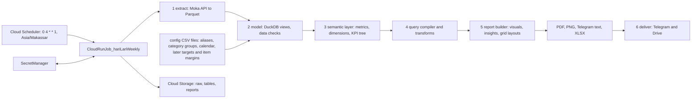

# Hari Lari go-live: weekly Moka report in Google Cloud plus a reporting framework for driving reports

This is the Cursor version of [docs/go-live-plan.md](hari-lari-analytics/docs/go-live-plan.md), with a status and a suggested LLM for every task. All paths are relative to `hari-lari-analytics/`.

## Legend

- **Status:**
  - `done`: finished.
  - `partial`: some of the work exists.
  - `todo`: not started.
  - `decision`: needs your call.
  - `manual`: you do it in a console or app.
  - `optional`: nice to have.
- **Suggested LLM** (match the model to the task):
  - **Opus 5.5:** design work, tricky data logic, parity debugging.
  - **Sonnet 5.5:** standard implementation with tests.
  - **GPT-5.4 nano:** small mechanical edits, docs and config.
  - **You:** steps in a console or app that need your login.
- **Size:** S is under an hour, M is a few hours, L is about a day.

## Architecture



## Design choices

- **Cloud Run Job, not Cloud Functions.** It runs our own container, the same code as on the laptop.
- **DuckDB and Parquet, not BigQuery, for v1.** The data is a few MB, so this needs no extra service and costs nothing.
- **Full pull every week, nothing incremental.**
- **Region `asia-southeast2` (Jakarta).**
- **Cost:** expect about 0 USD a month, inside the free tier.
- **Sequence:** go live with today's PDF fed from the API (phases 1 to 6). Build the framework (phases 7 and 8), prove it on new components and swap in the component report once its numbers match the old one (phase 9). Phase 10 builds the driving reports on top.
- **Framework first, measured on new work.** The goal of phases 7 to 9 is a framework in which a new component takes under 30 minutes and usually only YAML, and in which reports explain why a number moved. Success is measured on components the old report never had (9.1), not on reproducing the old PDF pixel for pixel.
- **Own framework, borrowed concepts.** Models follow dbt's layers and stay plain SQL; metric kinds follow dbt's semantic layer (MetricFlow). The presentation layer, the KPI tree and the push delivery are ours. Design: [docs/components.md](hari-lari-analytics/docs/components.md).

## Known data issues to fix

- **Broken key on the lines table.** [extraction/moka/extract.py](hari-lari-analytics/extraction/moka/extract.py) `Table.add` does `{**parent, **flat(rec)}`. The line's own `payment_id` (always 0) therefore overwrites the parent key.
- **Wrong time zone label.** API timestamps say `+07:00`, but the clock time already equals Bali local time. Drop the offset; do not convert.
- **Refunds have the opposite sign.** A refund is a second payment with the same `payment_no`, positive amounts and `parent_payment_id` set.
- **The token expires on 11 May 2027.** It has a refresh token, which [extraction/moka/moka_client.py](hari-lari-analytics/extraction/moka/moka_client.py) currently refreshes only within 1 hour of expiry.

---

## Phase 0: Decisions

- **0.0** Write the go-live plan document. Status: done. LLM: Opus 5.5. Size: S.
- **0.1** Choose the Google Cloud project. Status: done. Decision: a new dedicated `hari-lari-analytics` project (add a suffix if the ID is taken).
- **0.2** Choose what gets sent to the group. Status: done. Decision: the cover PNG and the PDF go in Telegram, plus a message with a Google Drive link to the PDF and Excel lines file. New scope: upload to Drive with the `hari-lari-job` service account (enable the Drive API, share a folder with the service account), add the link to the caption (4.8), and add a Drive upload step to the orchestration (5.1). `deliver/telegram.py` (4.7) no longer sends the Excel.
- **0.3** Choose the group members. Status: done. Decision: owners and managers only. The Drive folder is restricted to named Google accounts. The Excel file (no names) is fine for them. Open item: the member list and their Google emails, collected in phase 4.
- **0.4** Choose where failure alerts go. Status: done. Decision: a private admin chat with the bot, plus the Cloud Monitoring email alert (3.13) as a backup.
- **0.5** Confirm the report anchor. Status: done. Decision: yesterday (Sunday, Bali date), with a manual `--anchor` override.

## Phase 1: Harden the extraction

- **1.0** Write the full-history extractor (`extraction/moka/extract.py`). Status: done (works locally). LLM: Opus 5.5.
- **1.1** Commit `extraction/` on a branch. Done when `git status` is clean. Status: done. LLM: GPT-5.4 nano. Size: S.
- **1.2** Fix the parent-key overwrite in `Table.add`: parent keys win, and child fields that clash get a prefix. Done when `transaction_lines.payment_id` matches `transactions.id` on 100% of rows. Status: done. LLM: Sonnet 5.5. Size: S.
- **1.3** Add a test for 1.2 on a saved JSON fixture: one payment with two lines, a discount and a modifier. Status: done. LLM: Sonnet 5.5. Size: S.
- **1.4** Move the extraction into `src/hari_lari_analytics/extract/` and add a `hari-lari-extract` command. Status: done. LLM: Sonnet 5.5. Size: M.
- **1.5** Use explicit 120-second timeouts and keep the retry, backoff and request log. Status: done. LLM: Sonnet 5.5. Size: S.
- **1.6** Add a `TokenStore` interface with two backends: local file and Secret Manager. A refresh writes a new secret version. Status: done. LLM: Opus 5.5. Size: M.
- **1.7** Refresh the token when fewer than 30 days remain, and test it with a fake clock. Status: done. LLM: Sonnet 5.5. Size: S.
- **1.8** Run one real refresh by hand to learn whether Moka rotates the refresh token, and note the result. Status: done (the refresh token IS rotated; every refresh must be saved, see 1.6). LLM: You (with Sonnet 5.5). Size: S.
- **1.9** Make the output location configurable (local folder or `gs://...`) and write Parquet. Status: done. LLM: Sonnet 5.5. Size: M.
- **1.10** Parse timestamps as naive local clock time (drop the offset), with a test. Status: done. LLM: GPT-5.4 nano. Size: S.
- **1.11** Add sanity checks that fail the run: zero payments, or last week's receipts missing. A stale last sale only warns. Status: done. LLM: Sonnet 5.5. Size: S.
- **1.12** Write a `manifest.json` per run: row counts, first and last sale, number of calls, duration, token expiry. Status: done. LLM: GPT-5.4 nano. Size: S.

## Phase 2: The report reads API data

- **2.1** Write `load_api.py`, which reads the Parquet tables of one run. Status: done. LLM: Sonnet 5.5. Size: S.
- **2.2** Map API lines to the cleaned line schema of [src/hari_lari_analytics/clean.py](hari-lari-analytics/src/hari_lari_analytics/clean.py) and add the ids: payment, item, variant and category. Status: done. LLM: Sonnet 5.5. Size: M.
- **2.3** Turn refund payments into negative quantity, with the amount in `refunds`. Done when `Gross - Discounts - Refunds = Net` holds on every line. Status: done. LLM: Opus 5.5. Size: M.
- **2.4** Derive the adjusted item and category by `item_id` from today's items. Fall back to `config/item_aliases.csv` for deleted items. Status: done. LLM: Opus 5.5. Size: M.
- **2.5** Take the payment type from `payment_type_label` and the discount code from `transaction_line_discounts.discount_name`. Status: done. LLM: GPT-5.4 nano. Size: S.
- **2.6** Parity test against the back-office CSV for 1 Jan to 31 Oct: 948 receipts and 1,700 lines. The only allowed difference is the refund of receipt `1O4S7G`. Status: done (the API data matches the CSV line for line, including the refund of `1O4S7G`, so there is no difference at all). LLM: Opus 5.5. Size: M.
- **2.7** Add `--source api|csv` and `--anchor` (default yesterday) to [src/hari_lari_analytics/cli.py](hari-lari-analytics/src/hari_lari_analytics/cli.py). Status: done (`--source` defaults to `csv` for now; the anchor defaults to yesterday for `api` and to the last sale date for `csv`, so old exports still work). LLM: Sonnet 5.5. Size: S.
- **2.8** Compare the API-based PDF with the CSV-based one page by page. Status: done (pages 2 to 10 are pixel-identical; the cover differs only in the "Input files" line; signed off). LLM: You (with Opus 5.5). Size: S.
- **2.9** Also render the cover as a PNG. Status: done. LLM: GPT-5.4 nano. Size: S.
- **2.10** Update the README and METRICS.md: API source, refund rule, time zone rule, anchor rule. Status: done. LLM: GPT-5.4 nano. Size: S.
- **2.11** Add `config/category_group.csv`, a hand-maintained mapping from adjusted category to `category_group_level_1` (values: `food`, `drink`, `consignment`), same style as [config/item_aliases.csv](hari-lari-analytics/config/item_aliases.csv). Columns: `category,category_group_level_1,category_group_level_2`. Level 2 is optional and may stay empty at first (for example coffee, tea or bakery under drink or food). Write a loader with validation: no duplicate category, level 1 limited to the three values, and a warning (not a failure) for categories in today's data that have no group, which land in `unmapped`. Join the groups onto the cleaned lines by adjusted category, and test it on a small fixture. Status: done (`config/category_group.csv` covers every live and deleted category; `Custom Amount` and `Other` (non-food entries) are deliberately left `unmapped`, and so is the unused `Bundle_Package`; loader `load_category_groups` in `load.py`, join `add_category_groups` in `dimensions.py`, `--category-groups` flag). LLM: Sonnet 5.5 (GPT-5.4 nano for the first CSV draft, which you check). Size: S.

## Phase 3: Google Cloud infrastructure

These steps are scripted as `gcloud` commands in `deploy/setup.sh`. Phase status: completed.

- **3.1** Install and authenticate the `gcloud` CLI in WSL. Status: done. LLM: You. Size: S.
- **3.2** Create the project and link billing. Status: done (project `hari-lari`, billing linked). LLM: You. Size: S.
- **3.3** Enable the APIs: run, cloudscheduler, secretmanager, artifactregistry, cloudbuild, storage, logging and monitoring. Status: done (also drive and billingbudgets). LLM: GPT-5.4 nano. Size: S.
- **3.4** Create a budget of 5 USD a month with alerts at 50% and 100%. Status: done (created by CLI: 120 CZK, about 5 USD, because the billing account is in CZK; alerts at 50% and 100%). LLM: You. Size: S.
- **3.5** Create a private bucket in `asia-southeast2`, with raw JSON moving to Nearline after 90 days. Status: done (`gs://hari-lari-data`, Nearline after 90 days for `raw/`). LLM: GPT-5.4 nano. Size: S.
- **3.6** Create the service account `hari-lari-job` with least-privilege roles: bucket object admin, plus secret accessor and secret version adder on the token secret. Status: done (`hari-lari-job`, plus an invoker account `hari-lari-scheduler`). LLM: Sonnet 5.5. Size: S.
- **3.7** Create the secrets: Moka client id and secret, `moka-oauth-token` (version 1 from `.token.json`), Telegram token, chat id and admin chat id. Status: done for the Moka secrets; Telegram secrets exist but are empty until phase 4. LLM: You. Size: S.
- **3.8** Create the Artifact Registry repository `hari-lari`. Status: done. LLM: GPT-5.4 nano. Size: S.
- **3.9** Write a `Dockerfile`: `python:3.13-slim`, `uv sync --frozen --no-dev`, entry point `hari-lari-weekly`. Status: done (`Dockerfile`; the entry point is `hari-lari-extract` until phase 5 adds `hari-lari-weekly`). LLM: Sonnet 5.5. Size: M.
- **3.10** Build and push the image with Cloud Build. Status: done. LLM: GPT-5.4 nano. Size: S.
- **3.11** Create the Cloud Run Job: 1 CPU, 1 GiB, 20-minute timeout, 1 retry, secrets as environment variables, `TZ=Asia/Makassar`. Status: done (a real execution succeeded and wrote Parquet to `gs://hari-lari-data/raw/2026-11-22/`). LLM: Sonnet 5.5. Size: S.
- **3.12** Create the Scheduler job `0 4 * * 1` in `Asia/Makassar`, calling the job through an invoker service account. Status: done (created and PAUSED until 6.4). LLM: Sonnet 5.5. Size: S.
- **3.13** Add a log-based email alert when a job run fails. Status: done (policy "Hari Lari job failed", email to harilari.bali@gmail.com). LLM: Sonnet 5.5. Size: S.

## Phase 4: Telegram bot and group

- **4.1** Create the bot with `@BotFather` using `/newbot`, and store the token only in Secret Manager. Status: done (`@HL_Reporter_bot`; token in `telegram-bot-token`, rotated once after it was pasted in chat). LLM: You. Size: S.
- **4.2** Set the bot's profile. Turn joining groups off again after 4.4 (`/setjoingroups`). Status: done. LLM: You. Size: S.
- **4.3** Create the group "Hari Lari - Weekly Report" and add the members. Status: done ("HL Reporting" with emojis; upgraded to a supergroup). LLM: You. Size: S.
- **4.4** Add the bot to the group. Status: done. LLM: You. Size: S.
- **4.5** Get the chat ids through `getUpdates`: the group id (starts with `-100`) and the admin chat id. Store both. Status: done (group `-100...` in `telegram-chat-id`, admin private chat in `telegram-admin-chat-id`; test message, a real cover + PDF with caption, and a test alert all arrived in the admin chat; a test message arrived in the group). LLM: You. Size: S.
- **4.6** Add a runbook note that the chat id changes when the group becomes a supergroup. Status: done (`docs/runbook.md`). LLM: GPT-5.4 nano. Size: S.
- **4.7** Write `deliver/telegram.py`: `sendPhoto` for the cover, `sendMediaGroup` for the PDF and Excel, retry on 429 using `retry_after`, and a 50 MB guard. Status: done (`deliver/telegram.py`, stdlib only, token scrubbed from errors; changed from the plan: `sendPhoto` for the cover and `sendDocument` for the PDF, because Telegram cannot mix photos and documents in a media group and the Excel goes to Drive per 0.2; helper CLI `hari-lari-telegram whoami|chat-ids|ping|send-report`). LLM: Sonnet 5.5. Size: M.
- **4.8** Write the caption: week and dates, net sales, orders and AOV with change vs prior, and the last sale timestamp, plus the Drive link once phase 5 has it. Status: done (`deliver/caption.py`, `build_caption(lines, anchor, drive_url)`; week = 7 days ending on the anchor). LLM: Sonnet 5.5. Size: S.
- **4.9** Write `send_alert` to the admin chat: which step failed, a short error and a link to the logs. Status: done (`send_alert`, never raises, links to the Cloud Run execution logs). LLM: GPT-5.4 nano. Size: S.

## Phase 5: Weekly orchestration

- **5.1** Write the `hari-lari-weekly` command: extract, model, report, upload, deliver, with each step timed. Status: done (`hari-lari-weekly`, package `weekly/`; a real local run with `--to admin` sent the cover, the PDF and the caption with the Drive link to the admin chat in 114 s; Drive step: because a service account has no storage quota in a normal Drive, the upload runs as harilari.bali@gmail.com through a one-time OAuth consent (`hari-lari-drive`, secrets `drive-oauth-*`), into a week folder `<anchor> (week N)` of the folder in `DRIVE_FOLDER_ID`, which is the "Weekly Sales Reports" folder; a failing Drive step warns the admin and the report goes out without the link). LLM: Sonnet 5.5. Size: M.
- **5.2** Add `--dry-run`: everything except sending, with output under a `dry-run/` prefix. Status: done (also no Drive upload, no marker, no admin alerts; real dry run against the Moka API verified). LLM: GPT-5.4 nano. Size: S.
- **5.3** Make sending idempotent with a sent-marker per anchor in the bucket, and a `--force` override. Status: done (marker `sent/<anchor>.json`; a private `--to admin` run neither reads nor writes it; a failing marker write only warns, because a non-zero exit would make Cloud Run retry and send twice). LLM: Sonnet 5.5. Size: S.
- **5.4** Wrap each step so a failure sends the admin alert and exits non-zero. Status: done (verified with a real run that has no sales: ERROR log, admin alert, exit 1). LLM: Sonnet 5.5. Size: S.
- **5.5** Log in structured JSON with a `severity` field. Status: done (`weekly/log.py`; every line has `step`). LLM: GPT-5.4 nano. Size: S.
- **5.6** Send a token-expiry reminder when fewer than 45 days remain. Status: done (`token_expiry_notice`, fake-clock tests; the expiry date was already in the manifest). LLM: GPT-5.4 nano. Size: S.

## Phase 6: Go live

- **6.1** Do a manual dry run in the cloud. Status: done (2026-11-23: image rebuilt from `main` at `1625dee`, job updated with the Telegram and Drive secrets and `DRIVE_FOLDER_ID`; execution `hari-lari-weekly-nt92k` finished in 127 s: extract, model, report and upload to `dry-run/reports/2026-11-22/` all succeeded, nothing sent). LLM: You. Size: S.
- **6.2** Do a real run that sends to the admin chat instead of the group. Status: done (2026-11-23: execution `hari-lari-weekly-nrnqg`, 81 s, no warnings or errors; Drive upload ok, report for 2026-11-22 sent to the admin chat, no sent-marker written). LLM: You. Size: S.
- **6.3** Check readability on a phone inside Telegram. Status: done (2026-11-23: confirmed by you on the admin-chat report). LLM: You. Size: S.
- **6.4** Switch to the group chat id and enable the scheduler. Status: done (2026-11-23: the job reads the group id from `telegram-chat-id` (no `--to admin`), scheduler `hari-lari-weekly` is ENABLED, `0 4 * * 1` Asia/Makassar; next run 2026-11-30 04:00 WITA, and reports the week 23-29 Nov, anchor Sunday 2026-11-29; verified by a real send of the 2026-11-22 report to the group, confirmed by you: cover with caption plus PDF). LLM: You. Size: S.
- **6.5** First live Monday: check at 04:10 WITA that the report arrived. Status: manual. LLM: You. Size: S.
- **6.6** Write `docs/runbook.md`: re-running a week, re-authorising the token, adding members, what each alert means. Status: todo. LLM: Sonnet 5.5. Size: M.
- **6.7** Remove the CSV source after four good Mondays. Status: todo. (`config/item_aliases.csv` was already shortened from 22 to 11 rows after phase 2; the CSV source now needs the frozen full copy in `tests/fixtures/item_aliases_full_2026-11.csv`, so delete that copy and its use in the parity test too.) LLM: GPT-5.4 nano. Size: S.

---

## Phase 7: Framework core

The goal of phases 7 to 9 is a framework in which a new component takes under 30 minutes and usually only YAML, a new report only YAML, and the reports explain why a number moved, not only what it is. The design is in [docs/components.md](hari-lari-analytics/docs/components.md). Four ideas carry it:

- **One query compiler, many transforms.** A component states a semantic query: model, dimensions, metrics, window, comparison and filters. One compiler turns every query into SQL with the same output shape, including what changes the grouping (top N with "Other", time buckets, bins), so distinct order counts and ratios stay correct. Small transforms then reshape the result (per trading day, growth labels, pivot, cumulative share, classify, decompose). Most of today's charts and most of the backlog are one query plus two or three transforms. Only genuinely new logic needs Python, and then it is one transform or one visual that every later component reuses.
- **The semantics live in registries.** Metrics (including filtered metrics such as orders with a drink, and ratios of them), dimensions (including order attributes such as basket size or "has food") and a KPI tree (net sales = orders × AOV; AOV = items per order × average item price; AOV = Σ contributive AOV) are defined once. Components only name them.
- **Every number carries its sample size.** At about 180 orders a week (November 2026), with several categories on fewer than 30 receipts in 14 days, the framework greys out small rows and makes no claims about them, instead of reporting noise.
- **Every result can go to every output:** a PDF slot, a Telegram text line, an Excel sheet. Rule-based insights turn results into short sentences.

A component, new style:

```yaml
id: aov_bridge
title: Why the average order value moved
query:
  model: fct_orders
  metrics: [aov, items_per_order, avg_item_price]
  window: $period
  compare: prior
transforms:
  - decompose: { identity: aov_basket }
visual: { type: waterfall }
insights: [top_drivers]
```

A report places components into a 12-column page grid; the three period sections are one group of pages repeated through `repeat: { period: [L14D, L6W, L3M] }`, and any other parameter (for example the top 5 categories) can be repeated the same way. The phase ends with a tracer check (7.15): two components run through the whole core and match today's numbers.

- **7.1** Write the design note `docs/components.md`. Status: done (2026-11-24: first version agreed with decisions D1 to D4; revised the same day for the framework-first goal: one query compiler with composable transforms instead of one Jinja pattern per chart, filtered metrics, order and item attributes, calendar events, data checks, a KPI tree with exact decomposition, sample sizes, rule-based insights, grid layouts, four outputs, any report parameter and developer tooling; D1 and D2 stay, D3 and D4 changed, D5 to D10 added). LLM: Opus 5.5. Size: M.
- **7.1b** Review the revised note and confirm or change decisions D3 to D10 before 7.3. Status: done (2026-11-24: all of D3 to D10 confirmed as proposed, one by one; D8 clarified: no dbt installation and no extra cost, DuckDB runs in-process in the existing job). LLM: You. Size: S.
- **7.2** Add the dependencies `duckdb`, `pyyaml`, `jinja2` and `pydantic`. Status: done (2026-11-24: `uv add` put `duckdb>=2.0.1`, `jinja2>=3.1.6`, `pydantic>=2.14.4` and `pyyaml>=6.0.4` in `pyproject.toml` and `uv.lock`; imports work and all 157 tests pass; the revision needs no further dependency, since pydantic also writes the JSON Schema of 7.12). LLM: GPT-5.4 nano. Size: S.
- **7.3** Build the data models as DuckDB views in the layers `seed_`, `stg_`, `int_`, `dim_` and `fct_`, with the cleaning rules of `load_api.py` and `clean.py` inside them: refund lines, fully refunded receipts, the item and category resolution by id with the alias fallback, Custom Amount and variant capitalisation (this absorbs the old task 7.4). Besides `fct_sales_lines`, build `fct_orders` with order attributes (items, lines, weekday, hour, payment type, `has_food`, `has_drink`, `has_consignment`, `has_discount`, `has_modifier`), also joined onto the lines so filtered metrics work on both; `dim_items` with each item's first and last sale; `dim_categories` with the category groups; and `dim_calendar`, one row per day from the first sale to the anchor with `is_trading_day`. Join the category groups by adjusted category name, not by `category_id`: Moka reuses ids with a new meaning (`7436715` was "Minuman Kulkas" before it became "Non Coffee"). Carry the line `note` into `fct_sales_lines` for 10.3, but never into the Excel export, because free text may contain names. Done when `fct_sales_lines` equals the pandas lines row for row on the fixture and on the run of 2026-11-22. Status: done (2026-11-24, branch `framework-core`: `reporting/db.py` registers the run tables as typed `raw_` views (an empty Parquet table has no columns, so optional tables may be missing or empty) and the config files as `seed_` views, puts the anchor in `run_context`, and builds 16 SQL models in `reporting/models/` in dependency order, refusing upward references; `tests/test_models.py`: `fct_sales_lines` equals the pandas lines on all 40 columns on the fixture (two anchors) and on the run of 2026-11-22 (2,707 lines), and a perturbation of any column fails the test; `fct_orders` has 1,499 receipts, 1,497 of them orders, with the same net sales (107,559,625 IDR) as the lines; `fct_orders` dates a receipt at its payment, so a refund on a later day would land on the sale day there and on the refund day in `fct_sales_lines`, but both refunds so far were same-day). LLM: Opus 5.5. Size: L.
- **7.4** Add `config/calendar_events.csv` (`date_from,date_to,kind,name`, with kinds `holiday`, `closure`, `promotion` and `other`), a loader with validation, and the join into `dim_calendar` and `fct_orders`. Fill it with the Balinese and national holidays from 23 Jul 2026 to the end of 2027 (Galungan, Kuningan, Nyepi and others) and the closures you know. Status: done (2026-11-24: loader `load_calendar_events` in `load.py` (dates, `date_to` >= `date_from`, kinds, names, duplicates; empty `date_to` = one day; overlaps allowed); seed `seed_calendar_events`; `dim_calendar` gets `event_kind` (closure > holiday > promotion > other), `event_name` (names joined by ' + '), `is_holiday`, `is_closure`, `has_promotion`, and `fct_orders` and `fct_sales_lines` get the event of their day. The file holds the national holidays and cuti bersama of the SKB lists for 2026 and 2027, Galungan, Umanis Galungan, Kuningan, Saraswati, Pagerwesi and Nyepi, a closure on Nyepi 2027, and all 32 days without sales up to 22 Nov 2026 as closures named "Closed": you confirmed that a day without sales was always a closure, sometimes for internal reasons. A test checks this on the run of 2026-11-22. From now on, add each closure when it happens; 7.5 will warn about a day without sales and without a closure). LLM: Sonnet 5.5, with you checking the dates. Size: S.
- **7.5** Write the data checks `checks.yml`, run on every build and failing the run (with the admin alert in the weekly job): unique keys, not null, accepted values, relationships between facts and dimensions, `Gross - Discounts - Refunds = Net` on every line, and line totals equal to order totals. Status: done (2026-11-24: `reporting/checks.py` and `checks.yml`, 39 checks with pydantic-validated YAML, `severity: warn` and `message`, samples of the failing rows, `totals` over whole models; `open_run` builds, checks and raises `DataCheckError` on errors; on the run of 2026-11-22: no errors, one warning (the deliberately unmapped `Custom Amount` and `Other`). Decision: the live weekly job stays untouched; the checks join it at 9.6, when the job builds the component report. The builder now creates each model once as a table: as stacked views, the checks took 40 s, as tables 0.07 s, with a 0.3 s build). LLM: Sonnet 5.5. Size: S.
- **7.6** Write the registries `metrics.yml` and `dimensions.yml`. Metric kinds: `sql` (an aggregate per model), `filtered` (a base metric restricted by dimension values, compiled to an aggregate `filter (where ...)`), `derived` (an expression over other metrics, such as AOV or an attach rate) and `relative` (uses the total of the filter: penetration, share, contributive AOV). Every metric has a label, description, format, `up_is_good`, additivity and the sample-size rule `min_n` (default: 30 orders). Dimensions have a grain (`line`, `order`, `item` or `day`), the models they exist on, a sort, a domain for empty values and optional bins. Define every metric of METRICS.md plus `share`, `discount_rate`, `items_per_order`, `avg_item_price`, `net_sales_per_trading_day`, the orders with food or a drink and the food and drink attach rates; the dimensions include the category groups of 2.11 and the order attributes of 7.3. Status: done (2026-11-24: `reporting/registry.py` loads `metrics.yml` (22 metrics: the 12 of METRICS.md plus `share`, `discount_rate`, `items_per_order`, `avg_item_price`, `net_sales_per_trading_day`, `food_orders`, `drink_orders`, `food_and_drink_orders`, `food_attach_rate` = orders with a drink that also have food ÷ orders with a drink, and `drink_attach_rate` the other way round) and `dimensions.yml` (36 dimensions: time truncations, weekday, calendar events, order attributes with `basket_size` and `order_line_count` as bins, items, categories, category groups, discount code, modifiers), checked against each other and the models with readable errors that name the file and entry. A `sql` metric is one aggregate per model, parsed, so a `filtered` metric adds its condition to the aggregate's own filter; `up_is_good: null` means neutral; dimensions get the grain `item` for item and category attributes (several per receipt), `labels` and `null_label`. The registry hands the compiler the aggregate of a metric per model, the expression of a derived or relative metric, and a plan with every input in order. Tests: every metric runs on both fact models, hand-computed values on the fixture, and parity with the pandas `compute_metrics` and `contributive_aov` on the fixture and on the run of 2026-11-22). LLM: Opus 5.5. Size: M.
- **7.7** Write the KPI tree `kpi_tree.yml`: identities of kind `product` (net sales = orders × AOV; AOV = items per order × average item price; contributive AOV = penetration × category AOV), `sum` (net sales = gross sales - discounts - refunds) and `sum_over` (AOV = Σ contributive AOV over the categories). Test that every identity holds on the run of 2026-11-22, to rounding. Status: done (2026-11-24: 7 identities: `sales_volume_value`, `net_from_gross`, `aov_basket`, `aov_by_category` and `aov_by_category_group` (each with `then: category_slice`), `category_slice` and `net_sales_by_category`; validated when loading (known metrics, a fully additive driver for `sum_over`, `then` matching the driver). `tests/test_kpi_tree.py` checks each identity on every model it exists on, over the full history and L14D, L6W and L3M, on the fixture and the run of 2026-11-22 (relative tolerance 1e-9; 106 checks on the real run, the category slices per category included); a wrong identity fails, and the worked example of `docs/components.md` is reproduced exactly). LLM: Opus 5.5. Size: S.
- **7.8** Write the window resolver: L14D, L6W, L3M, full, WTD, MTD and `last_n_days`, `last_n_weeks`, `last_n_months`; the comparison `prior`, `last_year` or `none`; the time grains day, week, month and 7-day blocks counted back from the window end (for sparklines); and the trading days per window. It wraps [src/hari_lari_analytics/periods.py](hari-lari-analytics/src/hari_lari_analytics/periods.py) and keeps its tests. `last_year` has no data until late July 2027 and shows `n/a` until then, like any comparison that starts before the first sale. Status: done (2026-11-24: `reporting/windows.py`, built on `periods.py`, which now has `last_n_days`, `last_n_weeks`, `last_n_months`, `week_to_date`, `month_to_date` and `full_history` (the old functions delegate, `test_periods.py` unchanged); names `L<n>D`, `L<n>W`, `L<n>M` or `last_n_*(n)`, `WTD`, `MTD`, `full`. Decision (you): `prior` is the same length directly before, except a day window shorter than a week (compared with the same weekdays a week earlier, so a Saturday with the Saturday before), `WTD` (the same weekdays a week earlier) and `MTD` (the same days of the month before, cut to its last day). `last_year` shifts by 364 days, or by 12 months for month windows, `MTD` and `full`. `Calendar.from_db` reads the anchor, first sale and trading days from the models; buckets per grain, 7-day blocks counted back from the window end, and the bucket before the window for growth labels. Tests: the old period cases through the resolver, every window and comparison, buckets, and the trading days equal those of `report_data.build_section`). LLM: Sonnet 5.5. Size: M.
- **7.9** Write the query compiler: a semantic query (model, dimensions, metrics, window, comparison, filters, `totals`, `keep_prior_only`, `top` with an optional "Other" row, time grain, bins, and extra buckets before the window for growth labels) becomes one SQL statement, with the current and prior period together, totals through `GROUPING SETS` and filters as bound parameters. It runs in DuckDB and returns a `Result` in one output convention: dimension columns, metrics, `prior_*`, `*_change`, `*_delta`, `is_total` and `n_orders`, plus `ResultMeta` (windows, `compare_ok`, `empty`, metric specs, trading days, result shape and the SQL). A registered Python `@query` is the escape hatch for sources that are not SQL aggregates: the data notes from the run manifest and the Excel lines export. Status: done (2026-11-24: `reporting/compiler.py` (pydantic `Query`, strict; `compile_query` and `run_query`), `reporting/result.py` (`Result`, `ResultMeta`, `BucketInfo`) and `reporting/queries/` (`@query`, `QueryContext`, `SourceQuery`, `execute`, `parse_query`; sources `notes` and `lines_export`). One statement per query: window rows, top-N mapping, aggregates with `GROUPING SETS`, a frame of output rows with current and prior joined, trading days from `dim_calendar`, then derived and relative metrics and changes; filter values are bound parameters; about 30 to 60 ms per query on the real run. Choices made on the way, documented in `docs/components.md`: a new time dimension `bucket` in the query's grain (`sale_date`, `sale_week` and `sale_month` bring their own); a series fills every bucket for every group and is compared with the prior bucket by bucket, by position; in a series a relative metric uses the total of its bucket, and `totals: true` adds a total row per bucket; `top` ranks over the current window, the prior of "Other" holds everything outside the top N, and without `other` the totals and shares still cover all groups (found by the parity test: today's top 15 items divide by all net sales); every row gets `trading_days` (per bucket, per weekday or other calendar value, else the window's), so every dimension of grain day is now also on `dim_calendar` (registry check); extra output columns `is_other`, `in_window`, `prior_n_*`, `prior_trading_days`; query options `bins` (override) and `buckets_before`; `keep_prior_only` refuses a time dimension or `top`. `tests/test_compiler.py` (67 tests): hand-computed cases on the fixture, 15 invalid queries with their messages, the two sources, and parity with `report_data.Section` for the anchor 2026-11-22 in L14D, L6W and L3M: KPIs and first and last sale, categories with prior-only rows and the total (same order), top 15 items, payment types, discounts by code, orders by hour per trading day, the trend with prior and growth, and the sparklines. Open for 9.3: the `notes` source has the run, the manifest warnings and the data-check warnings, but not yet today's cleaning notes (items outside the catalog, items ending up Uncategorized, refund amount gaps); those become warn checks when the data notes are ported). LLM: Opus 5.5. Size: L.
- **7.10** Write the transform library: pure functions from `Result` to `Result` that never query the database, each with an options schema, its requirements on the query (added or checked by the loader) and a hand-computed test: `sort_limit`, `rank`, `fill_domain`, `per_trading_day` (per window, or per weekday from `dim_calendar`), `growth_vs_previous`, `cumulative_share` (fully additive metrics only), `pivot`, `classify` (thresholds, quadrants, item lifecycle) and `suppress_small_n`. Status: done (2026-11-24: package `reporting/transforms/` with the `@transform` registry (`__init__.py`: pydantic options, accepted result shapes, `Requirements`, `parse_step`, `apply`, `run_pipeline`, and `plan_query`, which the loader of 7.12 calls to add buckets before the window and metrics and to fail on a missing dimension or comparison), `shape.py` (`sort_limit`, `rank`, `fill_domain`, `pivot`), `time.py` (`per_trading_day`, `growth_vs_previous`), `share.py` (`cumulative_share`), `classify.py` (thresholds, quadrants, item lifecycle) and `quality.py` (`suppress_small_n`, `small_n_mask`). `ResultMeta` gained `matrix` and `classifications` (the splits a scatter visual draws) and the compiler now puts the bins a query used into the result's dimensions, so `fill_domain` fills exactly those. `tests/test_transforms.py`: 54 tests, hand-computed on the fixture and on made-up results, and parity with `report_data` on the real run for the hours per trading day (`fill_domain` + `per_trading_day`) and the growth labels. Choices you may want to revisit: a filled row has no comparison, because the query drops groups without sales in the current window, so what the prior window held for them is unknown; `per_trading_day` gives no value for a row with 0 trading days (a weekday nobody sold on); `growth_vs_previous` skips the daily grain by default, as today's report does; the item lifecycle is decided from the comparison period alone ("new" = nothing sold in the prior period, rising and fading at ±25%, skipped when both periods have fewer than `min_n` = 15 orders with the item, an option; the default metric rule of 30 would classify 18 of 99 items over L6W, 15 classifies 32), documented in `docs/components.md`. Not done here: the options JSON Schema (7.12), `decompose` (7.11)). LLM: Sonnet 5.5. Size: M (about 9 tasks of S).
- **7.11** Write the `decompose` transform: it splits the change of a KPI between the prior and the current period over the drivers of one KPI-tree identity, so that the effects add up to the change exactly. It uses log-mean (LMDI) weights for products, differences for sums, one row per member for `sum_over`, and goes one level deeper on request (AOV, then the categories, then penetration and category AOV per category). New or vanished members are shown whole. Test it on hand-computed cases and on the worked example in the design note. Status: todo. LLM: Opus 5.5. Size: M.
- **7.12** Write the component schema and loader with pydantic: strict (an unknown key fails, naming the file and field); `query`, `transforms`, `visual`, `insights`, `facet`, `title`, `hint` and default `params`; parameters (`$period`, `$category`, `$item`, `$payment_type` or any parameter a report declares); overrides from a report slot with `with:`; the additivity check for transforms and visual options that sum rows; and the JSON Schema export, referenced from each YAML file for autocompletion and validation in the editor. Status: todo. LLM: Sonnet 5.5. Size: M.
- **7.13** Write the facet engine: repeat a component inside one slot by dimension value (all, a list, or the top N decided once over the component's own window), by period or by metric. Status: todo. LLM: Opus 5.5. Size: M.
- **7.14** Write the developer CLI `hari-lari-component`: `run <id> --period L6W [--anchor] [--sql] [--csv]` prints the result and its SQL; `validate` checks every component and report; `new <id> [--from <id>]` scaffolds a component with its snapshot test; `schema` writes the JSON Schema. Status: todo. LLM: Sonnet 5.5. Size: M.
- **7.15** Tracer check, the exit of phase 7: the full-history KPIs and `category_contributive_aov` run through the whole core and equal `report_data.Section` for the anchor 2026-11-22 in all three periods. Status: todo. LLM: Opus 5.5. Size: S.

## Phase 8: Presentation and outputs

Visuals draw and never compute. Pages are a grid, so placing or moving a component is a YAML change. One report writes a PDF, PNG pages, Telegram text and an Excel file.

- **8.1** Create the visual registry and theme: move the building blocks out of [src/hari_lari_analytics/report_pdf.py](hari-lari-analytics/src/hari_lari_analytics/report_pdf.py) unchanged (`Palette`, the formats `idr`, `pct`, `compact`, `headline` and `change_text`, and the card, chips, sparkline, table and bar column helpers) into `reporting/visuals/`, so the old report imports them and still renders identically. A visual is `(fig, rect, result, options, theme)`, declares its options schema, its minimum size and the result shapes it accepts, and does no data work. Status: todo. LLM: Sonnet 5.5. Size: M.
- **8.2** Write the core visuals, each with a rendering test on the fixture: `kpi_card` (value, change, prior, sparkline), `table` (bars, deltas coloured by `up_is_good`, total row, rank), `bar_trend` (prior ticks, growth labels), `hbar`, `dot_plot`, `stacked_share_bar`, `heatmap`, `scatter_quadrant`, `waterfall` (for `decompose`), `text_line` and `notes_card`. Rows below the sample-size rule are greyed out with their `n` shown. Status: todo. LLM: Sonnet 5.5. Size: L (about 11 tasks of S or M).
- **8.3** Write the insight engine: rule types in Python, rules in `insights.yml`. Rules read results and return scored sentences: the largest drivers of a change (from `decompose`), the biggest movers in a breakdown, threshold crossings, records since the first sale, and data notes. No sentence about fewer orders than the metric's `min_n`, and none without a valid comparison. A component lists its rules; the report collects, ranks and de-duplicates the sentences, and shows them through an `insights` visual and as plain text. Status: todo. LLM: Opus 5.5. Size: M.
- **8.4** Write the grid layout engine: a page is a 12-column grid with row heights; a slot names a component with its row, column, span and height; the page chrome (header chips, footer, the note when a comparison starts before the first sale) comes from the report context. The engine checks each visual's minimum size, and a test fails when any text overflows its slot. Status: todo. LLM: Sonnet 5.5. Size: M.
- **8.5** Write the report builder: report YAML with parameters and repeats over any parameter (a list of periods, the top 5 categories), `when_empty`, and the outputs PDF, PNG of chosen pages, Telegram text (text blocks of components, insights and template lines, checked against Telegram's 1,024-character caption limit; values known only at delivery, such as the Drive link, are filled in by the deliver step) and XLSX (one sheet per listed component, plus the lines export). Command: `hari-lari-report build --report weekly --run <run> [--anchor]`. Status: todo. LLM: Opus 5.5. Size: L.
- **8.6** Add previews: `hari-lari-component run <id> --png` renders one component at its default slot size, and `--watch` re-renders it on every save. Status: todo. LLM: Sonnet 5.5. Size: S.
- **8.7** Build the gallery and snapshots: a gallery report generated from all components on the test fixture, and a golden result per component in `tests/snapshots/` (refreshed on purpose with an update flag), so a change to the compiler, a transform or a metric shows exactly which components it moves. Status: todo. LLM: Sonnet 5.5. Size: M.
- **8.8** Write the authoring guide: a README section and a Cursor rule `.cursor/rules/reporting-components.mdc` for `src/hari_lari_analytics/reporting/**`, covering how to add a metric, a component, a transform, a visual and a report, with two worked examples and the CLI loop. Status: todo. LLM: Sonnet 5.5. Size: S.

The exit of phase 8: a page with the two tracer components renders to PDF, PNG and Telegram text without text overflow.

## Phase 9: Prove the framework, then port and cut over

The live job keeps sending the old report until 9.7. Do not rebuild or redeploy the image just before a Monday without a cloud dry run first (6.1).

- **9.1** Extensibility trial: build three components the old report never had, each time-boxed to 30 minutes and allowed to touch only YAML. (1) Orders per trading day by weekday and hour: `fct_orders`, `per_trading_day`, `pivot`, `heatmap`. (2) The AOV bridge: `decompose` of AOV into items per order and average item price, `waterfall`. (3) The food and drink attach rate: filtered metrics on `fct_orders`, `bar_trend`. Write the time taken and every point where Python was needed into `docs/framework-gaps.md`. Status: todo. LLM: Sonnet 5.5 (Opus 5.5 reviews the gaps). Size: M.
- **9.2** Close the gaps from 9.1 in the framework (a transform, a metric kind, a compiler option, a visual option), then rebuild the affected components in YAML only. If a gap was structural, repeat the trial with one more new component. Status: todo. LLM: Opus 5.5. Size: M.
- **9.3** Port today's report, one component per piece, each with a parity test of its result against `report_data.Section`. The numbers must match; the drawing may improve, so there is no pixel diff. The pieces: full-history KPI cards and the gross, discounts and refunds line; period summary cards with sparklines (facet by period); the data notes from the run manifest; KPI cards with change, prior value and sparkline; the net sales and orders trend with prior ticks and growth labels (Opus 5.5); key figures; categories and contributive AOV with the total and prior-only rows (from 7.15); the penetration dot plot; top 15 items; orders by hour per trading day; payment types with "Other"; discounts by code; page chips and footer; the empty-period page; the Excel lines export. Status: todo. LLM: Sonnet 5.5. Size: L.
- **9.4** Write `reports/weekly.yml` with today's pages in today's order, and its Telegram text output with the content of [deliver/caption.py](hari-lari-analytics/src/hari_lari_analytics/deliver/caption.py). Status: todo. LLM: Sonnet 5.5. Size: S.
- **9.5** Write a second report from existing components only, `reports/category_deep_dive.yml`, repeated over the top 5 categories of the last 6 weeks: penetration and category AOV trend, the category's top items, its hours, and its attach rate with the other group. No new Python; anything that would need Python goes into the gaps file. Status: todo. LLM: Sonnet 5.5. Size: S.
- **9.6** Run side by side for two Mondays: the job also builds the component report under `dry-run/`, the parity tests run on those real runs, and you read both PDFs on your phone. Status: todo. LLM: You (Sonnet 5.5 for the wiring). Size: S.
- **9.7** Cut over `hari-lari-weekly` to the component report and its caption, then delete `report_data.py`, the page methods of `report_pdf.py` and `deliver/caption.py`, and update the README and METRICS.md. Status: todo. LLM: Sonnet 5.5. Size: M.

## Phase 10: Driving reports

Each item is a component, a page or a report built on the framework; the sizes assume phases 7 to 9 are done. The backlog is grouped by the decision it supports and ranked P1 (first), P2 (next) and P3 (only on request); 10.0 may reorder it. Status: all todo. LLM: Sonnet 5.5 unless noted.

Out of scope: the customer branch of the KPI tree, because only 38 of 1,501 receipts (2.5%) in the run of 2026-11-22 have a customer attached; and forecasting, because the history starts on 23 Jul 2026.

**Direction**

- **10.0** Ask the owners after four live Mondays (around 21 Dec): which pages they read, which numbers they acted on, what they missed, and their targets. Record the answers here and reorder this backlog. LLM: You. Size: S.
- **10.1** Weekly v2 (P1): a first page "This week" with the top insights, the drivers of the net sales change along the KPI tree, the KPI cards against target (10.2) and, once 10.5 exists, the recipe margin. The period pages are trimmed to what 10.0 shows is read, or move to the Drive copy only. The Telegram caption carries the top three insights. LLM: Opus 5.5 for the design. Size: M.
- **10.2** Targets (P1): `config/targets.csv` (`period_kind,period_start,metric,value`), the target as a result column for the metrics that have one, target lines on `kpi_card` and `bar_trend`, and an insight rule for the share of target reached. Needs the owners' numbers from 10.0. Size: S.

**Money: revenue leakage, pricing and margin**

- **10.3** Unpriced add-ons (P1): in the run of 2026-11-22, 99 of the 236 line notes mention oat milk, while real modifiers exist only since 21 Nov 2026. A `classify` rule on the line note, with keywords and add-on prices in `config/note_addons.csv`, estimates the revenue not charged per week, so you can see whether the new modifiers stop it. LLM: Opus 5.5. Size: S.
- **10.4** Recipe margins from `config/item_margins.csv` (P1, details below). LLM: Opus 5.5 for the design, Sonnet 5.5 for the code. Size: M.
- **10.5** Recipe margin by item, category and category group, as a table and a trend, always with the margin coverage (P1, depends on 10.4). Size: S.
- **10.6** Discount dependence (P1): the discount rate and the share of orders with a discount over time, by code (`FOUNDER25` is on about 17% of all lines), and with 10.4 the margin given away per code. Size: S.
- **10.7** Menu engineering matrix (P2, depends on 10.4): popularity against recipe margin per item over the last 3 months, in four quadrants (`classify`, `scatter_quadrant`). Size: S.
- **10.8** Payment mix trend with estimated card fees, the rates in `config/payment_fees.csv` (P2). Size: S.

**Costs and profit**

- **10.9** Costs from the expense tracker (P2, after 10.4 and the go-live of `hari-lari-expense-tracking`, its task t28): read the Expenses tab of its production sheet read-only into `stg_expenses`, map the expense categories to P&L lines in `config/expense_group.csv`, and add a weekly and monthly profit estimate: net sales - recipe COGS - expenses. LLM: Opus 5.5. Size: M.

**Staffing and operations**

- **10.10** Staffing page (P2): orders per trading day by weekday (Friday has 427 receipts against 118 on Monday) and the weekday-by-hour heatmap from 9.1, with the calendar events marked. Size: S.
- **10.11** Refund and void log (P3). Size: S.

**Menu and mix**

- **10.12** Penetration and category AOV trend per category, faceted by category (P2). Size: S.
- **10.13** Basket size distribution and its trend (P2): orders average 2 items, and 54% have one line. Size: S.
- **10.14** Item Pareto, as an ABC analysis (P3). Size: S.
- **10.15** New, rising and fading items, from the item lifecycle in `dim_items` (P3). Size: S.

**Data quality**

- **10.16** Category hygiene check as a data note: near-duplicate categories and the 268 Uncategorized lines (P2). LLM: GPT-5.4 nano. Size: S.

**More reports**

- **10.17** Daily flash (P2): `reports/daily.yml`, yesterday against the same weekday a week earlier plus the insights, as Telegram text only to the managers, through a second scheduler at 06:00 WITA. It also shows that a new report is one YAML file and one scheduler. Size: S.
- **10.18** Mirror the data to BigQuery and Looker Studio (P3): only if the owners want to explore the data themselves; the push reports stay the main channel. Size: M.

### 10.4 Recipe margins: config/item_margins.csv

The idea is the same as [config/item_aliases.csv](hari-lari-analytics/config/item_aliases.csv): a small CSV in `config/` that the models join in. Margins live outside Moka for now (only 182 of 2,704 lines have a COGS in Moka). Their source of truth is your Excel recipe workbook, which lives outside this repository; you share it when this task starts. The CSV is a flat export of that workbook. The proposed columns below are a starting point; the real layout of the workbook decides the final shape.

What the numbers mean: this is a **recipe margin**, the margin if every sold item used exactly its recipe. Waste, unsold bakery stock, staff meals and comps are not in it, so the real gross margin is lower. Every margin visual says "recipe margin" and shows the coverage; the profit estimate (10.9) adds the real expenses.

Proposed columns (the consignment row is an invented example):

```text
item,variant,item_variant_id,cost_basis,unit_cost_idr,keep_pct,valid_from,recipe_ref,note
Latte,Hot,,recipe,14500,,2026-08-01,Recipes.xlsx!Latte,
Focaccia Tomato,,,recipe,9800,,2026-08-01,Recipes.xlsx!Focaccia,
HYGO Protein Bar,,,consignment,,0.25,2026-08-01,,consignment terms
```

- **Matching rule:** `item` and `variant` use today's adjusted names, like the aliases file. `item_variant_id` is optional; when filled it wins over the names.
- **Cost basis:** `recipe` items have a `unit_cost_idr`. `consignment` items (category group `consignment`) have no recipe; `keep_pct` is the share of their net sales that Hari Lari keeps.
- **Modifiers:** paid add-ons such as oat milk get their cost from `config/modifier_costs.csv` (`modifier_option_id,modifier_option_name,unit_cost_idr,valid_from`), added to the cost of the line.
- **Cost history:** `valid_from` allows cost changes; each sale uses the latest row with `valid_from <= sale date` (an as-of join in the model). Prefer dated ingredient prices in the workbook, so the export script (10.4f) writes a new row whenever a price moves and the CSV is never edited by hand.

Steps, each Size S:

0. **10.4-pre** You share the Excel recipe workbook: copy it into the session or give its path. It stays out of git, like `data/input/`. Status: blocked on you. LLM: You.
1. **10.4a** Read the workbook's real structure (sheets, recipe blocks, ingredient prices, yields). Map recipe names to today's Moka item and variant names, then fix the CSV columns. Status: todo, waiting on 10.4-pre. LLM: Opus 5.5.
2. **10.4b** Fill `config/item_margins.csv` with 5 to 10 real items from the workbook. Recipe costs never enter git: the file lives in the private config location of 11.2 (until that exists, add it to [.gitignore](hari-lari-analytics/.gitignore) and keep it local). Mark open questions such as yields or modifiers in `note`. Status: todo. LLM: Sonnet 5.5, with you checking the numbers.
3. **10.4c** Write the loaders with validation for `item_margins.csv` and `modifier_costs.csv`: no duplicate (item, variant, valid_from), costs above zero, `keep_pct` between 0 and 1, names that exist in today's items, and warnings for unmatched names. Status: todo. LLM: Sonnet 5.5.
4. **10.4d** Add the model `int_item_costs` (the as-of join) and the cost columns on `fct_sales_lines`, then the metrics `cogs_idr`, `gross_margin_idr`, `gross_margin_pct` (over the lines with a cost only) and `margin_coverage` (the share of net sales that has a cost) in `metrics.yml`, plus the identity gross margin = net sales - COGS in `kpi_tree.yml`, without touching the compiler. Status: todo. LLM: Sonnet 5.5.
5. **10.4e** Components and a small report `reports/margins.yml`: recipe margin by item and category for the last 6 weeks, with the coverage warning. Status: todo. LLM: Sonnet 5.5.
6. **10.4f** A script `scripts/export_item_margins.py` (openpyxl) that reads the workbook from a path given at run time and regenerates both CSVs. It becomes required rather than optional if the workbook layout is regular enough. Status: todo. LLM: Sonnet 5.5.

## Phase 11: Make the repository publishable

The goal: the repository can be public on GitHub without revealing Hari Lari's business. That means no real sales figures or counts; no real categories, items, consignment partners or discount codes; no costs, margins, targets or expenses; no internal identifiers; and none of these in the git history either. The code, the framework and the design docs stay public and run on a fictional demo café. Production keeps the real values outside git. Do 11.1 now and 11.2 before 10.2; the rest can follow phase 10.

What a survey of the tracked files and the full history found on 24 Nov 2026:

- **A Moka token in the history.** `extraction/moka/.token.json.bak-2026-11-22` (access and refresh token) was committed on 22 Nov and later scrubbed with `git filter-branch`, but the backup ref `refs/original/refs/heads/go-live-extraction` that filter-branch leaves behind still holds it. It was never pushed: no remote branch contains it. No other secret values are in the history.
- **Real categories and partners:** `config/category_group.csv` (every category with its Moka id, including the consignment partners HYGO, Casa Boa and BAHASA Books) and `config/item_aliases.csv` (real item names); the partner names also appear in `tests/fixtures/category_group.csv` and `tests/test_category_group.py`.
- **Real discount codes** in tests and fixtures: `FOUNDER25` and `CLEANUP20` (and `EVENTHOST100` in the docs). Otherwise the test fixtures are already fictional ("Demo Cafe", receipts `R001`, fake tokens).
- **Business figures in the docs:** receipt and line counts, net sales, orders per week, orders per category, discount shares, the weekday split and the oat-milk count, in this plan, `docs/go-live-plan.md` and the worked example of `docs/components.md`.
- **Internal identifiers:** the Gmail address (`deploy/setup.sh`, this plan, `docs/runbook.md`), the project `hari-lari`, the bucket `gs://hari-lari-data`, the bot handle, Cloud Run execution ids, and a first name in `pyproject.toml` and `tests/test_telegram.py`.
- **Coming with phase 10:** recipe costs, margins, targets, card fees and expenses, the most sensitive files of all. They never enter git (10.4b, 11.2).

Tasks:

- **11.0** Decide: (a) whether the name "Hari Lari" stays in the code and README (package `hari_lari_analytics`, commands `hari-lari-*`, report titles); recommended: keep it and publish no data, since a rename touches every file and the GCP resources. (b) Which docs stay public; recommended: README, METRICS.md, `docs/components.md` and a generic runbook, while the two plan files (an operational log full of ids and figures) move to the private location. (c) The history: rewrite this repository once and make it public, or keep it private and publish a fresh repository from a cleaned snapshot; recommended: rewrite once, because after 11.2 the real values live outside git and one repository is easier to maintain. (d) The owners agree to publishing the code without data. Status: decision. LLM: You. Size: S.
- **11.1** Purge the token backup now, whatever 11.0 decides: delete `refs/original/`, expire the reflog, run `git gc --prune=now`, and confirm that `git log --all -- extraction/moka/.token.json.bak-2026-11-22` returns nothing. Then test whether the access token in it (issued 12 Nov 2026, valid for 180 days) still works against the API. Moka rotates the refresh token on every refresh (1.8), but whether the old access token dies too is unknown; if it still works, ask Moka to revoke it or re-authorise (runbook) and test again. Status: todo (urgent, although the risk is local because it was never pushed). LLM: Opus 5.5, with you. Size: S.
- **11.2** Move the business config out of git. The job and the CLI read their config from `CONFIG_DIR`: a local folder (default `config/`, now untracked) or, in the cloud job, `gs://hari-lari-data/config/` through the job's existing bucket access; the Dockerfile stops copying `config/`, and a missing file fails the run loudly. This covers `category_group.csv`, `item_aliases.csv` and every phase-10 file (`targets.csv`, `item_margins.csv`, `modifier_costs.csv`, `note_addons.csv`, `payment_fees.csv`, `expense_group.csv`); `calendar_events.csv` may stay public if it holds only public holidays. Commit `config/examples/` with the same columns for the demo café. Done when a cloud dry run (6.1) builds the report with the config from the bucket. Status: todo (best before 10.2). LLM: Sonnet 5.5. Size: M.
- **11.3** Build the demo café: `scripts/make_demo_data.py` writes a fictional extraction run in the API's Parquet shape, seeded so it is reproducible: made-up categories, items, a consignment partner and discount codes, a weekday and hour pattern, growth, refunds, modifiers and a holiday, plus matching `config/examples/`. The tests, the gallery (8.7), the snapshots and the README screenshots use it. Status: todo. LLM: Opus 5.5. Size: M.
- **11.4** Replace the real names in tests and fixtures: consignment partners, discount codes and the first name become fictional names of the same shape (for example `Partner Ceramics`, `WELCOME25`). The tests must still fail and pass for the same reasons. Status: todo. LLM: Sonnet 5.5. Size: S.
- **11.5** Clean the docs: README, METRICS.md and `docs/components.md` lose every real figure (the worked example is recomputed on the demo café); the plan files move to the private location per 11.0; the runbook uses placeholders. Status: todo. LLM: Sonnet 5.5. Size: S.
- **11.6** Turn the internal identifiers into settings: `deploy/setup.sh` gets no default email (a required variable), and the project, bucket, bot and folder names come from `.env`, with neutral examples in `.env.example`. Status: todo. LLM: GPT-5.4 nano. Size: S.
- **11.7** Write the publish guard `scripts/publish_check.py`. It scans the working tree and the full history (all refs) for a denylist kept outside git (the real category, item, partner and code names, the email, the ids) and for patterns (email addresses, IDR amounts and counts in docs, token shapes, `gs://` paths, Moka category ids), and exits non-zero on any hit with file, commit and line. Run it as a pre-push hook and in CI, so nothing comes back after publishing. Status: todo. LLM: Sonnet 5.5. Size: M.
- **11.8** Rewrite the history per 11.0: delete the stale local branches first, then run `git filter-repo` with `--invert-paths` for the files that left git (the config CSVs, the plan files) and `--replace-text` with the denylist for strings in files that stay, across every branch. Force-push; every older clone must be re-cloned. Done when `publish_check.py` reports zero hits on all refs and the test suite passes. Status: todo. LLM: Opus 5.5. Size: M.
- **11.9** Publish: switch on GitHub secret scanning and push protection, read the README as a stranger would, get the owners' final OK, then make the repository public. Status: todo. LLM: You. Size: S.

## Risks

- **Token expiry or a failed refresh:** handled by tasks 1.6, 1.7, 5.6 and the runbook (6.6).
- **Slow or unavailable Moka API:** retries, a 20-minute timeout and one Cloud Run retry.
- **Report sent twice:** the sent-marker (5.3).
- **Wrong numbers after a switch:** the parity tests (2.6 and 9.3), the data checks on every build (7.5) and the KPI-tree identity tests (7.7).
- **Telegram chat id changes:** runbook note (4.6), and a failed send alerts the admin chat.
- **The framework grows without paying off:** the 30-minute trial (9.1) measures it on new components; every gap goes into `docs/framework-gaps.md` and is fixed in the framework rather than worked around in a component.
- **Noise read as a signal:** about 180 orders a week, with several categories on fewer than 30 receipts in 14 days. The sample-size rule (7.6) greys out small rows and keeps insights off them, and the calendar events (7.4) explain holiday weeks.
- **Breaking the live Monday run:** the live job does not use the reporting package until the cut-over (9.7), and every image rebuild before then gets a cloud dry run first (6.1).
- **Recipe margins read as real margins:** they are labelled recipe margins and shown with their coverage (10.4); the profit estimate (10.9) uses the real expenses.
- **Margins out of date relative to the recipes:** the `valid_from` column, the coverage metric (10.4d) and the export script (10.4f).
- **Business data leaks once the repository is public:** the config lives outside git (11.2), the publish guard runs on every push (11.7), and the history is rewritten once and checked on all refs (11.8).
- **The weekly job breaks when the config leaves the image:** 11.2 ends with a cloud dry run, and a missing config file fails the run with the admin alert instead of producing a report without groups or aliases.
