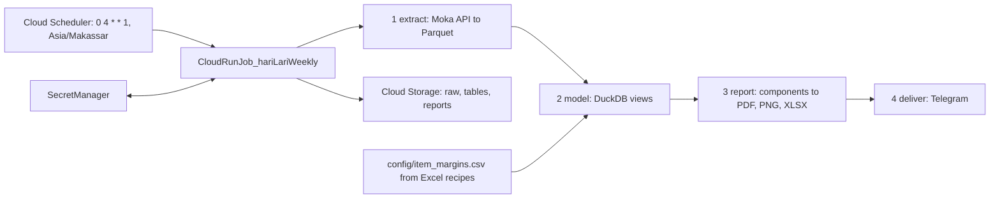

# Hari Lari go-live: weekly Moka report in Google Cloud plus a component-based reporting rebuild

This is the Cursor version of [docs/go-live-plan.md](hari-lari-analytics/docs/go-live-plan.md), with a status and a suggested LLM for every task. All paths are relative to `hari-lari-analytics/`.

## Legend

- **Status:**
  - `done`: finished.
  - `partial`: some of the work exists.
  - `todo`: not started.
  - `decision`: needs your call.
  - `manual`: you do it in a console or app.
  - `optional`: nice to have.
- **Suggested LLM** (match the model to the task):
  - **Opus 5.5:** design work, tricky data logic, parity debugging.
  - **Sonnet 5.5:** standard implementation with tests.
  - **GPT-5.4 nano:** small mechanical edits, docs and config.
  - **You:** steps in a console or app that need your login.
- **Size:** S is under an hour, M is a few hours, L is about a day.

## Architecture



## Design choices

- **Cloud Run Job, not Cloud Functions.** It runs our own container, the same code as on the laptop.
- **DuckDB and Parquet, not BigQuery, for v1.** The data is a few MB, so this needs no extra service and costs nothing.
- **Full pull every week, nothing incremental.**
- **Region `asia-southeast2` (Jakarta).**
- **Cost:** expect about 0 USD a month, inside the free tier.
- **Sequence:** go live with today's PDF fed from the API (phases 1 to 6). Swap in the component report only once it matches the old one figure for figure (phases 7 and 8).

## Known data issues to fix

- **Broken key on the lines table.** [extraction/moka/extract.py](hari-lari-analytics/extraction/moka/extract.py) `Table.add` does `{**parent, **flat(rec)}`. The line's own `payment_id` (always 0) therefore overwrites the parent key.
- **Wrong time zone label.** API timestamps say `+07:00`, but the clock time already equals Bali local time. Drop the offset; do not convert.
- **Refunds have the opposite sign.** A refund is a second payment with the same `payment_no`, positive amounts and `parent_payment_id` set.
- **The token expires on 11 May 2027.** It has a refresh token, which [extraction/moka/moka_client.py](hari-lari-analytics/extraction/moka/moka_client.py) currently refreshes only within 1 hour of expiry.

---

## Phase 0: Decisions

- **0.0** Write the go-live plan document. Status: done. LLM: Opus 5.5. Size: S.
- **0.1** Choose the Google Cloud project. Status: done. Decision: a new dedicated `hari-lari-analytics` project (add a suffix if the ID is taken).
- **0.2** Choose what gets sent to the group. Status: done. Decision: the cover PNG and the PDF go in Telegram, plus a message with a Google Drive link to the PDF and Excel lines file. New scope: upload to Drive with the `hari-lari-job` service account (enable the Drive API, share a folder with the service account), add the link to the caption (4.8), and add a Drive upload step to the orchestration (5.1). `deliver/telegram.py` (4.7) no longer sends the Excel.
- **0.3** Choose the group members. Status: done. Decision: owners and managers only. The Drive folder is restricted to named Google accounts. The Excel file (no names) is fine for them. Open item: the member list and their Google emails, collected in phase 4.
- **0.4** Choose where failure alerts go. Status: done. Decision: a private admin chat with the bot, plus the Cloud Monitoring email alert (3.13) as a backup.
- **0.5** Confirm the report anchor. Status: done. Decision: yesterday (Sunday, Bali date), with a manual `--anchor` override.

## Phase 1: Harden the extraction

- **1.0** Write the full-history extractor (`extraction/moka/extract.py`). Status: done (works locally). LLM: Opus 5.5.
- **1.1** Commit `extraction/` on a branch. Done when `git status` is clean. Status: done. LLM: GPT-5.4 nano. Size: S.
- **1.2** Fix the parent-key overwrite in `Table.add`: parent keys win, and child fields that clash get a prefix. Done when `transaction_lines.payment_id` matches `transactions.id` on 100% of rows. Status: done. LLM: Sonnet 5.5. Size: S.
- **1.3** Add a test for 1.2 on a saved JSON fixture: one payment with two lines, a discount and a modifier. Status: done. LLM: Sonnet 5.5. Size: S.
- **1.4** Move the extraction into `src/hari_lari_analytics/extract/` and add a `hari-lari-extract` command. Status: done. LLM: Sonnet 5.5. Size: M.
- **1.5** Use explicit 120-second timeouts and keep the retry, backoff and request log. Status: done. LLM: Sonnet 5.5. Size: S.
- **1.6** Add a `TokenStore` interface with two backends: local file and Secret Manager. A refresh writes a new secret version. Status: done. LLM: Opus 5.5. Size: M.
- **1.7** Refresh the token when fewer than 30 days remain, and test it with a fake clock. Status: done. LLM: Sonnet 5.5. Size: S.
- **1.8** Run one real refresh by hand to learn whether Moka rotates the refresh token, and note the result. Status: done (the refresh token IS rotated; every refresh must be saved, see 1.6). LLM: You (with Sonnet 5.5). Size: S.
- **1.9** Make the output location configurable (local folder or `gs://...`) and write Parquet. Status: done. LLM: Sonnet 5.5. Size: M.
- **1.10** Parse timestamps as naive local clock time (drop the offset), with a test. Status: done. LLM: GPT-5.4 nano. Size: S.
- **1.11** Add sanity checks that fail the run: zero payments, or last week's receipts missing. A stale last sale only warns. Status: done. LLM: Sonnet 5.5. Size: S.
- **1.12** Write a `manifest.json` per run: row counts, first and last sale, number of calls, duration, token expiry. Status: done. LLM: GPT-5.4 nano. Size: S.

## Phase 2: The report reads API data

- **2.1** Write `load_api.py`, which reads the Parquet tables of one run. Status: done. LLM: Sonnet 5.5. Size: S.
- **2.2** Map API lines to the cleaned line schema of [src/hari_lari_analytics/clean.py](hari-lari-analytics/src/hari_lari_analytics/clean.py) and add the ids: payment, item, variant and category. Status: done. LLM: Sonnet 5.5. Size: M.
- **2.3** Turn refund payments into negative quantity, with the amount in `refunds`. Done when `Gross - Discounts - Refunds = Net` holds on every line. Status: done. LLM: Opus 5.5. Size: M.
- **2.4** Derive the adjusted item and category by `item_id` from today's items. Fall back to `config/item_aliases.csv` for deleted items. Status: done. LLM: Opus 5.5. Size: M.
- **2.5** Take the payment type from `payment_type_label` and the discount code from `transaction_line_discounts.discount_name`. Status: done. LLM: GPT-5.4 nano. Size: S.
- **2.6** Parity test against the back-office CSV for 1 Jan to 31 Oct: 948 receipts and 1,700 lines. The only allowed difference is the refund of receipt `1O4S7G`. Status: done (the API data matches the CSV line for line, including the refund of `1O4S7G`, so there is no difference at all). LLM: Opus 5.5. Size: M.
- **2.7** Add `--source api|csv` and `--anchor` (default yesterday) to [src/hari_lari_analytics/cli.py](hari-lari-analytics/src/hari_lari_analytics/cli.py). Status: done (`--source` defaults to `csv` for now; the anchor defaults to yesterday for `api` and to the last sale date for `csv`, so old exports still work). LLM: Sonnet 5.5. Size: S.
- **2.8** Compare the API-based PDF with the CSV-based one page by page. Status: done (pages 2 to 10 are pixel-identical; the cover differs only in the "Input files" line; signed off). LLM: You (with Opus 5.5). Size: S.
- **2.9** Also render the cover as a PNG. Status: done. LLM: GPT-5.4 nano. Size: S.
- **2.10** Update the README and METRICS.md: API source, refund rule, time zone rule, anchor rule. Status: done. LLM: GPT-5.4 nano. Size: S.
- **2.11** Add `config/category_group.csv`, a hand-maintained mapping from adjusted category to `category_group_level_1` (values: `food`, `drink`, `consignment`), same style as [config/item_aliases.csv](hari-lari-analytics/config/item_aliases.csv). Columns: `category,category_group_level_1,category_group_level_2`. Level 2 is optional and may stay empty at first (for example coffee, tea or bakery under drink or food). Write a loader with validation: no duplicate category, level 1 limited to the three values, and a warning (not a failure) for categories in today's data that have no group, which land in `unmapped`. Join the groups onto the cleaned lines by adjusted category, and test it on a small fixture. Status: done (`config/category_group.csv` covers every live and deleted category; `Custom Amount` and `Other` (non-food entries) are deliberately left `unmapped`, and so is the unused `Bundle_Package`; loader `load_category_groups` in `load.py`, join `add_category_groups` in `dimensions.py`, `--category-groups` flag). LLM: Sonnet 5.5 (GPT-5.4 nano for the first CSV draft, which you check). Size: S.

## Phase 3: Google Cloud infrastructure

These steps are scripted as `gcloud` commands in `deploy/setup.sh`. Phase status: completed.

- **3.1** Install and authenticate the `gcloud` CLI in WSL. Status: done. LLM: You. Size: S.
- **3.2** Create the project and link billing. Status: done (project `hari-lari`, billing linked). LLM: You. Size: S.
- **3.3** Enable the APIs: run, cloudscheduler, secretmanager, artifactregistry, cloudbuild, storage, logging and monitoring. Status: done (also drive and billingbudgets). LLM: GPT-5.4 nano. Size: S.
- **3.4** Create a budget of 5 USD a month with alerts at 50% and 100%. Status: done (created by CLI: 120 CZK, about 5 USD, because the billing account is in CZK; alerts at 50% and 100%). LLM: You. Size: S.
- **3.5** Create a private bucket in `asia-southeast2`, with raw JSON moving to Nearline after 90 days. Status: done (`gs://hari-lari-data`, Nearline after 90 days for `raw/`). LLM: GPT-5.4 nano. Size: S.
- **3.6** Create the service account `hari-lari-job` with least-privilege roles: bucket object admin, plus secret accessor and secret version adder on the token secret. Status: done (`hari-lari-job`, plus an invoker account `hari-lari-scheduler`). LLM: Sonnet 5.5. Size: S.
- **3.7** Create the secrets: Moka client id and secret, `moka-oauth-token` (version 1 from `.token.json`), Telegram token, chat id and admin chat id. Status: done for the Moka secrets; Telegram secrets exist but are empty until phase 4. LLM: You. Size: S.
- **3.8** Create the Artifact Registry repository `hari-lari`. Status: done. LLM: GPT-5.4 nano. Size: S.
- **3.9** Write a `Dockerfile`: `python:3.13-slim`, `uv sync --frozen --no-dev`, entry point `hari-lari-weekly`. Status: done (`Dockerfile`; the entry point is `hari-lari-extract` until phase 5 adds `hari-lari-weekly`). LLM: Sonnet 5.5. Size: M.
- **3.10** Build and push the image with Cloud Build. Status: done. LLM: GPT-5.4 nano. Size: S.
- **3.11** Create the Cloud Run Job: 1 CPU, 1 GiB, 20-minute timeout, 1 retry, secrets as environment variables, `TZ=Asia/Makassar`. Status: done (a real execution succeeded and wrote Parquet to `gs://hari-lari-data/raw/2026-11-22/`). LLM: Sonnet 5.5. Size: S.
- **3.12** Create the Scheduler job `0 4 * * 1` in `Asia/Makassar`, calling the job through an invoker service account. Status: done (created and PAUSED until 6.4). LLM: Sonnet 5.5. Size: S.
- **3.13** Add a log-based email alert when a job run fails. Status: done (policy "Hari Lari job failed", email to harilari.bali@gmail.com). LLM: Sonnet 5.5. Size: S.

## Phase 4: Telegram bot and group

- **4.1** Create the bot with `@BotFather` using `/newbot`, and store the token only in Secret Manager. Status: done (`@HL_Reporter_bot`; token in `telegram-bot-token`, rotated once after it was pasted in chat). LLM: You. Size: S.
- **4.2** Set the bot's profile. Turn joining groups off again after 4.4 (`/setjoingroups`). Status: done. LLM: You. Size: S.
- **4.3** Create the group "Hari Lari - Weekly Report" and add the members. Status: done ("HL Reporting" with emojis; upgraded to a supergroup). LLM: You. Size: S.
- **4.4** Add the bot to the group. Status: done. LLM: You. Size: S.
- **4.5** Get the chat ids through `getUpdates`: the group id (starts with `-100`) and the admin chat id. Store both. Status: done (group `-100...` in `telegram-chat-id`, admin private chat in `telegram-admin-chat-id`; test message, a real cover + PDF with caption, and a test alert all arrived in the admin chat; a test message arrived in the group). LLM: You. Size: S.
- **4.6** Add a runbook note that the chat id changes when the group becomes a supergroup. Status: done (`docs/runbook.md`). LLM: GPT-5.4 nano. Size: S.
- **4.7** Write `deliver/telegram.py`: `sendPhoto` for the cover, `sendMediaGroup` for the PDF and Excel, retry on 429 using `retry_after`, and a 50 MB guard. Status: done (`deliver/telegram.py`, stdlib only, token scrubbed from errors; changed from the plan: `sendPhoto` for the cover and `sendDocument` for the PDF, because Telegram cannot mix photos and documents in a media group and the Excel goes to Drive per 0.2; helper CLI `hari-lari-telegram whoami|chat-ids|ping|send-report`). LLM: Sonnet 5.5. Size: M.
- **4.8** Write the caption: week and dates, net sales, orders and AOV with change vs prior, and the last sale timestamp, plus the Drive link once phase 5 has it. Status: done (`deliver/caption.py`, `build_caption(lines, anchor, drive_url)`; week = 7 days ending on the anchor). LLM: Sonnet 5.5. Size: S.
- **4.9** Write `send_alert` to the admin chat: which step failed, a short error and a link to the logs. Status: done (`send_alert`, never raises, links to the Cloud Run execution logs). LLM: GPT-5.4 nano. Size: S.

## Phase 5: Weekly orchestration

- **5.1** Write the `hari-lari-weekly` command: extract, model, report, upload, deliver, with each step timed. Status: done (`hari-lari-weekly`, package `weekly/`; a real local run with `--to admin` sent the cover, the PDF and the caption with the Drive link to the admin chat in 114 s; Drive step: because a service account has no storage quota in a normal Drive, the upload runs as harilari.bali@gmail.com through a one-time OAuth consent (`hari-lari-drive`, secrets `drive-oauth-*`), into a week folder `<anchor> (week N)` of the folder in `DRIVE_FOLDER_ID`, which is the "Weekly Sales Reports" folder; a failing Drive step warns the admin and the report goes out without the link). LLM: Sonnet 5.5. Size: M.
- **5.2** Add `--dry-run`: everything except sending, with output under a `dry-run/` prefix. Status: done (also no Drive upload, no marker, no admin alerts; real dry run against the Moka API verified). LLM: GPT-5.4 nano. Size: S.
- **5.3** Make sending idempotent with a sent-marker per anchor in the bucket, and a `--force` override. Status: done (marker `sent/<anchor>.json`; a private `--to admin` run neither reads nor writes it; a failing marker write only warns, because a non-zero exit would make Cloud Run retry and send twice). LLM: Sonnet 5.5. Size: S.
- **5.4** Wrap each step so a failure sends the admin alert and exits non-zero. Status: done (verified with a real run that has no sales: ERROR log, admin alert, exit 1). LLM: Sonnet 5.5. Size: S.
- **5.5** Log in structured JSON with a `severity` field. Status: done (`weekly/log.py`; every line has `step`). LLM: GPT-5.4 nano. Size: S.
- **5.6** Send a token-expiry reminder when fewer than 45 days remain. Status: done (`token_expiry_notice`, fake-clock tests; the expiry date was already in the manifest). LLM: GPT-5.4 nano. Size: S.

## Phase 6: Go live

- **6.1** Do a manual dry run in the cloud. Status: manual. LLM: You. Size: S.
- **6.2** Do a real run that sends to the admin chat instead of the group. Status: manual. LLM: You. Size: S.
- **6.3** Check readability on a phone inside Telegram. Status: manual. LLM: You. Size: S.
- **6.4** Switch to the group chat id and enable the scheduler. Status: manual. LLM: You. Size: S.
- **6.5** First live Monday: check at 04:10 WITA that the report arrived. Status: manual. LLM: You. Size: S.
- **6.6** Write `docs/runbook.md`: re-running a week, re-authorising the token, adding members, what each alert means. Status: todo. LLM: Sonnet 5.5. Size: M.
- **6.7** Remove the CSV source after four good Mondays. Status: todo. (`config/item_aliases.csv` was already shortened from 22 to 11 rows after phase 2; the CSV source now needs the frozen full copy in `tests/fixtures/item_aliases_full_2026-11.csv`, so delete that copy and its use in the parity test too.) LLM: GPT-5.4 nano. Size: S.

---

## Phase 7: Component framework

A component is a YAML file of pointers. It does not hold code.

```yaml
id: category_contributive_aov
model: fct_sales_lines
pattern: contributive_aov
dimensions: [adjusted_category]
metrics:
  [net_sales, items_sold, orders, penetration, category_aov, contributive_aov]
filter: { window: $period, compare: prior }
facet: null # e.g. { by: adjusted_category, top: 5 } repeats the component
visual:
  {
    type: table,
    bars: [share],
    deltas: [penetration, category_aov, contributive_aov],
  }
```

A report YAML places components into named layout slots. The three period sections are one template repeated through `repeat: { period: [L14D, L6W, L3M] }`.

- **7.1** Write the design note `docs/components.md`: vocabulary, folder layout (`models/`, `patterns/`, `components/`, `reports/`, `visuals/`) and a worked example. Status: todo. LLM: Opus 5.5. Size: M.
- **7.2** Add the dependencies `duckdb`, `pyyaml`, `jinja2` and `pydantic`. Status: todo. LLM: GPT-5.4 nano. Size: S.
- **7.3** Build the data models as DuckDB views: `stg_*`, `fct_sales_lines`, `fct_orders`, `dim_items`, `dim_categories`, `dim_calendar`. Status: todo. LLM: Opus 5.5. Size: L.
- **7.4** Port the cleaning rules into the models: refunds, fully refunded receipts, Custom Amount, variant capitalisation. Status: todo. LLM: Opus 5.5. Size: M.
- **7.5** Write the metric registry `metrics.yml`: SQL expression, format, `up_is_good`, additivity (orders are not additive). Status: todo. LLM: Sonnet 5.5. Size: M.
- **7.6** Write the dimension registry `dimensions.yml`, including `category_group_level_1` and `category_group_level_2` from `config/category_group.csv` (2.11), exposed through `dim_categories`. Status: todo. LLM: GPT-5.4 nano. Size: S.
- **7.7** Write the window resolver: L14D, L6W, L3M, full, WTD, MTD, last_n_weeks, compare prior or last year. It reuses [src/hari_lari_analytics/periods.py](hari-lari-analytics/src/hari_lari_analytics/periods.py) and its tests. Status: todo. LLM: Sonnet 5.5. Size: M.
- **7.8** Write the pattern engine: render the Jinja SQL, run it in DuckDB, return a DataFrame plus metadata. Status: todo. LLM: Opus 5.5. Size: M.
- **7.9** Write seven patterns, each with a hand-computed test: kpi_summary, trend, sparkline, ranking, share_breakdown, contributive_aov, distribution. Status: todo. LLM: Sonnet 5.5 (Opus 5.5 for contributive_aov and trend). Size: 7 tasks of S or M.
- **7.10** Write the facet engine: by dimension value (all, top N or a list) and by period. Status: todo. LLM: Opus 5.5. Size: M.
- **7.11** Write the component loader with pydantic validation, so a typo fails loudly. Status: todo. LLM: Sonnet 5.5. Size: M.
- **7.12** Move the visual library out of [src/hari_lari_analytics/report_pdf.py](hari-lari-analytics/src/hari_lari_analytics/report_pdf.py) into `visuals/base.py` (Palette, card, chips, table, bar column, sparkline). Visuals take `(fig, rect, data, options)` and do no data work. Status: todo. LLM: Sonnet 5.5. Size: M.
- **7.13** Write the layout engine: cover, overview, full, details, and an n-by-m grid. Status: todo. LLM: Sonnet 5.5. Size: M.
- **7.14** Write the report builder: expand repeats and facets, then write the PDF and per-page PNGs. Status: todo. LLM: Opus 5.5. Size: M.
- **7.15** Cache component results per run. Status: optional. LLM: GPT-5.4 nano. Size: S.

## Phase 8: Rebuild every current chart as a component

Each task adds the component YAML, its visual, and a parity test against today's `report_data.Section`. LLM: Sonnet 5.5 unless noted. Status: all todo.

- **8.1** Full-history KPI cards: kpi_summary over the full window.
- **8.2** The gross, discounts and refunds line on the cover.
- **8.3** Period summary cards with sparkline, faceted by period.
- **8.4** Data notes card, built from the run manifest. LLM: GPT-5.4 nano.
- **8.5** KPI cards with change, prior value and sparkline.
- **8.6** Net sales and orders trend with prior ticks and growth labels. LLM: Opus 5.5.
- **8.7** Key figures table.
- **8.8** Categories and contributive AOV table, including the total row and prior-only rows. LLM: Opus 5.5.
- **8.9** Order penetration dot plot (already in the code but not used).
- **8.10** Top 15 items.
- **8.11** Orders by hour, average per trading day.
- **8.12** Payment types stacked bar with "Other".
- **8.13** Discounts by code.
- **8.14** Page header chips and footer. LLM: GPT-5.4 nano.
- **8.15** Empty-period page. LLM: GPT-5.4 nano.
- **8.16** Excel lines export as an `export` component.
- **8.17** Write `reports/weekly.yml`, which reproduces today's PDF.
- **8.18** Visual diff of the old and new PDF (`pdftoppm` plus a pixel diff). LLM: Opus 5.5.
- **8.19** Write a second report, `reports/category_deep_dive.yml`, from existing components only, with no new Python.
- **8.20** Cut over `hari-lari-weekly` to the component report, then delete `report_data.py` and the old page methods.
- **8.21** README section on how to add a component and a report. LLM: GPT-5.4 nano.

## Phase 9: Optional new components

The customer branch of the KPI tree is out of scope. Status: optional. LLM: Sonnet 5.5 unless noted.

- **9.1** Orders per trading day by weekday. Friday has 427 receipts against 118 on Monday; this stands in for order frequency.
- **9.2** Heatmap of orders by weekday and hour.
- **9.3** AOV bridge: items per order times average item price. Orders average 2 items, and 54% have one line.
- **9.4** Basket size distribution with trend.
- **9.5** Penetration and category AOV trend per category. This is the showcase for faceting.
- **9.6** Food and drink attach rate, using `category_group_level_1` from 2.11. LLM: Opus 5.5.
- **9.6b** Sales and margin by `category_group_level_1` (and level 2 once filled in), as a share breakdown and trend. Depends on 2.11. Consignment likely needs separate margin treatment in 9.11.
- **9.7** Discount dependence over time. `FOUNDER25` is on about 17% of all lines.
- **9.8** Item Pareto (ABC analysis).
- **9.9** New, rising and fading items.
- **9.10** Mirror the data to BigQuery and Looker Studio.
- **9.11 PoC: item margins from `config/item_margins.csv`** (details below). LLM: Opus 5.5 for the design, Sonnet 5.5 for the code. Size: M.
- **9.12** Gross margin by item and category, reading the margins from 9.11. It no longer depends on COGS in Moka (only 182 of 2,704 lines have one today).
- **9.13** Menu engineering matrix (popularity against margin), which depends on 9.11.
- **9.14** Unpriced add-ons found in line notes: "oat milk" appears about 70 times, and only 10 lines use real modifiers. LLM: Opus 5.5.
- **9.15** Payment mix trend with estimated card fees (MDR rate set in config).
- **9.16** Refund and void log.
- **9.17** Category hygiene check: near-duplicate categories and 268 Uncategorized lines. Shown as a data-notes entry. LLM: GPT-5.4 nano.

### 9.11 PoC: config/item_margins.csv

The idea is the same as [config/item_aliases.csv](hari-lari-analytics/config/item_aliases.csv): a small, hand-maintained CSV in `config/` that the pipeline joins in. Margins live outside Moka for now. Their source of truth is your existing Excel recipe workbook, which lives outside this repository. You will share it when this task starts. The CSV is a flat export of that workbook. The proposed columns below are a starting point; the real layout of the workbook decides the final shape.

Proposed columns:

```text
item,variant,item_variant_id,unit_cost_idr,valid_from,recipe_ref,note
Latte,Hot,,14500,2026-08-01,Recipes.xlsx!Latte,oat milk +4000 not included
Focaccia Tomato,,,9800,2026-08-01,Recipes.xlsx!Focaccia,
```

- **Matching rule:** `item` and `variant` use today's adjusted names, like the aliases file. `item_variant_id` is optional; when filled it wins over the names.
- **Price history:** `valid_from` allows cost changes over time. Each sale uses the latest row with `valid_from <= sale date`.

Steps, each Size S:

0. **9.11-pre** You share the Excel recipe workbook: copy it into the session or give its path. It stays out of git, like `data/input/`. Status: blocked on you. LLM: You.
1. **9.11a** Read the workbook's real structure (sheets, recipe blocks, ingredient prices, yields). Map recipe names to today's Moka item and variant names, then fix the CSV columns. Status: todo, waiting on 9.11-pre. LLM: Opus 5.5.
2. **9.11b** Fill `config/item_margins.csv` with 5 to 10 real items from the workbook (the `!config/*.csv` rule in [.gitignore](hari-lari-analytics/.gitignore) already keeps it tracked). Mark open questions such as yields or modifiers in `note`. Status: todo. LLM: Sonnet 5.5, with you checking the numbers.
3. **9.11c** Write a loader with validation: no duplicate (item, variant, valid_from), costs above zero, names that exist in today's items, with warnings for unmatched names. LLM: Sonnet 5.5.
4. **9.11d** Join the costs onto the lines (`dim_item_costs` in phase 7, or directly on the cleaned lines before then). Add the metrics `cogs_idr = quantity * unit_cost_idr`, `gross_margin_idr = net_sales - cogs_idr` and `gross_margin_pct`, plus the margin coverage (the share of net sales that has a cost). LLM: Sonnet 5.5.
5. **9.11e** Build a one-page margin table by item and category for the last 6 weeks, with a coverage warning, as a standalone PDF or a component. LLM: Sonnet 5.5.
6. **9.11f** A script `scripts/export_item_margins.py` (openpyxl) that reads the shared workbook from a path given at run time and regenerates `item_margins.csv`, so the CSV never needs hand edits. It becomes required rather than optional if the workbook layout is regular enough. LLM: Sonnet 5.5.

## Risks

- **Token expiry or a failed refresh:** handled by tasks 1.6, 1.7, 5.6 and the runbook (6.6).
- **Slow or unavailable Moka API:** retries, a 20-minute timeout and one Cloud Run retry.
- **Report sent twice:** the sent-marker (5.3).
- **Wrong numbers after a switch:** the parity tests (2.6 and phase 8) and the visual diff (8.18).
- **Telegram chat id changes:** runbook note (4.6), and a failed send alerts the admin chat.
- **Margins out of date relative to the recipes:** the `valid_from` column and the coverage metric (9.11d).
