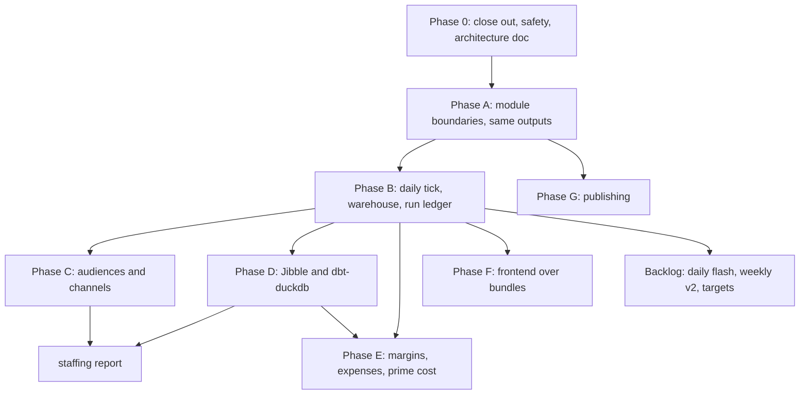

# Hari Lari analytics platform

The go-live plan ([archived](archive/hari_lari_analytics_go-live_47a99005.plan.md)) built the extraction, a reporting framework and the live weekly report, and closed after phase 9.8 on 26 Nov 2026. This plan turns that repository into a small modular BI platform: clear module boundaries, a stored warehouse between the data and the reports, delivery through audiences instead of hard-wired channels, and new sources: Jibble attendance first, then margins and expenses. The hard constraint is cost: under 10 EUR a month, and the expected cost is under 1 EUR.

Phases A to C restructure; each ends with outputs identical to before (A) or with one visible payoff (B: daily data and a daily stock alert; C: a new audience or channel is config). Phase D is the test of the structure: a second source has to fit without touching the report engine. E adds the money, F the frontend, G the publishing.

Critical path: t1 Monday → t5 → t6 → t7 → t8 → t9 → t10 → t12 → t13 → t14 → t15 → t16 → t17 → t26 → t27 → t28 → t29 → t30 → t31. The owner tasks marked "can be done at any time" (t24) run in parallel.



## Rules for this plan

- **No release between Saturday 18:00 and Monday 05:00 WITA**, and every release goes through the cloud dry run (7A.8). After phase B every day is a run day, so the rule becomes: release Tuesday to Thursday, and watch the next tick (phase B itself is released on Friday 27 Nov, see the exception below).
- **Exception for phase B (decided 27 Nov 2026, a Friday): one release of everything up to t18, and Monday 30 Nov is the live test of it all.** The owner works through t11 to t18 with the agents today, 27 Nov, and releases the result once, before the freeze starts on Saturday 18:00 WITA. The Docker image promoted for it (Artifact Registry, the Cloud Run job on Google Cloud) contains phase 0 (t1 to t4, done), phase A (t5 to t9, already live as `bd35ece9d9f7`) and phase B (t10 to t18): config from the bucket, landing, warehouse, reports reading the warehouse, ledger, `hari-lari-tick`, runbook and cost hygiene. Cloud Scheduler then runs `hari-lari-tick` on that image instead of `hari-lari-report-weekly`; the daily ticks of Saturday 28 and Sunday 29 Nov (no report due) are the first signals, and **Monday 30 Nov, 04:00 WITA, is the first live run of phases 0, A and B together**, with the owner reading the report at 04:10 (t1's routine, t9's bundle compare, t17's confirmation). This departs deliberately from "release Tuesday to Thursday". Only one part of t18 cannot be done today: reading the bill after the first month on the tick (about 1 Jan 2027); it is a dated follow-up in 'Cost budget', not a reason to hold the release. The fallback if t17 is not verified, with the promoted image tag recorded in it, by Saturday 18:00: keep `hari-lari-report-weekly` as the Monday job on the last image, leave the tick unscheduled (or `--dry-run` only), and release phase B Tuesday to Thursday as the rule says.
- **Statuses stay one line.** What was done, measured and found goes into the pull request description and the commit messages, not into this file.
- **Each phase ends with a check on real data**, named in its last todo.

## What was found before planning (26 Nov 2026)

- **The report run owns the pipeline.** `run_report_job` in `reporting/delivery.py` extracts, builds the models, checks, renders, stores, uploads to Drive, sends to Telegram and writes the marker. Each scheduler job runs `run --report <id>` with its own full Moka pull; only `run --scheduled` (the release dry run) shares one extraction. Data freshness is tied to the report schedule, and a second source has nowhere to plug in.
- **No warehouse, only "the latest run".** `open_run()` loads the newest extraction folder and rebuilds all 16 models in memory. The single-source assumption sits in the names (`raw_<table>`, `sources.yml` is the Moka table list, `load_run` lives in the legacy `load_api.py`). Catalogue and stock snapshots exist in the dated `raw/` folders but are not modelled as history.
- **`reporting/` holds 14,300 of 17,200 Python lines** and contains transformation, the semantic layer, the query engine, presentation, report definitions, outputs and orchestration.
- **The pandas pipeline is still load-bearing** (about 1,200 lines in `load.py`, `load_api.py`, `clean.py`, `dimensions.py`, `periods.py`, `metrics.py`, `report_excel.py`): the cleaning rules exist twice, and the new core imports the old modules.
- **Channels are written into the report schema** (`deliver: { telegram, drive }`), ops alerts share the delivery path, and the expense tracker has its own Telegram client.
- **Drive is a publishing sink, not the archive.** Cloud Storage is the archive. Drive depends on a personal Gmail OAuth refresh token, the most fragile credential.
- **What happened in a run is scattered** over sent-markers, output folders, JSON logs and Cloud Run executions.
- **Proportion:** the framework is complete for sales views (new components took 2 to 4 minutes in YAML in 9.1). The next value is new data, so the restructure is sized to make new sources cheap.
- **Cloud Scheduler:** 3 free jobs per billing account. The expense tracker already uses one (`expense-bot-tick`), the weekly report one more. One job per report would exceed the free jobs with the stock alert and a daily flash.
- **Jibble:** an organisation owner creates API credentials (client id and secret, OAuth client credentials at `identity.prod.jibble.io`); the REST API at `workspace.prod.jibble.io/v1/` serves `People` and `TimeEntries` with OData filters. Third-party docs say the free plan includes API access; t24 confirms it for the account.

## Decisions (26 Nov 2026)

- **D20. Break off.** The go-live plan closes after 9.8 and is archived; its open items are carried over (table below).
- **D21. dbt-core with dbt-duckdb for the warehouse, adopted when the second source lands** (spike t26, go or no-go D24). The semantic layer, the KPI tree, the compiler, transforms, insights and the presentation stay our own: that is the part no tool does better for this café. D8 rejected dbt for cost; dbt-core is free and runs in-process, so the trade-off is one dependency against snapshots of history, sources and freshness, multi-source staging, lineage, and a manifest that Lightdash, Evidence and MetricFlow read.
- **D22. One daily tick.** One Cloud Scheduler job starts one Cloud Run job a day: extract the sources that are due, build the warehouse, then run the reports that are due. A report's `schedule` says on which days it is due, the tick says when.
- **D23. Jibble is the first new source**, because it unlocks labour cost % and sales per labour hour, which no Moka data can.
- **D25 (27 Nov 2026, t3). Insight rules, facets and the semantic manifest belong to `presentation`**, not `analysis`, where each would import upwards. All decisions are now in [docs/decisions.md](decisions.md).
- **Principles:** the warehouse holds nothing that cannot be rebuilt from landing and config; `distribution` and `sources` import only `core`; reports name audiences, never channels; a frontend renders bundles and never computes a metric.

## Target architecture

### Modules

Each module may import only the modules above it in this list; `sources` and `distribution` import only `core`; `orchestration` is the one module that wires everything. Every module is either an **engine** (Python, changes rarely) or holds **content** (SQL, YAML, CSV, changes weekly).

| Module | Responsibility | Content it reads |
| --- | --- | --- |
| `core` | settings (`project.yml`), secrets, storage (local or `gs://`), logging, clock | `project.yml` |
| `sources/<name>` | one extractor per source system, writes `landing/<source>/<date>/` and nothing else | |
| `warehouse` | staging per source, history models, marts, seeds, data tests; dbt-duckdb from t27 | SQL models, `sources.yml`, `models.yml`, config CSVs |
| `semantic` | metrics, dimensions, KPI tree, model metadata, semantic manifest | `metrics.yml`, `dimensions.yml`, `kpi_tree.yml` |
| `analysis` | query compiler, windows, transforms, decompose, `@query` sources | |
| `presentation` | components, facets, insight rules (D25), visuals, layouts, formats, report engine and renderers (PDF, PNG, XLSX, text, bundle), semantic manifest | `components/*.yml`, `reports/*.yml`, `insights.yml` |
| `orchestration` | the daily tick, due rules, run ledger, idempotency, ops alerts, CLIs that run things | |
| `distribution` | channels (Telegram, later email) and publishing sinks (Drive) behind one message type | audiences in `project.yml` |
| `frontend/` | static app over `bundle.json` and `reports/index.json` | |

### Storage layout (one bucket, `gs://hari-lari-data`)

```text
landing/<source>/<date>/      Parquet tables, manifest.json, raw JSON (deleted after 90 days)
warehouse/<date>/             warehouse.duckdb, marts/<model>.parquet
warehouse/latest.json         the newest good build
reports/<report>/<anchor>/    PDF, PNG, XLSX, text, bundle.json
reports/index.json            every report and anchor, for the frontend
runs/<date>/<run>-<step>.json the run ledger
config/                       private business config (aliases, groups, margins, targets, staff costs)
```

### A day

At 04:00 WITA, with a retry tick at 06:00 (D27), Cloud Scheduler starts the job. It extracts each source that is due into `landing/`, builds the warehouse and runs the data tests, writes the marts, runs every report whose schedule is due today and whose sources succeeded, publishes through the audiences, and writes a ledger record per step. A failed source alerts the admin; reports that do not need it still run; a report still not sent after the last tick is announced to its chats and sent by hand (D30). The details are in [architecture.md](architecture.md).

### End-state warehouse

- **Dimensions:** `dim_date` (trading days, holidays, closures), `dim_item` with its history from the daily catalogue snapshots (renames and Moka's reuse of category ids handled properly), `dim_category` and groups, `dim_employee` (pseudonymous), `dim_supplier`, `dim_expense_category`.
- **Facts:** `fct_sales_lines`, `fct_orders`, `fct_stock_daily`, `fct_shifts`, `fct_labour_hourly`, `fct_expenses`, item costs as of each sale.
- **Cross-source marts:** `fct_daily_ops`, `fct_hourly_ops`, `fct_daily_pnl`. Here the café's key numbers appear: labour cost % of sales, sales per labour hour, staffing against demand by hour, prime cost % of sales, and a monthly profit estimate.

## Cost budget

Approximate list prices; t18 replaces the estimate with the real bill, read after the first month on the daily tick (about 1 Jan 2027).

| Item | Per month | Note |
| --- | --- | --- |
| Cloud Run job, one tick a day, about 3 to 5 min | 0 | inside the free tier |
| Cloud Run service for the frontend (phase F) | 0 | scales to zero |
| Cloud Storage, `asia-southeast2` | under 0.20 EUR | the free 5 GB is only in US regions; a few GB a year |
| Secret Manager | about 0.4 EUR | 13 secrets; 6 active versions free per billing account, then 0.06 USD each; enabled and disabled versions both count, only destroyed ones are free (t18, 27 Nov) |
| Artifact Registry | about 0.45 EUR | 5.5 GB on 27 Nov, 0.5 GB free, 0.10 USD per GB; the policy keeps 20 versions (t18, 27 Nov) |
| Cloud Scheduler | 0 | 2 of the 3 free jobs (the tick and the expense tracker's) |
| GitHub Actions, Cloudflare | 0 | inside the free tiers |
| **Total** | **about 1 EUR** | the 5 USD budget alert stays |

## Carried over from the go-live plan

| Old | New | Note |
| --- | --- | --- |
| 6.5 first live Monday | t1-monday | |
| 6.6 runbook | t17-cutover-b | rewritten for the tick |
| 6.7 remove the CSV source | t6-retire-pandas | together with the whole pandas pipeline |
| 10.0 owner feedback | t44-owner-feedback | |
| 10.1, 10.2 weekly v2, targets | t45-weekly-v2 | |
| 10.4 to 10.7 margins | t32-margins, t33-margin-views | |
| 10.9 expenses and profit | t34-expenses-source, t35-pnl | |
| 10.10 staffing | t31-staffing-report | now with Jibble labour hours |
| 10.17 daily flash | t43-daily-flash | |
| 11.0 to 11.9 publishing | t2, t11, t39 to t42 | 11.1 is urgent (t2), 11.2 moves into phase B (t11) |
| 12.0 to 12.6 frontend | t13 (marts), t15 (index), t36 to t38 | 12.5 interactive queries stays optional, below |

## Backlog (unscheduled; t44 reorders it)

- **10.3** Unpriced add-ons from line notes (`config/note_addons.csv`), to see whether the new modifiers stopped it.
- **10.8** Payment mix with estimated card fees (`config/payment_fees.csv`).
- **10.11** Refund and void log.
- **10.12** Penetration and category AOV trend per category.
- **10.13** Basket size distribution and its trend.
- **10.14** Item Pareto (ABC).
- **10.15** New, rising and fading items.
- **10.16** Category hygiene as a data note.
- **10.18** BigQuery and Looker Studio over the marts: only if the owners want self-service, compared with the frontend first.
- **10.19** Stock alert as an order list per supplier (after t19).
- **12.5** Interactive queries on the frontend through the same compiler over the marts, only if the bundles are not enough.
- **Shared Telegram client** with the expense tracker, if both keep growing.

## Risks

- **The restructure breaks the Monday report:** phase A changes no output and is checked by identical bundles and pixel-identical pages (t6, t7); B and C release midweek after a dry run and a run to the admin chat (t17). Phase B is the exception (27 Nov 2026): t11 to t18 are released together on a Friday, in one image with phases 0, A and B, so that Monday 30 Nov is a live test of all of it; the cloud dry run, the admin-chat tick and the rollback command are the safety net, and if they are not clean by Saturday 18:00 the old weekly job stays (see 'Rules for this plan').
- **The refactor grows without paying off:** every phase after A ends with one visible payoff; phase D measures whether a new source fits without touching the report engine.
- **dbt adds more weight than it saves:** the spike (t26) is a go or no-go with measured build time, image size and CI time.
- **Labour data is personal:** pseudonymous keys, no names in bundles, Excel or marts unless the owner decides, staff costs only in private config (t29).
- **A source fails silently:** the ledger records every step, freshness alerts fire after N days without data (t22), and reports that need a failed source are not sent.
- **Margins or profit read as exact:** labelled recipe margin and estimate, always with coverage (t32, t35).
- **Business data leaks once public:** private config (t11), publish guard on every push (t41), history rewritten once and checked on all refs (t42).

## Models per task

- **claude-opus-5-5-high:** design notes, data logic with traps (shifts, as-of joins), parity and golden files, security-relevant work.
- **claude-sonnet-5-5-high:** standard implementation with tests.
- **gpt-5.6-terra-medium:** small, well-specified changes.
- **gpt-5.4-nano-medium:** mechanical edits, docs and housekeeping.
- **Owner:** anything that needs a login, a decision or a phone.
